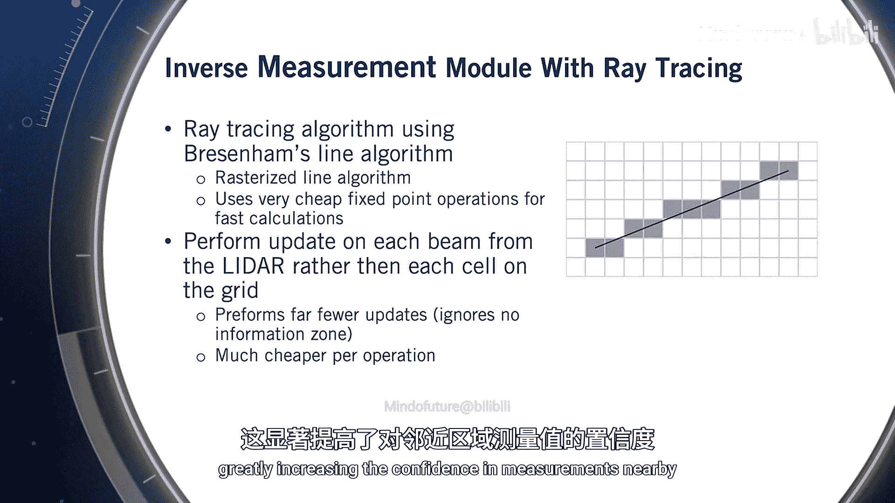
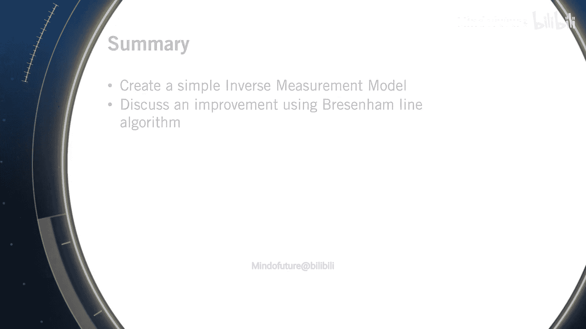

# 【多伦多大学】自动驾驶汽车的运动规划 ｜ Motion Planning Self Driving Cars p11 P11_第二课_根据激光雷达扫描数据构建占据栅格第二部分_03_01_03 -BV1kusszSEwn_p11-

Welcome everyone to the second part of our lesson on populating occupancy grids。In this video。

 we will define the concept of an inverse measurement model and see how to build a simple inverse measurement model for a LiDar sensor。

We will also describe ray tracing。Which will significantly reduce computational requirements for the inverse measurement model。

 Let's dive in。Recall from the previous video that in order to perform the Bayesian update of our occupancy grid。

We need to be able to evaluate the law Gods update rule。To do this。

 we need to compute P of MI given YT， which represents the probability of a cell MI in the occupancy grid being occupied。

 given a certain measurement YT is obtained by the LDarR。However， so far。

 the measurement models we have seen have taken the form the probability of YT given MI。

 which in the mapping case represents the probability of getting a certain LIDarR measurement given a cell in the occupancy grid is occupied。

So for occupancy good updates， we need to flip this measurement model around。That is。

 we have to construct an inverse measurement model that constructs P of MI given YT for every new measurement received。

As mentioned in the first lesson of this module， for simplicity's sake。

 we will only look at the LiDAar data as a 2D range data containing two sets of information。

The bearing at which each beam was fired and the range that the beam traveled。

This is easily extended to 3D with the addition of an elevation angle。

The bearing of each beam is represented by a set of angles phi。

 evenly spaced within a range defined by the minimum and maximum viewing angles of the sensor。

Typical rotating LIDar are able to capture data in all directions around the vehicle。

We'll assume the available bearings in this course will cover all 360 degrees。

The range of each beam corresponds to the distance it has traveled before impacting an object represented by R1 to RJ。

The range is measured between minimum and maximum ranges， R min and R max。

And we'll assume our min is zero for simplicity。Most LiDar today will also return a no echo signal if a particular beam does not return an echo。

 indicating the absence of any object within range in that direction。As we proceed in this video。

 we will make an assumption here that the entire LDR scan。

 measurements from a single rotation of the sensor， is measured at the same instant in time。

This is not an accurate model for a vehicle moving its speed with a rotating lidar head。

 as we must actually correct for the motion of the vehicle。

The correction can be done using the state estimates you developed in course2 and interpolating the motion between these state estimates as needed。

So the inverse measurement model will take the following form。

Suppose this is the vehicle with a LDar sensor collecting range measurements at different bearings in the following environment。

We construct a temporary occupancy grid that encompasses the maximum range of the beams in all directions。

The coordinate frame for this measurement grid uses the occupancy grid map frame。

And so we define a position， x1 T and x2t， and an orientation x3 T of the sensor in the occupancy grid frame。

In practice， this occupancy grid frame is set to the vehicle frame and the map is transformed at each step based on our state estimates。

We're now ready to populate the temporary measurement grid with occupancy probabilities。

Based on the current LiarR data， we can define three distinct areas of the measurement grid。First。

 there is an area of no information which none of the LDarR beams have been able to reach。

The current LDAR scan provides no new information about the environment in this area。

Then there is an area with low probability of an object。

 as all the beams have passed through this area without encountering anything。And finally。

 there is an area with high probability of an object in which the lighter has come into contact with an object and has returned a non maximum range value。

To translate these areas onto the measurement grid。

 each grid square will be assigned a range and bearing relative to the vehicle's current location。

The relative range of each cell is simply the Euclidean distance from the sensor to the cell。

Defined as follows， where RI is the range to grid cell I and MXI and MYI are the X and Y coordinates of the center of the grid cell。

Finally， x1 T and x2 T are the sensor location at the current time T。

The relative bearing to each cell is computed using the tan inverse function。

Here Phi identifies the bearing to the given cell in reference to the sensor's coordinate frame。

For each cell， we associate the most relevant LiDarR beam by finding the measurement with the minimum error between its beam angle and the cell bearing。

We then define two parameters， alpha and beta， which define a sector around each beam in which cell occupancy should be determined based on the beam range。

This essentially creates a region around each beam。

 which will get assigned the measurement information of that particular beam。

Alpha controls the range cells at the range of the beam， which will be tagged as high probability。

Beta controls the angle about the beam for which cells will be marked as either low or high probability。

We are now ready to assign a probability that any cell is occupied given the LIDAR measurements received based on these three types of cells。

The no information zone corresponds to all cells with a greater range than the measured range or outside the angle beta sized cone for the measurements associated with it。

We assign a probability of an obstacle equal to the prior probability of a cell being occupied。

 which is usually 0。5。The high information zone defines cells that fall within alpha over 2 of the range measurement and within beta over 2 of the angle of the measurement associated with it。

We assign an occupied probability of greater than 0。5 to these cells。And finally。

 the low information zone is defined by cells that have a range less than the measured range minus alpha over 2。

And lie within the beta sized cone about the measurement。

We assign an occupied probability of less than 0。5 to these cells。For example。

 let's say the LiDar scan returns arranged to an object at the location marked by a red X。

The affected area， which will be tagged as high probability， is given in red。

 increasingasing the value of alpha will increase the range of the affected region。

 and increasing the value of beta affects the angle of the affected region。

We can now construct the full inverse measurement model to be used in our logOs update。However。

 this simple inverse measurement model can be computationally expensive。

It requires a full update of every cell in the measurement map and relies on multiple floating point operations to identify which measurements correspond to which cells。

An alternative is to use a ray tracing algorithm， such as the computer science classic。

 the Bresnham line algorithm。 Bresnham's line algorithm was originally designed in the early 1960s to efficiently solve the line plotting problem for displays in printing on the available hardware of the day。

By ray tracing along the beams of the LDarR scan， we reduce the number of cells that need to be processed and identify them more quickly。

 relying on integer addition， subtraction and bit shifting to move through the grid along the LDarR beams。

Interestingly， many beams go through the same cells near the car。

 greatly increasing the confidence in measurements nearby。

This concludes our discussion of the inverse measurement model for log odds， occupancy grid mapping。

 let's summarize。

In this video， we constructed a simple inverse measurement model for LDarR data needed in the loggos update step。

We also briefly covered a potential improvement by using ray tracing to speed computations。

In our next video， we'll look into the many steps needed to prepare a 3D LiIDAR scan to be used for occupancy grid mapping。

 see you there。

