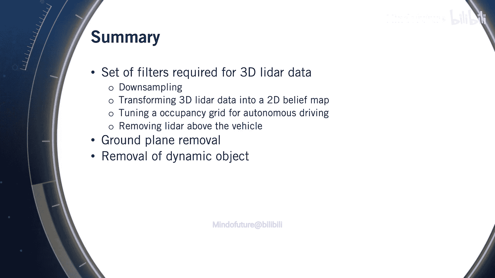

# 【多伦多大学】自动驾驶汽车的运动规划 ｜ Motion Planning Self Driving Cars p12 P12_第三课_自动驾驶汽车的占据栅格更新_03_01_04 -BV1kusszSEwn_p12-

Hello everyone， welcome to the third video in the Enronment mappinging module。

In this video， we will cover the autonomous vehicle specific requirements to convert a LDAR scan into a filtered representation that can be used to create an occupancy grid。

We will first look at several filtering methods which must be applied to the 3D scan。

Then we will see how a 3D LiIDarR scan is projected down to the 2D space and converted into a belief map。

Finally， we will discuss the tuning of several parameters required to make accurate occupancy grids。

 so let's get started。Here we have a typical LIDAR scan acquired by the autonomous vehicle as it drives along a local road。

We will highlight several filters that must be applied to the LDAR scan before it can be used to populate an occupancy grid。

First， in order to make update operations run in real time。

 it is usually desirable to downs sampleample the number of points of a LiDarR scan to a smaller amount。

Second， to remove objects that don't affect driving。

 we filter out all LiDar points which are above the autonomous car。Third。

 we do not want to label the drivable surfaces occupied。

 so we remove all lidDarR points which have hit the drivable surface or ground plane。

This drivable surface comes from the perception modules， which you studied in course 3。Finally。

 we remove all dynamic or moving objects such as cars or pedestrians that are in motion， again。

 relying on the perception stack to identify their locations。

Downampling is the process of reducing the number of LDar points to be considered by removing or ignoring redundant LDar points。

Common LiDar used in autonomous driving can produce up to 1。2 million points every second。

 which provide very rich geometric descriptions of all the objects around a vehicle。

Many of the generated points are actually redundant， however。

 due to the fact that there are many points that surround them capturing the same object information。

In this example， we see a road sign that is densely covered in LiDar points。

 where a small fraction of the points would suffice to indicate the location of the obstacle for occupancy grid mapping。

Most importantly， it is computationally impractical to deal with the 1。2 million points a second。

 thus some points must be removed to improve computations for all future operations。

Down sampling can be performed in a variety of ways。

 the simplest of which is to use a systematic filter that keeps every n point along the LDarR scan ring。

It is also possible to apply image down sampling techniques in the range image and to search spatially in a 3D grid。

 replacing collections of points with a single occupancy measurement。In each case。

 these methods are readily available in open source point cloud libraries such as PCL or computer vision libraries such as OpenCV。

Our second filter is a trivial one， which simply removes points above the vehicle height。

 in this case， above 2。4 meters。This filter usually presumes a flat ground plane， however。

 and so you should be aware that this is a dangerous assumption to apply blindly。

The value of eliminating overhanging trees， wires， bridges， and signs is significant， however。

 so it is worth including in this discussion。The next filter involves removing points that are deemed to fall on the drivable surface。

Due to the nature of the LDarR scan， many of the concentric circles seen in this image are due to the LDar scan hitting the drivable surface。

 and these points should not be confused with occupied cells in the occupancy gridmap。However。

 this proves to be a challenging task as several complications arise。First off。

 all roads have different road geometries， including variable concavity for drainage。

 different slopes and bank angles， curvatures， etc。This change is also very difficult to predict。

 However， if the ground plain is not removed， the occupancy grid might have artifacts which can result in deadlock in which the car cannot continue driving as it believes the roadway is blocked。

The second problem is that curbs have different heights at different locations。

 and road boundaries are not always clearly defined in LDAar data。

These variations can lead to parts of the curbs or nondrivable areas being removed as parts of the ground plane。

Finally， the need to detect small objects on the road， such as a soccer ball or a turtle。

 means that simple geometric methods working on point clouds have a hard time resolving the true state of the roadway ahead。

 the best approach to dealing with this sort of issue is to take advantage of vision and deep neural networks through semantic segmentation。

 as you studied in course 3。This can be seen in the segmented image in which the ground plane is shown in dark purple。

The task then becomes a mapping of the drivable surface detected in the vision data to the LiDAar point cloud。

 masking out all those points that fall within the projected boundaries of the drivable surface。

The final filter that is required is the removal of all dynamic objects。

 such as moving cars or pedestrians。This can be done once again with the reliance on the perception stack。

 which must detect and track all dynamic objects in the scene。

The 3D bounding box of the detected dynamic object is used to remove all the points in the affected area。

A small threshold is also added to the size of the bounding box used to account for any small mistakes in the perception algorithm object location estimate。

 increasing robustness of the point removal filter。However， a lot of the time。

 this is unsatisfactory for two reasons。First， not all instances of dynamic object classes that are detected are actually moving。

Some vehicles may be parked at the side of the road and thus can be considered as part of the occupancy grid as they are indeed static。

To handle this issue， perception needs to use dynamic object tracks to identify those objects that are currently static so the occupancy Maper can avoid removing them。

Second， due to the computing time required by the perception stack。

 usually the dynamic object is only detected after some delay。

 this results in the update to the occupancy grid using out of date object positions。

Which leads to the bounding boxes missing large portions of the Liar points on a dynamic vehicle。

Instead， we can rely on predictions of the moving object's motion based on their object tracks。

The bounding box is shifted forward along the predicted path。

 leading to a greater amount of the points of the dynamic object being removed from the most recent LDAR scan。

After all this filtering， the LDarR data is finally ready to be projected from 3D down to 2D。

Let's now look at a simple yet effective technique for this final step。First， the Z value。

 which stores the height of the Lidar point， is set to 0， which collapses the Liar grid to a plane。

The 2D scan plane is divided into the same grid pattern as the occupancy grid。

For each cell of the occupancy grid， all the Lidar points that fall within it are counted。

This value will then be used as the measure of the occupancy belief。The more points in a cell。

 the greater the chance that there is a measurement of a static object in that cell of the Occupant secret。

You have made it to the end of the final video discussing the occupancy grid in this video we saw the filtering techniques required to make a LiDarR point cloud suitable for use as an occupancy grid。

These include down sampling。Removing Lidar points above the car。Ground plane removal。

 and finally removal of dynamic objects。Then we saw a simple yet effective method to transform 3D LiIDarR data down to 2D belief maps。

 which， as explained in lesson 1， can be used to create an occupancy grid。Finally。

 we saw all the different areas that an occupancy grid must be tuned in and adjusted carefully。

In the next video， we will discuss high definition road mapps。

 specifically focusing on the Lalet map and its uses for motion planning。 See you next time。

