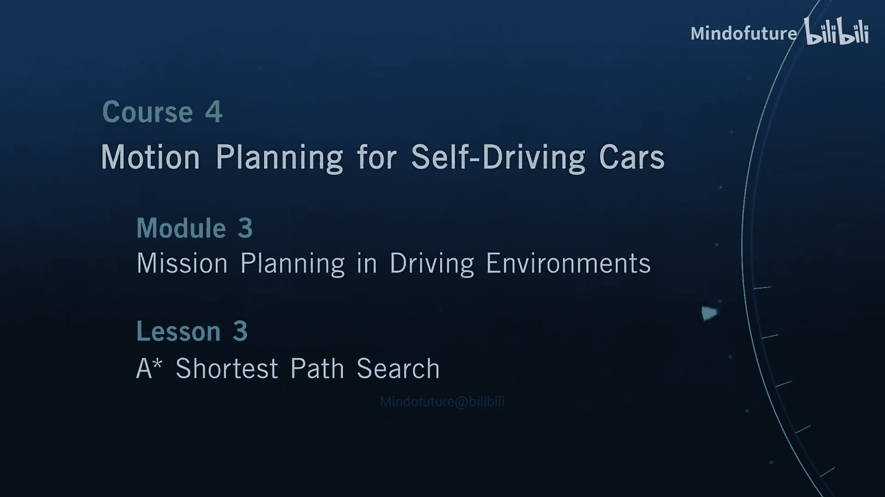
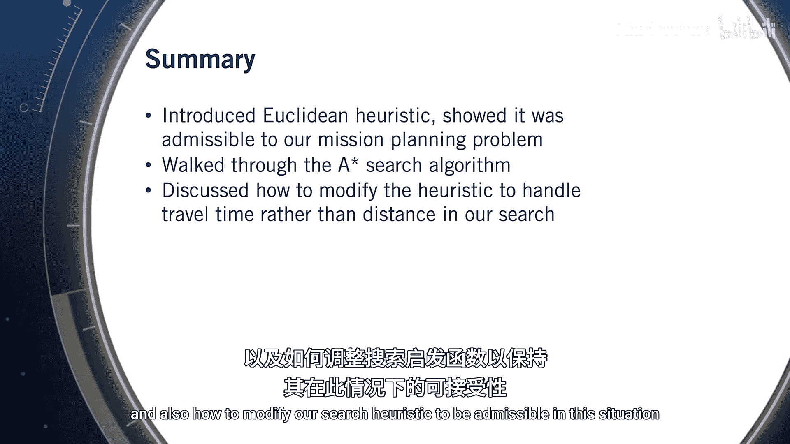

# 【多伦多大学】自动驾驶汽车的运动规划 ｜ Motion Planning Self Driving Cars p16 P16_第三课_最短路径搜索_04_01_03 -BV1kusszSEwn_p16-

Welcome in this lesson， we will build on Deska's algorithm by introducing a new。

 potentially faster approach that we can use for our mission planning problem。😊，To do this。

 we'll leverage heuristics in our search， which will help us refine the search process to make it more efficient。

By the end of this video， you should understand the role of heuristics in graph search and identify which heuristics are valid for our mission planning problem and which are not。

You should also be able to leverage heuristics in our graph search problem by using the A star search algorithm。

And recognize how to apply a star search to variant of the mission planning problem we've discussed so far。

 So let's get started。If you recall from the last lesson。

 we introduced Dgtra's algorithm to help us tackle the mission planning problem for the case of weighted graph edges。

 which was more realistic than our previous unweighted graph instance。

 because it let us take into account variable distances across different road segments。😊，However。

 Dysla's algorithm required us to search almost all of the edges present in the graph。

Even though only a few of them were actually useful for constructing the optimal path。

While this wasn't a problem for our small example graph。

 it will cause issues when we scale our problem to more realistic proportions。

 such as a full road network for a city。To improve our efficiency and practice。

 we can instead rely on a searchuristic by using the a star algorithm to find our destination rather than Dxus。

What is a search heuristic in this context， A search heuristic is an estimate of the remaining cost to reach the destination vertex from any given vertex in the graph。

Of course， any heuristic we use won't be exact， as that would require knowing the answer to our search problem already。

Instead， we rely on the structure of the problem instance to develop a reasonable estimate that is fast to compute。

In our case， the vertices in the graph correspond to points in space with the edges corresponding to segments of a road。

 which have a weight corresponding to the length of those road segments。Therefore。

 a useful estimate on the cost or length between any two vertices is the straight line or Euclidean distance between them。

 as shown here by H of V for a given vertex V and gold T。Therefore。

 for any vertex we encounter in our search， our estimate for the remaining cost to the goal vertex will just be the Euclidean distance between that vertex and the goal。

Note that this estimate is always an underestimate of the true distance to reach the goal。

 Since the shortest path between any two points is a straight line。

This is an important requirement for A star search and heuristics that satisfy this requirement are called admissible heuristics。

As an example calculation， suppose we have a start vertex A and a goal vertex C。

 vertex A corresponds to the  point00， and vertex B corresponds to 20。 vertex C in this case。

 corresponds to 2，2。Therefore， the Euclidean distance between A and C is 2。828。

 which is our heuristic estimate of the cost to the goal。

Note that the edge cost between any two adjacent vertices is not equal to the distance between those vertices。

This is because road segments are not straight line paths， and in general。

 the road segment length will be influenced by the shape of the road。Because of the graph simplicity。

 we can see that the actual cost of the path from A to C is 4。

6 by summing up the A B and B edge costs。 As expected。

 our heuristic is an underestimate of the true cost。

Let's use this new heuristic to better inform our graph search。

Here we have the pseudocode for the A star algorithm。 It's largely the same as Dxto's algorithm。

 but it has a few key differences， which we've highlighted in blue。

Let's look more closely at the specific changes。Recall that in Dysto's algorithm。

 We push our open vertices onto a min heap， along with their accumulated cost from the origin。

The min heap then sorts the open vertices by their associated accumulated cost。

The main difference between Dgcl's algorithm and a star is that instead of using the accumulated cost。

 we use the accumulated cost plus H V， the heuristic estimated remaining cost to the gold vertex as the value we push onto the min heap。

The min heap then essentially sorts the open vertices by the estimated total cost to the goal。

In this sense， A star biases the search towards vertices that are likely to be part of the optimal path。

 according to our search heuristic。Since we are storing a heuristic based total cost in the min heap。

 we also need to keep track of the true cost of each vertex as well。

 which we store in the cost structure。An interesting thing to note is that if we take our heuristic to be 0 for all vertices。

 which is still an admissible heuristic， we then end up with the exqui algorithm。😊。

As before with Dla's algorithm， we will add the origin to the min heap。

 then pop each vertex off of the heap and add all adjacent vertices to the heap until we process the gold vertex。

😊，Let's apply the A star algorithm to our example graph。

Here we have our road network graph from the previous lessons。

 except now we've added the actual position of each vertex。Note that the figure is not to scale。

 and the vertices are nicely spaced to make the figure more legible instead of being depicted in Euclidean space。

However， you can see that the edge length between any two adjacent vertices are at least as long as their Euclidean distance。

As always， the first vertex we add to the min heap is the origin S。There is zero accumulated cost。

 and the Euclidean distance between S and T， which is a lower bound on our shortest path distance。

 is 4。472。 So we add vertex S with cost 4。472。Next。

 we process the first node S and add the adjacent vertices， A， B， and C to the min heap。

Remember that we need to add the accumulated cost to the heuristic cost to the goal when adding each vertex to the min heap。

Thus， for vertex A， we have a cost of 5 plus 3 is 8。 For vertex B， we have a cost of 7 plus 2 is 9。

 and for vertex C， we have a cost of 2 plus the square root of 9 plus 4 is 5。6。

The order of the vertices in the min heap is now C， A B。

We also add S as the predecessor to the vertices， A， B and C， and then add S to the closed set。

The next vertex to process is C， which only connects to vertex E。The cost of E works out to 11。4。

So we now have a vertex order， A， B， E。We then assign E's predecessor to be C and add C to the closed set。

Next， we pop a off of the min heap， and we see that it has outgoing edges to vertex B and D。

The cost to B is 8， which is lower than the original estimated cost for B。

 So we update its cost in the min heap and change its predecessor from S to a。

To show we've updated its cost， we've highlighted the edge in purple。

We also add vertex D to the min heap with cost of 7。The new heap ordering is thus DBE。

We then assign a to be the predecessor of D and add a to the closed set。The process continues with D。

 which has outgoing edges to E and T。 The estimated cost of E is 15。4。

 Since this is higher than E's current cost in the min heap， we ignore this new path to E。

 And as such， we mark this edge in red。The estimated cost of T is 7。 since it is the goal node。

 it has zero heuristic cost to goal。After doing this， the new min heap ordering is T B E。

 We set the predecessor of T to be D and add D to the closed set。 Finally， we process the vertex T。

 which is the goal vertex。 So we are dead。 The final shortest path from S to T is shown on this graph here。

 And we are able to avoid processing both B And D。 thanks to the A star approach。😊，Unfortunately。

 this example graph is quite small in order to demonstrate how the algorithm works。 However。

 as we scale the problem to much larger graph inputs。

 we will see that the heuristic used in the a star algorithm will cause it to explore far fewer vertices than the Dyster's algorithm。

 asymptically， A star will never do worse than Dyxts。 And in practice。

 A star will result in a much faster mission planning process。😊，Now， in our examples。

 we've simplified the mission planning problem such that the edge weights are the distance along road segments in the map。

However， if we were to include other factors such as traffic。

 speed limits or weather into our mission planning problem。

 the raw distance along the path would be too simplistic to capture the scope of the problem。

To remedy this， we can instead take the estimated time to cross the road segment as our edge weights。

And this takes all of the mentioned factors into consideration。However。

 this renders our Euclidean distance metric useless。

 as it no longer captures the true cost to the goal in terms of time。To remedy this。

 we can use a lower bound estimate of the time to the gold point as a Euclidean distance divided by the maximum speed allowed across all road segments。

😊，The car should not exceed this speed limit， so even in ideal traffic and weather conditions as well as a straight line path to the goal。

 this is the absolute shortest amount of time the car can travel to that goal。

This means it is a lower bound on the true cost to the goal at all times， and as such。

 it is an admissible heuristic。For example， here we have set our maximum speed to be 100 kilometersm perph。

 with the edge weights corresponding to the number of seconds it takes to traverse a path。

After computing our heuristic value of 10 and 1。8 seconds。

 we can see that it is much lower than the true path length from A to C， which is  a hundred and 65。

6 seconds。 This is because in general， this heuristic is a poor， lower bound。

 as the segments will often take much longer to traverse than the computed minimum。

 Poor lower bounds can degrade the ability of our heuristic to guide our search to the goal for more complex problems。

 As compared to problem instances， though were strictly focused on minimizing distance。😊。

More advanced methods are available， which precompute additional values and consider modified heuristic definitions that allow large networks with time based travel estimates to be searched efficiently。

We've included some links in the supplemental material if you're interested in learning more。

In this video， we introduced the concept of the Euclidean heuristic and showed that it was an admissible heuristic for our mission planning problem。

😊，We then used it in our implementation of A star search for our mission planning problem。

We also discussed how to modify the mission planning problem we've discussed so far to include travel times instead of road lengths。

And also how to modify our searchuristic to be admissible in this situation。

Congratulations， you've reached the end of this module on mission planning。😊，In this module。

 you learn to define the mission planning problem as a shortest path search over a directed graph。

 And you apply Dgtras and A star algorithms to find the shortest path efficiently。In the next module。

 you'll learn about dynamic object interactions and how these relate to the second stage of our motion planning hierarchy。

 the behavioral planner， See you there。

