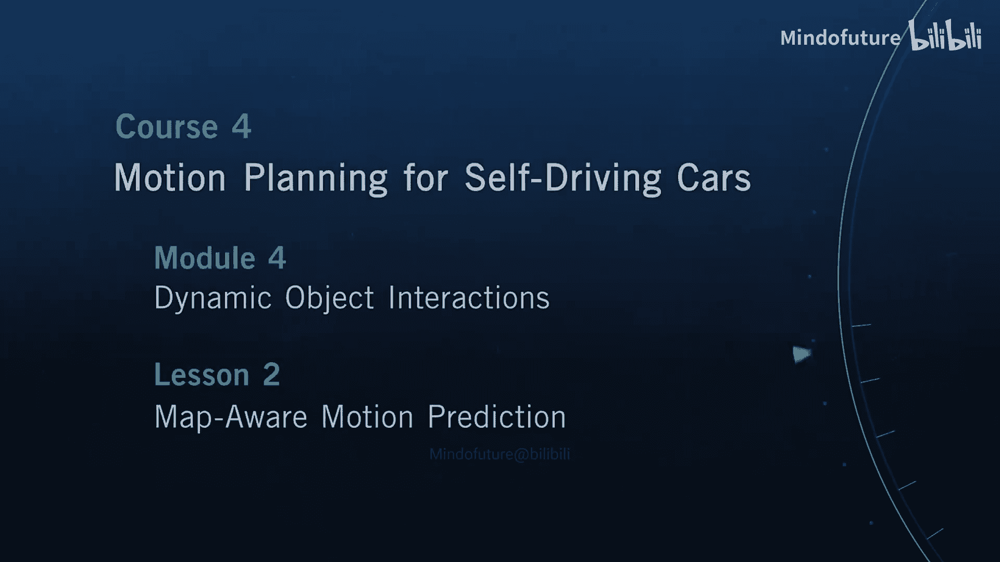
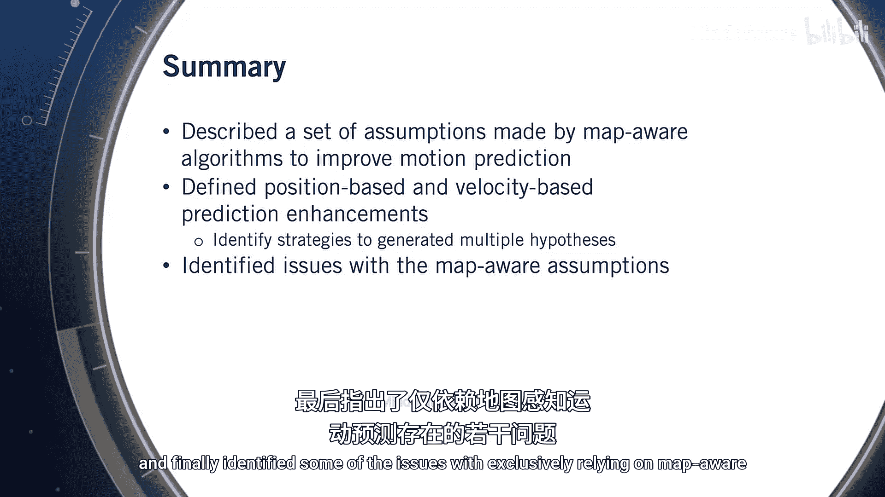

# 【多伦多大学】自动驾驶汽车的运动规划 ｜ Motion Planning Self Driving Cars p18 P18_第二课_具备地图意识的运动预测_05_01_02 -BV1kusszSEwn_p18-

Welcome to the second lesson in our module on dynamic Object interaction。In this video。

 we will be extending the topic of motion prediction of dynamic objects to include information available from the HD roadmap。

To begin， we will discuss the different assumptions relied on by mapware algorithms for motion prediction to keep the task simple and efficient。

 Then we will look at applying a lane following prediction approach to improve position prediction components。

Next， we'll explore map based prediction when multiple lane options are available。

And then we'll explore a velocity prediction around regulatory elements。Finally。

 we'll discuss some of the issues and shortfalls of mapware predictions that revolve around assumptions made regarding dynamic objects。

 so let's get started。In the previous video， we explored constant velocity motion prediction。

 which worked well only in a very limited number of scenarios。

Mapware algorithms make two broad categories of assumptions to improve the motion predictions。

 particularly for vehicles。Position based assumptions to improve the position component of the vehicle state and velocity based assumptions to improve the velocity component。

The first assumption made to improve the position component of the prediction is that vehicles driving down a given lane usually follow that lane。

Returning to our simple example scenario， if we have a vehicle on a curved roadway。

 the vehicle will most likely turn along with the roadway。

The second assumption that can be made is that a drive lane change or direction prediction can be made based on the state of the indicator light of the vehicle。

If such a detection has been made by the perception stack for a vehicle。

 it is possible to switch the prediction to account for this additional information。

Velocity based assumptions are used to improve the velocity prediction of a dynamic object。

All vehicles on the road are affected by road geometry。 Thus。

 it is useful to assume that as a vehicle approaches a turn with significant curvature。

 the vehicle is likely to slow down to avoid exceeding its lateral acceleration limits。Finally。

 velocity prediction can be greatly enhanced if we also consider regulatory elements。

 which the dynamic object may encounter。For example。

 if there is a stop sign at a close distance in front of an dynamic object。

 it is safe to assume that the vehicle will execute a decelerate to stop maneuver。

 resulting in a lower velocity over time。While this is not a complete set of all assumptions that can be made to improve motion prediction using HD roadmaps。

 they are sufficient to illustrate the diversity of contextual information available to improve our predictions。

Further， it is important to understand that the more constraints or assumptions that are added to a prediction model。

 the less generalizable it can be to all traffic scenarios。In fact， by the end of this lesson。

 we will see cases where even these generic assumptions can be overly constraining。

Let's now incorporate each of these map based assumptions into our motion prediction methods。

For roadways with natural curvature。We make the assumption that a vehicle which is on a drive lane will likely follow that drive lane through the curve。

Our motion predictions can be updated then by using the center line of the lanelet map as the predicted path of the vehicle instead of the straight line path generated by constant velocity predictions。

Recall the Lalet map definition from module 2 of this course。

 which provides left and right lane boundaries for every lane on the road from which there can be a center line constructed。

The center line of a lalet is defined as a set of points making up a polyline that is equally spaced from both lane boundaries。

While minor deviations from the exact center line can be expected。

 the center line can act as a good motion prediction approximation。

This is a major step forward over constant velocity predictions on any roadway with curvature。

However， by restricting path predictions to the center line of any given lalet。

 we will result in two major issues。The first is that during normal driving。

 drivers routinely change lanes。So as mentioned earlier。

 such maneuvers may be predicted based on indicator like perception。

 although not all lane changes by human drivers are preceded by an indication。

The second problem that arises is that it is regularly the case that there is more than one center line to choose from。

 such as in the case of an intersection。For example。

 at this simple tea junction it is possible for the vehicle to turn either left or right。

 this leads us to the need to consider multiple hypotheses based on likely behaviors of the other agents in the scene。

Again， we have two options， we can identify the most likely behavior using object state。

 appearance and track information。And then construct a prediction based on the most likely behavior。

Or we can construct a prediction for the most likely behaviors and associate a probability that the agents will follow a particular path based on the state appearance and track information。

The second approach is a slight generalization of the first， so we will focus our attention on it。

 We refer to this as multi hypothesis prediction。In the case of multi hypothesispothesis prediction approaches。

 each nominal behavior of a vehicle based on the full range of possibilities available to it at its current location in the HD roadmap is considered。

For the three way intersection example， we can include three possibilities， turn left， turn right。

 or stay stationary。Based on corroborating evidence such as indicator signals positioned to the left or right of the center line and the state of the vehicle at the intersection。

It is possible to evaluate each of the three hypotheses in terms of the likelihood the agent will execute each of them within the prediction horizon。

These probabilities can be hard to quantify exactly。

 so can either be learned from training data of many vehicles proceeding through similar intersections or can be engineered and refined from real world testing。

Such approaches traditionally provide more ambiguous information to the behavior planner。

 requiring this next stage of the planning process to consider multiple scenarios simultaneously。

And to handle the probabilistic representation of belief。However， if handled correctly。

 this approach can also be significantly safer， enabling defensive driving strategies and rapid replaning if probabilities shift based on new information。

This approach also has an advantage of being able to adapt to human based driving errors。

 such as forgetting to signal when changing lanes。Now that we understand how a roadmap can be used to improve the positional component of the predicted trajectories。

Let us now dive into the velocity component。The first improvement in this area is based on the known road geometry or curvature and a prediction of how other vehicles will react to it。

All vehicles， no matter their make and model， will reduce their velocity as they enter sharp curves or execute turns。

We can use an expected maximum lateral acceleration， usually in the range of 0。

5 to 1 meter per second squared to improve velocity estimation along curves。

The second and more significant improvement is to incorporate regulatory elements to improve velocity estimation。

Given the anticipated path of the vehicle， any roadway elements such as stop signs， yield signs。

 speed limit changes， or traffic lights can all inform the velocity prediction。

In the case of traffic lights， the light state is also required。In each case。

 a stop location can be predicted based on the regulatory element line， as defined in the HD roadmap。

Then a smooth deceleration can be applied to the vehicle velocity prediction along its path。In fact。

 given an HD roadmap， it is possible to pre processces the map for nominal trajectories along each roadway and to define lanelet specific multi hypothesispothesis priors based on nominal driving behavior。

This serves both as guidance for the ego vehicle in planning its behaviors and trajectories。

 and also in terms of refining the motion predictions for other agents。Of course。

 obstructions in the lane ahead of a vehicle， precedence of arrival information at intersections and lead vehicles in the lane can all be integrated to improve predictions for other vehicles。

Given the complexity of making decisions for a single self driving car。

 there is a limit to how many variables and how much depth of information and logic can be used to improve motion prediction。

There is also a limit to how much we can rely on assumptions about expected dynamic object behavior to predict future actions。

Dynamic objects do not always behave according to the nominal behaviors expected of the drivers。

They do not exactly follow the center line， do not drive at the speed limit。

 accelerate and deceleerate at different rates， for example。Further。

 they may react to information not yet available to the prediction system。

 such as a pothole in the road ahead or a bouncing ball。

 and they may simply not observe a regulatory element。

 as occurs when a vehicle accidentally runs a red light。All these variations must be accounted for。

 which can be done to some extent with the multi hypothesisth approach。

The best approach is therefore to track the evolution of beliefs over the set of hypotheses and to update based on evidence from the perception stack at every time step。

There is a great deal of complexity embedded in these methods。

 and we encourage you to explore some of the challenging issues associated with motion prediction for self- drivingriv cars by digging into the references included in the supplementary material。

This concludes our discussion of motion prediction in today's lesson we have described a set of assumptions for mapware algorithms to improve motion prediction of vehicles on drive lanes。

Defined position and velocity based methods to improve motion prediction。

Described multi hypothesis prediction as a way to maintain multiple beliefs about another vehicle's future actions and finally identified some of the issues with exclusively relying on Maware motion prediction。

I hope you will join us next time where we will see how to use our predicted paths to calculate a time to collision between pairs of dynamic objects。

 See you there。

