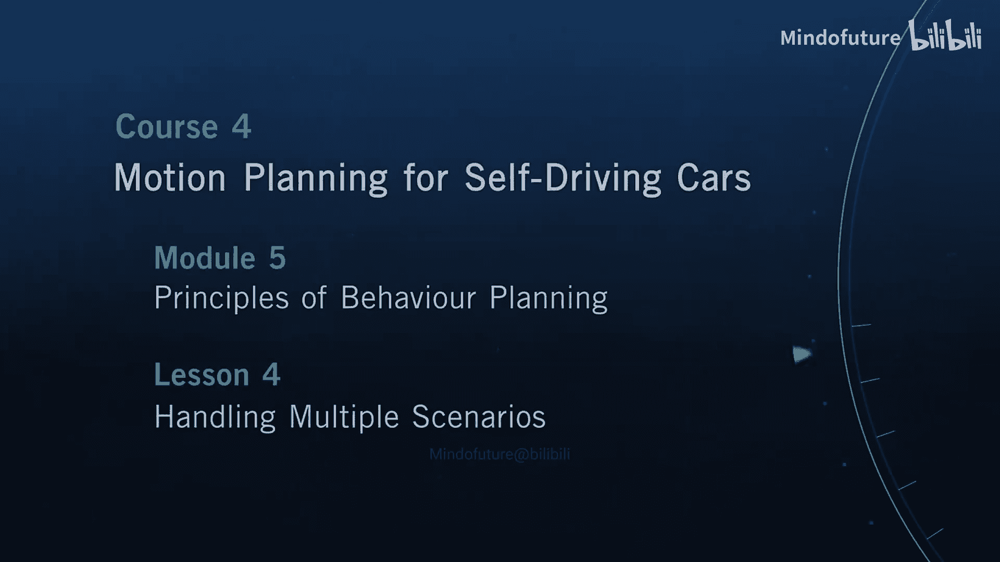
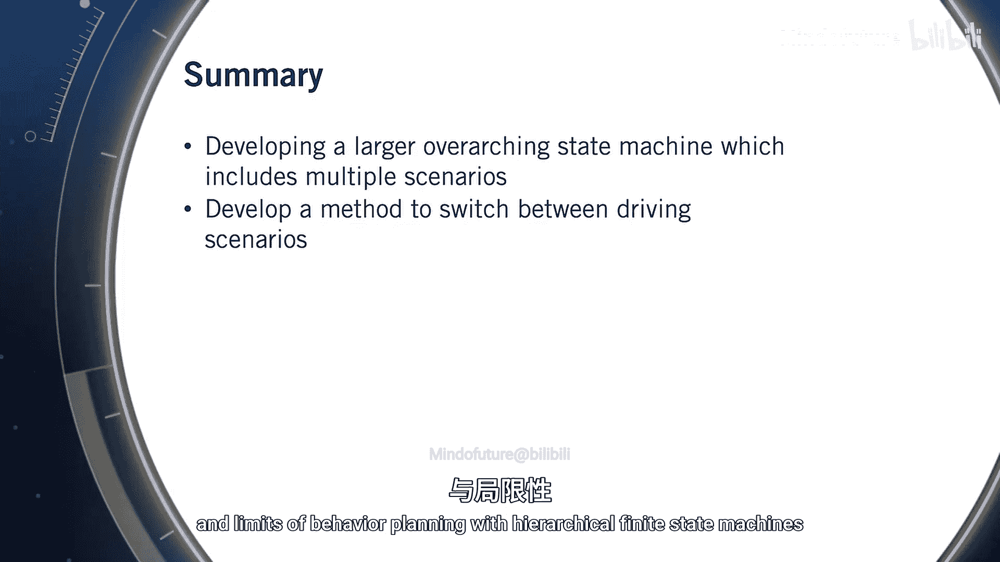

# 【多伦多大学】自动驾驶汽车的运动规划 ｜ Motion Planning Self Driving Cars p23 P23_第四课_处理多重场景_06_01_04 -BV1kusszSEwn_p23-

Welcome to the fourth video in the Be planningning module In the last video。

 we introduced dynamic objects into our finite state Ma behavior planner。In this video。

 we will develop a larger behavior planner which is able to manage the decision process for multiple scenarios simultaneously。

We will do this by introducing the notion of a hierarchical finite state machine。

We will also develop a method to switch between each of the driving scenarios as they occur。

 Let's begin。So far in this module， we have developed a finite state machine behavior planner that can handle a single fourway stop intersection scenario with dynamic objects。

However， in driving， there are many such scenarios which will be encountered。 For example。

 there are three way stop intersections， traffic light controlled intersections and straight road scenarios。

 just to name a few， While many of the scenarios share some similarities largely due to the logic required to handle them。

 Each of the scenarios can be considered to require fundamentally different driving behaviors。

One method of handling these multiple scenarios is by adding additional states， transitions。

 and conditions to a single state machine in an ever expanding network of behaviors。However。

 there are several problems with this approach。The first problem is that we would need to develop additional logic to differentiate the current scenario as well as the rules needed to handle each scenario individually。

This quickly runs into a problem known as rule explosion。

 in which the number of rules required to add additional scenarios becomes unimaginably large。

The second problem with a single state machine is that due to the number of extra rules and transitions that need to be evaluated at each step。

 the computational time required significantly increases。And lastly。

 such a system is complicated to create and maintain， as the number of cases。

 which one must worry about increases quickly。Essentially， as the complexity increases。

 we lose all the advantages of using a finite state machine that were highlighted back in lesson one。

There is， however， another approach we can use， we can represent each high level scenario as a single state。

 this would allow us to create much simpler transitions in between the high level scenario states。

In this example， we can see that the states represent a straight road scenario and the fourway intersection scenario we worked with previously。

With each one of these high level scenario states， we will store a low level state machine with which we can handle the scenario independently。

For example， for the intersection scenario， the low level state machine will be the one constructed over the last two lessons。

This method of representation is known as a hierarchical state machine。

With the superstates representing each scenario and the substates representing the maneuvers to be handled in each scenario。

The transitions between the high level scenario state machine would be a rule that defines when a new scenario has been entered based on the H D road map and dynamic vehicle information。

 Let's say we have this simple hierarchical state machine with two scenarios。

 One for straight road with a pedestrian crossing and another for a stop sign based intersection。

To move from the straight road to the stop sign intersection。

 the autonomous vehicle has to be close to an encounter with this intersection。

This is done with a distance check to the next intersection along the mission plan。All the movements。

 which we have talked about here is at the superstate level。

 The next question we have to answer is how do we switch between scenarios when processing the sub state maneuvers？

One method is to introduce transitions to key maneuver subs out of the current scenario superstate。

Let us continue to use the intersection scenario as an example。 First。

 let's establish which state will be the key exit state out of the scenario。

The only way we're able to exit an intersection is while in the track speed or follow leader states after having passed the intersection。

So let's put the exit transitions there。The condition on the transitions would be to confirm that this scenario has indeed been completed In this example。

 we can use the distance to the next stop sign intersection。If this is larger than a given threshold。

 we can exit the intersection scenario。With this method of transition。

 we are able to also maintain maneuvers between scenario switches。 In this case。

 track speed in the intersection superstate will connect to the track speed of the next scenario that we enter。

😊，Adding an additional multi lane scenario to this hierarchical state machine is done by creating a new superstate scenario node with a sub state state machine capable of handling that scenario。

This type of finite state machine has some inherent strengths and weaknesses。

The strengths of this approach are due to its subdivided nature by creating individual state machines within each superstate。

 this method is able to limit the computational time required at any one time step by restructuring our search space。

This subdivided nature also makes both testing and programming of a hierarchical state machine significantly easier。

However， the hierarchical state machine is not without its problems。

 while limiting the number of rules required， this approach is still unable to handle rule explosion completely。

One reason for the large number of rules is that all scenarios have fully separated state machines。

 and thus many of the rules are duplicates of one another in order to handle similar behaviors in different scenarios。

Ultimately， the hierarchical approach allows the system designer to handle a greater amount of complexity than a flat single layered finite state machine。

The idea can be extended to multiple layers as long as key states can be defined at each level in reality。

 the perspective enforced by finite state machines that a single behavior is active at any given time and that all transitions to other behaviors can be explicitly defined has a limit on how large a set of scenarios it can handle。

Nonetheless， it provides a useful tool for typical behavior planning in a self driving car。

Let's summarize what we've discussed in this video。

We first introduced the hierarchical finite state machine。

 which is able to handle multiple scenarios simultaneously。

We also discussed how to transition between the different driving scenarios at the super and sub state levels。

And we discussed the capabilities and limits of behavior planning with hierarchical finite tape machines。

Join us in our next video where we will discuss a range of advanced research approaches that are able to solve some of the issues we've faced so far with behavior planning。

See you there。

