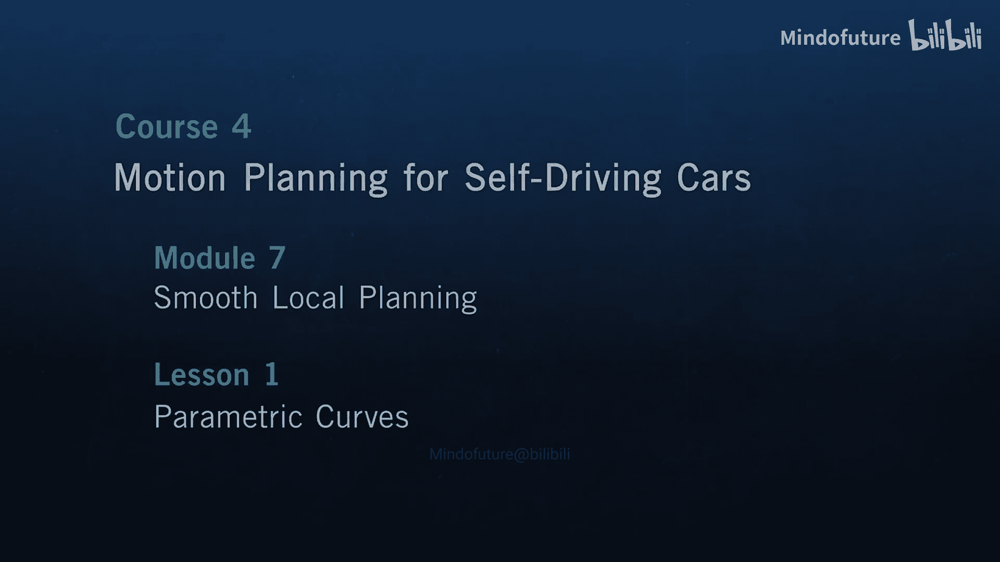
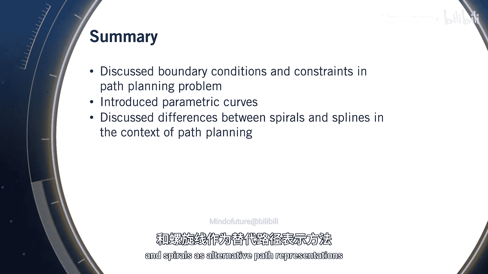

# 【多伦多大学】自动驾驶汽车的运动规划 ｜ Motion Planning Self Driving Cars p29 P29_第一课_参数曲线_08_01_01 -BV1kusszSEwn_p29-

。

Hi everyone and welcome to the final module of Course 4。

In this module we'll discuss the lowest level of our hierarchical motion planner。

 which is the local planner。 as a reminder， the local planner is the portion of the hierarchical planner that executes the maneuver requested by the behavior planner in a collision free。

 efficient and comfortable manner。This results in either a trajectory。

 which is a sequence of points in space at given times， or a path and velocity profile。

 which is a sequence of points in space with the required velocities at each point。

This plan can then be given as the reference input to the controllers that you've developed in course one。

In this module， we'll build upon the introductory reactive planner we developed back in moduleule 4。

 such that it is able to handle some of the nuances presence in the autonomous driving motion planning problem。

In particular， we'll move from the discrete time to continuous time in order to produce smooth。

 parameterized paths that are easy to track with our controllers。In this video。

 we'll introduce the path planning problem and its associated constraints and boundary conditions。

As well， we'll discuss parametric curves and how they are useful for representing paths for this problem。

In particular， you should understand the difference between splines and spirals in the context of motion planning and the advantages and drawbacks of each。

 so let's get started。The first step in understanding the path planning problem is to first understand its most fundamental requirements。

For the path planning problem， this is given a starting position， heading and curvature。

 find a path to an ending position， heading and curvature that satisfies our kinematic constraints。

In the context of an optimization， the starting and end values can be formulated as the boundary conditions of the problem。

 and the kinematic motion of the vehicle can be formulated as continuous time constraints on the optimization variables。

In this context， the boundary conditions are the conditions that must hold on either end point of the path for a given optimization solution to be considered feasible。

If these boundary conditions are violated， no matter how great the path is。

 we haven't achieved our core objective of actually getting to the point we want to get to。

 so the path is not useful to us。These boundary conditions will influence how we decide to set up the underlying structure of the optimization problem。

 Let's look at why this is。For our path planner， our only kinematic constraint is going to be restricting the maximum curvature along the path。

In general， this is not easy to satisfy， since there are infinitely many points along a continuous path。

Instead， we will often take samples of the curvature at different points along the path and constrain the curvature of each of these points。

Assuming the path is relatively well behaved， this will likely correspond to the curvature of the entire path。

 satisfying the constraint。To simplify the representation of our optimization problem。

 we're going to define a path as a parametric curve。What is a parametric curve？

A parametric curve is a curve that can be described as a set of equations with specific parameters。

These parameters often denote path traversal， whether it be through arc length or just varying from 0 to 1。

For example， here we have a cubic sp set of parametric equations for the X and Y positions of a path。

The parameter of the equations u varies from  zero to 1 as we travel from the start of the path to the end of the path。

The vector valued function R contains the x and Y position at each point corresponding to a given u value。

For autonomous driving， we often but not always require the path to be a parametric curve。

 Why is this。We often focus on planning methods that optimize a given path according to boundary conditions shown here by beta n and beta f。

 kinematic constraints shown here by alpha， and a objective functional shown here by F。

Having a parametric representation of the path makes setting up the optimization problem simpler as we have a function we can directly give to our objective functional F。

Note that the term functional refers to mappings that take a function as their argument and return a real value。

 so it can be used to define a cost over a space of functions or parameterized curves。

We can contrast this parametric curve approach with the reactive planner in module 4。

 where we represented the trajectory and the path with a sequence of points in space。

This is known as a non parametric path， since the curve we followed did not have a parametric representation。

In the field of autonomous driving， there are two common types of path parameterizations。

 The first are quinttic splines， which are fifth order polynomial functions of the X and Y position of the car。

The second type is the polynomial spiral given by a polynomial curvature function with respect to arc length。

Pictured here is a third order polynomial spiral， a cubic spiral。

Both of these parameterized curves give us the meansmes to satisfy the boundary conditions we just discussed。

And also offer us parameters to use in objective functions to craft the paths according to our requirements。

Selecting either of these has associated trade offs， so let's explore each more deeply。First。

 let's discuss thequintex sp。The quinttic spline is given by two equations。

 one for the progression of x along this spline， and one for y。

Here we can see that the quintex line has 12 parameters，6 for the x equation。

 and 6 for the y equation。These parameters correspond to the polynomial coefficients that form the shape of the curve。

The traversal parameter U is fairly arbitrary here for simplicity。

 we take it to be in the range of0 to 1。What this means is that u equals0 corresponds to the start of the path and u equals 1 corresponds to the end。

A nice property of the quinttic sp is that forgiven position。

 heading and curvature boundary conditions。 There is an immediate closed form solution for the spline coefficients that satisfy them。

😊，The solution is quite long， so we won't list it here。

 but it is still cheaper to evaluate than generating a path using an iterative optimization method。

See the supplemental materials for a full listing。There are also additional degrees of freedom which can be further optimized depending on this application。

This is desirable because it allows us to generate a feasible solution to the boundary conditions immediately。

 which can be further refined in any time fashion。The downside withquint's blinds is that it is often hard to constrain curvature within a certain set of bounds。

 as is often required in autonomous driving。If we look at the curvature equation for a parametric curve。

 we can see that for our quinttic sps， the curvature as a function of arc length will not in general be a polynomial。

This has the potential to introduce cups or even discontinuities of the curvature in the spline。

 which makes it difficult to approximately satisfy curvature constraints across the entire domain of the spline。

We will discuss these curvature constraints in more detail in our next lesson。

 where we set up the optimization problem for path planning。As an alternative approach。

 we can also employ polynomial spirals to represent our path。

 These curves offer a closed form equation for the curvature of the curve along each point of its arc length。

For autonomous driving， it is common to select a cubic polynomial as our curvature function of arc length。

 however， higher order functions are also acceptable。

The main positive of using polynomial spirals is that their structure is highly conducive to satisfying the approximate curvature constraints that are often required by the path planning problem。

Since a spiral is a polynomial function of curvature。

 the curvature value will not change extremely quickly like it can in the case of quintex appliance。

This means we can constrain the curvature of only a few points in the spiral。

 and the spiral will very likely satisfy the curvature constraints across the entire curve。

This is highly useful when performing path optimization。

 as the number of constraints greatly increases the computational effort of each optimization step。

The downside of using polynomial spirals is that there is no closed form solution of the position and heading of the spiral。

 unlike the case in the quintex sp。Therefore， we must perform an iterative optimization in order to generate a spiral that satisfies our boundary conditions。

As can be seen here， the position equations results in freennel integrals。

 which have no closed form solution。We therefore need to use numerical approximation techniques to compute the final endpoints of the spiral。

 In this module， we will approximate these frenel integrals using Simpson's rule shown here on the third line。

 Simpson's rule is more accurate with fewer points than other approximation methods。

 which will be useful when we set up our optimization problem。

When it comes to the strength and weaknesses of the spiral。

 we almost have a duality when compared to the spline。

 Each has a weak point where the other is strong。 The spline provides closed form solutions based on start and end points alone。

 whereas the spiral does not。The spiral ensures smooth curvature variation along the path while the spline does not。

You will therefore need to determine which method is appropriate。

 depending on your specific application， As a brief shorthand。

 the spline leads to computational efficiency while the spiral leads to easier implementation of curvature constraints。

For this module， we will focus on the polynomial spirals as we develop our path planner as we have a strong interest in ensuring the paths generated by our local planner can be executed smoothly and safely by the vehicle。

However， many of the techniques described going forward can also be applied toquint explains。

Let's summarize this lesson。We gave you an overview of the boundary conditions and parametric curves used in autonomous driving path planning。

And we introduced splines and spirals as alternative path representations and discussed their differences in the path planning context。

In our next lesson， we'll be discussing how to set up the path planning optimization problem using the cubic spiral parameterization we discussed in this lesson。

 as well as the constraints and objective functions we defined earlier in this course we'll see there。

