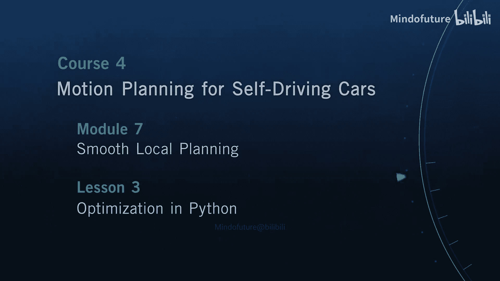
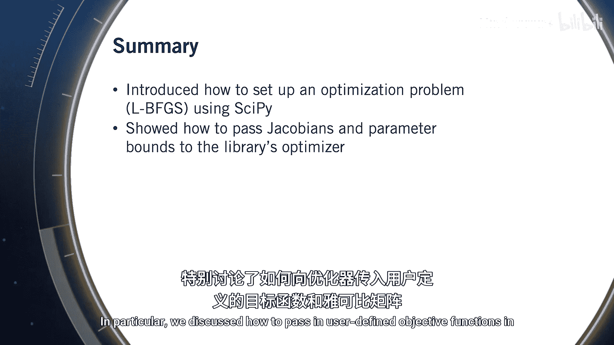

# 【多伦多大学】自动驾驶汽车的运动规划 ｜ Motion Planning Self Driving Cars p31 P31_第三课_Python中的优化实现_08_01_03 -BV1kusszSEwn_p31-

Hello everyone， in this lesson we are going to go over the basics of optimization in Python to help cement some of the optimization concepts we've discussed in the previous lessons of this module and in fact throughout this specialization。

In particular， we're going to go through some of the functions required to solve a generic nonlinear optimization problem using the Si P optimizeized library。

By the end of this video， you should know how to set up and call a constrained optimization problem using this library。

In particular， you should know how to pass Jacobians to the optimizer。

 as well as any required parameter bounds defined in the optimization problem， so let's get started。

The field of optimization is a wonderfully rich area of study。

 which we cannot explore in detail in this specialization。

The SipP Optized Library covers a handful of some of the most popular optimization algorithms。

 making them easily accessible and ensuring reasonable efficiency in their implementation。

Many of the implemented optimization methods have a similar structure in terms of what type of parameters they require。

So to abstract this away into a simple interface， the Si Pi optimized library contains a generic。

 minimized function。Some examples of the available optimization methods include conjugate gradient。

 Nedermead， dogleg， and BFGS for more details on these methods。

 see the links in the supplemental materials。The specific optimization algorithm run by the library will depend on the method parameter that you pass to this function。

The method parameter will also determine which additional parameters the optimization algorithm requires。

For example， in the LBFGSB algorithm that we'll use， we require not only the model to minimize。

 but also the models to Coion and variable bounds。In the case where the model is a single skill or valued function。

 the Jacobian reduces to the gradient。This Jacobian is passed to the minimize function through the jack parameter。

 as shown in this function call。The actual function we wish to minimize is the first argument to the minimize function。

The constraints are passed to the constraints variable as a list of constrained dictionaries or objects。

In addition， there is also the optional options parameter。

 which advanced users can use to customize things like what is output by the optr。

 These optimization algorithms also require an initial guess for the optimization variables for the model or objective function。

 and this is given by X not in the function call。 Let's look at the BFGS algorithm for a concrete example of how to implement an optimization with Sippi。

Essentially， for the BFGS algorithm， we are required to pass in the function pointer to the actual objective function we wish to minimize。

 as well as a function pointer to a function that evaluates the Jacobian of the objective function。

These functions will take in a vector of all of the optimization variables in order to evaluate the objective function and the Jacobian at a specific point。

Once the optimization is complete， the minimize function will return a result variable。

The member variable of the results denoted by x will return the final vector of optimization variables where the local minima has been achieved。

As we mentioned earlier， we can also specify constraints for our optimization problems for most algorithms。

 these constraints are given in the form of lists or dictionaries。

 the simplest type of constraints are inequality constraints on the objective variables called bounds。

Bounds are specified by the LBFGSB algorithm as a list of lists where each sublist is of length2 and contains the upper and lower bound for each optimization variable。

In other words， the first sublist corresponds to the bounds for x0 and the second sublist for x1。

 etc。These bounds are then passed to the constraints's optional parameter of the minimize function。

Linear and nonlinear constraints can also be passed to the optimizer。

 but for now we will focus on using bounds for optimization constraints。For more details。

 you can take a look at the SIP optimization documentation online。

You can also combine multiple types of constraints by passing in a Python list of each constraint object that you would like to use in the optimizer function。

To summarize in this video， we introduced how to set up an optimization problem using the S Pi optimizationim library。

In particular， we discussed how to pass in user defined objective functions in Jacobians as well as parameter bounds to the optimizer。

You should now have a good idea of how to solve general optimization problems using the Python library。

For more information， you can consult the SIPI Opim Library documentationcu。After this lesson。

 we have a programming assignment to give you a chance to practice the concepts we've discussed here and to prepare you for the end of module project。

