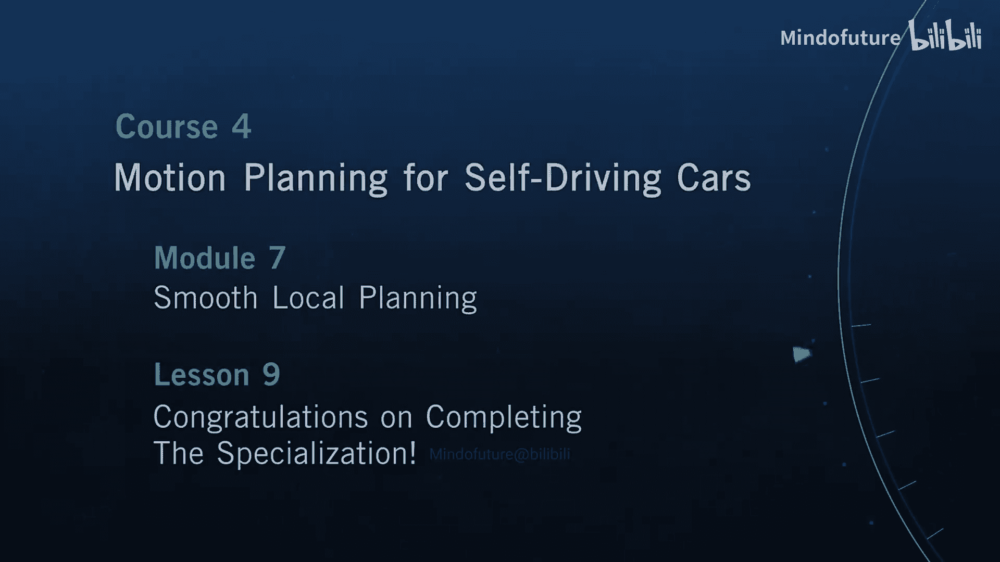
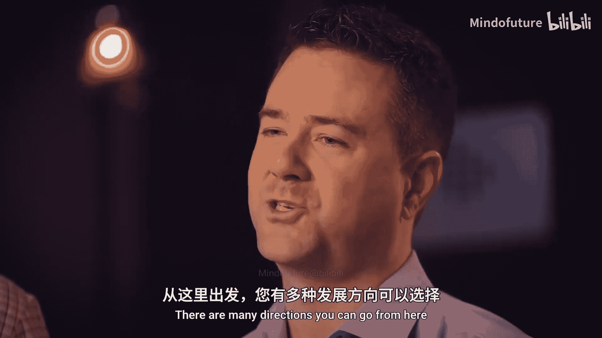
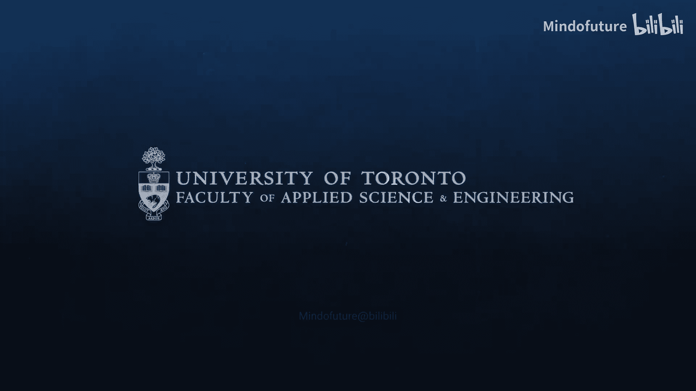

# 【多伦多大学】自动驾驶汽车的运动规划 ｜ Motion Planning Self Driving Cars p37 P37_恭喜完成专项课程_08_03_02 -BV1kusszSEwn_p37-

Hi， everyone。Stepeven and I wanted to personally take the time to thank you for all of the hard work you've put into this specialization and congratulate you on a job well done。

 You've completed the University of Toronto Se drivingriving cars specialization。

 You should feel ready to break into a career in the self drivingiv cars field。

 whether it's an academia or industry。😊，There's plenty of opportunity to continue to develop and inform this space。

We need people like you to help us build the future of self driving cars today。

We've covered a lot of ground in this specialization。

 from basic vehicle control to state estimation to perception and on to path planning。

 each of these pieces is essential to the overall self driving car software stack。

You've now integrated these moving parts to create a fully functional selfdriving system。

 Before you go， we want to remind you of a few extra items that you might not have taken the time to check out while you are working through the main content in this specialization。

First， we've included multiple fascinating interviews with colleagues from both industry and academia to provide you with additional perspectives on many aspects of the material you've been studying。

We've talked to safety assurance expert Kristof Shanetsky， to Paul Newman。

 cofounder and CEO of Ox Boica and professor at Oxford University， and to Diana Burges。

 Winston Liu and Andy Wong， three engineers actively engaged in the autonomous driving space at leading companies in the Bay Area。

Second， we've included links to further reading throughout the specialization。

 which are curated to make it easy to find a good place to start when digging deeper on any of the topics covered in the specialization。

We hope you'll take the time to check out these great resources and to discuss them in the forums as well。

 The material you've covered should put you on the road to a career in the self driving vehicle industry。

😊，The industry is exploding， and there is a huge demand for engineers and developers with the skills you've acquired。

There are many directions you can go from here。 You might choose to further explore ways in which your self driving car software can be tuned and improved for better performance。

Or to enable the vehicle to carry out more aggressive maneuvers， for example。

 Or you might choose to examine the mathematics behind one of the techniques described in the courses in more detail to gain a better grasp of the principles involved。

 The possibilities and opportunities are endless。 Ultimately， the way you go is up to you。

 But you now have the foundational knowledge to contribute to a field that will have a tremendous impact on the world。

 You can help shape the positive changes that self-driving cars will bring to our society and to fundamentally change the way in which we interact。

 It's been an absolute blast to take you guys on this journey through all of the different topics we've talked about in terms of how to build a selfdriving car。

 We hope that you've enjoyed it as much as we have。😊。

It's been a tremendous learning experience for both Stephen and myself。

 And we're excited to see what you take away from the course and what you'll do with the knowledge you've learned in the future。

 See you on the road。😊。

