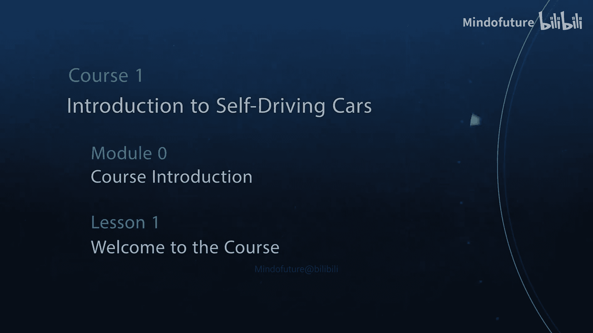
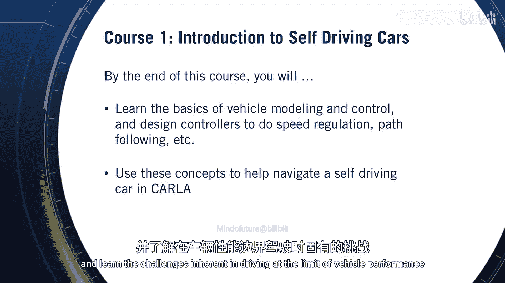

# 【多伦多大学】自动驾驶汽车简介 ｜ Intro Self Driving Cars p02 P02_欢迎学习本课程_01_01_02 -BV1mRsHzHETY_p2-

🎼。

Welcome to the first course of the University of Toronto's Se driving car specialization。

 My name is Stephen， and I'll be your instructor throughout this course。

This course is designed to introduce you to the world of autonomous vehicles or more simply self driving cars。

We'll start off by identifying what we mean by the driving task and then list out elements of driving all those things that you do automatically when you're behind the steering wheel。

This includes many perception tasks， identifying road signs， other vehicles and pedestrians。

 and predicting their actions， as well as making many kinds of decisions to maneuver safely through traffic。

Then we'll go through the different ways to design a basic self driving car hardware configuration。

 discuss a generic software stack to decompose the driving task into manageable components。

And discuss how to represent the perceived environment for decision making。Next。

 we will study how to incorporate safety considerations into autonomous vehicle design。

 both in software and in hardware。From there， we will move into vehicle modeling and control。

 where we will develop a vehicle model that captures longitudinal and lateral dynamics。

 define a controller that regulates the speed of the vehicle。

 define a path following controller to track a desired path。

 and even look at state of the art model predictive trajectory controllers for precisely executing challenging maneuvers。

At the end of this course， you will work on a realistic project that will navigate a self driving car around a racetrack in the carless simulation environment。

 which I'll introduce to you later in this course。You'll test the limits of your control design and learn the challenges inherent in driving at the limit of vehicle performance。

These topics should establish the basic terminology for self driving used throughout the specialization。

List out the most important requirements for building self driving solutions and show how you can execute a dynamic driving maneuver in a self driving car。

I'm very excited to be introducing you to these ideas。

 and I hope they will be useful for you as you go forth to help make self-driving vehicles a part of our daily lives。

 so let's get started。 It's a great day to build self-driving cars。😊。

