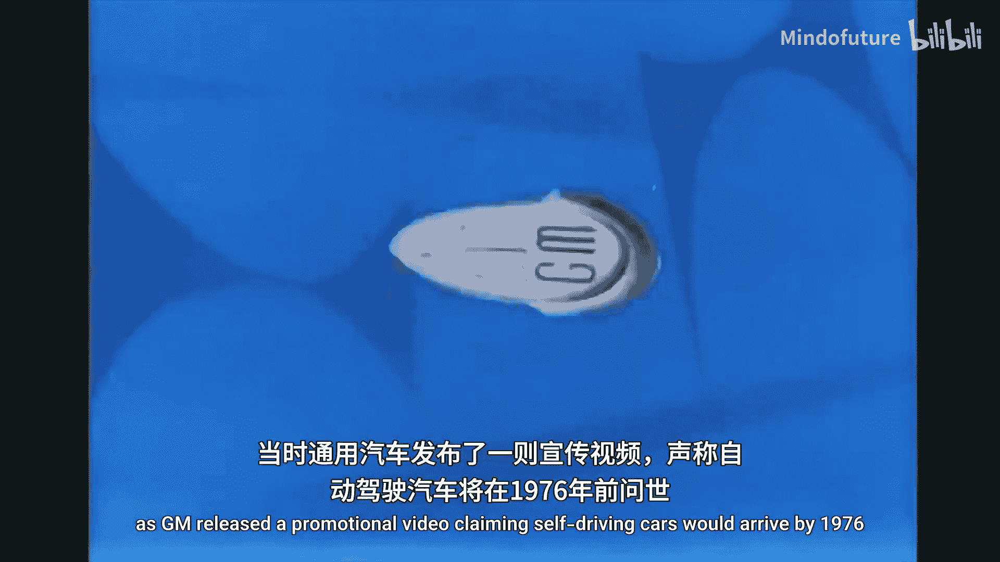
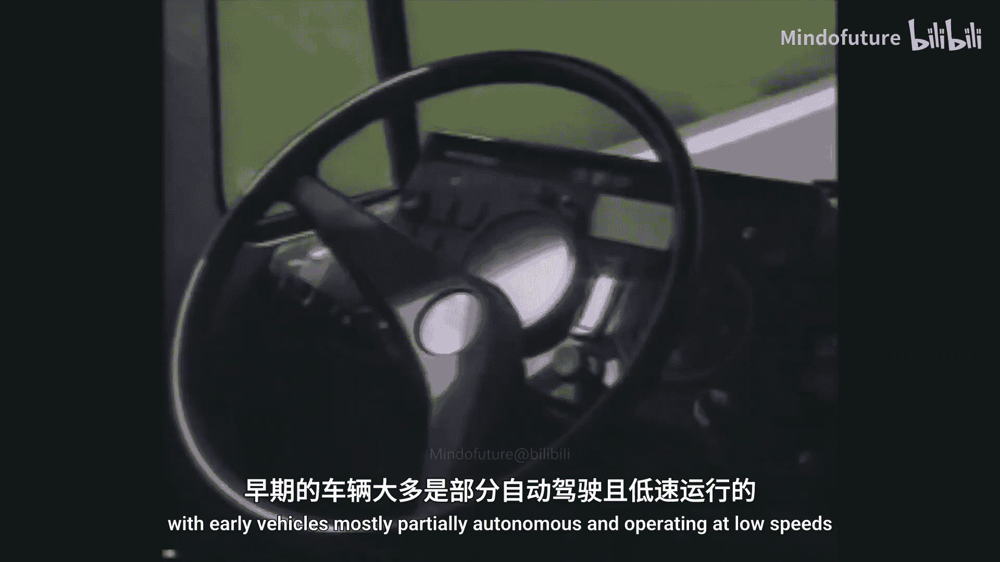
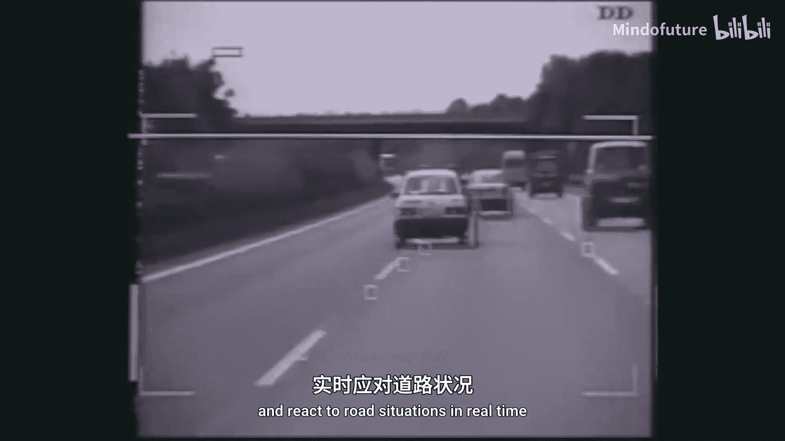
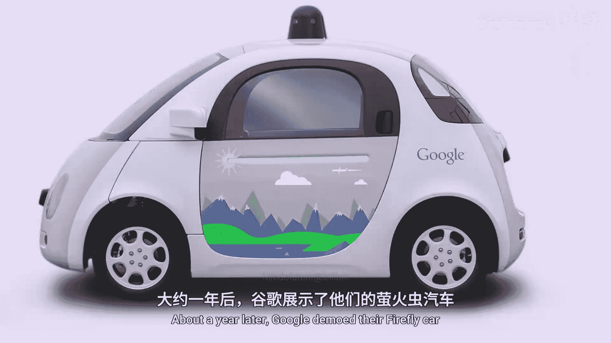

# 【多伦多大学】自动驾驶汽车简介 ｜ Intro Self Driving Cars p03 P03_自动驾驶汽车的故事_01_01_04 -BV1mRsHzHETY_p3-

🎼。

🎼Hello everyone， welcomee to this video in which we roll through the many major milestones in the rapidly evolving story of self-driving cars。

 A driverless future seems just around the corner， but it's been a long arduous journey to arrive at this point The dream of self-driving cars is almost as old as the automobile as early as 1925 Francis Houddina demonstrated a remote control car called the American wonder which drove through the streets of Manhattan frightening passerbys with an empty driver's seat Houdina。

 a local mechanic is not to be confused with Harry Houdini。

 the famous escape artist who was rather upset and started an altercation when people accidentally attributed the Marve to him。

The self driving car dream was alive and well in 1956。

 as GM released a promotional video claiming self driving cars would arrive by 1976。

In the key to the future， GM saw humans handing over control on the highway。

 enjoying a stress free drive and the passengers even interacting with the car through voice activated control features。

 a little optimistic， but in terms of timing， it's amazing how many of this video's predictions are now becoming available in the market and Mstream's inspiration comes straight from the reality of driving and busy traffic。

There is no doubt that one of the most dangerous things we do on a regular basis is driving our car。

In fact， more than 94% of all driving accidents today are caused by some kind of human error What if we could minimize or completely eliminate driving deaths by taking human error out of the picture through automation。

 there are also many other profound benefits that could arise from a driverless's future instead of focusing on lanes turns and traffic。

 you could reply to work emails， eat or relax and make the morning so much more productive and we can extend the mobility that driving provides to the entire human population not just those able to perform the driving task let's go back to the beginning of the self-driving car story and take a look at the milestones that have defined this industry at the breakthroughs that make it all seem possible and at the setbacks that remind us how ambitious this vision of ubiquitous autonomy really is Our journey starts out with some early advances in Europe in the 1980s Pioneers have been working on self-driving technology for over 40 years。

With early vehicles， mostly partially autonomous and operating at low speeds。

In 1986， Ernst Dickmans and his team from the University of Munich pioneered a robotic van that could drive fully autonomously without traffic。

 and in 1987 it drove its speeds up to 60 kilometersph in the early 1990s。

 his team contributed significantly to the Eureka Prometheus project and developed an autonomous Diimler Bens using psychotic computer vision that is focusing on points of interest in the environment。

They had over 50 transputs， the latest microprocessors of the day。

 and the same probabilistic approaches used throughout robotics on board to fuse sensor input and react to road situations in real time。

Ultimately， the Diler Bens drove 1，600 kilometers in traffic from Munich to Copenhagen with a mean distance between human intervention of9 kilometers at the same time in the US。

 Carnegie Mellon University's Nav Lab was busy building a steady series of prototypes with ever improving capabilities。

In 1986， their first autonomous vehicle， Nv Lab1， managed 30 kilometers per hour on the road using multiple sun workstations。

Then in 1990， NavLB2 a modified hummvee which could perform autonomously both off and on road。

Reached autonomous speeds of 110 kilometers per hour on the road。

This pushed the team to attempt something much more ambitious， and in 1996。

 they completed their no handscro America Tour。A 4800 kmeter route across the continent with an impressive 98。

2% autonomous driving Soon after， the UC Berkeley Path project rose to prominence with successful demonstrations of autonomous plattos of vehicles operating on dedicated HOV lanes on the I5。

🎼In 1992， four vehicles drove convoy at highway speeds。

 relying on magnetic markers on the roadway for precise relative positioning and demonstrated that using this kind of convoying saves on fuel costs and reduces wind drag。

 Succs tests continued and in 1997， largegescale demonstrations with 8 to 10 vehicles were completed。

 The project also firmly established the use of radar systems and vehicle to vehicle communications in the AV industry。

Leading to advances such as adaptive cruise control and emergency braking， then in 2002， DARPA。

 the Defense Advanced Research Project Agency， announced the first of its grand challenges that would forever change the world's perception about what autonomous robots can do the first event was held in 2004 and DARPA offered the winners a $1 million prize if they could build an autonomous vehicle that was able to navigate $142 miles through the Mojave Desert。

 although the first event saw only a few teams get off the start line and Carnegie Mellon's red team taking first place having driven only seven miles。

 it was clear that the task of driving 140 miles through the desert without any human aid was indeed possible。

In the second DARPA Grand challengeenge， the next year。

 five of the 23 teams smashed expectations and successfully completed the track without any human interventions at all。

 Stanford's vehicle Stanley won the challenge， followed by Carnegie Mellon Sandstorm。

The era of driverless cars had arrived。🎼Later， the 2007 installment called the DARPA Urban Challenge。

 invited universities to show off their autonomous vehicles on busy roads with professional stunt drivers。

 This time， after a harrowing 30 minute delay when the Jumotronron screen blocked their vehicle from receiving GPS signals。

 the Carnegie Mellon team came out on top with Stanford's junior vehicle coming in second。

🎼The three grand challenges were truly a watershed moment in the development of self-driving cars。

 changing the way the public and more importantly， the tech and automotive industries thought about the feasibility of full vehicle autonomy。

 It was now clear that a massive new market was opening up and the race was on。

Google immediately brought the team leads from both Carnegie Mellon and Stanford。

 Chris Umsson and Mike Montemerlo to push their designs onto public roads By 2010。

 Google's car had logged over 140，000 miles in California and later wrote in a blog post how they were confident on cutting the number of traffic deaths by half their pursuit of this ambitious goal continues to this day with the team having logged over 10 million miles as of October 2018。

 around the same time the first autonomous testing in the US two orange vans from the VizLb completed the international autonomous challenge。

 driving an entire route from the University of Parma in Italy to Shanghai， China which was about 15。

000 kilometers with minimal driver intervention。A year later。

 Volvo demonstrated their road train concept in which one vehicle could control several other vehicles behind it。

 thereby reducing road congestion and improving driver comfort。

Car drivers could choose a lead truck to follow， but the close following led to frequent vehicle damage and low visibility in rainy conditions as the pace of development accelerated。

 more and more companies were pushing for a legal framework for on road testing In 2012。

 the Nevada Department of Motor vehicles issued Google the first ever autonomous vehicle testing license which meant they could now test autonomously on public roads California soon followed suit with a mandated requirement to publish a variety of statistics on the test performed and the rates of human intervention In 2013。

 125 years after the first Bert of Ben's car was demonstrated for public use。

 Mercedes Bens demonstrated their self-driving capabilities by covering the same 106kmeter route autonomously。

With multiple players demonstrating viable on road demos。

 public interest in autonomous driving has taken off。

🎼The Consumer electronics show in Nevada became the annual showcase for the greatest self drivingriving tech and the wildest vehicle redesigns。

 About a year later， Google demoed their firefly car。

 a vehicle designed from the ground up to be autonomous at speeds up to 40 km hour with no steering wheel or pedals。

 passengers can instead sit back and relax。😊。

🎼And only press one stop button if they feel uncomfortable by doing so。

 Google showed us what the AV future could look like， and Tesla wasn't far behind。

 and around the end of 2015， they introduced their suite of autonomous features into the software called autopilot By 2016 they had demonstrated how autopilot could self-park and could be summoned by a button。

 This represented the largest deployment of partially autonomous features at the time。

 and saw Tesla quickly racking up millions of kilometers driven with their autopilot。🎼Inevitably。

 however， as the number of autonomous miles driven expanded。

 the first fatal accident involving a Tesla Model S happened in Florida in 2016。

 This was caused by a simultaneous failure of both camera and radar sensors to correctly identify a left-turn transport truck and an inattentive driver used to a car that takes care of itself。

This setback demonstrated the dangers of reliance on human monitoring of self-driving systems Despite this setback。

 progress continued unabated， this was also the time the notion of autonomous taxi fleets were becoming popular。

 with startups likezouks and Nutonomy leading the way in fact。

 newtonomy taxis first became operational in Singapore in 2016。🎼And finally。

 we arrive at 2018 and the infamous Uber crash that claimed a pedestrian's life in Arizona。

 This incident sent shock waves to the autonomous vehicle testing community。😊。

🎼With Uber stopping testing until the details could be fully understood。

Through an independent investigation by the National Highway Traffic Safety Administration。

 we'll discuss this worrying case in more detail in the first course as an example of the challenges that remain in self driving systems。

So the story of the development of autonomous vehicles is a story of enormous successes as well as setbacks that seem to be happening more often recently。

 so what is it that's driving the increase in self-driving accidents during testing First the number of miles being driven by self-driving cars in hard conditions is exploding。

🎼So the number of accidents are bound to go up。 In fact。

 Waymo recently announced that as of fall 2018， they have completed over 10 million miles of autonomous driving。

🎼The time between human interventions continues to grow with the most advanced systems traveling thousands of kilometers without any intervention at all。

Human level performance appears to be just around the corner。

 but the industry needs more support than ever to meet and exceed this ambitious goal。

 many new and established companies are pushing to bring truly driverless cars to market as early as 2020 the first large scale deployments will be in fleets where companies own the vehicles and provide revolutionary new services like Robboaxs。

Driverless delivery。The technology is still quite expensive。

 but prices will fall quickly as economies of scale take over。

So much still needs to be done to bring about the transformational changes we expect driverless cars to bring to our society。

 the industry will continue to need outstanding engineers to produce innovative solutions for driving。

So I guess the real question is， are you ready to help shape the future of personal mobility？

