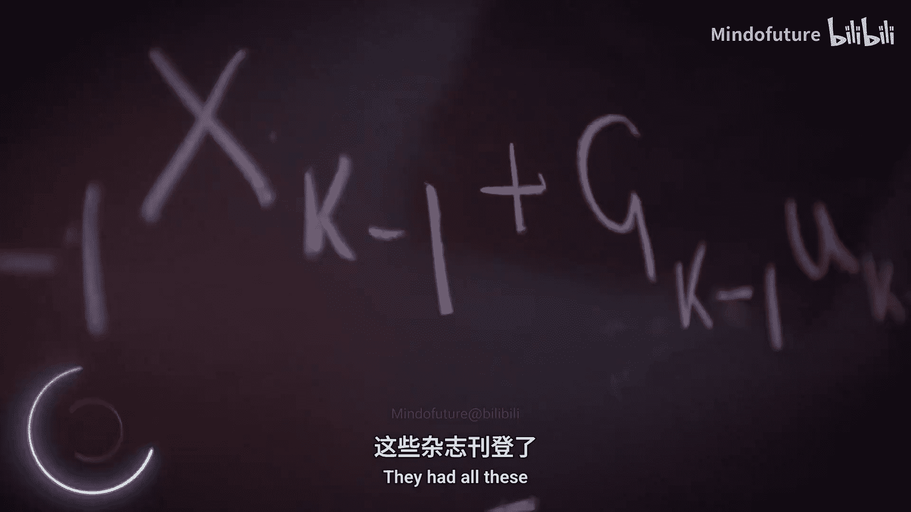
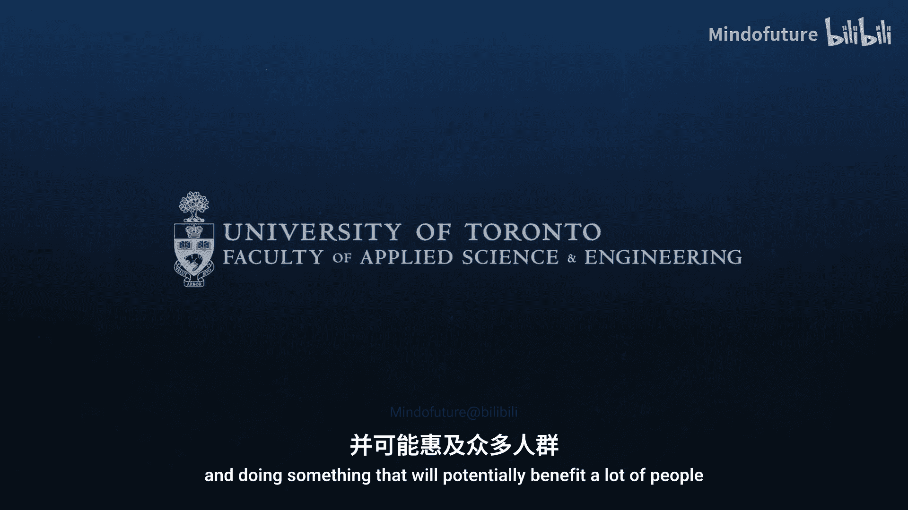

# 【多伦多大学】自动驾驶汽车简介 ｜ Intro Self Driving Cars p05 P05_认识讲师乔纳森·凯利_01_02_02 -BV1mRsHzHETY_p5-

🎼。

My name is Jonathan Kelly and I am an assistant professor at the Institute for Aerospace Studies at the University of Toronto。

 Canada as a child I used to love to go every month to the magazine store and I would always read popular mechanics or popular science They had all these。

🎼Interesting articles about things from space travel to to new vehicles to new computing。

 new computing designs， just really interesting stuff。 And so。

 that's ultimately what prompted me to start looking at science and technology as a possible career choice。

 One of the things that happened when I was I was quite young was the first space shuttle disaster。

 the challenger disaster。 I can still remember that， actually， and thinking just。

My goodness that something must have gone wrong and just how dire the consequences were。

 this tremendous explosion at the time I just remember sitting stunned thinking technology sort of always worked。

That was my opinion， well， technology always works。🎼It doesn't fail。 Cars don't just explode。

 And then seeing this on television really brought it home that。Eineering really does matter。

 solid engineering is critically important in these life。

Life threatening or potentially life changing situations， self driving cars。

Are in many ways very similar right we have a responsibility as engineers to design these systems to be as safe and reliable as possible as we can It's one of the things that's the most exciting technology revolutions that's really coming in the near term。

 new ideas， new technologies， new designs are coming down the pipe every single day I often just sit down at my desk and my eyes sort of pop when I see the number of innovative new ideas and techniques that people are coming out with。

 it's also excitement from a point of view of actually changing the the technology landscape。

🎼And doing something that will potentially benefit a lot of people。🎼응。

