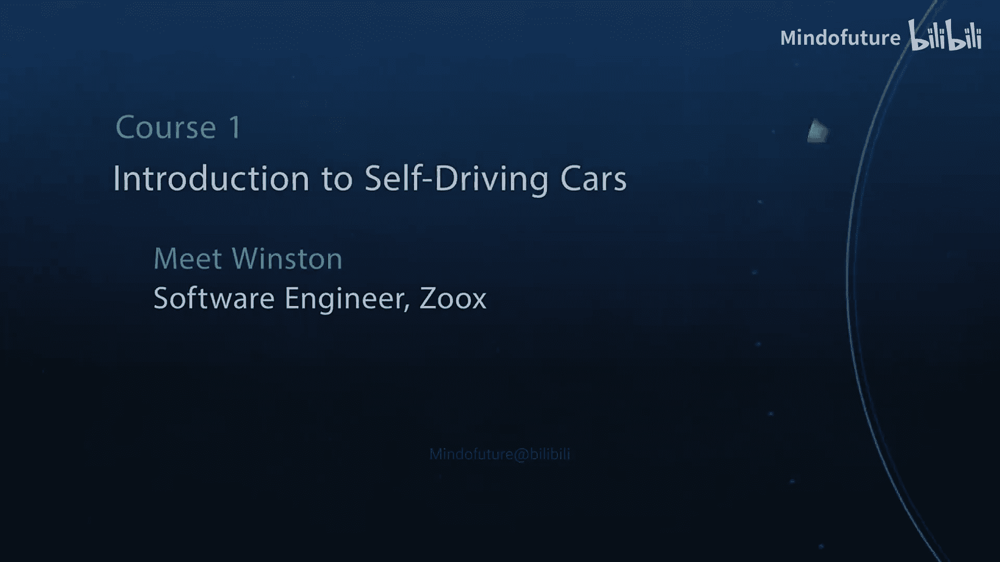
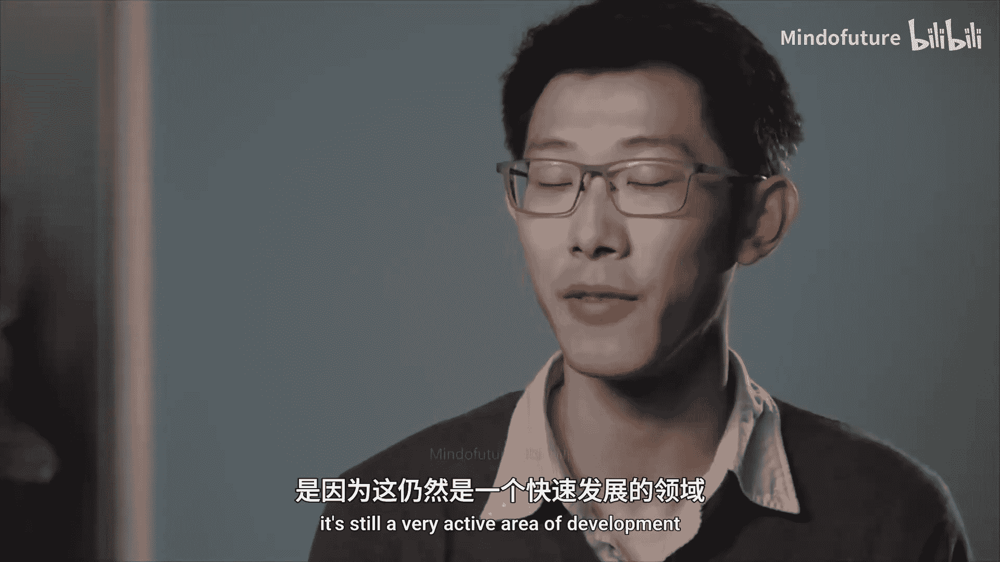
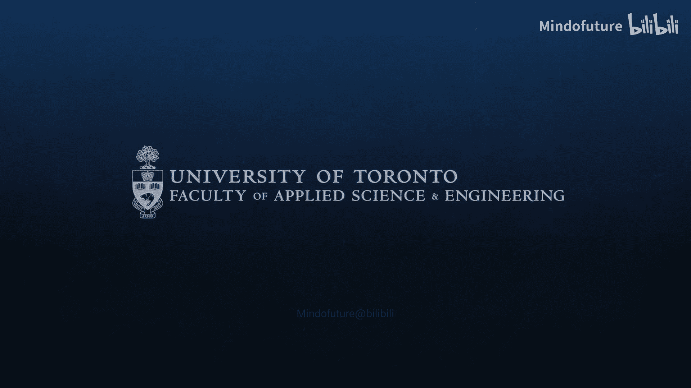

# 【多伦多大学】自动驾驶汽车简介 ｜ Intro Self Driving Cars p07 P07_认识温斯顿-软件工程师_01_02_04 -BV1mRsHzHETY_p7-

My name is Winston View， I'm currently a software engineer in localization and mapping at Zs。

 so how I got started in autonomous vehicles is when I was in my final year of university。

 General Motors and the Society of Automotive Engineers or SAE they got together and they created the student competition called Autodrive and this was basically a threeyear competition and at the end of each year there would be a contest and the goal was to be for at the end of all three years for the student teams to be able to create a level4 vehicle。

 level4 on the SAE autonomy scale。And I was leading the trajectory planning team and designed the trajectory planning and lane changing algorithms that we used in the contest in first year。

And so what ended happening is we ended up winning we won first place and we submitted a paper detailing our design ands that's imp progress right now so the moment I realized I was interested in self-driving cars and this is a bit of a story is way back at the beginning of my university career。

 I was on the UA student team that's unmanned aerial vehicles and so we were building these fixedwing drones that were semi-autonnomous。

 they were remote controls and they had industrial cameras and they had compute onboard and I led the computer vision side of things for that so I was responsible for detecting these letters painted onto wooden signs and these wooden signs would be on the ground and our plane would be up 200 feet in the air and then as I was driving down the street one day I thought。

 well hey， can I apply these same computer vision tools and I'm using。

To detect the signs to detect road signs。And I had this idea I was going to put webcams on my parents' car and drive it around the neighborhood and detect all of the street signs Well my parents weren't too thrilled with that so that project didn't end up goinging anywhere but then when the Autodve team at my school started recruiting I thought well hey this is cool and then once I actually started working on the project I realize this is something that I want to do and now I'm here so at Zeucs I'm on the clams team clams like the shellfish and that stands for calibration localization and mapping simultaneously I'm mostly working on the mapping side of things which mostly entails generating 3D maps I can't get into too much more detail than that but suffice it to say that right now I know more about San Francisco geographyography from building our maps than from Ashley being there what really gets me pumped up to go to work in the mornings is the fact that I'm working on these really。

really cool problems that are cutting edge， you know。

 this is things that people or companies really haven't tackled for because it's still a very active area of development。

