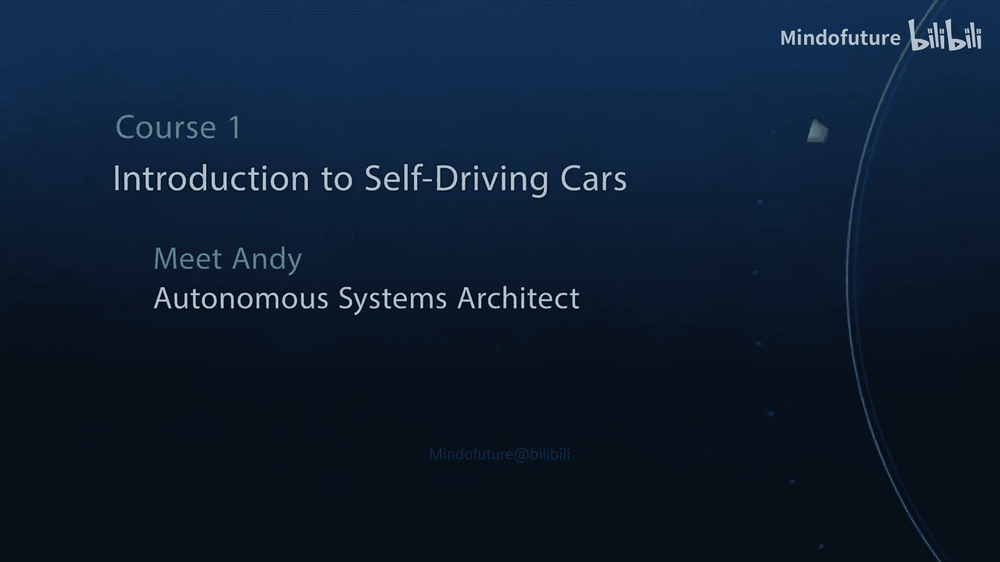
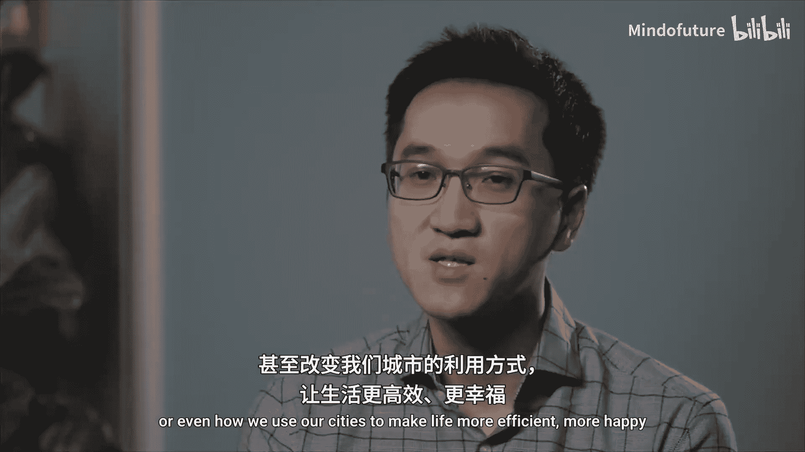
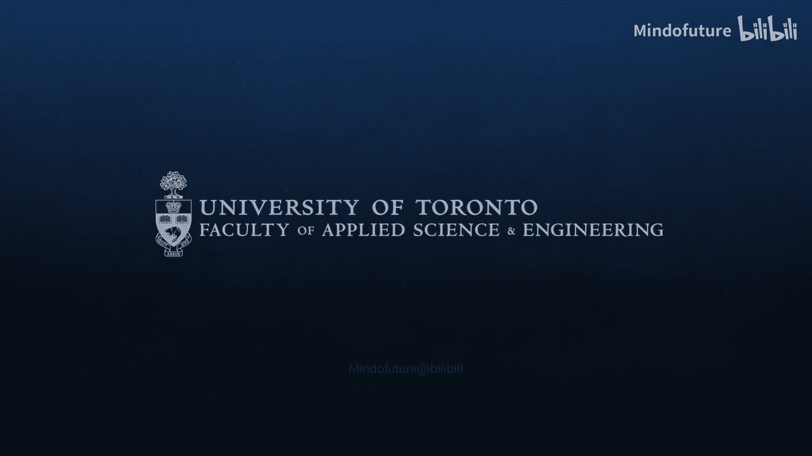

# 【多伦多大学】自动驾驶汽车简介 ｜ Intro Self Driving Cars p08 P08_认识安迪-自动驾驶系统架构师_01_02_05 -BV1mRsHzHETY_p8-

Hi， I'm Andy Wang， autonomous system architect so I got started in robotics way back in high school。

 I was one of those first robotics kids who competed in Canada by the time I got to university I helped co-found a robotics team and my faculty advisor at the time I just come back from the US and told us about this competition going on down there called the DARPA challengellenge。

 which is one of the really main things that Kstarted this whole industry from that we spawn some autonomous Racing activities which I was involved in and at that point I was pretty well hooked I took a few years to work before coming back to grad school at which point I studied vehicle controls and dynamicsy and now here I am so I currently work on the next generation of our self-driving car platform and being a systems level engineer I get the fun distinction of being able to work across a wide variety of teams to bring together a。

heive system and what that means is I get to work with both our software engineers doing perception motion control software。

 for example and also hardware engineers designing our sensors and vehicle platforms I happen to think robotics is super fun and it's this problem in particular is one that I really love because that's a direct impact on the quality of human life not only are we striving to improve the safety and save human lives I think it may also have the opportunity to help reshape how we think about transportation or even how we use our cities to make life more efficient more happy。

