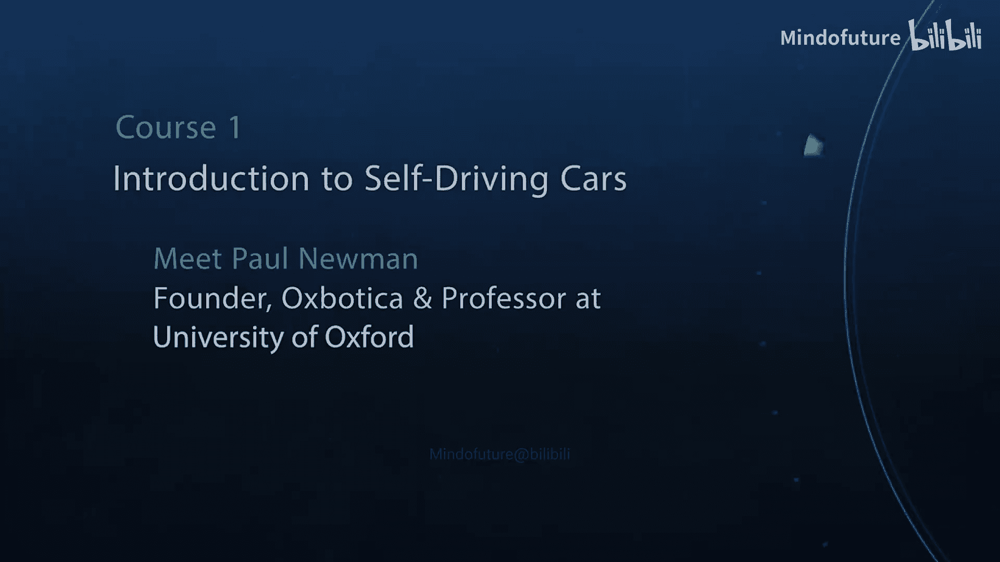

# 【多伦多大学】自动驾驶汽车简介 ｜ Intro Self Driving Cars p09 P09_认识保罗·纽曼-Oxbotica创始人、牛津大学教授_01_02_06 -BV1mRsHzHETY_p9-

I'm Paul Newman， I'm CTO and founder of Oxfordbotker and professor of Information engineering at the University of Oxford。

 so I can remember the day that I got interested in self-driving vehicles and autonomy and it was out in Sydney and I was talking to a PhD student I just started my PhD and he introduced this problem called the slam problem So can a vehicle figure out where it is in the world without having me given a map and can it build that map itself and I knew then that there was the mother of all problems that I wanted to work on So I can remember and it was the 19th of March 1996 I really discovered that there was a big problem here and since then it's never got old and we know how to solve those problems now。

 but I was always an engineer trying to build things and when I discovered that was the most exciting way to build things was a combination of software and mechanical things and that's almost by definition robotics than I was in。

And so I've never really lost that from probably about nine when I started you know trying to program very basic computers through to what I do every day now it's a thrill that's never left me Okay so what do we do here at Oica well we build the software that makes autonomous vehicles autonomous we go from the lowest level sensors all the way up through the stack through planning。

 through localization， through control， through perception up to fleet management system so the whole software environment that makes fleets of vehicles autonomous。

😊。

Here's what we build。And we develop now， down at the university。

 I'm the director of the Oxford Robics Institute and I've got a great life there， too。

 So there I work on what are the hard， hard problems of autonomy and robotics that are perhaps。😊。

10 years down the line。 One of those really sort of nascent research questions of machines and intelligence and machine learning that we would want in our vehicles in in the five to 10 year period。

 So I've got a very privileged life。 So so why why do I care about self driving cars so much。

 because transport's done， It's broken at the moment。

80% of all accidents in the road are caused by inattention。

 The one thing that machines won't do is get bored。 So we don't deal with that in any way。 you know。

 the way in which we drive is inefficient。 as we get older， as we get more infirm。

The one thing we need is to stay in contact with our species。 And if we say， oh， yes。

 I'm sorry your eyesight fading can't drive。 You've had an epileptic fit。 you can't drive。

 So the whole edifice of how we drive ourselves and move our atoms be the human atoms or good atoms iss just nuts。

 It's derived from horses and carts。 We wouldn't do that if we had our technology now。

 So that's nuts and software and algorithms are going to change that。

 I'm absolutely sure they will have more atoms move better and safer because of Av technology。

 So there's a question about should the vehicles themselves be independently smart。

Or should they leverage smart infrastructure， So， so what's smart infrastructure。

 or a traffic light that says I'm about to turn red。 And this is my location or around about。

That says a rotary that says this is where the vehicles are。 your slots coming up。

 You there's any number of ways we could think about instrumenting our cities。

 So my view is that the vehicles themselves need to be smart enough to deal without a dependency on infrastructure。

 if smart infrastructure is provided then sure you can use it if you can trust it and there's questions about cybersecurity and well that's that's the whole stack。

 really， the cybersecurity question。 So so my view is the vehicle itself must be smart enough to deal just like you are as a driver。

 you can look at traffic lights and you can look at lane boundaries you don't need to be told by the car in front。

 there's a car in front， you can see it。Because if that the infrastructure is taken away。

 you still want to be able to have an autonomous vehicle， it could be augmented by infrastructure。

 but I believe you shouldn't be dependent on it because if you solve that problem then you really do have all of transport in any place in grasp。

 it might take some time but you're in that trajectory and you're not dependent on expensive bespoke infrastructure I mean my view of expensive bespoke infrastructure for self-dring cars is called city。

