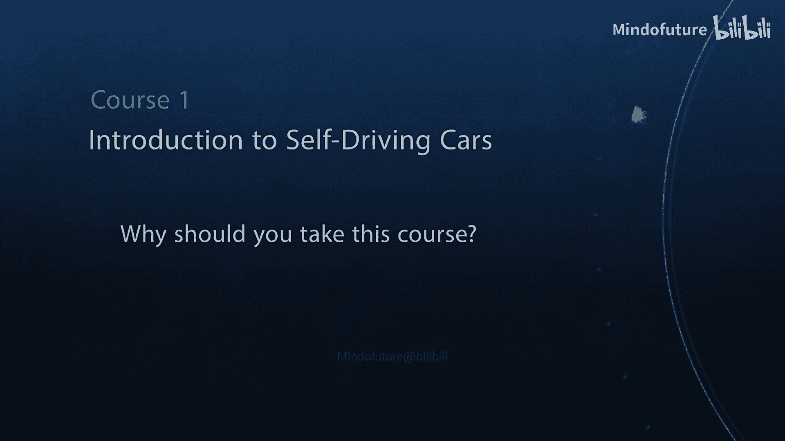
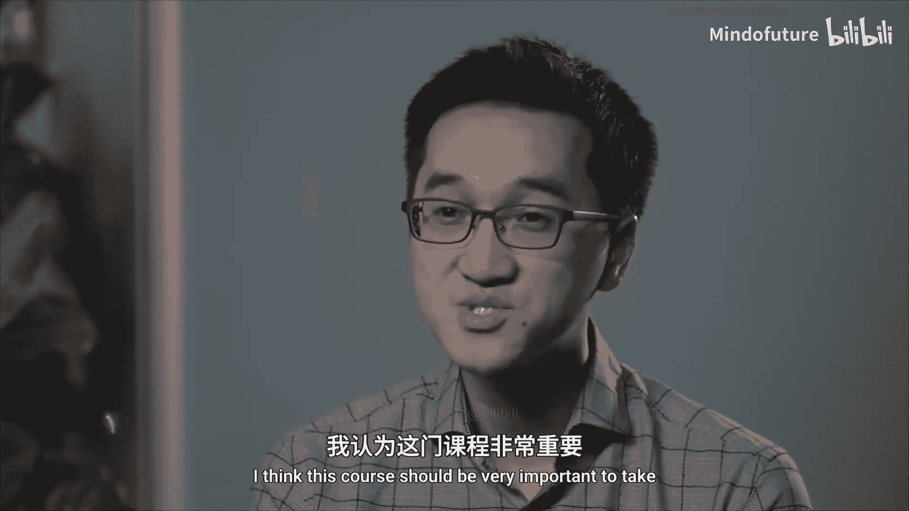

# 【多伦多大学】自动驾驶汽车简介 ｜ Intro Self Driving Cars p10 P10_为什么要学习这门课程_01_02_07 -BV1mRsHzHETY_p10-

Is this a worthy field to get involved in well I mean I think the moral， the safety， the efficiency。

 you know transporting more atoms better safer quicker for us。

 that's a compelling argument in itself。But oh， my word， is it interesting。 You know。

 it's a hard problem to be working And。 It's not a problem that we're just gonna go， oh yeah。

 Do you remember that Wednesday。 that was the day we figured it out。 or any date。

 not nothing special about Wednesday。 So you know it's a really exciting career to be in because we're at the start of it。

 And it's not going to finish anytime soon and the problems are really really hard and the diverse。

 So if you're an engineer and you go really like to work on hard problems that aren't obvious。

 But as I crack in as I peel this onion。 I'm going have a big impact on how things are moved。

 then you should totally do this course and you should totally become an AV engineer。

 I think this course should be very important to today because it will teach you a lot of the fundamentals of the self-draagon car space。

 It'll teach you a wide range of topics and they'll teach you a lot of what you need to know in order to understand and develop the systems going forward。

 and they'll make you a flexible and knowledgeable engineer who is going to be able to adapt to this really fast pace industry。

😊。

I think that the course or courses are very useful for anyone trying to get into this industry as they give you a very better more general view of everything that goes on and goes into making a vehicle drive by itself and it would be very useful to try and get into that space using that I've actually used part of what I learned in my controls courses in University of Waterloo which is part of these courses as well and I've used PID controllers in robotics so it's all of this is even useful from a firmware standpoint one way for individuals already out there and in the workspace to break into the self-driving field is to gain some knowledge about some of the problems that we're facing。

 for example state estimation and one of the ways to learn that would be to take this Coursera course。

