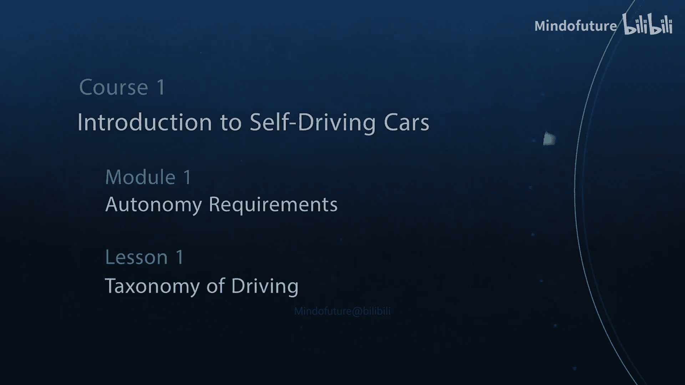
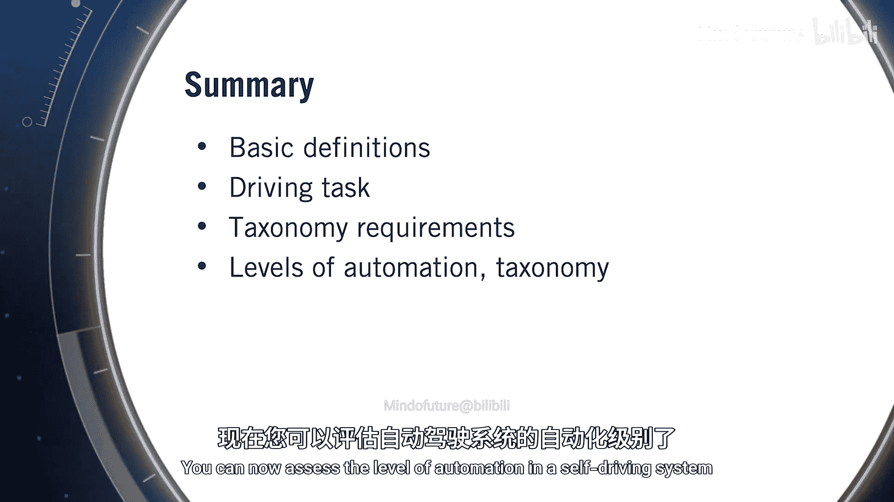

# 【多伦多大学】自动驾驶汽车简介 ｜ Intro Self Driving Cars p11 P11_第一课-自动驾驶等级分类_02_01_01 -BV1mRsHzHETY_p11-

🎼。

Welcome to the first module of the introduction to self driving carss course Through this module。

 you will learn about the main components needed to create a self driving car and the technical requirements that drive their design Before we begin。

 it's important that you understand autonomous vehicle requirements or how we define self driving for a car。

😊，This first week is meant to give you a high level survey of the terms and concepts that we'll explore more deeply throughout the specialization。

So in module 1， I will introduce you to the taxonomy for self driving cars or a system of classification that we use to define driving automation。

 Next， I'll describe the perception needs for the driving task。

Or those items that we need to be able to identify properly。Finally。

 we will tackle the question of how to make driving decisions and discuss a few approaches for making choices about how a vehicle moves through the environment。

The goal of this first module is to remind you just how many assessments and decisions the driving task truly requires。

 Hopefully， this will help you appreciate just how much complexity we as humans can manage effectively when it comes to staying safe on the road。

 So let's begin。In this video， we will cover the basic self driving terminology。

 then discuss some requirements leading to a classification system for driving automation levels。

Define the task of driving and the various components of driving。

Formted taxonomy based on our requirements and levels of autonomy needed for a driving task。

And finally， we will conclude with the limitations of our proposed taxonomy classification system。

Let's get started with some technical terms and definitions。

 We will use these throughout the specialization， and they're helpful to know if you're working in this industry。

The first term on our list is the driving task。Broadly speaking。

 the driving task is made up of three subtasks。The first subtask is perception。

Or perceiving the environment that we're driving in。

This includes tracking a car's motion and identifying the various elements in the world around us。

 like the road surface， road signs， vehicles， pedestrians， and so on。

We also need to track all moving objects and predict their future motions so we can drive safely and accurately。

The second subtask is motion planning。This allows us to reach our destination successfully。

 For example， you may want to drive from your home to your office。

 so you'll need to consider which roads you should take when you should change lanes or cross an intersection and how to execute a swerve maneuver around a pothole along the way。

😊，Finally， we need to operate the vehicle itself with vehicle control。

So we need to take the appropriate steering， brake。

 and acceleration decisions to control the vehicle's position and velocity on the road。

These three subtasks form the main driving task and need to be performed constantly while driving a vehicle。

The next concept I'll introduce is called the Operaal Design domain or ODD for short。

The ODD constitutes the operating conditions under which a given system is designed to function。

It includes environmental， time of day， roadway， and other characteristics under which the car will perform reliably。

Clearly defining the operating conditions for which a self driving car is designed is crucial to ensuring the safety of the system。

 so the ODD needs to be planned out carefully in advance。Now that we know some of the basic terms。

 let's get to the big question。How do we classify the level of automation in a driving system？

Here are some things to consider。First， how much driver attention is needed， For example。

 can you watch a movie while driving to work？Or do you need to keep your attention on the steering wheel at all times？

Driver attention is one of the crucial questions to consider when defining the level of autonomy。

Second， how much driver action is actually needed， for example， do you need to steer？

Does the car take care of the speed or do you control that as well？Do you need to change lanes？

Or can the car stay in the current lane without any intervention？

And what exactly do we need to expect when we say that the car can automatically drive？

We define the driving task broadly in the previous slides。

But we will need to discuss this in more depth。All of these questions lead us to the autonomous driving taxonomy。

The standards are continuously evolving， but for the purposes of our classification。

 we will use the decomposition suggested by the Society of Automotive Engineers in 2014。

You can find a link to this resource in the lesson supplementary readinging。

Let's now discuss a way to describe the driving task in increasing levels of automation。First。

 we have lateral control， which refers to the task of steering and navigating laterally on the road。

 turning left， right， going straight， or tracking a curve and so on。Next。

 we have longitudinal control。This is the task where we control the position or velocity of the car along the roadway through actions like braking or acceleration。

Then we have object and event detection and response， or OEDR for short。

OEDR is essentially the ability to detect objects and events that immediately affect the driving task and to react to them appropriately。

OEDR really encompasses a large portion of autonomous driving and so is used in conjunction with a specific operational design domain to categorize current self driving systems。

Next we have planning Plan is another important aspect of driving as immediate response is already part of OEDR。

 planning is primarily concerned with the long and short term plans needed to travel to a destination or execute maneuvers such as lane changes and intersection crossings。

Finally， there are some miscellaneous tasks that people do while driving as well。

 These include actions like signaling with indicators， hand waving。

 interacting with other drivers and so on。Now we have a clear description of what tasks we expect a self driving car to perform。

Let's now discuss the questions that can lead us to the taxonomy for classifying the level of automation in a self driving car。

First， can this system handle steering tasks or lateral control？Second， can it perform acceleration。

 braking and velocity manipulation tasks or longitudinal control？And third。

 can the system perform object and event， detection and response， and to what degree？Crucially。

 can the system handle emergency situations by itself。

 or does it always need a driver to be attentive during emergencies？Finally。

 can the system perform in all scenarios and all conditions。

 or does it have a limited ODD or set of operating conditions that it can handle safely？

Based on these questions， let's walk through the commonly used levels of automation defined by the SAE standard J3016。

Let's start with full human perception， planning and control， and call this level zero。In this level。

 there is no driving automation whatsoever， and everything is done by the driver。

If an autonomous system assists the driver by performing either lateral or longitudinal control tasks。

 we are in level1 autonomy。Adaptive cruise control is a good example of level1。

In adaptive cruise control or ACC， the system can control the speed of the car。

 but it needs the driver to perform steering。So it can perform longitudinal control。

 but needs the human to perform lateral control。 Similarlyly。

 lane keeping assist systems are also level1。In lane keepinging assistance。

 the system can help you stay within your lane and warn you when you are drifting towards the boundaries。

Today's systems rely on visual detection of lane boundaries coupled with lane centering lateral control。

Let's move on to the next level， the level of partial automation。In level 2。

 the system performs both the control tasks， lateral and longitudinal in specific driving scenarios。

Some simple examples of levell 2s features are GM SuperCs and Nissan's Propilot assist。

 these can control both your lateral and longitudinal motion。

 but the driver monitoring of the system is always required。Nowadays。

 many automotive manufacturers offer level 2 automation products， including Mercedes， Audi。

 Tesla and Hyundai。Next up is level3 in level3 or the level of conditional automation。

 the system can perform object and event detection in response to a certain degree in addition to the control tasks。

However， in the case of failure， the control must be taken up by the driver。

The key difference between level2 and3 is that the driver does not need to pay attention in certain specific situations as the vehicle can alert the driver in time to intervene。

This is a controversial level of automation， as it is not always possible for an autonomy system to know when it is experiencing a failure。

An example of level3 systems would be the Audi A8 luxury sedan。

 which was an automated driving system that can navigate unmonitored in slow traffic。

In the next level， we arrive at highly automated vehicles where the system is capable of reaching a minimum risk condition in case the driver doesn't intervene in time for an emergency。

Level4 systems can handle emergencies on their own。

 but may still ask drivers to take over to avoid pulling over to the side of the road unnecessarily。

With this amount of automation， the passengers can check their phone or watch a movie knowing that the system is able to handle emergencies and is capable of keeping the passengers safe。

However， level4 still permits self driving systems with a limited ODD。As of fall 2018。

 only Waymo has deployed vehicles for public transport with this level of autonomy。

The Waymo fleet can handle the driving task in a defined geographic area with a nominal set of operating conditions without the need for a human driver。

Finally， in level 5， the system is fully autonomous and its ODD is unlimited。

 meaning that it can operate under any condition necessary。

Level 5 is the point where our society undergoes transformational change， with driverless taxis。

 shuttling people and packages wherever we need them。We don't have any examples for level 5 yet。

 but maybe you'll be the one to bring these to reality someday soon。

A thing to note the levels of autonomy are actually a coarse measure of automation。 In fact。

 it is possible for two car models to claim level 4 autonomy。

 but have very different capabilities and ODDs。So let's summarize in this video。

 we covered various concepts relating to automation。

We covered some basic definitions including the operational design domain and the concept of the driving task。

And we explored the five levels of driving automation。

You can now assess the level of automation in a self driving system。

In the next lesson， we will explore the requirements for perception。

 a crucial aspect for autonomous system design。

