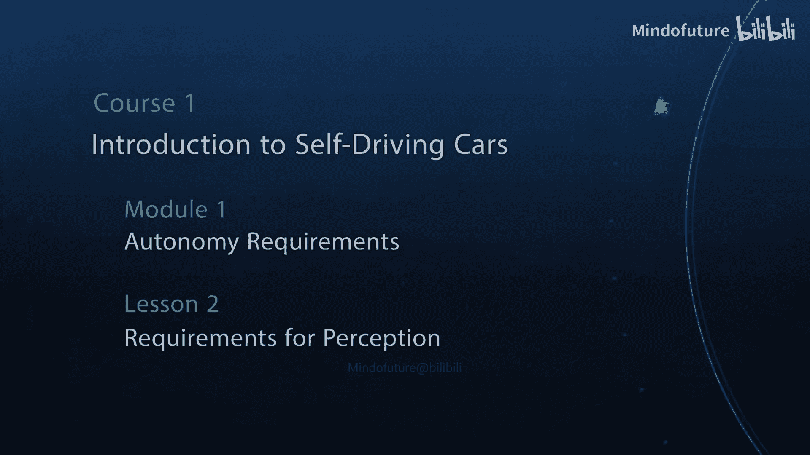
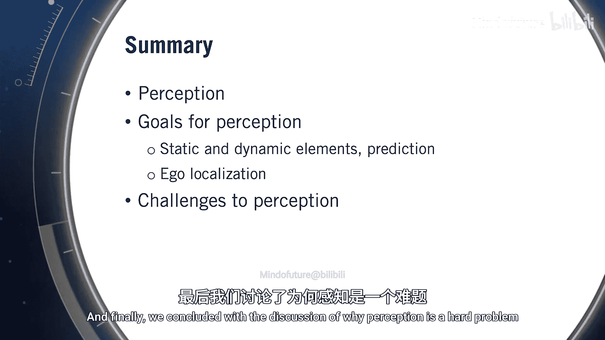

# 【多伦多大学】自动驾驶汽车简介 ｜ Intro Self Driving Cars p12 P12_第二课-感知系统的要求_02_01_03 -BV1mRsHzHETY_p12-

Welcome to the second lesson in this module In the previous lesson。

 we learned how to classify automation according to its capabilities and operational design domain。

In this lesson， we will start analyzing how a driving task is performed。More specifically。

 we will go over the many processes of perception。We will first define the perception task listing out the requirements for perception。

 such as what static and dynamic objects we need to identify。

And what needs we have for tracking the ego vehicle's motion？Through the environment。And finally。

 we will conclude with a discussion on some challenges to robust perception。So let's dive in。

Very roughly speaking， any driving task can be broken down into two components。First。

 we need to understand what's happening around us and where we are。

 so we need to perceive our surroundings。And secondly， we need to make a driving decision。

 for example， should we accelerate or stop before a pedestrian vote to enter the roadway？

Recall from the previous lesson the concept of OEDR or object and event detection and response。

Any driving task requires some kind of OEDR， that is we need some way of identifying objects around us。

Recognizing events happening near us and then responding to them。

Recall that the classification of automated systems that we discussed had OEDR as one of the criteria。

In other words， if we want to build a self driving car， we need to be able to perform OEDR。

Let's go further and analyze a crucial part of OEDR perception。So what is perception？As we discussed。

 we want to be able to make sense of the environment around us and the way we're moving within it。

In particular， for any agent or element on the road， we need to first identify what it is， a car。

 a cyclist， a bus， etc。And second， we want to understand its motion has it been moving in a certain way that can tell us what it will do next。

As humans， we are really good at understanding patterns。However。

 it's still difficult for computer systems to be able to recognize these same patterns around us as quickly as we do。

We can point to a car going straight and say， oh， it will be in this position in some amount of time in the future。

This is what makes driving possible for us， so this ability of predicting the trajectory of a moving object is really important to perception。

If we can do this prediction correctly， we can make informed decisions for example。

 if I know what the car in front of me is going to do next。

 then I can decide what to do next in such a way that both of our goals are met。

Let's discuss the various elements we need to be able to identify for the perception task。First。

 we need to identify static elements。These are elements like roads， lane markings。

 things that segregate regions on the roads， like zebra crossings。

And important messages such as school up ahead。These are all on the road area。

Then there are off road elements like curbs that define the boundaries within which we can drive。

There are the on road traffic signals that periodically change and signal whether you are allowed to move forward or left or right or just stay stopped。

Then there are all kinds of road signs like those telling you the speed limit indicating direction。

 whether there is a hospital coming up or a school coming up and so on。 Again again。

 these are off road elements。Finally， there are road obstructions。

 So the orange cones that tell you construction is happening are that there is road blockage and so on。

 Also， these are on road elements。😊，Second， let's discuss the dynamic elements that we need to identify for perception。

These are the elements whose motion we need to predict to make informed driving decisions。

We need to identify other vehicles on the road。So four wheelers like trucks， buses， cars， and so on。

And then we also need to identify and predict the motion of two wheelers like motorcycles， bicycles。

 and so forth。These are all moving systems with more freedom than four wheelers。

 And so they are harder to predict。Finally， we should also be able to identify and predict the motion of pedestrians around us。

 how pedestrians behave is very different from vehicles。

 as pedestrians are known to be much more erratic than vehicles in their motion。

 because of the inherent freedom that humans have in the way they move。

Another crucial goal for perception is ego localization。

 we need to be able to estimate where we are and how we are moving at any point in time。

Knowing our position and how we are moving in the environment is crucial to making informed and safe driving decisions。

The data used for egomotion estimation comes from GPS。

 IMU and odoometry sensors and needs to be combined together to generate a coherent picture of our position。

The second and third courses of this specialization will dive deeply into these essential perception tasks。

 starting with ego localization in Co2， and followed by on and off road object detection and tracking in course 3。

Now that we've discussed the main goals for perception。

 let's conclude this discussion by going over why perception is also a difficult problem。First。

 performing robust perception is a huge challenge。 detectionte and segmentation can be approached with modern machine learning methods。

 but there is much ongoing research to improve their reliability and performance to achieve human level capability。

Access to large data sets is critical to this effort with more training data。

 our segmentation and detection models perform better and more robustly。

 but collecting and labeling data for all possible vehicle types。

 weather conditions and road surfaces is a very expensive and time consuming process。Second。

 perception is not immune to censor uncertainty。There are many times that visibility can be challenging。

 or GPS measurements get corrupted， or LiDar and radar returns are noisy in terms of their position value。

Every subsystem that relies on these sensors must take uncertain measurements into account。

This is why it is absolutely crucial to design subsystems that can accommodate sensor uncertainty and corrupted measurements in every perception task。

Then there are effects such as occlusion and reflection in camera or Lidar data。

 These can confuse perception methods with ambiguous information that is challenging to resolve into accurate estimates of object locations。

There are also effects such as drastic illumination changes and lens flare or GPS outages in tunnels。

 which make some sensor data completely unusable or unavailable。

Perception methods need multiple redundant sources of information to overcome sensor data loss。

And finally， there's weather and precipitation that can adversely affect the quality of input data from sensors。

 so it is crucial to have at least some sensors that are immune to different weather conditions。

 for example， radar。Let's summarize in this video， we briefly went through the main tasks for perception。

The task of detecting and assessing various types of static and dynamic objects in agents in the environment。

And the task of making sense of how the ego vehicle is moving through the environment。And finally。

 we concluded with the discussion of why perception is a hard problem。

That's it for this video， see you in the next video where we will be discussing the decision making aspects of autonomous driving。

