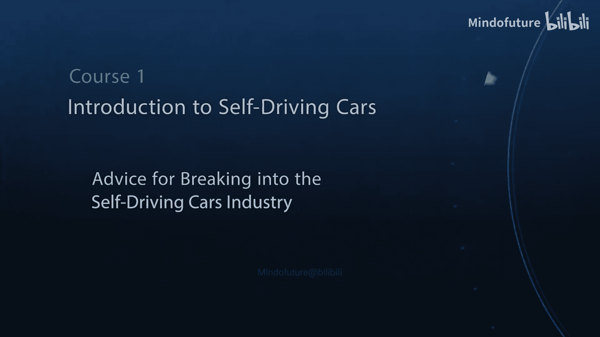
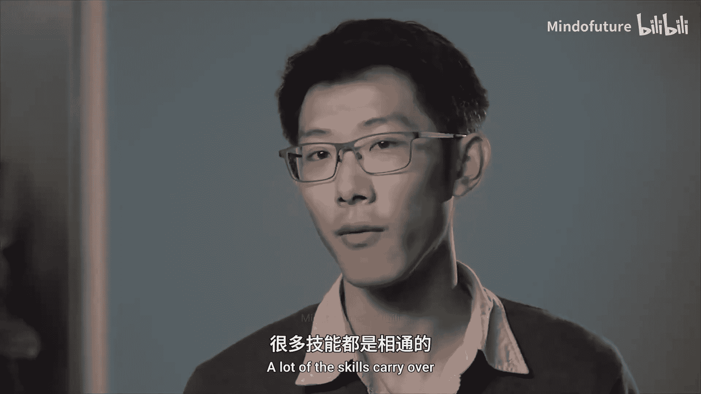

# 【多伦多大学】自动驾驶汽车简介 ｜ Intro Self Driving Cars p14 P14_进入自动驾驶汽车行业的建议_02_02_01 -BV1mRsHzHETY_p14-

Some advice for junior people trying to break into the autonomous industry getting a degree in engineering definitely helped me especially from the University of Waterloo where I got to do a lot of internships a lot of interactive projects and I also during that time helped mentor our first robotics team so all of that helped to boost up my resume so if you wanted to get into the autonomous space into firmware engineering。

 some of the schooling that you might want is an engineering degree you can also do it through a CS degree but getting some real experience with hardware it definitely helps I took in my final years of university I took embedded classes to get more familiar with more of the low-lel software or lowlel aspects of software that I would need in a more day-today life and being very familiar with the hardware definitely helps in my day-to-day job because I'm。

Actuating pieces。Definitely I've seen people in this industry who have more of a mechanical background and that also helps。

 but just knowing how to code also definitely helps with that and knowing all of the pieces around you。

 robotics in general， I think that mechatronic engineering was definitely a help for that for me because it was so wellroed and I got to do everything and there was so many projects that definitely helped me to figure out how everything went together。

So I think in the industry right now， because it's growing so fast and so rapidly pretty much every kind of role is needed。

 including firmware or even perception or any part of the autonomous stack just needs people。

 I get contacted specifically a lot about firmware jobs because of my background in firmware。

 but I think that in general， there are just so many jobs out there right now that everyone's just trying to get the best people to work on their autonomous challenge。

It's a very aggressively hiring industry， so I constantly get recruited by other companies looking to just get people and I'm obviously trying to find as many people as possible for zs so that we can continue working and growing and seems like we're doing pretty good considering our numbers。

 but。As always there's always more people needed and everybody's trying to solve this problem and everyone's trying to get every all the best people to work on it Now that I've had the chance to work in industry。

 I think the ideal candidate would be people who are interested and excited about the field and in terms of technical skills are fluent in C++ and Python We need research engineers who are able to solve problems from first Pri Wales and we also need people with machine learning experience One of the biggest pieces of advice I can give to people at the undergraduate or graduate level is to join student teams Student teams give you the opportunity to work collaboratively with your peers and develop your communication leadership skills。

Although the projects you work on might not be cutting edge at the same time。

 they really help you gain experience working in a semiprofessional setting communication skills are important for people out in the workplace as well because especially in autonomous driving we have all of these unique problems that we need to solve and being able to communicate your ideas clearly is vitally important Being there when things fail is a very valuable learning experience a lot of the skills carry over。

 for example， troubleshooting， working with others。

 being able to solve problems I found that experience very helpful once they started working in the industry My advice for junior engineers looking to break into the industry is really to be handson and practical to try taking on projects yourself that could take the form of either a laptop on wheels where you program your own stack and to end or using the simulator to predict what the environment would be like once we do hit the ground I think the。

these practical problems through practical means or teach a lot and I personally have drawn a lot from previous projects in my day to- day job nowadays。

 What advice would I give if you wanted to come and work in an AV company first of all。

 be open to all areas of engineering， don't become just a computer vision specialist if you can Try and understand that this is fundamentally a robotics question because we have software using multiple sensors trying to ask some very difficult questions in the presence of a very devious world that's got strange lighting。

 strange weather people behaving in strange ways and you have to know a bit about control or interfacing to people who know about control who know about planning。

 who know about vision， who know about lasers who know about communications who know about systems engineering。

 you're going want to be interacting with those individuals the whole time So I would say understand this as a big engineering science problem obviously code like code all the time practice practice。

Practice and code well， you know be proud that just if you have a circuit。

 as an undergraduate you're building a circuit。 and if it looks shocking， it probably is shocking。

 that's just a good joke with electricity， but the same is true for software。

 So be a proud software engineer about the quality of the code that you're writing and you will do well love getting into the mess of it right so please don't work with cameras ands。

 go out into a rainstorm， go out into the snow， go into the blinding sun and deal with cameras out there and don't worry that it doesn't work because that's the best lesson you can get。

 So so you know boldly go out into places that are tricky for these systems to work in and learn from that。

 So be a proud roboticist and be a systems engineer as well because it's a full stack problem right it's not just I want to process a camera really well。

 I want to spot cars。 it's all of it and it all has to interact in the end。

