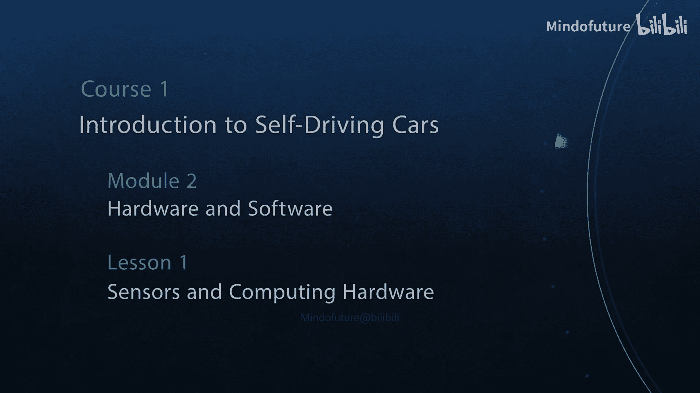
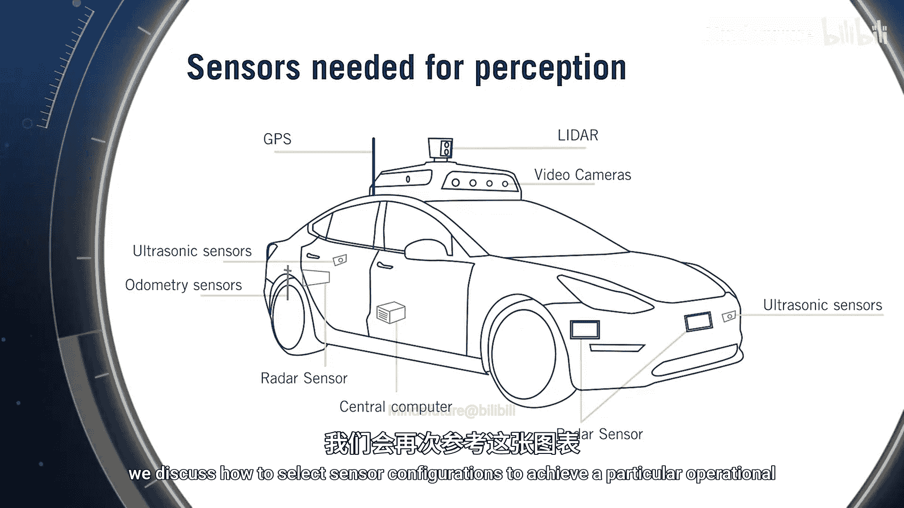
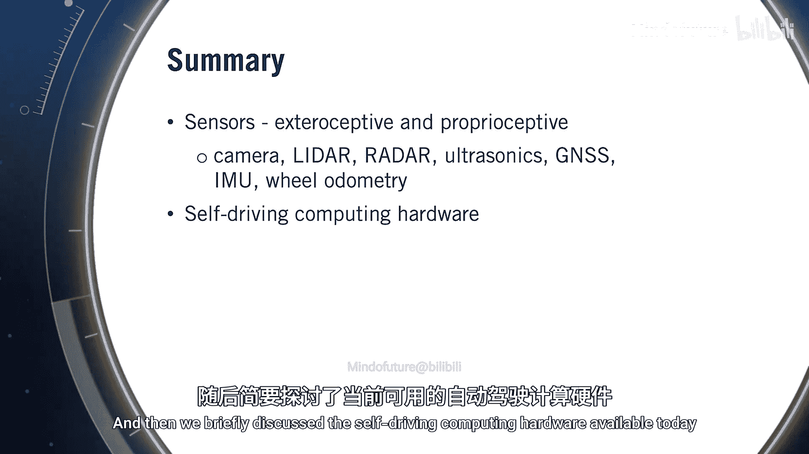

# 【多伦多大学】自动驾驶汽车简介 ｜ Intro Self Driving Cars p15 P15_第一课-传感器与计算硬件_03_01_01 -BV1mRsHzHETY_p15-

🎼。

Welcome to the first lesson of week 2。 This week， we will discuss many details about the hardware and software architecture used in today's self driving cars。

😊，In particular， we will cover the various sensors that can be used for perception。

The computing platforms available today。The basics of designing sensor configurations for self driving cars。

The components of a typical autonomy software stack。And finally。

 we will conclude by discussing the various ways which we can represent the environment for self driving。

Hopefully， by the end of this week， you will have a broad understanding of the equipment and software ideas that go into making a self driving car。

Let's begin this video。In this video， we will define sensors and discuss the various types of sensors available for the task of perception。

And we will then discuss the self driving car hardware available nowadays。

Let's begin by talking about sensors。 Even the best perception algorithms are limited by the quality of their sensor data。

And careful selection of sensors can go a long way to simplifying the self driving perception task。

So what is a sensor？A sensor is any device that measures or detects some property of the environment or changes to that property over time。

Sensors are broadly categorized into two types， depending on what property they record。

If they record a property of the environment， they are externaloceptive。

Exterero means outside or from the surroundings。On the other hand。

 if the sensors record a property of the ego vehicle， they are proprioceptive。

Proprios means internal or one's own。Let's start by discussing common externaloceptive sensors。

We start with the most common and widely used sensor in autonomous driving， the camera。

Cameras are a passive light collecting sensor that are great at capturing rich。

 detailed information about a scene。😊，In fact， some groups believe that the camera is the only sensor truly required for self driving。

But state of the art performance is not yet possible with vision alone。While talking about cameras。

 we usually tend to talk about three important comparison metrics。

We select cameras in terms of their resolution。 The resolution is the number of pixels that create the image。

 so it's a way of specifying the quality of the image。

We can also select cameras on the basis of field of view。

 The field of view is defined by the horizontal and vertical angular extent that is visible to the camera and can be varied through lens selection and zoom。

😊，Another important metric is the dynamic range。 The dynamic range of the camera is the difference between the darkest and the lightest tones in an image。

 High dynamic range is critical for self driving vehicles due to the highly variable lighting conditions encountered while driving。

 especially at night。There's an important trade off in cameras and lens selection that lies between the choice of field of view and the resolution。

Wider field of view permits a larger viewing region in the environment。

 but fewer pixels that absorb light from one particular object， as the field of view increases。

 we need to increase resolution to still be able to perceive with the same quality the various kinds of information we may encounter。

Other properties of cameras that affect perception exist as well， such as focal length。

 depth of field， and frame rate。We'll go into much more detail on cameras and computer vision in course 3 on visual perception。

The combination of two cameras with overlapping fields of view and aligned image planes is called a stereo camera。

 stereo cameras enable depth estimation from synchronized image pairs。

Pixel values from one image can be matched to the other image。

 producing a disparity map of the scene。 This disparity can then be used to estimate depth at each pixel。

Next， we have Lidar， which stands for light detection and Ranging sensor。

 Lidar sensing involves shooting light beams into the environment and measuring the reflected return。

😊，By measuring the amount of returned light and time of flight of the beam。

 both in intensity and range to the reflecting object can be estimated。

LDAar usually include a spinning element with multiple stacked light sources and output a three dimensional point cloud map。

 which is great for assessing scene geometry。Because it is an active sensor with its own light sources。

 Lidar are not affected by the environment's lighting。

So LiDarR do not face the same challenges as cameras when operating in poor or variable lighting conditions。

 Let's discuss the important comparison metrics for selecting LDar。

The first is the number of sources it contains， with 8， 16， 32 and 64 being common sizes。

And the second is the points per second it can collect。The faster the point collection。

 the more detailed the 3D point cloud can be。Another characteristic is the rotation rate。

 the higher this rate， the faster the 3D point clouds are updated。

Detection range is also important and is dictated by the power output of the light source。

And finally， we have the field of view， which once again is the angular extent visible to the LiDar sensor。

Finally， we should also mention the new LDar types that are currently emerging， high resolution。

 solid state LDar。Without a rotational component of the typical LDArs。

 these sensors stand to become extremely low cost and reliable。

 thanks to being implemented entirely in silicon。HD solidli state LDar are still a work in progress。

 but definitely something exciting for the future of affordable self driving。

Our next sensor is radar， which stands for radio detectionction and Ranging。

Radar sensors have been around longer than Lidar and robustly detect large objects in the environment。

 They are particularly useful in adverse weather， as they are mostly unaffected by precipitation。

Let's discuss some of the comparison metrics for selecting radar。

 radardar are selected based on detection range。Field of view。

And the position in speed measurement accuracy。Radar are also typically available as either having a wide angular field of view but short range or having a narrow field of view。

 but a longer range。The next sensor we are going to discuss are ultrasonics or sonars。

 originally so named for sound navigation and ranging， which measure range using sound waves。

 Soar are sensors that are short range and inexpensive ranging devices。

 This makes them good for parking scenarios where the ego vehicle needs to make movements very close to other cart。

Another great thing about sonar is that they are low cost。Moreover， just like radar and LDar。

 they are unaffected by lighting and precipitation conditions。

Soar is selected based on a few key metrics。The maximum range they can measure。

The detection field of view and their cost。Now let's discuss the proprioceptive sensors。

 the sensors that sense ego properties。The most common ones here are global navigation satellite systems。

 GNSS for shorts， such as GPS or Galileo， and inertial measurement units or IMUs。

GNSS receivers are used to measure ego vehicle position， velocity， and sometimes heading。

The accuracy depends a lot on the actual positioning methods and the corrections used。

Apart from these， the IMU also measures the angular rotation rate， accelerations of the ego vehicle。

 and the combined measurements can be used to estimate the 3D orientation of the vehicle。

 where heading is the most important for vehicle control。And finally。

 we have wheel odoometry sensors。 This sensor tracks the wheel rates of rotation。😊。

And uses these to estimate the speed and heading rate of change of the ego car。

This is the same sensor that tracks the mileage on your vehicle。So to summarize。

 the major sensors used nowadays for autonomous driving perception include cameras， radar， LiDar。

 Soar， GNSS， IMUs， and Wodoometry modules。These sensors have many characteristics that can vary widely。

 including resolution， detection range， and field of view。

Selecting an appropriate sensor configuration for a self driving car is not trivial。

Here's a simple graphic that shows each of the sensors and where they usually go on a car。

We will revisit this chart again in the next video when we discuss how to select sensor configurations to achieve a particular operational design domain。

Finally， let's discuss a little bit about the computing hardware most commonly used in today's self driving cars。

The most crucial part is the computing brain， the main decision making unit of the car。

It takes in all sensor data and outputs the commands needed to drive the vehicle。

Most companies prefer to design their own computing systems that match the specific requirements of their sensors and algorithms。

 Some hardware options exist， however， that can handle self driving computing loads out of the box。

 The most common examples would be invidious drive P X and Intel and mobilize IQ。

Any computing brain for self driving needs both serial and parallel compute modules。

 particularly for image and LiDAR processing to do segmentation， object detection and mapping。

For these， we employ GPUs， FPGAs and custom Ass， which are specialized hardware to do a specific type of computation。

For example， the drive PX units include multiple GPUs。

 and the IQs have FPGAs both to accelerate parallelizable compute tasks such as image processing or neural network inference。

And finally， a quick comment about synchronization。

 because we want to make driving decisions based on a coherent picture of the road scene。

It is essential to correctly synchronize the different modules in the system and serve a common clock。

Fortunately， GPS relies on extremely accurate timing to function and as such can act as an appropriate reference clock when available。

Regardless， sensor measurements must be timestamped with consistent times for sensor fusion to function correctly。

Let's summarize in this video， we learned about sensors and their different types based on what they measure。

We covered the major sensors used in self driving hardware systems。

And discuss the advantages in comparison metrics。And then we briefly discussed the self driving computing hardware available today。

Hopefully， this solidifies some of the concepts we learned last week for doing autonomous perception。

 In the next lesson， we'll take a step further and look at how to select an appropriate sensor configuration for your self driving car。

😊，See you in the next video。

