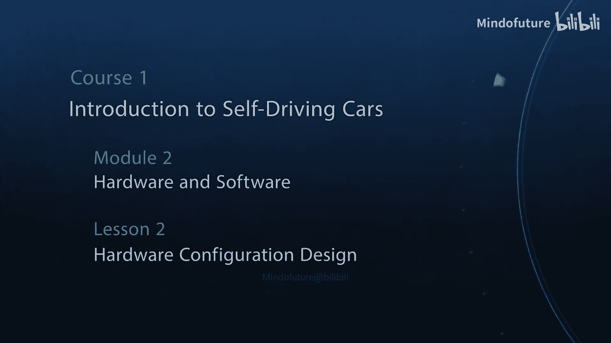
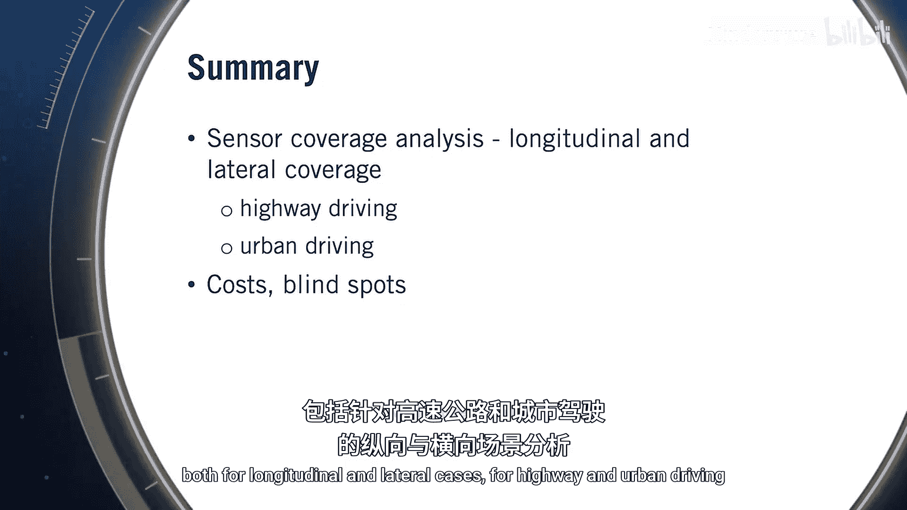

# 【多伦多大学】自动驾驶汽车简介 ｜ Intro Self Driving Cars p16 P16_第二课-硬件配置设计_03_01_03 -BV1mRsHzHETY_p16-

Welcome to the second video of this week， we started out this week by covering the various kinds of sensors most commonly used for perception。

Now let's learn how to place these sensors to aggregate a complete view of the environment。

In this video， we will cover the configuration design to meet sensor coverage needs for an autonomous driving car。

We will do this by going through two common scenarios。

 driving on a highway and driving in an urban environment。After analyzing these scenarios。

 we will lay out the overall coverage requirements and discuss some issues with the design。

Let's begin by recalling the most commonly available sensors from our last video。

 These are the camera for appearance input， the stereo camera for depth information。

 Lidar for all weather 3D input， radar for object detection。

Ultrasonics for short range 3D input and GNSS IMU data and Wow Doometry for ego state estimation。

Also， remember that all of these sensors come in different configurations and have different ranges and fields of view over which they can sense。

They have some resolution that depends on the instrument specifics and field of view。

Before we move to discussing coverage， let's define the deceleration rates we're willing to accept for driving。

 which will drive the detection range as needed for our sensors。

Aggressive decelerations are set at5 mters per second squared。

 which is roughly the deceleration you experience when you slam the brakes hard and try to stop abruptly in case of an emergency。

Normal decelerations are set to two meters per second squared。

 which is reasonably comfortable while still allowing the car to come to a stop quickly。

Given a constant deceleration， our bra distance D can be computed as follows。

 D is equal to v squared over 2 a， where v is the vehicle velocity and a is its rate of deceleration。

We can also factor in reaction time of the system and road surface friction limits。

 but we'll keep things simple in this discussion。Let's talk about coverage now。

The question we want to answer is where should we place our sensors so that we have sufficient input for our driving task？

Practically speaking， we want our sensors to capture the O DD we have in mind or the O DD our system can produce decisions for。

 We should be able to provide all of the decisions with sufficient input。

There can be so many possible scenarios in driving。

 but we'll look at just two common scenarios to see how the requirements drive our sensor selection。

We'll look at highway and urban driving。Let's think about these two situations briefly。

For a divided highway， we have fast moving traffic。

 usually high volume and quite a few lanes to monitor。

 But all vehicles are moving in the same direction。😊。

The other highlight of driving on a highway setting is that there are fewer and gradual curves。

 and we have exits and merges to consider as well。On the other hand， in the urban situation。

 we'll consider we have moderate volume and moderate speed traffic with fewer lanes。

 but with traffic moving in all directions， especially through intersections。😊。

Let's start with the highway setting。We can break down the highway setting into three basic maneuver needs。

We may need to hit the brakes hard if there's an emergency situation。

We need to maintain a steady speed matching the flow of traffic around us。

And we might need to change lanes。In the case of an emergency stop。

 if there is a blockage on our road， we want to stop in time。

 So applying our stopping distance equation longitudinally。

 we need to be able to sense about 110 me in front of us， assuming a highway speed of 120 km。

An aggressive deceleration。Most self driving systems aim for sensing ranges of 150 to 200 meters in front of the vehicle as a result。

Similarly， to avoid lateral collision or to change lanes to avoid hitting an obstacle in our lane。

We need to be able to sense at least our adjacent lanes， which are 3。

7 meters wide in North America to maintain speed during vehicle following。

 we need to sense the vehicle in our own lane。Both their relative position and the speed are important to maintain a safe。

 following distance。This is usually defined in units of time for human drivers and set to two seconds in nominal conditions。

It can also be assessed using aggressive deceleration of the lead vehicle and the reaction time from our ego vehicle。

So at 120 kilometers per hour， relative position and speed measurements to a range of 165 meters are needed。

 and typical systems use 100 meters for this requirement。Laterterally。

 we need to know what's happening anywhere in our adjacent lanes in case another vehicle seeks to merge into our lane or we need to merge with other traffic。

 A wide 160 to 180 degree field of view is required to track adjacent lanes and a range of 40 to 60 meters is needed to find space between vehicles。

Finally， let's discuss the lane change maneuver and consider the following scenario。

Suppose we want to move to the adjacent lane。Longitudinally， we need to look forward。

 so we are a safe distance from the leading vehicle。

And we also need to look behind just to see what the rear vehicles are doing。And laterally。

 it's a bit more complicated。We may need to look beyond just the adjacent lanes。 For example。

 what if a vehicle attempts to maneuver into the adjacent lane at the same time as we do。

We'll need to coordinate our lane change room maneuvers so we don't crash。

The sensor requirements for lane changes are roughly equivalent to those in the maintained speed scenario。

As both need to manage vehicles in front of and behind the ego vehicle， as well as to each side。

Overall， this gives us the picture for coverage requirements for the highway driving scenario。

We need longitudinal sensors and lateral sensors in both wide field of view and narrow field of view sensors to do these three maneuvers。

 the emergency stop， maintaining speed and changing lanes。

Already from this small set of ODD requirements， we see a large variety of sensor requirements that arise。

 Let's discuss the urban scenario。 Next， the urban scenario， as we discussed before。

 is a moderate volume， moderate traffic scenario。With fewer lanes than the highway case。

 but with the added complexity of pedestrians。There are six types of basic maneuvers here。Obviously。

 we can still perform emergency stop， maintain speed and lane changes。

 but we also have scenarios such as overtaking a parked car。

 left and right turns at intersections and more complex maneuvers through intersections such as roundabouts。

In fact， for the first three basic maneuvers， the coverage analysis is pretty much the same as the highway analysis。

 but since we are not moving as quickly， we don't need the same extent for our long range sensing。

Let's discuss the overtake maneuver next。More specifically。

 consider a case where you have to overtake a parked car。Longitudinally。

 we definitely need to sense the parked car， as well as look for oncoming traffic。

 So we need both sensors， wide short range sensors to detect the parked car and narrow long range sensors to identify if oncoming traffic is approaching。

And laterally， we'll need to observe beyond the adjacent lanes for merging vehicles as we did in the highway case。

For intersections， we need to have near omnidirectional sensing for all kinds of movements that can occur。

 approaching vehicles， nearby pedestrians， doing turns and much more。And finally， for roundabouts。

 we need a wide range short distance sensor laterally since the traffic is slow。

 but we also need a wide range short distance sensor longitudinally because of how movement around the roundabout occurs。

We need to sense all of the incoming traffic flowing through the roundabout to make proper decisions。

And so we end up with this overall coverage diagram for the urban case。

 The main difference with respect to highway coverage is because of the sensing we require for movement at intersections and at roundabouts and for the overtaking maneuver。

In fact， the highway case is almost entirely covered by the urban requirements。

Let's summarize the coverage of analysis。For all of the maneuvers we do， we need long range sensors。

 which typically have shorter angular field of view。And wide angular field of view sensors。

 which typically have medium to short range sensing。As the scenarios become more complex。

 we saw the need for full 360 degree sensor coverage on the short scale。

Out to about 50 meters and much longer range requirements in the longitudinal direction。

And we can also add even shorter range sensors like sonar， which are useful in parking scenarios。

And so in the end， our sensor configuration looks something like this diagram。To summarize。

 our choice of sensors should be driven by the requirements of the maneuvers we want to execute。

And it should include both long range sensors for longitudinal dangers and wide field of view sensors for omnidirectional perception。

The final choice of configurations also depends on our requirements for operating conditions。

 sensor redundancy due to failures， and on budget。There is no single answer to which sensors are needed for a self driving car。

In this video， you learned how to select a hardware configuration by doing sensor coverage analysis。

 both for longitudinal and lateral cases for highway and urban driving。

In the next video， we'll study a modular software architecture for a typical autonomous driving stack。

 See you then。

