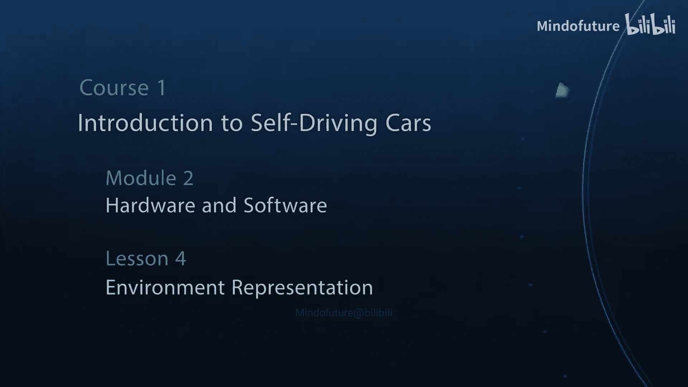
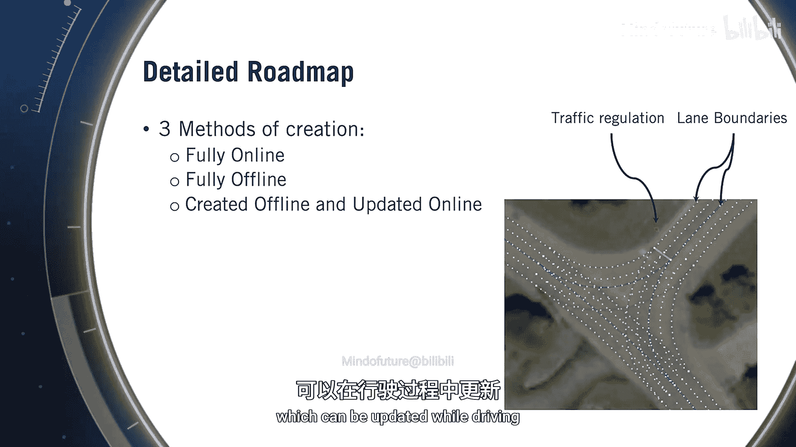
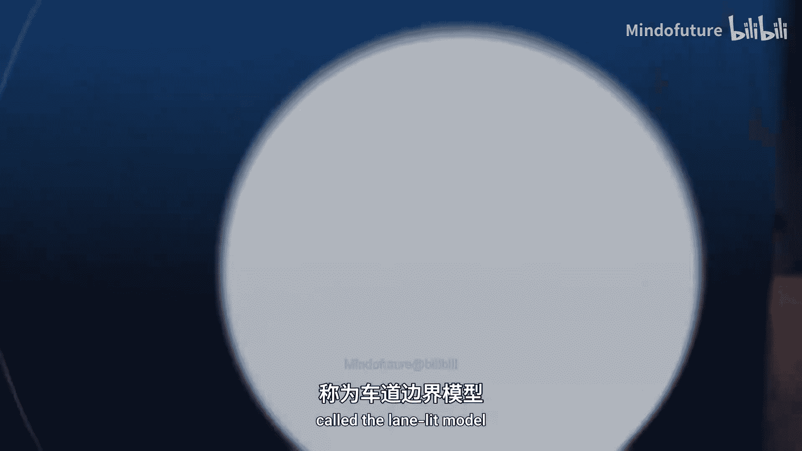
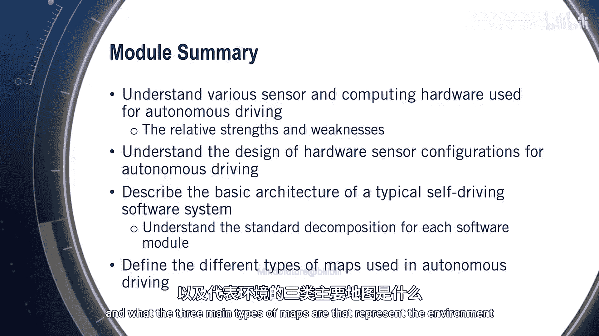

# 【多伦多大学】自动驾驶汽车简介 ｜ Intro Self Driving Cars p18 P18_第四课-环境表征_03_01_07 -BV1mRsHzHETY_p18-

In this lesson we'll take a closer look at the maps created to represent the environment around our car。

 I'll present an overview of the three different map types traditionally used for autonomous driving。

 which you saw briefly in the previous video then I'll give you a more detailed explanation about each of the maps so you can better understand how they are created and used throughout the specialization。

The first map we will discuss is the localization map。

This map is created using a continuous set of Liar points or camera image features as the car moves through the environment。

This map is then used in combination with GPS， IMU and Wow Doometry by the localization module to accurately estimate the precise position of the vehicle at all times。

The second map is the occupancy grid map。The occupancy grid also uses a continuous set of LiDarR points to build a map of the environment。

 which indicates the location of all static or stationary obstacles。

This map is used to plan safe collision free paths for the autonomous vehicle。

The third and final map that we'll discuss in this video is the detailed roadmap。

It contains detailed positions for all regulatory elements， regulatory attributes， and lane markings。

This map is used to plan a path from the current position to the final destination。

Let's take a closer look at the localization map。As I mentioned previously。

 the localization map uses recorded LiDar points or images which are combined to make a point cloud representation of the environment。

As new LiDar or camera data is received， it is compared to the localization map and a measurement of the ego vehicle's position is created by aligning the new data with the existing map。

This measurement is then combined with other sensors to estimate egomotion and ultimately used to control the vehicle。

Here we have some recorded LiIDAR data from our self driving car。

The movement of the vehicle is clear based on the evolution of the LiDar points in this video as the car drives out of a driveway and onto the street ahead。

This detailed evolving representation of the motion of a car through its environment is extremely valuable for the localization module。

The localization map can be quite large and many methods exist to compress its contents and keep only those features that are needed for localization。

The construction of this map will be more rigorously explained in the next course of this specialization。

Where we discuss localization in detail。The occupancy grid is a 2D or 3D discretized map of the static objects in the environment surrounding the ego vehicle。

This map is created to identify all static objects around the autonomous car once again using LiDarR point clouds as our input。

The objects which are classified as static include trees， buildings， curbs。

 and all other non drivable surfaces。For example， in this grid map。

 if all occupied grids were colored in， this is what the occupancy grid may look like。

As the occupancy grid only represents the static objects from the environment。

 all dynamic objects must first be removed。This is done by removing all lidDar points that are found within the bounding boxes of detected dynamic objects identified by the perception stack。

Next， static objects which will not interfere with the vehicle are also removed。

Such as the drivable surface or any overhanging tree branches。As a result of these two steps。

 only the relevant Liar points from static objects in the environment remain。

The filtering process is not perfect， however， and so it is not possible to blindly trust the remaining points are。

 in fact， obstacles。The occupancy grid therefore represents the environment probabilistically by tracking the likelihood that a grid cell is occupied over time。

This map is then relied on to create paths for the vehicle which are collision free。

Both the creation of this map and its application to the local planning problem will be covered in much greater detail in Co 4 of this specialization。

Let's look at an example of an occupancy grid updating over time。

Here we see the occupancy grid visualized as the light gray square area under the autonomous car。

 updating the position of static objects in the environment with black squares。😊。

As the autonomous car moves through the environment。

 all stationary objects in the environment such as poles， buildings and parked cars。

Are shown as occupied grid cells。Finally， the detailed roadmap is a map of the full road network。

 which can be driven by the self driving car。This map contains information regarding the lanes of a road as well as any traffic regulation elements which may affect them。

The detailed roadmap is used to plan a safe and efficient path to be taken by the self driving car。

The detailed roadmap can be created in one of three ways。Fully online。Fully offline。

Or created offline and updated online。A map which is created fully online relies heavily on the static object of the perception stack。

To accurately label and correctly localize all relevant static objects to create the map。

This includes all lane boundaries in the current driving environment。

 any regulation elements such as traffic lights or traffic signs。

Any regulation attributes of the lanes such as right turn markings or crosswalks？

This method of map creation is rarely used due to the complexity of creating such a map in real time。

A map which is created entirely offline， is usually done by collecting data of a given road several times。

 specialized vehicles with high accuracy sensors are driven along roadways regularly to construct offline maps。

Once the collection is complete， the information is then labeled with the use of a mixture of automatic labeling from static object perception and human annotation and correction。

This method of map creation， while producing very detailed and accurate maps。

 is unable to react or adapt to a changing environment。

 The third method of creating detailed road maps is to create them offline and then update them online with new relevant information。

😊，This method of map creation takes advantage of both methods， creating a highly accurate roadmap。

 which can be updated while driving。

In Course 4 on motion planning， we will present a method for storing all of the information present in a detailed roadmap called the Lanelet model。

Let's look at an example of a detailed roadmap。As you can see。

 the lane boundaries of the detailed roadmap are visualized in red。Along with the boundaries。

 the center of each lane is also visualized in red。

 This information is vitally important for path following。

 as it provides a default path along a lane。As you can see in this video。

 the vehicle while autonomously driving neatly follows the center of the lane。

That completes our discussion of mapping for self driving cars。 In this video。

 you learned about three types of maps commonly used for autonomous driving， the localization map。

 the occupancy grid， and the detailed roadm。You'll study each of these map types further as we dive into localization。

 collision avoidance， and motion planning in the remaining courses of this specialization。

Congratulations， you completed the second module in this introduction to Self Driving Cars course。

In this module， you learned how to select sensing and computing hardware in self driving cars。

How to design a specific sensor suite based on the requirements of driving。

How to decompose the software system for autonomous driving。

And what the three main types of maps are that represent the environment。

In the next module， we will take a closer look at the vehicle modeling for the purpose of precision control。

I'll see you in the next module。

