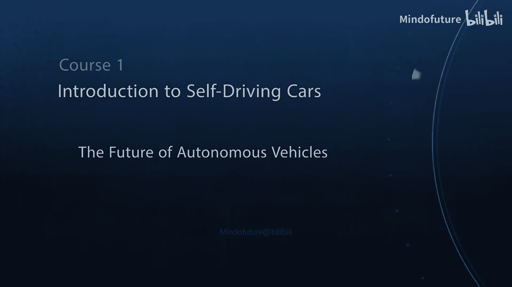
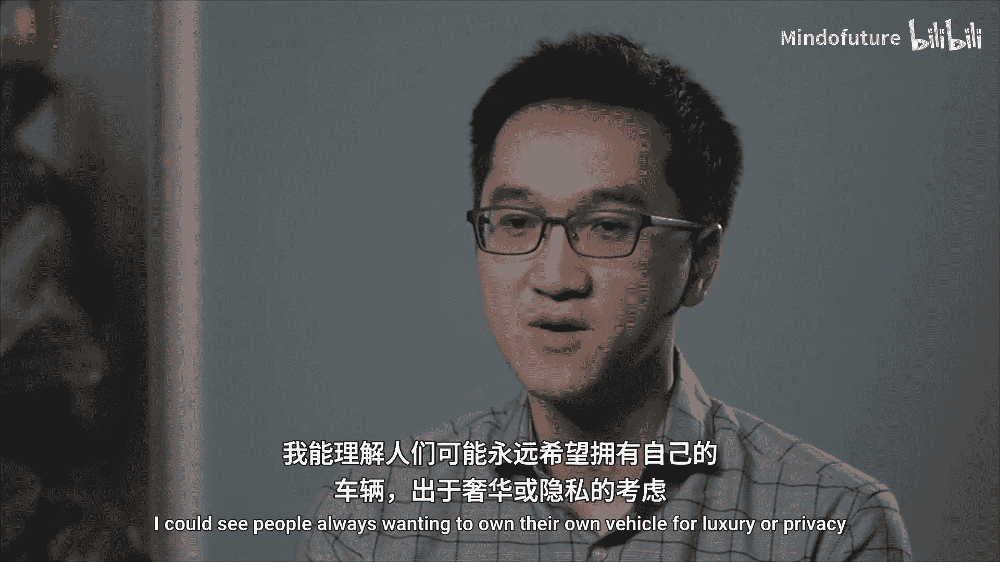

# 【多伦多大学】自动驾驶汽车简介 ｜ Intro Self Driving Cars p19 P19_自动驾驶汽车的未来_03_02_01 -BV1mRsHzHETY_p19-

How do I see the world of autonomous vehicles evolving， Well， it's not， I think。

 an industry where suddenly you nail it。 you know， it's it's kind of like an analog of computers。

 We haven't finished computers， no one says。When will we have computers。Its it's not done。

 It's something that gets better over time。 just like computing and software is。

 this is a big endeavor， and it starts now and it's never going to stop。

 So every year they're going to be getting better。 They're going to getting smarter。

 I think it's an interesting play， because this time， it's software。

 not the arrangement of steel atoms that makes the play that makes the difference。

 And there's something extraordinary about the way that software is so nonlinear in the impact that they can have。

 You know， it doesn't cost much to copy software， but it does cost the finite amount to make another imprint of a car that costs something。

 So there's something quite extraordinary there。😊，That's coming through。

 So it's a great space to be working in because you can write software that doesn't require a steel plant。

 and you can have an impact on transport on transport。 And I think that's absolutely remarkable。

 We haven't really seen that before。 You had to like。😊。

Own an oil and gas field or a car factory and all the rest of it to make an impact in transport before。

 And now it's because you can write text files。 That's something quite extraordinary。

 The industry is very new。 and but the future is very bright。

 And as for how will Zs compete with the automotive OVMs that are already out there working on this。

😊，I think that Zs is unique in its approach and I think that solving the self-driving vehicle challenge isn't just an automotive challenge by removing the human you have to build in so much extra redundancy and you have to have so much extra software to make that work that you have to both look at the automotive industry the automotive engineering as well as looking at aerospace and computer science and software engineering and so Zs is really set up for that because it was born to do that it was born to build the。

Vehicle from the ground up and it。Has had that mission the entire time。

 it's very focused on that mission and so it's less encumbered by what some of the larger Oems would have especially since they've starting mostly with just auton are just automotive engineering I see the self-driving industry really taking off because there' it's this convergence of two things autonomy and ride sharing right now cars are utilized maybe 5% of the time so that means that 95% of the time they're sitting in your driveway。

 they're sitting in a parking lot at work。And the the beauty of self thriving is that we're able to take。

These autonomous vehicles and have them out on the road for the majority of the day and to be able to move more riders with less vehicles I could see the industry going to waves in terms of personal ownership or transportation as a service I see arguments for both and perhaps the reality is in the future we'll see a combination of both I could see people always wanting to own their own vehicle for you know luxury or privacy reasons and also accessible transportation would benefit greatly from autonomous technology so it's very likely that we'll see both in on the horizon A question that often comes up around AVs is when will I be able to buy one。

It's a very reasonable question。😊，I think we will first experience them by not buying one。

 but by getting a ride in one in certain areas， in certain cities。

So that's the geofencing argument that the vehicles will first appear working in an area of a city that they're well rehearsed and well practiceract and you know a lot about how that city changes and its lighting conditions and when it gets busy and where the really。

 really hard turnings are and they'll be like fancy buses a transport service in a city。😊。

But the question that actually people want me to answer is。😊，When will I be able to buy， you know。

 walk into a forcot of a car sales room and I'll have the one with no steering wheel and no windows。

Which is basically what a full L5 system would be like no human is needed ever and the vehicle can go wherever。

 whenever， whatever the weather。😡，Anywhere and you never have to worry about not getting there。

 so it has the same functionality that your car does now， and it's a consumer piece of tech。

That's a long way off because the complexity of driving。😊。

Many of the difficult situations have got nothing to do with your driving test at all。

 you solve this random problem that's because you're a human you go oh I know what to do there and it might be the only time ever driving that problem ever arises and you solve it in that way。

They actually reverse around it and go oh， it's a plastic bag。

 And it's going to drive over that cardboard box because I think it really is just cardboard。

 or there's some cows on the road and I'm going to wait for them to pass because they're going to pass any number of things。

 Those are really， really hard problems or dealing with the twos and blues coming up behind and pulling off up onto the sidewalk because you know that the person has also clocked that there's a siren coming behind。

 So they're not going to be alarmed that you're driving at them on the sidewalk。

 And there's some sort of social contract between the two of you。

Look I could go on with all the interesting corner cases that we as humans solve。

 but to have a vehicle that， you know， to five sigma takes you from wherever you are to wherever you want to go any time of day。

 any weather， any country， anywhere。And you have the same confidence you do in in the vehicle that you buy now that you can do that。

 That's a long， long way away。 And that's great。 That's like saying when do we have the best computers ever。

 Well， it just gets better every day。 You can't answer that question。😊。

But that doesn't mean that we don't transform transport before that。 Yeah。

 so cars didn't go everywhere to start with。But they've got better and better and better。

