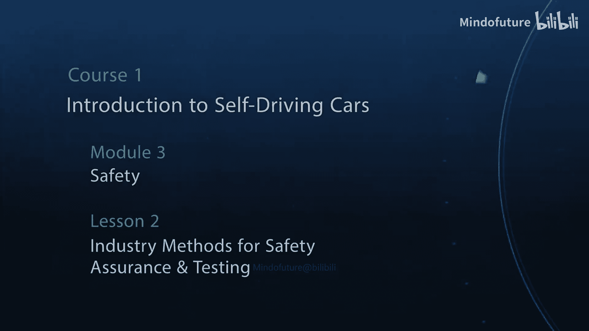
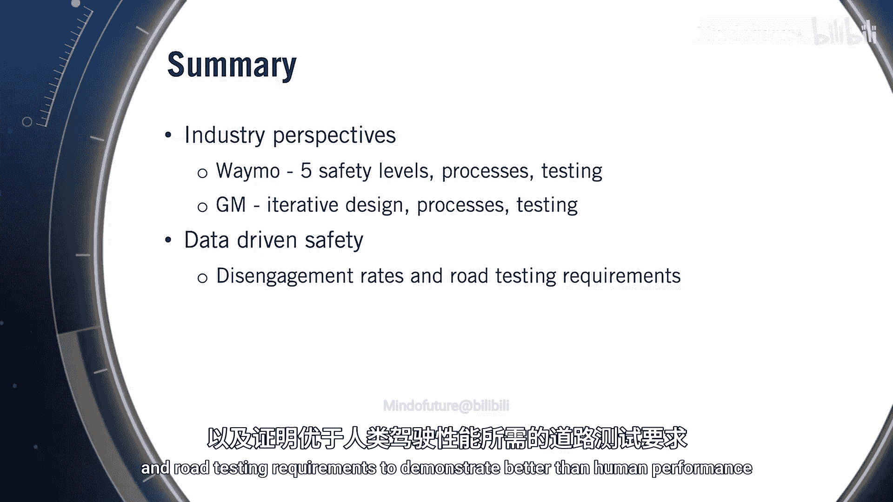

# 【多伦多大学】自动驾驶汽车简介 ｜ Intro Self Driving Cars p21 P21_第二课-行业安全保证与测试方法_04_01_03 -BV1mRsHzHETY_p21-

Welcome to the second lesson this week。In this lesson。

 we will discuss the various industry perspectives on safety and testing。Specifically。

 we'll first analyze the safety perspectives of two big names in the industry， Waymo and G M。

And then we'll discuss two different approaches to assessing safety， analytical versus empirical。

 let's begin。As we saw in the last video， the NHTSA requested that each self driving developer should develop and describe a comprehensive safety strategy that covered the 12 concepts included in their guidance document To date。

 two prominent reports have emerged from Waymo and G M。😊。

And we'll use both as our basis for our discussion of industry approaches to safety。

The Waymo safetyfety report was released in 2017 and has a lot of great insight into how to organize a comprehensive safety strategy for self driving cars。

Wmo covers all 12 of the NHTSA concepts， but organizes them into a five level safety approach。First。

 Waymo systems are designed to perform safe driving at the behavioral level。

 This includes decisions that follow the traffic rules can handle a wide range of scenarios within the ODD and maintain vehicle safety through it。

Second， Waymo ensures that the systems have backups and redundancies。

This is so that even if a fault or failure occurs， the car can switch to a secondary component or a backup process to minimize the severity of failures and return the vehicle to a safe state。

 continuing the drive if possible。This is referred to as functional safety。Next。

 Waymo emphasizes crash safety as recommended by the NHTSA。

It designs systems that ensure minimum damage to people inside the car in the event of a crash。Next。

 it tries to ensure operational safety。So that means its interfaces are usable and convenient and intuitive。

The focus here is on allowing passengers to have some level of control over the vehicle。

 but only in ways that maintain system safety。Finally， Waymo fosters non collision safety。

This refers to system designs that minimize the danger to people that may interact with the system in some way。

 First responders， mechanics， hardware engineers and so on。

These five pillars form Waymo's safety by design system and leads to a system of extensive requirement definition。

 design iteration， and testing to ensure that the objectives of the system are met by each component。

The process uses several tools from existing domains and will go into more details of these tools in the next video。

At the outset， the Waymo team identifies as many hazard scenarios as possible and analyzes possible mitigation strategies for each。

 that is how to ensure that the vehicle can still reach a safe state when a hazard occurs。

Then they use a hazard assessment method to identify more specific safety requirements。

The various methods they use are preliminary analysis of possible safety risk。

 a fault tree hazard assessment which works from the top down in terms of the dynamic driving task。

And some design failure modes and effects analysis， which works from the bottom up。

 assessing the effects of small subsistent failures on the overall capabilities of the system。

Finally， they perform lots of testing to ensure that the requirements are met。

Let's discuss the kind of testing procedures that Waymo follows specifically to evaluate its software。

 as it is the most publicly visible and well documented program out there。First。

 they test all software changes in simulation on the order of 10 million miles of simulation per day。

This represents an enormous computing effort running continuously to confirm the expected improvements to safety requirements for the system。

To do this， they mine all of their on road experiences for challenging scenarios and perform systematic scenario fuzzing。

Which changes the position and velocity parameters of other vehicles and pedestrians randomly so they can test if the ego vehicle behaves safely throughout all of them。

This approach is particularly useful for finding hard edge cases with hard to resolve time gaps for merging or crossing intersections。

 for example。Then they do closed course testing in which they test their software on private tracks。

They cover 28 core scenarios， as identified by an UC Berkeley study。

 as well as 19 additional scenarios that Waymo added。

These scenarios are organized around avoiding the four most common accident scenarios。

 which are rear end intersection， road departure and lane change。

There are obviously many variations of each of these categories。

 but together they account for over 84% of all crashes。And finally， they do real world testing。

 which are regularly seen on the streets of many different cities in the United States。

 including Mountain View， California， right near the main Google campus。

This testing allows them to identify more and more cases that are out of the ordinary。

And primarily rely on the dynamic driving task fallback strategy of having humans monitor the autonomy software during testing。

The combination of these strategies for testing is by no means unique to Waymo。

 but has emerged as the de facto standard as it provides the maximum flexibility and feedback for a fixed investment。

Focusing each test method on what it does best， simulation on manipulating scenarios that make them hard。

 closed course testing on confirming specific gains and safety performance and real world testing on finding ever more challenging scenarios and increasing public confidence in the technology。

Okay， now let's turn our attention to the safety ideology for General Motors。

 who acquired cruiseise automation in 2016 and has propelled itself to a leading position in self driving development as a result。

GM's strategy follows the NHTSA safety framework very closely and addresses each of the 12 main areas individually。

GM's safety strategy does not try to reorganize or simplify the NHTSA guidance。

 but instead focuses on its implementation strategies for achieving the required safety assessments。

First and foremost， GM emphasized their iterative design model。In which they first analyze scenarios。

 then build software， then simulate the scenarios and test their software。

 and finally deploy their software on real world cars。

And they keep adding improvements and refinements to both the requirements and the autonomous system iteratively。

Second， whereas Waymo relies on OEs to design its vehicles and only discusses mechanical and electrical hazards related to its autonomy hardware。

 GM manufactures their cars entirely themselves and so can enforce a more integrated design with consistent quality standards throughout the self-driving hardware。

Next， GM ensures safety through a comprehensive risk management scheme。

They identify and address risks and try to eliminate them completely and not just mitigate them。

Finally， all their systems follow their internally well definedfined standards of safety。

 reliability， security， and so on， they have years of experience of developing vehicles in the automotive industry and have developed extensive safety processes as a result。

Their safety processes involve three types of analysis。First。

 they performed deductive analysis through the fault3 method and pinpoint components that could possibly have faults and address them。

Next， they perform inductive analysis through Design FMEA。

So they do a failure modes and effect analysis on their design proposals and try to ensure safety from the bottom up。

And finally， they employ hazard and operability studies to perform exploratory analysis and figure out when the system may potentially not work as expected。

Now this may all sound familiar， and indeed these are the same pillars of analysis that Waymo describes。

In the next video， we'll go through more details on how these methods actually work。

Let's talk about safety thresholds in GM vehicles。All GM vehicles have to follow two critical safety thresholds at the very least。

First， GM defines a clear set of fail safefes， backup systems and redundancies for different components so that the system continues to work even after a failure。

Second， the components must pass the SotIF evaluation。

 which we'll discuss in more detail in the next video。With this evaluation。

 we ensure that all critical functionalities are evaluated in both known and unknown scenarios。

And finally， GM follows a rigorous testing mechanism consisting of performance testing。

 requirements validation， fault injection， intrusive testing。

 and durability tests and simulation based testing。

Both these companies rigorously follow safety standards and are therefore great examples of how to do safety practically and effectively。

So we now have a clearer picture of how safety assessment is performed in industry。

 but we're still left with this question。Is it really possible to truly precisely assess whether an autonomous car is safe？

Or at least safer than a human driver。Let's discuss the various approaches that can be used to assess the safety of an autonomous driving system。

We have two possible approaches， analytical or data driven safety assessment。

By analytical safety assessment， we mean that the system can be analyzed to define quantifiable safety performance or failure rates based on critical assessment of hazards and scenarios。

If the overall system failure rates can be determined through analysis。

 it can provide strong guidance on which aspects of the system are the biggest contributors to overall safety。

A great example is the space shuttle program， for which initial estimates of analytical failure rates were pegged at one in 100。

000 flights。After the program ended， however， a forensic study revealed that early shuttle program flights had failure rates closer to one in 10。

 and that this only progressed to one in100 by the end of the program。

It is a marvel that such analysis is even possible for such a complex system when considering all of the thousands of subsystems that go into a shuttle launch and all of the millions of variables that can affect the operations of these systems。

This sort of detailed analysis is also applicable to self driving cars。

 but may arguably be more complex due to the infinite variety of situations a vehicle can find itself in。

In the end， analytic methods can only provide guidance on the safety performance of the self driving system。

 and their results need to be validated through experience。To evaluate experience。

 we use data driven testing。This is the concept whereby we are assured that the system is safe because it has demonstrated that using a specific version of the software。

 it can achieve desired failure rates on a set of roads and scenarios that are included in the operational design domain。

In the case of self driving， these desired failure rates can be tied to human level driving performance。

 where we hope to reduce accidents by 10x or 100x over the performance of today's drivers。

So what does the data say， are autonomous cars actually safer？First。

 know that driving is still dangerous by human standards。

 a report in 2015 concluded that of all the fatalities in driving。

 about 90% of these occurred due to human errors， sometimes through a lack of judgment。

 sometimes through a failure of human perception， etc。But humans are also extremely good at driving。

 and indeed the entire driving environment has been designed based on human perception and planning abilities。

In the United States， there is roughly one fatality per 146 million kilometers driven。

 one injury per 2。1 million kilometers driven， and approximately one collision per 400。

000 kilometers。This last number is only estimated as most smaller collisions are not actually reported。

In fact， autonomous driving may do a lot to shed more light on these statistics。

 as much more comprehensive reporting and reconstruction will be possible with the additional sensors available to us。

Now let's consider the preliminary self driving vehicle statistics， more specifically。

 the disengagement rates published by all autonomous driving vehicles being tested in California。

A disengagement is when either the autonomy software requests the driver to take over control or the safety driver feels the need to intervene。

It is understandably challenging to get true crash statistics for the entire fleets being tested。

 as these are sensitive statistics。Fortunately， testing in California comes along with some useful reporting requirements。

In 2017， Waymo drove 563000 km in California and experienced 63 disengagements for a rate of roughly  one disengagement every 9000 km。

😊，GM Cruise drove 210，000 kilometers in California with 105 disengagements for roughly one every 2。

000 kilometers。Both were improving quickly throughout the year。

 reaching disengagement rates of once every 12500 km and every 8300 km， respectively。

 for the last three months of the year。These are hard numbers to relate to in terms of humor performance。

 but roughly mean that a typical commuter would only have to intervene once a year for a failure of the autonomy system。

This is enormous progress， but also still a ways off from the 400。

000 kilometers between crashes that humans achieve on trillions of miles every year。

The primary causes of the 63 Waymo disengagements in order of frequency。

Were unwanted vehicle maneuvers， perception discrepancies， hardware issues， software issues。

 behavior predictions。 and finally， a single case of a reckless road user。

It's clear that the core tasks of perception， prediction。

 and behavior planning remain challenging problems， and much work still needs to be done。Lastly。

 a word about statistical significance。The performance observed from today's fleet are impressive。

But how well do they represent an accurate comparison to human capabilities。

 How many miles do we really need to drive to demonstrate autonomous vehicles are safer than human drivers。

Particularly in terms of fatalities。In the supplemental material。

 we've included a link to a report by Rand Corporation that attempts to address this question。

And the numbers are startling。Since fatalities are such rare events and with numerous factors under consideration。

 the report states that upwards of 8 billion miles would be needed if pure on road testing is used to validate the safety case for a self-driving system。

It would take at least 400 years to do so with a fleet of 100 vehicles traveling 247。

 that's a long time to wait。It is for this reason that we see such multifaceted approaches to safety。

And every company is expanding vehicle fleets to increase the experience gained with autonomous systems on the road。

To summarize in this video， we looked at two industry perspectives on autonomous driving safety assessment。

 Waymo and G M， and found many methods borrowed from other industries。

 And we discussed the current disengagement rates and road testing requirements to demonstrate better than human performance。

 In the next lesson， we'll explore a few of the most commonly used safety framework and methodologies。

 We'll see you there。

