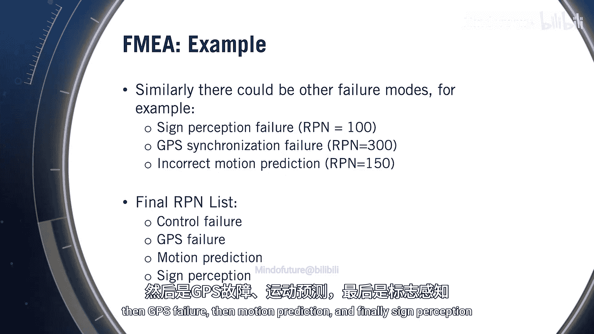
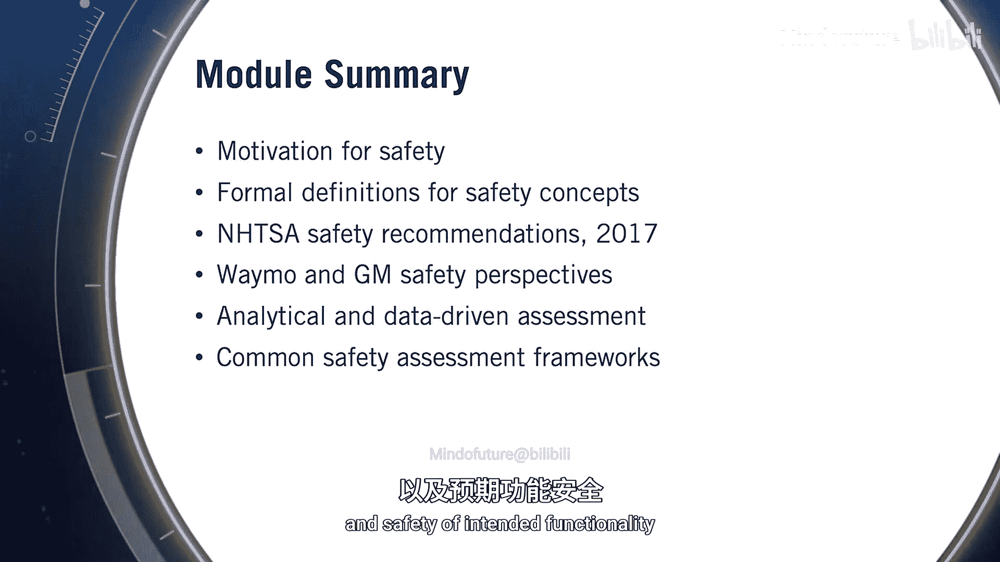

# 【多伦多大学】自动驾驶汽车简介 ｜ Intro Self Driving Cars p22 P22_第三课-自动驾驶安全框架_04_01_05 -BV1mRsHzHETY_p22-

Welcome to the final video of this week。In this video。

 we will discuss some popular safety frameworks， some of which we encountered in the last lesson。

More specifically。We will describe some generic analytical frameworks， including fault trees。

 failure modes and effects analysis， or FMEA， and hazard andoperability analysis or HSO。

Then we will focus on automotive and autonomous safety frameworks。

And discuss functional safety or FusSA。And safety of intended functionality， or soif。

We'll define these terms later on in the video。Let's begin。

We'll start off with faultult tree analysis Fult trees can be used as a preliminary analysis framework and can be steadily expanded to encompass as much detail as necessary。

Falult trees are top down flows in which we analyze a possible failure of a system to be avoided and then identify all of the ways in which it can occur from events and failures at lower levels of the system。

The top node in a fault tree is the root or top event。

The intermediate nodes in the fault tree are logicates that define possible causes for the root event。

The decomposition continues to a level of detail for which a probability of such an event can be defined。

The fault tree can then be analyzed by combining the probabilities using the laws of Boolean logic。

To assess the overall probability of a root cause event and the causes that most contribute to its occurrence。

Let's consider a simple example and take a car crash as our root event。

The cause of a car crash could be broken down in2。Either a software failure or a hardware failure amongst many other possibilities that we've described as hazard classes in our earlier videos。

And very crudely， the hardware failure could be because of manufacturing defects or material imperfections。

 for example。Similarly， a software error could be due to malfunctioning perception code or some cybersecur problem。

 say if we were hacked。From there， we can proceed to software subsystems and specific calculations within those subsystems deepening the tree at each successive branching。

Ultimately， we'll arrive at specific failure rates for which we can assign probabilities of occurrence per hour or per mile of operation。

We have now arrived at the leaf nodes of the fault tree。And then using the logic gate structure。

 we can explicitly compute statistics of overall failure rates。

 given assessments of the individual leaf node failure rates。

The operations used to propagate these probabilities upwards would be the same as the rules of probability when events follow set theory。

So， for example， for independent events， the or and an probabilities would be the sum or product of children node probabilities。

This is the general idea behind fault trees， which are referred to as probabilistic fault trees when probabilities are included at the leaf notes。

Probabilistic fault trees are a top down approach to safety that has been widely used in the nuclear and aerospace industries and can similarly be applied to autonomous driving。

The challenge lies in building a comprehensive tree and in correctly identifying the probabilities of the leaf node events。

Let's now look at FMEA， which stands for Fail modes and Eect Ana。

Whereas fault trees flow down from a system failure to all of its possible causes。

 FMEA is a bottom up process that looks at individual causes and determines all the possible effects that might occur。

Often， FTAs and FMEAs are used together to assess safety critical systems。

Failure modes are modes or ways in which a particular component of the overall system can cause the system to fail。

An effects analysis refers to analyzing all the possible effects these mode failures can cause。Often。

 the effects analysis seeks to identify those modes that bring about the most critical failures。

Which can then lead to improved designs that add more redundancy or higher reliability to the system。

Let's come to the big idea behind FMEA。The goal is to categorize failure modes by priority。

 So we ask questions like。How serious are the effects？How frequently do these failures happen？

And how easy is it to detect these failures。And then we quantify all the failures using priority values。

 and we start addressing the failures with the highest priority first。Here are the steps。

 The goal is to construct a table of all possible risky situations， and we start off by。First。

 discussing with field experts in identifying processes at the level of detail we want in the table。

Then we question the purpose of the system and list all failure possibilities。

Then for each failure possibility， we identify the possible consequences and assign each consequence a severity rating between1 and 10。

 10 being the most severe。For each consequence， we identify the possible root causes。

 and for each root cause we assign another number between one and 10 to denote how frequently this cause occurs。

Then we identify all the ways in which the failure mode can be detected by operator。

 maintenance inspection or a fault detection system。

We assess the overall mode detection likelihood before it causes an effect and assign another score from one to 10。

 with one being guaranteed to be detected and 10 being impossible to detect。And finally。

 we compute a final number called the risk priority number， which is the product of the severity。

 the occurrence， and the detection， and the higher this value is， the higher the priority is。

Eventually， we address the most problematic failure modes by modifying our implementation of the system until we reduce the risks to an acceptable level。

It is also possible to perform FMEA with actual failure probabilities， as in faultry analysis。

 and to define acceptable risk levels in terms of the likelihood of a critical event occurring over a fixed period of operation。

The method doesn't change just the meaning of the numbers and the complexity of completing the entire analysis。

Let's stick with a simple scoring approach and make the FMEA process more concrete with a brief example。

Consider。A specific failure where the vehicle has driven onto a gravel patch that appears in its test area due to road construction。

 which leads to controller instability。The worst case effect could be a physical crash。

 which would be severity 10。It might also lead to driver discomfort or a near miss。

 but these would be lower severity events。This event could happen regularly in urban environments。

 wherever construction of a particular type occurs， so it is somewhat likely。

 let's say we're able to assess the occurrence number at 4。Similarly。

 we can assign occurrence scores to the other effects。

And let's assume this problem is not currently detectable as the road surface texture is not actively monitored during operation of our autonomy software。

So detectability would be at number 10 for all of these effects。

The risk priority number for a crash would then be 10 times 4 times 10， which is 400。

And in the same way， we could have other failure modes as well。

Asign perception failure with a priority number of 100， let's say。

A GPS synchronization failure with a priority number of 300。

And maybe a vehicle motion prediction failure with a priority of 150。

And so we would go about addressing these failures in implementation by focusing on driving on gravel。

 then GPS failure， then motion prediction and finally sign perception。

And so this is the general framework behind FMEA。FMEA is a risk assessment idea that was developed by the military and aerospace industries and later brought to the automotive industry。

It provides a really structured way to quantify risks and deal with them， the most important first。

Lastly， a common variation on FMEA that appears frequently is the H and Operability studyy or HSO。

Has opP is more of a qualitative process as compared to FMEA。

 where we seek to define the risks quantitatively。So in Hazop。

 the main purpose is to brainstorm effectively over the set of possible hazards that can arise。

For complex processes， the risks can be assessed without having to assign specific values to occurrence。

 severity and detection， which may be hard to do。 Haazop is often used earlier in the design process to guide the conceptual design phase。

The key addition in Hazop is that guide words are used to lead the brainstorm applied to each system requirement。

 These guide words include things like not more， less， early， late。

 and lead to possible failure modes that might not otherwise be considered。

So think of HazopP as a simplified ongoing FMEA brainstorming approach。

Let's now focus on a more specific type of safety and discuss existing safety frameworks for automotive and low level autonomy feature development。

 which are often used in assessing hardware and software failures in autonomous vehicles。

In particular， let's discuss the functional safety approach described in ISO 26262 and the safety of intended functionality approach。

 which extends on ISO 26262 and is defined in ISO par 21-448。1。

We won't be able to go into significant detail on either process。

 but have included links to supplemental materials if you'd like to learn more。

Functional safety or fusa is the absence of unreasonable risk from malfunctioning behavior caused by failures of the hardware and software in a car。

 or unintended behaviors arising with respect to its intended design。

The IO262 standard defines functional safety terms and activities for electrical and electronic systems within motor vehicles。

And as such addresses only the hardware and software hazards that can affect autonomous vehicle safety。

The standard defines four automotive safety integrity levels or ACL。

 with ACL D being the most stringent and A being the least。

Each level has associated with it specific development requirements that must be adhered to for certification。

The functional safety process follows a V shaped flow。

 starting at the top left with requirement specification， then analysis of hazards and risks。

 and proceeding to implementation of functionality。

We then climb up the right branch to confirm the design goals have been met。

We start with low level verifications such as software unit tests and then proceed to subystem and full system validation through simulation。

 test track operations and on road testing。As we descend the V on the left。

 high level requirements turn into low level implementations， and as we climb the V on the right。

 we confirm each low level function implementation before combining them to confirm system requirements for safe operation。

The final step is a summary functional safety assessment to evaluate residual risk and determine if our system has reached an acceptable level of safety。

At the start of the functional safety V， we use HA or hazard and risk assessment。In Ha。

 we identify and categorize hazardous events and specify requirements to avoid unreasonable risk。

And this process drives all of the system development and testing beyond this point。To do so。

 we first identify possible hardware and software faults or malfunctions and unintended functions that can affect car safety。

This is where FMEA or HSOP are used in the functional safety framework and leads to a specific set of hazards to our system。

We then define a list of scenarios or situations that the system must operate in。

 drawing on our ODD to create this list。Next， we combine hazards and situations into hazardous events。

 describe expected damages and determine risk parameters to calculate numerical values of potential risk for each combination of situation and hazard。

After the risk assessment， we choose the highest risk scenarios。

 the worst case events that can happen with respect to each possible malfunction。And then finally。

 we define our safety requirements based on these worst case scenarios。

The HA process sets the design goals for the system in a way that is aware of all of the worst case failures that can occur。

 and through validation confirms that these worst case failures are handled with only reasonable risk。

And this is the main idea behind functional safety。

You focus on worst case requirements and then implement hardware and software that can at least handle these worst case requirements。

Finally， let's briefly explore the safety of intended functionality standard or SoTF。

Which is formally defined in the ISO PassS 21448 document。

SotifF is specifically concerned with failure causes related to system performance limitations and predictable misuse of the system。

Performance limitations are insufficiencies of the implemented functions due to technology limitations。

 such as sensor performance limitations and noise， or limitations of algorithms such as object detection failures and limitations of actuator technology。

Hardware and software failures are addressed by the functional safety standard in ISO 26262 and are out of the scope of SoTF。

SoTF also addresses unsaaffe actions due to foreseeable misuse by the user， such as user confusion。

 user overload and user overconfidence， The current SoTIF standard targets automation levels 0。

1 and 2， and it also states that its methods can be applied to levels 3，4 and 5 autonomy。

 but additional measures may be required。SoTifF can be seen as an extension of the functional safety process。

 specifically designed to address the challenges of automated driving functions。As such。

 it follows very much the same V shaped development philosophy， but with augmented components。

Sotif also employs Hara to identify the hazards that arise from performance limitations and misuse。

And then performs a similar sequence of design， unit testing。

 and verification and validation to confirm the safety requirements have been met。

If you'd like to dive deeper into either the functional safety or SoTF standards。

 please check out the links in the supplemental materials。

Let's summarize what we've learned about in this video。

We started off with a discussion of generic safety frameworks。

Falultory analysis as a top down approach to safety assessment。

And failure modes and effects analysis as a bottom up approach to safety。

And then we discuss the ideas of functional safety。

 which are used commonly in software and hardware risk assessments。

And discussed SoifF as an extension to functional safety that accounts for performance limitations and misuse。

All of these ideas are used a lot in the industry， as we saw with both Waymo and GM。

 which use nearly all of these techniques in their safety assessments。Congratulations。

 you've made it to the end of this safety assessment module。

 let's summarize what we learned this week。We started off with discussions on why safety is important。

 specifically how a broad range of distinct failures can lead to self driving accidents。

Then we formally defined safety concepts and discussed the NHTSA's safety recommendations for autonomous vehicles。

We then discussed how Waymo and GM think about self driving safety。

And then we described analytic and data driven approaches to demonstrating safety。And finally。

 in today's video， we discussed common safety assessment frameworks including fault trees。

 failure modes and effects analysis， functional safety， and safety of intended functionality。

Hopefully this week give you insight into designing safe self driving systems and into properly assessing the systems you build。

Before we wrap up this week， we'll have a discussion with Professor Christtav Sarneki from the University of Waterloo。

 an expert on autonomous safety assessment。I have lots of interesting questions to ask， stay tuned。

