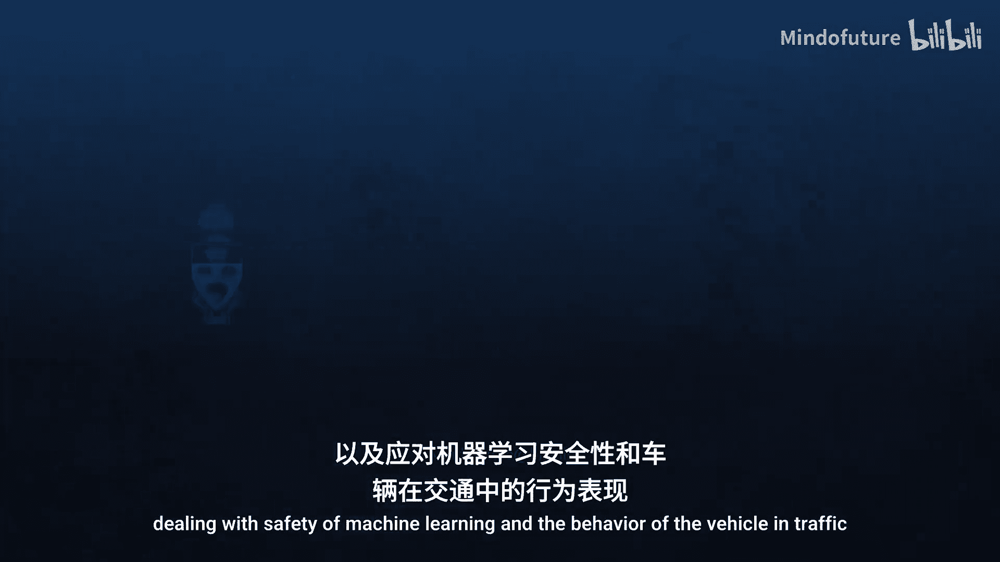
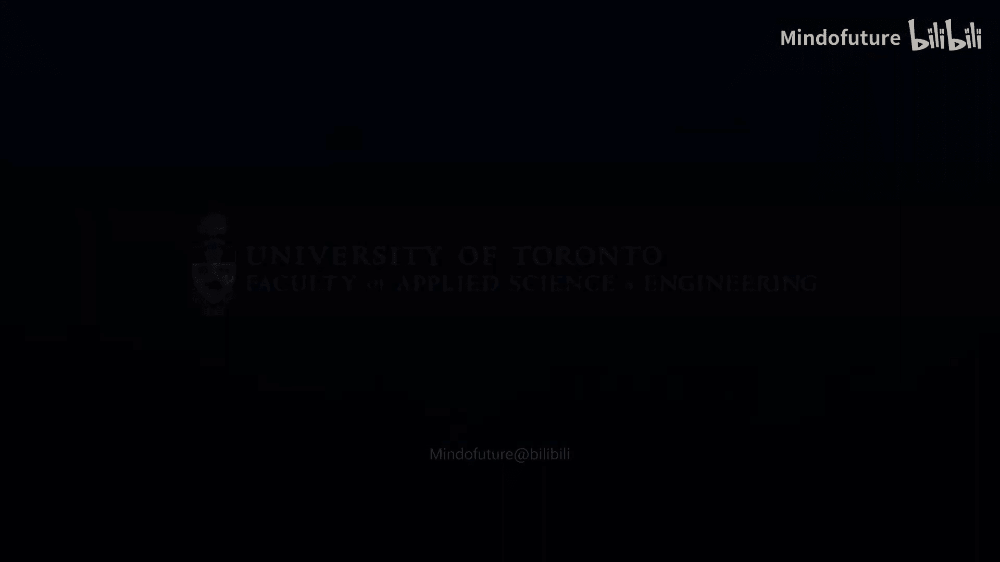

# 【多伦多大学】自动驾驶汽车简介 ｜ Intro Self Driving Cars p23 P23_认识安全保证专家克日什托夫·查内茨基教授_04_02_01 -BV1mRsHzHETY_p23-

Hi everyone and welcome to the self-driving car garage at the University of Waterloo。

 I'm here with my good friend and colleague Christtoof Chernnessky。

 and we're going to talk today about safety aspects of autonomous driving。

 Why don't we start a little bit with all the great things you've done in terms of safety design for autonomous vehicles I've worked for Daler research that's been 16 years ago and 12 years ago。

 I have a chance to。😊，Right in an autonomous vehicle the prototype， one of the early ones。 yeah。

 was pretty exciting When I arrived in Waterloo， I've worked on automotive software and CPT has been always an important topic in automotive software。

 mostly in terms of potential bugs。 essentially， you don't want to get the death of the screen of death。

 essentially in a vehicle while you driving at100 kilometersmet an hour， the outer bun。😊。

And for about two years now I've been working on autonomous vehicles and particularly the safety aspect of it。

 so focusing on architecture， the methodologies， design methodologies。

 dealing with safety of machine learning and the behavior of the vehicle in traffic。

