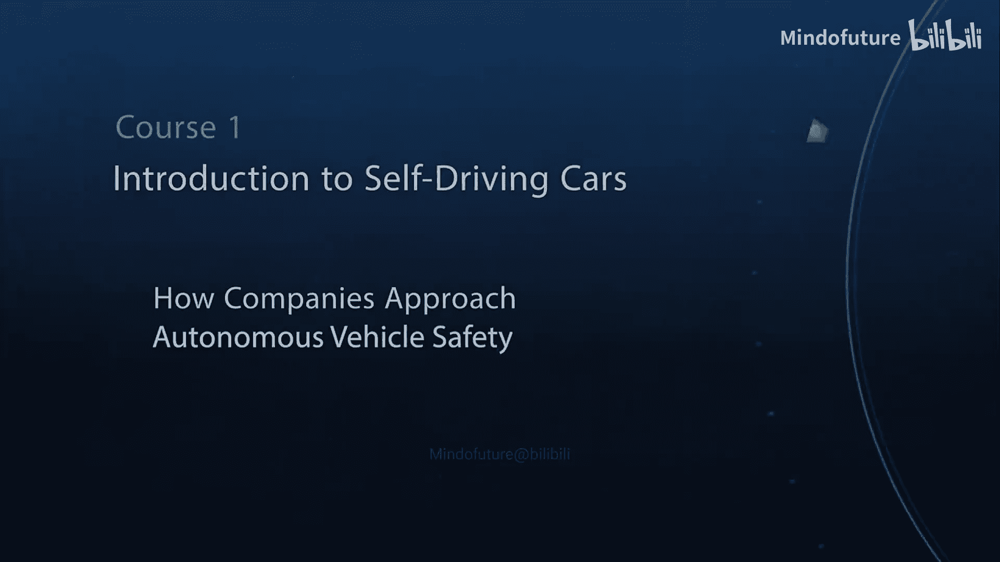
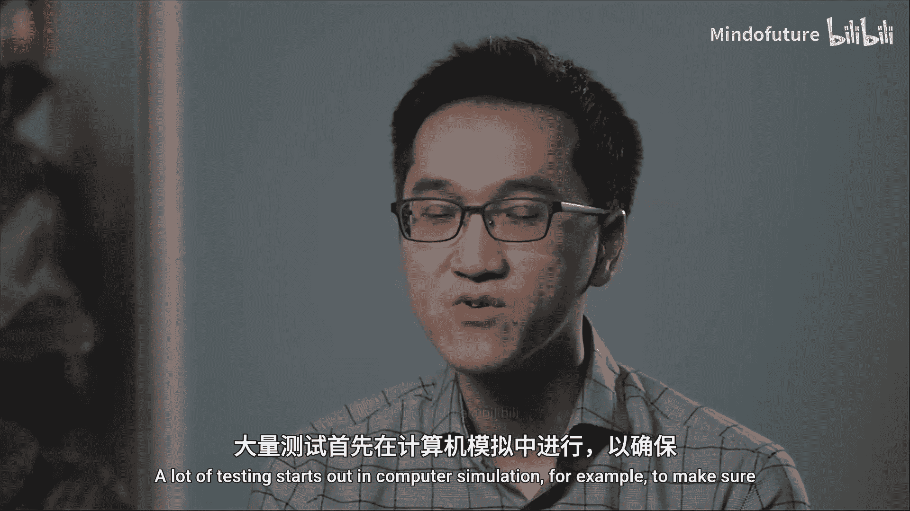

# 【多伦多大学】自动驾驶汽车简介 ｜ Intro Self Driving Cars p27 P27_企业如何应对自动驾驶汽车安全问题_04_02_05 -BV1mRsHzHETY_p27-

I see that the longterm benefits for autonomous driving is first off safety I hear of people who've been driving late at night and find that they've seen crashes or you drive home and everything's congested because someone maybe fell asleep at the wheel or they just bump the person in front of them and if you can get to a point if we can get to a point in society with autonomous vehicles as every vehicle out there。

 we shouldn't have any more crashes， we should be able to drive from point A to beat point B and be very safe about it and。

On top of that， hopefully congestion goes down， you should have less people on the road because you have these cars that all talk to each other and everyone's driving the same speed because there's no switching lanes constantly to get the faster lane。

Wwhich is what causes congestion a lot on top of construction and everything else On top of that。

 it also adds mobility for people who maybe can't drive themselves maybe they aren't able to get a license or inner our city it's just not practical to own a car it makes way more sense to take the bus or an autonomous vehicle at some point where you can get to point A to point B without having to go the round route which a bus would have to take you So even before our code gets deployed onto the vehicle we go through multiple stages of checking and making sure that it's functioning in the way that we expect So for example we run it in simulation we run it in against education that we've seen before and finally when we deploy it on the vehicles we run it on our private test tracks before we take it out into the public to ensure the safety of the vehicles that we have on the road。

 we have multiple stages of testing that we go through before we actually deploy。

These software features on the vehicle and so we test our code rigorously the first in simulation and then against edge cases that we might have seen before and then once we actually deploy the code onto the vehicles we test these vehicles on our private test tracks before we take them out onto public roads and one of the main advantages of having autonomous vehicles is that there is safety right so the statistic that gets thrown around quite a bit is that 94% of crashes are caused by human error and that's a huge margin for improvement that autonomous vehicles offers us guaranteeing safety across all the different scenarios open to us on the road is definitely one of the major challenges but fortunately we have ways of figuring that out whether it's through simulation or miles accumulation through real world testing and computer testing This topic often comes up in that。

Obviously， there's different visibility between daytime and nighttime。 Fortunatelyly。

 we have a variety of sensor of modality modes that really well augment each other for example。

 radar and lidar could see perfectly well at night so we have through the use of multiple different sensor of technologies being able to create a。

Safe， comprehensive perception of our world around us， even that nighttime。

 we definitely take testing and safety very seriously。

 a lot of testing starts out in computer simulation， for example。

 to make sure that everything is up to par and a lot of real world testing starts out with human drivers at the wheel who are able to take over at any time。

 to guarantee the safety if anything were to go wrong going forward。

 we do this you know more and more as we accumulate more miles more experience。

 we learn more and more from the data sets that we collect to further refine our systems Many of us will have known family members or people who've had an accident whilst driving a car。

And that's a bad thing， but after that accident， your neighbor doesn't necessarily get a better driver。

Doesn't become a better driver。 but with driverless cars in 20 years time。

 I'll be able to get into driverless cars that have the benefit of all the miles the other driverless cars have ever driven。

 and we exactly don't have that with humans。 So there's a really compelling argument for these machines to share their data as well and to share their experience of driving in every way that as humans we don't do it as a lonely experience that we have all of our 18 year old repeat and starting as not great drivers。

 So that's insane So there's so many reasons why we want to fix transports and cities。

 And when you're in a plane and you look down out of the window。

 look how much of the infrastructure that we have built on our nations is because we want to move stuff。

😊。

