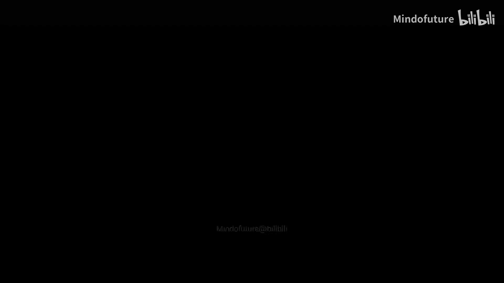
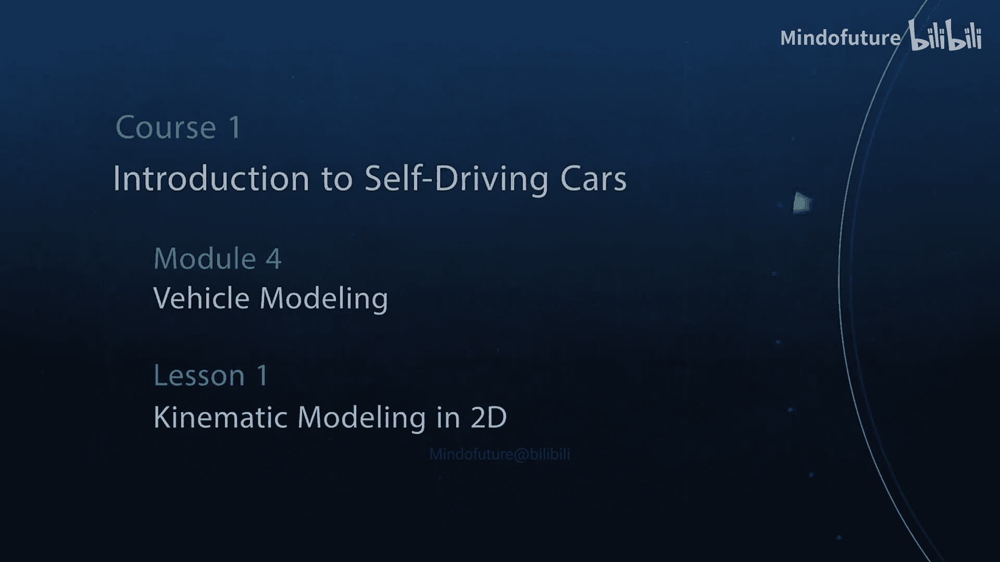
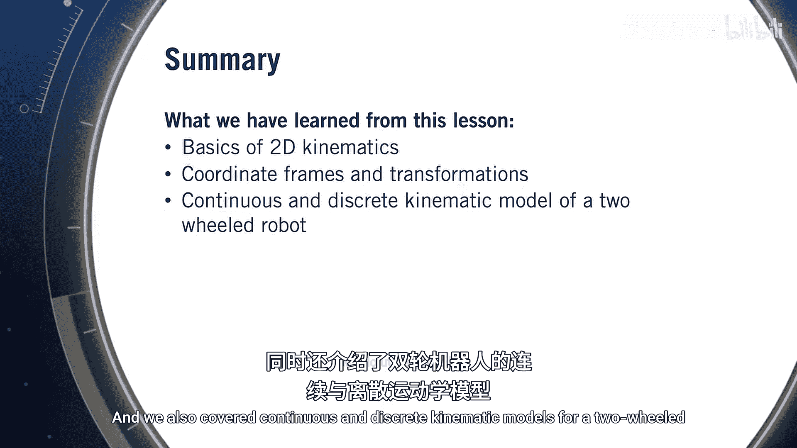

# 【多伦多大学】自动驾驶汽车简介 ｜ Intro Self Driving Cars p28 P28_第一课-二维运动学建模_05_01_01 -BV1mRsHzHETY_p28-

🎼。

In this module， we will cover kinematic and dynamic modeling of an autonomous car。

Creating a good vehicle model is essential for model based control development。

We'll look at modeling both the evolution of the kinematics。

 That is positions and velocities and the dynamics or forces and torques of a car and how they connect。

Later on in the next modules， we will use these vehicle models extensively for controller design。

In this module， you will study the basics of coordinate frames and kinematics。

Develop a kinematic model for cars known as the bicycle model。Explore the basics of dynamic modeling。

Develop a longitudinal and lateral vehicle dynamic model。Create actuator models for steering。

 throttle and break。And finally， study tire slip and tire modeling。So let's get started。 General。

 vehicle motion can be modeled either by considering the geometric constraint that defines its motion or by considering all of the forces and moments acting on the vehicle。

The first case is known as kinematic modeling。And especially at low speeds。

 when the accelerations are not significant， kinematic modeling is more than sufficient to capture the motion of a vehicle。

When we instead include knowledge of the forces and moments acting on the vehicle。

 we are performing dynamic modeling。Dynamic models can do a great job of estimating vehicle motion throughout the vehicle's operating range。

 but are more involved to develop than kinematic models。Before we start modeling vehicle motion。

 it's important to review the concepts of coordinate frame transformations。

We'll start with 2D transformations in this video and you'll see more on 3D transformations in the second course on state estimation。

The coordinate frames we use are right handed frames by convention。

 and we'll use a few standard coordinate frames throughout the specialization。The global。

 world or inertial coordinate frame is a fixed reference frame attached to the Earth。

Often will represent this coordinate frame as east north up ENU。

 relative to a reference point nearby， or Earth centered Earth fixed ECEF。

 as is used in GNSS systems。The next frame we'll talk about is the body frame。

 which is placed in some key location on the body of the vehicle， for example。

 the center of gravity of a vehicle or the center point of the rear axle。

This frame is moving and rotating with respect to the fixed inertial frame as the vehicle moves about。

Finally， the sensor frame is a coordinate frame which attaches to each sensor。

 describing the coordinates used for the sensor output。In many robotics applications。

 we need to attach several coordinates to our moving system。

And also represent elements from these frames in the inertial frame。To do this。

 we need to transform variables from one coordinate frame to the other， for example。

 from the body frame to the inertial。Even a simple two wheeled robot with a single sensor has three such frames to consider。

While the self driving car can have dozens。To maintain a consistent representation of sensor data for perception。

 we need to be able to transform information between coordinate frames。

Let's take a look at a simple transformation example for a velocity vector of a car。Generally。

 kinematic variables such as velocity are represented in the form of a vector with both magnitude and direction。

In this figure， the vector V is presented with a green arrow in a two dimensional coordinate frame。

We have two coordinate frames displayed here， the body frame defined by axes B1 and B2。

 and the inertial frame defined by axes E1 and E2， both in the 2D plane。

Let's assume the two coordinate frames， frame E and frame B， have the same fixed origin。

 but frame B is rotated by some angle theta relative to frame E。

We can then define the rotational matrices C sub EB。

 which transforms vectors from the frame B to the frame E， and C subb E。

 which projects the frame E onto frame B using the angle theta as shown。

Now let's extend our example to include a translation。Here we see a two wheeled robot。

 and we'd like to represent the position of a point P observed by the robot in the robot body frame B。

 with respect to the inertial frame E。The position of the robot with respect to the inertial frame is x and Y。

And the orientation of the robot once again， is theta。

The following equations relate the location of point P in the body coordinates P sub B。

And the inertial frame， P sub E。Note that in general。

 to transform one point from one coordinate to the other coordinate frame。

 body to inertial and vice versa requires two terms。 The translation of the origin， O， sub B。

 E and O sub E B， in this case。And the rotation of the axes， C sub EB and C sub BE。Finally。

 we can summarize the transformation between two coordinates frames using homogeneous coordinates。

Which lead to a compact matrix multiplication to apply the transformation。

We extend our location vector to include X， Y and1 and can then transform from body to inertial coordinates using p inertial is C sub EB and O sub EB times p in the body frame。

We're now ready to start kinematic modeling of a simple robot。

The robot's motion is constrained to move forward because its wheels point in this direction。

This constraint is called a non hoomic constraint， which means that it restricts the rate of change of the position of our robot。

So our robot can roll forward and turn while rolling， but cannot move sideways directly。

We'll use this constraint to define a kinematic model for our robot。

The velocity of the robot is defined by the tangent vector to its path。

Let's define the orientation angle of the robot as theta。

Then the tan of theta can be written as D Y over D X。 The velocity of the robot in the y direction。

 divided by the velocity of the robot in the X direction。By rearranging the above equation。

 we can derive an expression for the non hoomic constraint equation as follows。

We can then construct a pair of equations for the motion of the robot by combining these equations。

The velocity of the robot in the x direction is the magnitude of the velocity vector v multiplied by cosine of theta。

And in the y direction is V sine of theta。Lastly， we can assume the direct control over the robot's rate of change of heading。

We've now successfully built a kinematic model for our robot。This model takes as input。

 the forward velocity and rotation rate， and represents the robot using a vector of three states。

 the x and y position of the robot， and its heading。Throughout this course。

 we will work with state based models。Let's define what we mean by a state。

 A state is a set of variables often arranged in the form of a vector that fully describe the system at the current time。

Returning to our robot， the input of the model are velocity V and rate of change of orientation mega。

However， for the actual two wheel robot， it's also possible we need to directly command wheel velocities as inputs。

We'll now look at how to extend our model and relate each wheel rotational velocity to forward velocity V and rotation rate omega。

We'll need a few more variables defined as follows。P is the center of the robot。

L is the distance from the center of the robot to each of its wheels。R is the radius of the wheels。

W1 and W2 are the left and right wheel angular speeds。

The velocity of the robot at each wheel is the radius of the wheel times its rotational velocity。

 So V equals R times W I。And we can do this by assuming no slip between the wheel and the surface。

The velocity of the robot can be computed as the average velocity of both wheels as seen from this figure。

When the velocities of both wheels are the same， the robot moves in a straight line。

If the wheel velocities are different， the robot moves in a curved path about some instantaneous center of rotation or ICR。

Well now use the notion of ICR to define the kinematic model for our two wheel robot。

We again have that the rotation rate omega is equal to v over R and can use similar triangles to define two expressions for omega in terms of V2 and rh and V1。

 V2 and L。Combining these equations with our expression for velocities。

 V1 and V2 in terms of the wheel rotation speeds， yields the final form of the equation for the rotation rate of the robot。

We now return to our original robot model and substitute in the new expressions for the velocity and rotation rate of the two wheeled robot。

We can see that the inputs of this model are W1 and W2， which are the wheel's angular speeds。

 and the state remains the same for both robots。Also by discretizing the continuous time equations。

 we can convert our model from the differential form to a finite difference form。

This form is convenient for controller design， as we'll see shortly。

 as well as for simulation and state estimation purposes。

Note that the subscript K means the value of the variables at the current time step。

 and the subscript K plus1 will refer to values of the variables at the next time step。To summarize。

 in this lesson， we covered 2D coordinate frames and transformations。

And we also covered continuous and discrete kinematic models for a two wheeled robot。

In the next video， we'll develop a kinematic bicycle model。

 a convenient and compact tool for representing a self driving car's motion。See you next time。

