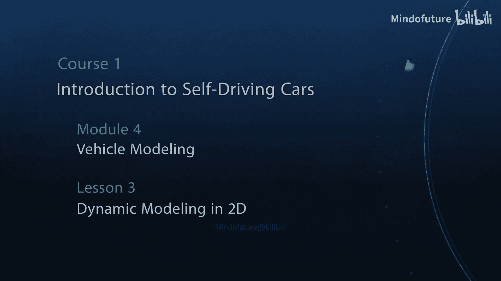
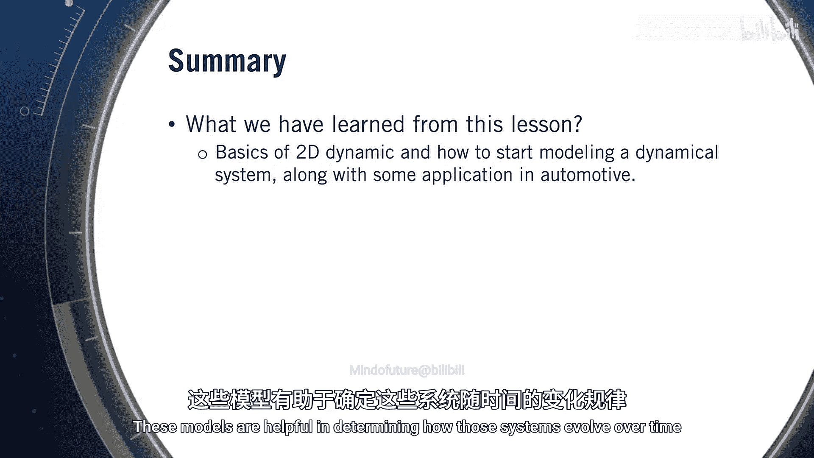

# 【多伦多大学】自动驾驶汽车简介 ｜ Intro Self Driving Cars p30 P30_第三课-二维动力学建模_05_01_05 -BV1mRsHzHETY_p30-

In the last lesson， we developed the kinematic bicycle model to capture vehicle motion with steering rate and velocity inputs。

In this lesson， we will move into the realm of dynamic modeling to start taking into account the forces and moments acting on the vehicle。

This type of model can lead to higher fidelity predictions than are possible with kinematic models。

This higher fidelity， however， comes at the cost of higher computational complexity。

 so both kinematic and dynamic models have their uses in self driving development。

Dynamic modeling is likely very familiar to many of you。

 So if you're comfortable making freebody diagrams and applying Newton's equations。

 don't hesitate to jump forward in the course。If you need a refresher or haven't done dynamic modeling before。

 this introductory video is for you。So why do we need dynamic modeling？In vehicle modeling。

 when the vehicle is moving and turning at higher speeds or when the road is slippery。

 the assumptions defined by the no slip condition may no longer hold as the forces exerted on the vehicle caused the tires to slip over the pavement。

Modeling the balance of forces during slip conditions can expand the set of driving conditions for which our model remains an accurate prediction of motion。

Also， many subsystems in the car have similar conditions where a hard kinematic constraint does not correctly capture the evolution of that subsystem。

And dynamic models are needed there as well。An example would be the drive train for which the balance of torques is needed to capture the connection from throttle position to wheel torque through the engine and transmission systems。

By explicitly modeling the balance of forces and moments acting on the vehicle。

 we can determine the accelerations the vehicle is experiencing and use them to model our vehicle motion。

We now turn to the task of defining the dynamic modeling process for a rigid body。

To build a typical dynamic model， we can follow the following steps。First。

 we set up the coordinate frames to be used in the model， for example。

 the body frame and the inertial frame we've discussed before。Next。

 we break down the dynamic system into lumped dynamic elements。

 These elements combine potentially distributed aspects of the system into discrete or lumped elements。

In the case of a spring mass damper， the lumped elements would be the spring， the mass。

 and the damper。We also define a model for each lumped element， for example。

 the linear spring provides a force proportional to its displacement from a resting position。Next。

 we sketch the free body diagram for each rigid body in the list of elements and properly name and model all the forces and moments acting on the body。

Finally， by using Newton's second law， we write the mathematical equations that define our dynamic model。

Summing all forces along each axis for translational dynamics in all moments about each rotational axis for rotational dynamics。

The result is an ordinary differential equation describing the motion of our rigid body。

 and this is our dynamic model。Let's follow our four step process for a one dimensional translational system。

 a rolling cart。This figure shows the card of masss M， whose position we'd like to track。

We start by defining the coordinate frame for the position of the cart， denoted with X。

Then we identify the rigid body， which is in this case， is the cart of mass M。Next。

 we draw free body diagram and define all of the forces acting on the cart。In this case。

 there were three forces acting on the cart， F1 pulling the cart to the right。

 and F2 and F3 pulling the cart to the left。Finally。

 we apply Newton's second law in the X direction to form the dynamic model。

The resulting dynamic equation describing the motion of the carts is m times the acceleration in the x direction denoted by x double dot。

Is equal to the summation of F1， F2， and F3。Note that F2 and F3 have negative signs due to the fact that they point in the negative x direction。

The same process can be applied for a shock absorber in a car。

The dynamic model of a shock absorber helps the engineers to design and tune vehicle suspension for better ride comfort and drivability。

To model this component， we can go through the same four steps that we introduced in the previous slides。

We again set up the coordinate system， which in this case is one coordinate y in the vertical direction。

We identify the rigid bodies or lump dynamic elements。In the case of a real physical system。

 this notion of lumped elements is very important。A shock absorber relies on a spring and a hydraulic cylinder with flow restriction to absorb shocks。

We model this system as three separate lumped elements， a mass， a spring。

 and the hydraulic cylinder or damper。We use a linear spring and damper model where the spring resists displacement in y。

 and the damper resists the y velocity。The third step is sketching the free body diagram。

Normally we show the forces or torques along with the velocities and directions in this diagram。

Finally， we form the dynamic equation， which in this case is the famous second order spring masss damper equation。

There is no variation in this process to handle rotational or torsal systems。

Rotational systems are very common in the automobile。

 with examples like the internal combustion engine shafts， gear boxes， torque converters and tires。

In a rotational system， we sum the torque's tau about each axis of rotation， and lump inertiaes J。

 torsal springs， and dampers in the same way as in the translational case。

We refer to the rotational acceleration of a rigid body as alpha。

Let's model the rotational dynamics of a wheel using our four step modeling process。

First we set up the coordinate system， one coordinate in the rotational direction is enough to represent the wheels motion。

We defined theta as the angular position of the wheel with theta dot as its rotation rate and theta double dot。

 its angular acceleration。Next we form the lump dynamic elements。

The tire model has rotational inertia J due to its rotating mass and torsal stiffness。

 K and damping B defined by the material properties of the tire in the wheel hub。

We drive the wheel with a drive torque from the vehicle's drive shaft and resist this with a load torque coming from the tire's interaction with the road surface。

Now we sketch the free body diagram， the drive torque and load torque are defined in opposite directions as the load resists the drive torque's acceleration of the wheel。

We can now form the dynamic model for the wheel system。

The difference between the drive torque and load torque defined the net torque acting on the wheel。

While the rotational spring and damper from the lumped element models resist the acceleration。

The final dynamic model describes how the wheel's position changes when subject to this netpt torque。

Dynamic models of vehicles are useful for multiple applications。

 They can be used to improve state estimation methods when fusing sensor data to track motion。

They can be used to aid and controller design to track a desired trajectory or path。

And they can help self driving engineers define the limits of vehicle performance to avoid from planning unsafe trajectories that a car cannot track。

However， a full three dimensional model of the vehicle taking into account body roll and pitch and arbitrarily inclined roads and different forces and moments at each tire makes for a very complex model。

Instead， it's possible to separate our model into two 2D models that split our vehicle control into a steering control and a throttle and brake control problem。

Full 3D vehicle modeling is a fascinating field， and we've introduced some links in the supplementary materials if you'd like to learn more。

For these reasons， we'll build a separate， longitudinal and lateral dynamic model for our self driving car。

The longitudinal model considers a vehicle traveling on an inclined road。

We restrict the vehicle motion to the XZ plane， there are several forces acting on the vehicle body and tires。

 including the traction force。The rolling resistance。Aerodynamic force。

And gradient resistance force due to gravity。In the next video。

 we'll go through the longitudinal vehicle dynamicsnas model in more detail。Similarly。

 the lateral vehicle dynamics model can be developed for motion in the X Y plane。

When looking at the vehicle from the top down or bird's eye view。In this 2D model。

 there are also several forces in the lateral direction acting on the vehicle。

 such as the slip forces and centrifugal forces。This topic will be discussed in a future lesson as well。

In this video， we covered the basics of 2D dynamic modeling and applied it to a shock absorber and wheel subsystem。

These models are helpful in determining how those systems evolve over time。

In the next lesson， we will cover the vehicle longitudinal dynamics and study the drive train components that provide torque to the drive wheels。

 we'll see you there。

