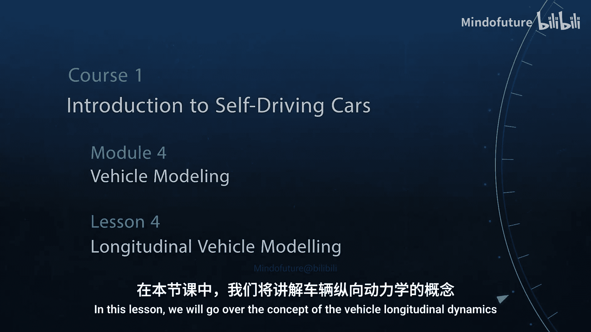
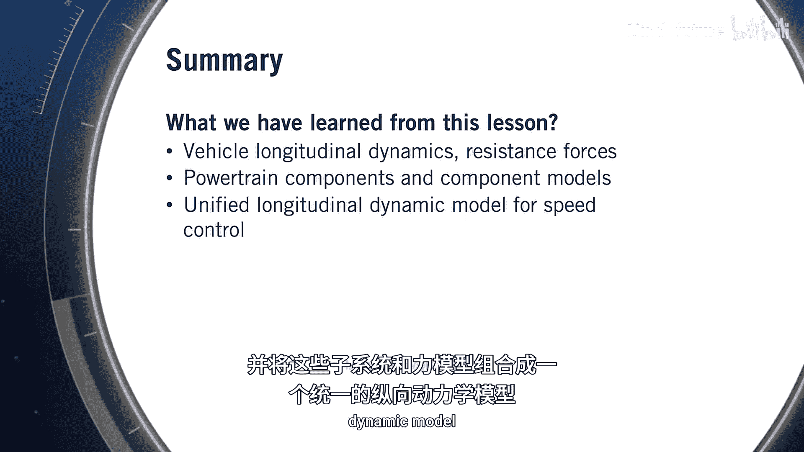

# 【多伦多大学】自动驾驶汽车简介 ｜ Intro Self Driving Cars p31 P31_第四课-纵向车辆建模_05_01_07 -BV1mRsHzHETY_p31-

In this lesson， we will go over the concept of the vehicle longitudinal dynamics and the powertrain component models needed to generate torques on the tires。

 By the end of this video， you'll be able to。

Define the balance of dynamic forces acting on a vehicle in the longitudinal direction。

Describe typical powertrain component models for an internal combustion engine vehicle。

And connect the typical powertrain component models to form a full vehicle model for longitudinal motion。

These models will help us build longitudinal controllers in the next module in this course。

 So let's get started。 The longitudinal vehicle dynamic model is simply based on the dynamics of the vehicle that generate forward motion。

Here is a typical vehicle longitudinal motion on an inclined road。

 the forces acting on the vehicle are the front and rear tire forces， FXF and FXR。

 the aerodynamic drag force， Farrow， and the rolling resistance， R， XF and R XR。

There's also the force due to gravity， MG sine alphapha， where alpha is the local road slope。

Based on Newton's second law， the longitudinal tire forces of the front and rear tires， F， F and FXR。

 which come from the vehicle power train， must overcome the resistance forces such as the aerodynamic force。

 Farrow， the gravitational force， MG sine Alpha， and the rolling resistance of the front and rear tires。

 RxF and RXR。The imbalance between these forces defines the acceleration of the vehicle in the longitudinal direction。

 denoted by x double dot。The longitudinal dynamics equations can further be simplified by grouping the front and rear tire forces as Fx and the front and rear rolling resistance forces as Rx。

Further， we can assume moderate road inclinations， which means that the small angle approximation can be applied。

 so the sine of alpha is approximately equal to alpha。

Our basic dynamic model for the longitudinal motion of a car is then as follows。

 M X double dot is equal to Fx minus Farrow minus Rx and minus M G alpha。Here。

 MX double dot is the inertial term that defines the vehicle's longitudinal acceleration。

FX is the traction force generated by the powertrain。An Farrow， Rx。

 and MG alpha make up the total resistance forces acting on the vehicle。

 which we'll refer to as F load。Note that we still need to develop models for each of the forces in this equation and define how they connect to the throttle and break inputs that our autonomous system will apply。

Through the rest of this video， we will develop these models and well go into more depth in subsequent videos on specific aspects such as powertrain。

 brake， and tire force modeling。Let's now build some simple models for the resistance forces on the car。

A vehicle's longitudinal motion is resisted by aerodynamic drag rolling resistance。

 and the force due to gravity。We've already built a model for the effects of gravity。

 so let's move on to aerodynamics。The aerodynamic drag can typically be modeled as dependent on air density。

 the frontal area of the vehicle， the vehicle's coefficient of friction。

 and the current speed of the vehicle， given a fixed vehicle shape and standard atmospheric pressure。

 we can define a simple lumped coefficient of the aerodynamic drag C alpha。

 and multiply it by the velocity squared to get the drag force。For rolling resistance。

 we have a similar model which can depend on the normal force， tire pressure and characteristics。

 and vehicle speed。If we again assume nominal operating conditions and drop the second order terms for simplicity。

 we can arrive at a linear rolling resistance model where CR1 is our linear rolling resistance coefficient。

In both cases， these are basic approximate models that are a good starting point for controller design。

In practice， the fidelity of the model you used depends on the accuracy required of the controller or the simulation environment。

Now that we have models for the resistance forces acting on the vehicle。

 let's look more closely at the drive forces created by the vehicle's powertrain。

The force generated to conquer the resistance forces comes from the powertrain and can be modeled as being generated by a series of components。

The power generated due to the combustion in gasoline or diesel engines or electrochemical reactions in batteries for electric vehicles or hybrid vehicles。

 flow through the drive line and ultimately provide a torque to the wheels。

The drive line refers to the sequence of components between the engine and the wheels and typically includes the torque converter or clutch。

 the transmission or gearbox， and finally the differential。

The brakes are also included in this figure and can provide a resistance torque on the wheel hub directly。

Because of the direct connection between wheel and engine when in gear。

 it is possible to model the relationship between the wheel speed and the engine speed as a kinematic constraint。

The wheel rotation speed omega W varies according to the torque converters's turbine speed omega T through several gear ratios。

 including the torque converter， transmission， and differential。

This combined gear ratio is denoted GR and changes depending on the state of the powertrain components。

 so what gear the transmission is in， for example。The engine speed is equal to the turbine speed and can be used interchangeably。

The vehicle forward velocity is also proportional to the wheel angular speed times the tire effective radius。

 which we will mostly model as a fixed tire radius。It can however。

 be modified for higher fidelity modeling based on expected deformation of the tire due to forces and moments on the car。

Assuming the effect of tire radius is known， we can write that the longitudinal vehicle speed x dot is equal to the tire radius are effective times the wheel speed omega w。

So if we can model the dynamics of the engine speed。

 we can then relate it directly to the vehicle speed through these kinematic constraints。

This expression for velocity can be differentiated to give longitudinal acceleration in terms of the engine rotational acceleration。

Now let's go through the dynamic equations of each of the powertrain components to build a dynamic model of the overall powertrain。

The wheel is the intersection between the torques coming from the powertrain side and the torques acting from the external resistance forces。

Therefore， we can present the wheel dynamics by the following first order differential equation to calculate the wheel angular speed mega W。

Here， T W is the wheel torque generated by the powertrain。

We can solve for the wheel torque using this differential equation if the tire force Fx is known。

 which can be calculated from the vehicle longitudinal dynamics derived earlier。

The wheel torque Tw is actually the combination of the brake torque and the output torque of the transmission or gearbox。

 as is visible on the left。We'll look at brake modeling in a later video and we'll focus on the powertrain for this video。

The torque applied to the transmission is referred to as the turbine torque T subt。

And comes from the torque converter， which couples the engine to the transmission。

Recall the turbine angular speed omega t of the torque converter is related to the wheel angular speed by the gear ratio GR。

We can therefore define a similar ordinary differential equation for the turbine angular speed as our transmission dynamic model。

Also， we can substitute in our expression for T wheel from the wheel dynamics model。

Next up is the torque converter In practice， the torque converter has complex dynamics because it has multiple impellers and fluid going through the impellers。

 which allows for the coupling and decoupling of the engine。When coupled。

 we can assume the turbine angular speed is almost the same as the engine speed。

 and therefore we replace the turbine speed with the engine angular speed in the transmission model to form a dynamic model that includes the torque converter。

Finally， we can define the full powertrain model by including the engine dynamics。

The engine inertia term is equal to the torque produced by the engine from the combustion process minus the turbine torque from the torque converter。

 which still includes a dependence on the tire force FX。

If we return to the original longitudinal vehicle model and solve for the tire force。

 we see a further dependence on the engine rotational acceleration。

Which can be grouped with the terms from the engine， transmission， and wheel inertius。

We now form the complete powertrain model and define an effective powertrain inertia as the sum of all the individual component inertias。

Which we'll call J sub E。The powertrain model simplifies down to the following equation。

Which balances the engine torque T engine with the total load torque T load to drive the engine acceleration and thereby the vehicle longitudinal acceleration。

This final equation achieves what we set out to do as it shows the dynamics of the whole powertrain system all the way from the engine to the external resistance forces acting on the vehicle。

We do still need to relate the engine torque to the accelerator pedal position and the brake torque to the brake pedal position。

 which we'll cover in the video on actuator modeling。To summarize in this video。

We defined compact models for the vehicle longitudinal dynamics and resistance forces。

We describe typical powertrain components and derive dynamic models for them。

And we combine these subsystems and force models into a single unified longitudinal dynamic model。

 which is suitable for speed control development。

In the next video， we will investigate the details of lateral dynamics and modeling to aid in the development of steering controllers。

See you there。

