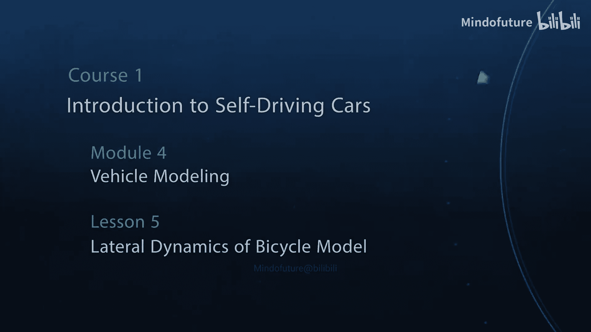
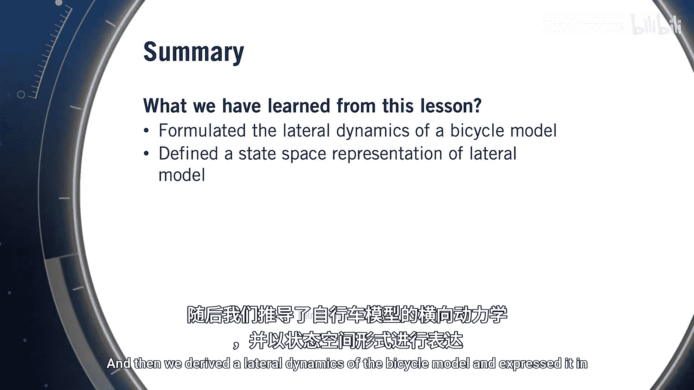

# 【多伦多大学】自动驾驶汽车简介 ｜ Intro Self Driving Cars p32 P32_第五课-自行车模型横向动力学_05_01_09 -BV1mRsHzHETY_p32-

In the previous video， we covered longitudinal dynamics for a vehicle。In this lesson。

 we will cover the dynamic modeling of a four wheel car based on the bicycle modeling approach。

By the end of this video， you will be able to。Build a dynamic model of a car using the kinematic bicycle model as a starting point。

And represent it in a standard state space form suitable for lateral control design。

 Let's get started。We would like to extend our kinematic bicycle model to a dynamic model by relaxing the no slip condition enforce for the kinematic model。

Recall that in the full dynamic bicycle model， we maintain two components of the motion。

 the first in the longitudinal direction in the direction of the heading。

 and the second in the lateral direction， perpendicular to the heading。

Specifically for the lateral vehicle model， we are interested in modeling the rotation rate of the vehicle based on the moments that affect the vehicle while moving。

To start modeling the lateral dynamics of the bicycle model， the following assumptions will be made。

First， the forward longitudinal velocity is assumed constant。

 this is done to decouple our lateral and longitudinal dynamic models。

 which simplifies our modeling task greatly， but does lead to modeling inaccuracies when accelerating or decelerating out of curves。

Second， as with the kinematic bicycle model， the left and right wheels for both front and rear axles are lumped into a single wheel each。

 so this assumption converts the four wheels to two wheels bicycle model。Finally。

 other nonlinear effects such as suspension movement。

 road inclination and aerodynamic forces are assumed to be negligible In practice。

 these effects can have a significant impact on the tire forces that occur。

 so this is again a limiting assumption in some cases， but is sufficient for our purposes。

We will use the vehicle center of gravity as the reference point for the dynamic model as it simplifies the application of Newton's second law。

We can define the total acceleration in the inertial frame as AY。

 and this includes the lateral acceleration in the body frame Y double dot。

 and the centripetal acceleration from rotation of the vehicle， omega squared R。

These expressions can be rewritten in terms of the slip angle rate of change， beta dot。

 and the heading rate of change sidedon， using the definition of the slip angle and the facts that v equals omega R and omega is equal to s dot respectively。

The model formulation for lateral dynamics can now be formed。

With the only two forces affecting the dynamics being the lateral forces on the front and rear tires。

The vehicle longitudinal velocity is defined by V as before， and the mass is M。

For the angular acceleration psi double dot， the moments produced by the tire forces act in opposite directions。

 and combined with the inertial term I Z times psi double dot to form this second order equation。

The parameters LF and LR define the distances to each tire from the CG。

One of the most important components in vehicle dynamics modeling are the tires。

Tire forces are generally hard to predict exactly， and tire models tend to be nonlinear and empirically identified。

We'll explore some of the more common tire models in detail in the final video in this module。

Fortunately， however， for normal driving conditions。

 a simple linear approximation can be used to model tire force generation。

This approximation is really only valid for small slip angles。

 and the tire forces are modeled as varying linearly with slip angles specifically。

As we use the linear tire model in our control design。

 we must make sure to not exceed this small angle assumption by sticking to non aggressive driving maneuvers。

In order to use these linear tire models， we need to define the front and rear side slip angles。

 alpha F and alpha R。They are defined in exactly the same way as the vehicle slip angled beta。

But are defined relative to the direction of the wheel and the vehicle velocity at the wheel center。

The cornering stiffness of the tire is defined by its ability to resist deformation while the vehicle corners。

 This diagram shows the relationship between the lateral tire force and the tire slip angle。

 and the slope of the line at 0 is known as the cornering stiffness coefficient C Y。

As can be seen in the plot for small slip angles， typically less than 8 degrees。

 the relation is almost a linear relation。We can introduce C and CR as linearized cornering stiffness of the front and rear wheels for the bicycle model。

Therefore， the relation between the lateral forces acting on the front and rear wheels will be the product of the cornering stiffness。

 C Y， and the slip angle alpha for each tire。We can rewrite the tire slip angles in terms of the vehicle slip angle beta。

 the steering angle， delta， the longitudinal velocity V， and the RA rate。

The previously derived dynamic equations for the lateral bicycle model can now be modified by substituting in the tire force slip equations。

This leads to the following pair of coupled ordinary differential equations that govern the dynamics of the vehicle in the lateral direction。

Note that the left hand side variables represent the rate of change of the vehicle slip angle and the rate of change of the yaw rate。

Conveniently， and because of the approximations and assumptions made throughout this derivation。

 the resulting dynamic lateral vehicle model is linear。

We can define a state vector x la that includes the lateral position Y， the slip angle， beta。

 the yaw angle， Psi， and the yaw rate psi dot。The system can now be expressed in standard state space form。

 as follows。X dot la equals a la times x la plus B la times delta。

The system dynamics matrices are A La and B La， which are time invariant if the forward speed V is kept constant。

The main input to the system is the driver's steering angle command Delta。

This state based representation is very useful when we are designing different control strategies such as PID or MPC for lateral control。

The linearity of this model also makes it suitable for state estimation with common filters。

 which you'll learn more about in Co 2。Let's summarize this video。

We first learned how to extend our kinematic bicycle model to become a dynamic bicycle model。

And then we derived the lateral dynamics of the bicycle model and expressed it in state space form。

In the next video， we'll explore and build models for the vehicle actuation system。

 including a throttle， brake and steering。 See you there。

