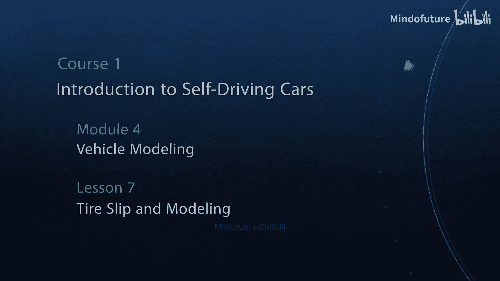
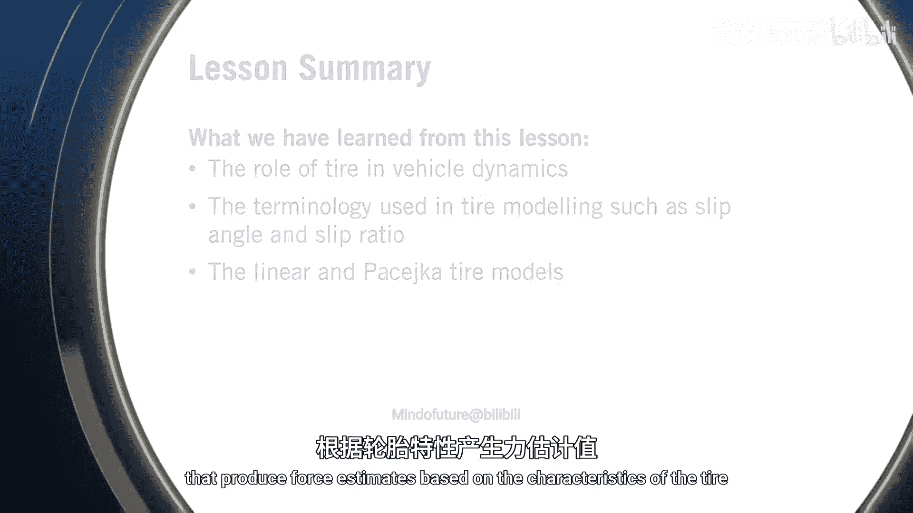

# 【多伦多大学】自动驾驶汽车简介 ｜ Intro Self Driving Cars p34 P34_第七课-轮胎滑移与建模_05_01_13 -BV1mRsHzHETY_p34-

Hello and welcome to this video on tire slip and modeling In this video。

 we will explore the concepts of the slip angle and slip ratio and introduce some well known tire models to complete our dynamic vehicle models。

In the previous video， we saw how to model the steering。

 throttle and brake systems from human neuro autonomous command to wheel angle and drive brake torques。

These actuation models drive the state of the tire and are therefore the inputs to the tire model we will develop。

The tire is the interface between the vehicle and the road and the external forces that are exerted on the vehicle are entirely defined by the tire's ability to generate them。

So to analyze the vehicle dynamics fully and develop controllers based on dynamic models。

It is really important to have a good tire model to capture the force generating behavior of the tire throughout its operating range。

Let's remind ourselves of two important definitions， the slip angle and the slip ratio。

The slip angle is the angle between the forward direction of the vehicle and the actual direction of its motion。

Which we denote beta。The vehicle's slip angle can be represented as the inverse tan of the lateral velocity VY divided by the longitudinal velocity Vx。

For small slip angles， we can use the small angle approximation。

And determine the slip angle beta as the ratio between the lateral velocity V Y and the longitudinal velocity V X directly。

 We can expand the slip angle concept and define the slip angle for each tire。Here。

 the tire slip angles for the front and rear wheels are defined as alpha F and alpha R respectively。

Tire slip angles are the angle between the direction in which the wheel is pointing and the direction in which it is actually traveling analogous to the vehicle slip angle。

The tire slip angles play an important part in defining the complete tire model。

We can relate the tire slip angles to the vehicle slip angles， the velocity and the yaw rate。

 where the distance between the vehicle center of mass and front and rear tires are represented by LF and LR respectively。

The other important definition needed when describing tire slip is the longitudinal slip or slip ratio。

The slip ratio captures the relationship between the deformation of the tire and the longitudinal forces acting upon it。

When accelerating or breaking， the observed angular velocity of the tire does not match。

The expected velocity for the pure rolling motion。Which means there is sliding between the tire and the road。

 in addition to rolling。The difference between the rotation speed of the tire and the longitudinal speed of the car can be expressed as a ratio relative to the pure rolling speed。

And it's called the slip ratio。There are three cases of differences between the vehicle velocity and the angular tire velocity。

First， when the vehicle velocity v is greater than the tire velocity， R times w。In this case。

 the wheels are skidding。This happens during deceleration of the vehicle。Second。

 when the vehicle velocity V is less than the tire velocity RW。In this case， the wheels are spinning。

This happens often in low friction driving on icy roads or when drifting， of course。Third。

 when the tire velocity is zero and the vehicle velocity is non zero。In this case。

 the wheels are locked。 This is an extension of our first case and can occur during emergency bra。

However， modern antiloc braking systems seek to avoid this regime due to its poor stopping performance and loss of steering control。

So let's look at some modeling methods for how the tire generates forces throughout its operating range。

The tire model takes as inputs the vehicle slip angle， the tire ratio。

The road coefficient of friction and the normal force in the vertical direction acting on the tire。

It then computes forces in the lateral and longitudinal directions。

Additional inputs can bring improved accuracy， of course。

 such as tire material properties and the Camber angle。

 the angle between the tire rotation plane and the road。

These additional inputs can help expand the set of forces and moments that can be modeled。

To include the self alignment moment or the moment about the steering axis that self aligns attire with the direction of travel。

The rolling resistance moment。And even an overturning moment。

Tire modeling is a deep and well established field。

 and many different kinds of models have been developed。

 We can categorize these models into three main modeling approaches， analytical。

 numerical and parameterized models。😊，Analytical models are models that have been defined from physics based modeling of the tire。

Which normally leads to simple and fast models that are suitable for controlled development。

Although appealing from a computational perspective。

These models don't often perform well over the full operating range of the tire。

The brush and fiialla models are some examples from this group。

Nummerical models come from the detailed solution of finite difference and finite element multidimensional models of attire。

 and are represented as a set of tables。These models are more accurate than the previous group。

 but difficult to use for model based control development。

Many simulators use numerical models to improve the fidelity of their vehicle dynamics， however。

Allowing for accurate assessment of stability and traction control systems prior to deployment。

Parameterized models are models that define a tire curve family through a parameterized function。

The function parameters are then identified through extensive measurement。

 and each tire must be assessed separately。Famous parameterized models such as the Linear Paacheika and Dov models。

 are used extensively in vehicle dynamic modeling。As they offer a combination of accurate force prediction and convenient computation。

These models can be easily implemented and are suitable for model based control development。

Let's now look at two parameterized models in a bit more detail。

We'll start with a simple linear tire model。The linear model has two parts represented by a piecewise linear curve。

The first part corresponds to the linear tire region， which relates the tire force。

 either longitudinal or lateral， directly to the tire slip ratio or slip angle through a force coefficient C。

The second part corresponds to the saturation region。

 where the tire exerts a constant maximum tire force for all slip ratios or angles above the maximum slip ratio or angle。

The maximum slip ratio S Max leads to a maximum longitudinal tire force FX max。

And the maximum slip angle alpha max leads to a maximum lateral tire force， FY max。In general。

 the linear tire model is a good approximation for a significant portion of the linear region。

But drops inaccur as we enter saturation。For nominal self driving， however。

 linear models are a good approximation since the tire mostly operates in the linear region。

The second model we'll look at is one of the most important and most widely used tire models in vehicle dynamics and model based control。

It is called the Pechica tirere model and is also called the magic formula because of how well it represents longitudinal and lateral tire forces。

So here is the magic formula to calculate the longitudinal tire force as a function of the slip ratio。

 the tire normal force， and the road coefficient of friction。We define system parameters B， C， D。

 and E from experiments， and these will differ from one tire to another。

The typical longitudinal tire force versus longitudinal slip at different road friction coefficients is shown in the figure。

Finally， let's look at some data collected from tire road testing。

The following plots showed the normalized longitudinal tire force on the left。

In the normalized lateral tire force on the right， plotted with respect to their slip ratio and slip angle respectively。

Overlaid on top of the experimental data points are the linear model and the Peacheit model。

We can see that both models are good representations of the data in the low slip regions。

But that the linear model does poorly as the slip increases。

This data also gives us a good idea of the difficulty of modeling tire forces exactly。

As the spread in the measured forces is quite pronounced relative to the models。Nonetheless。

 both models are extremely useful for creating simulated vehicles whose dynamics can be computed efficiently。

And for developing control laws based on the dynamic models of the vehicle and its many subsystems。

In this video， we looked at one of the most important components in vehicle dynamic modeling。

 the tire model。We revisited the definitions of tire slip and tire ratio。

And explore different tire models that produce force estimates based on the characteristics of the tire。

Congratulations， you've made it to the end of the third module in our introduction to Self Driving Cars courseur。

In this module， you developed your skills in kinematic and dynamic modeling of vehicles。

You derived a kinematic bicycle model of a car。You explored lateral and longitudinal dynamic modeling of vehicles。

In the next module， we will use these detailed vehicle models to design controllers that regulate longitudinal vehicle motion。

 See you then。

