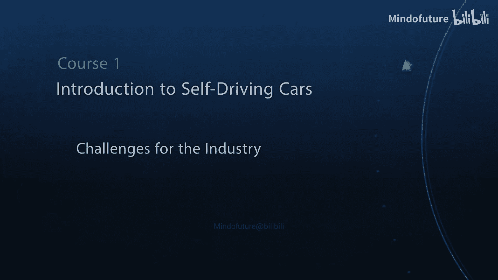
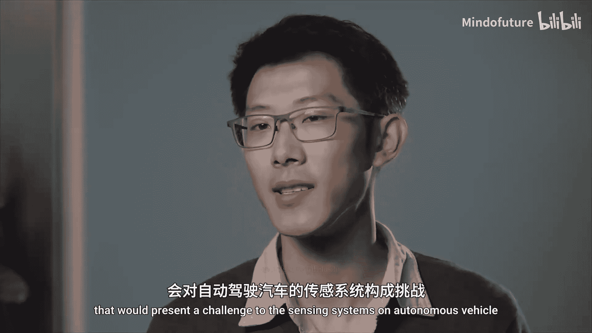

# 【多伦多大学】自动驾驶汽车简介 ｜ Intro Self Driving Cars p35 P35_行业面临的挑战_05_02_01 -BV1mRsHzHETY_p35-

Because the industry is so new， we get so many different challenges。

 we have to find so many different ways of solving problems that we've never had to solve before。

 so it's。Great and challenging in trying to figure out those innovative solutions to this such hard problem that we have。

 There's been a phenomenal amount of research in academia into how we get these cars on the road in the first place。

 Like how do we detect pedestrians。 How do you plan trajectories， for example， The problem that。

Industry needs to solve is how do we deliver this experience to thousands of customers。

 tens of thousands of riders， maybe you know someday even millions of riders。

 part of this problem is how do we scale up our systems。

 How do we deliver the same algorithms on maps that are the size of San Francisco。

 the Bay Area you know eventually the continental US and this is a big problem that is very exciting to tackle and very exciting to solve。

 Of course， in any major city， there are lots of environments that would present challenge to the sensing systems on autonomous vehicle For example。

 in San Francisco， you have areas with really tall buildings in that really contributes to GPS multipath areas。

 For example， the financial district of San Francisco with all of the tall buildings there。

 There's a really big question that circling around in the AV world now and that's how do we say strong things about the safety of systems that are unbelievably complicated。

This is one of the hardest engineering problems as a species we've engaged in。😊。

How are we going to say strong things。 So once God thought says， oh。

 you have to formally verify the code。 that seems to not scale at the moment with what we know about formal verification for the size of these systems。

 And， of course， the difficulty is that the inputs to our self driving vehicle are so wildly various that it seems hard to be able to write down all possible inputs that are coming into the system。

So then you could say， or maybe we should just build amazing simulators of it。

 so maybe we should if we could build simulators， then we could run 10。

000 copies of the autonomous vehicle simultaneously and get millions of miles overnight。

 Well that's very compelling as well but as yet we don't have an ability to really simulate the detail that comes in on some of these sensors。

 So it's very hard for example， to simulate a full scanning radar because of the complexity of those interactions。

 So then you come back to the argument that says you just need to go and drive and drive and drive。😊。

and get miles under the wheels and then remember the very interesting cases and try and replay those back。

 perhaps in your simulator so perhaps you build up a playbook。

I reckon the answer is all of those just like I say don't choose one sensor， I say use all of them。

 Why have an argument about what the best way is say well they all they all contribute in axes in understanding how do we certify and make our vehicle safe there's not one solution and we shouldn't be rushed to say what is it's all of these things you need simulation you need miles and in some places you might say well actually this is such a critical component on the vehicle where it starts talking to actually the vehicle controller that I do want some verification of that gateway on the command signal is going to the vehicle such that if the autonomy system fails a software contract to not come back guaranteed in 50 milliseconds then a safety trigger happens and the vehicle slows down so it's all of those things and I would say have an open mind to all of them and don't try and say it has to be done in this one particular way。

