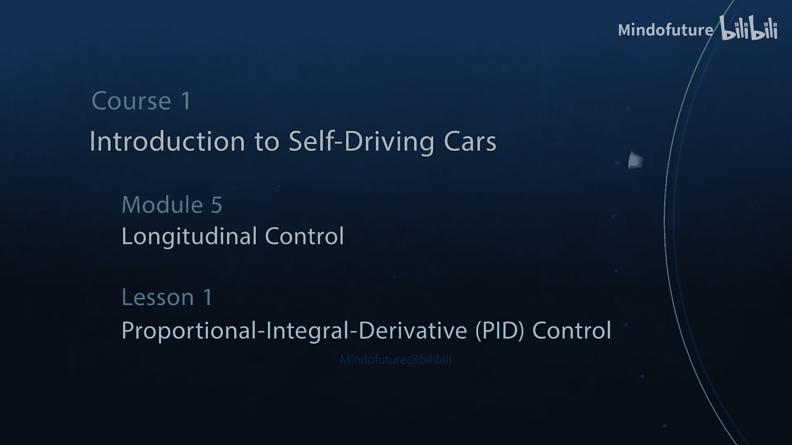
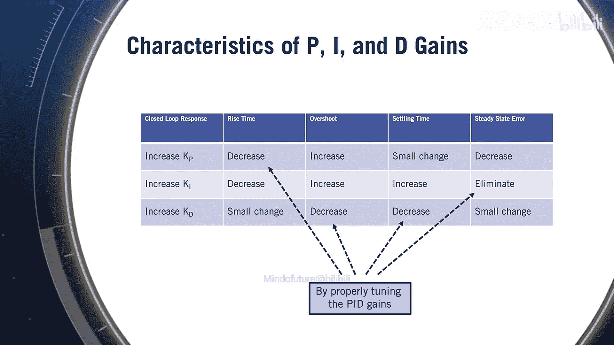
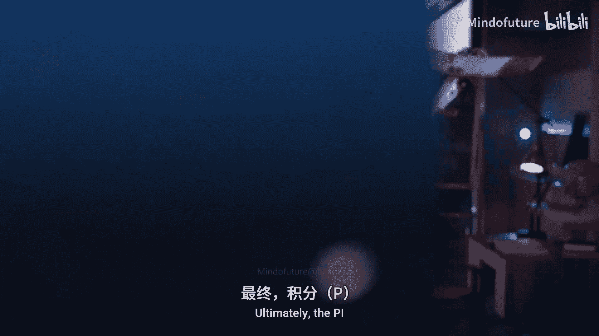
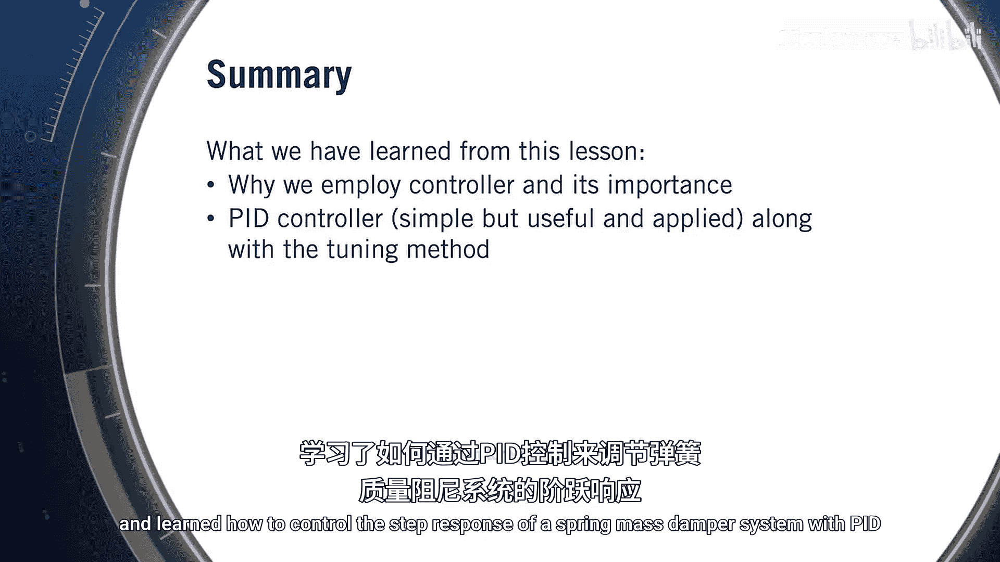

# 【多伦多大学】自动驾驶汽车简介 ｜ Intro Self Driving Cars p36 P36_第一课-比例积分微分PID控制_06_01_01 -BV1mRsHzHETY_p36-

🎼。

Welcome to Week five of this course in the previous module。

 you learned how to develop vehicle models to capture longitudinal and lateral dynamics In this module。

 we will go through the concepts of longitudinal vehicle control to regulate the speed of our self driving car。

Specifically， you'll review some of the essential concepts from classical。

 linear time andvariant control。Develop a PID control law for the longitudinal vehicle model and combine feedback forward and feedback control to improve desired speed tracking。

Design of the longitudinal speed control underpins all vehicle performance on the road and is one of the fundamental components needed for autonomous driving。

In this video， we will briefly review some of the basics of linear time andvariant control and the PID controller。

By the end of this video， you'll be able to design a PID control for a linear time andvariant system。

Note that we will have to assume you're familiar with classical control design。

 including the use of transfer functions in the Laplace domain。

So if you haven't seen these concepts before， please check out some of the great controls courses on Coursera listed in the supplemental materials。

 let's get started。In module3 of this course， we learned how to develop the dynamic and kinematic models for a vehicle based on the bicycle model。

These models aim to capture how the dynamic system reacts to input commands from the driver。

 such as steering， gas and brake and how it reacts to disturbances such as wind。

 road surface and different vehicle loads。The effects of the inputs and disturbances on the states。

 such as velocity and rotation rate of the vehicle are defined by the kinematic and dynamic models we developed。

The role of the controller then is to regulate some of these states of the vehicle by sensing the current state variables and then generating actuator signals to satisfy the commands provided。

For longitudinal control， the controller sensing the vehicle speed and adjust the throttle and brake commands to match the desired speed set by the autonomous motion planning system。

Let's take a look at a typical feedback control loop。

 the plant or process model takes the actuator signals as the input and generates the output or state variables of the system。

These outputs are measured by sensors， and estimators are used to fuse measurements into accurate output estimates。

The output estimates are compared to the desired or reference output variables。

 and the difference or error is passed to the controller。

The controller can be seen as a mathematical algorithm that generates actuator signals so that the error signal is minimized。

And the plant state variables approach the desired state variables。 The plant model。

 be it linear or nonlinear， can be represented in several ways。

 Two of the most common ways are state space form， which tracks the evolution of an internal state to connect the input to the output。

And transfer function form， which models the input to output relation directly。

Note that for transfer functions， the system must be linear in time invariant。

A transfer function G is a relation between inputs U and outputs y of the system。

Defined in the laplace domain as a function of S， a complex variable。

We use the Laplace transform to go from the time domain to the S domain because it allows for easier analysis of an input output relation。

And is useful in understanding control performance。When working with the transfer functions。

 the numerator and denominator roots provide powerful insight into the response of a system to input functions。

The zeroes of a system are the roots of the numerator。

 and the poles of a system are the roots of its denominator。

Control algorithm design can vary from simple， such as constant gain multiplication。

 lookup tables and linear equations to more detailed methods based on nonlinear functions and optimization over finite prediction horizons。

 Some of the basic and classic controllers include lead lag controllers and proportional integral and derivative or PD controllers。

 In the rest of this video， we will go into more detail on the PID control combination as a useful starting point for longitudinal control。

😊，More involved control design is also possible and is particularly useful for nonlinear system models。

 time varying models， or models with constraints that limit output selection。

Nonline methods such as feedback linearization， backsstepping and sliding mode control are beyond the scope of this course。

 but can certainly be applied to the self driving vehicle control problem。

Optimization based methods are heavily used in autonomous driving。

 and so we'll look at model predictive control as an example of this group of controllers later on in the course。

PID control is mathematically formulated by adding three terms dependent on the error function。

 a proportional term directly proportional to the error E。

An integral term proportional to the integral of the error。

 and a derivative term proportional to the derivative of the error。The constants KP。

 KI and KD are called the proportional integral and derivative gains and govern the response of the PID controller。

 which is denoted U of T。As it is the input to the plant model。

Taking the Laplace transform of the PID control yields the transfer function GV。

Multiplying by S in the Laplace domain is equivalent to taking a derivative in the time domain。

And dividing by S is equivalent to taking the integral。

By adding these three terms of the PID controller together。

We get a single transfer function for PID control。Note that not all gains need to be used for all systems。

 if one or more of the PID gains are set to zero， the controller can be referred to as P， PD， or PI。

The PID transfer function contains a single pole at the origin， which comes from the integral term。

It also contains a second order numerator with two zeros that can be placed anywhere in the complex plane by selecting appropriate values for the gains。

PID control design therefore boils down to selecting zero locations to achieve the desired output or performance based on the model for the plant。

There are also several algorithms to tune PID gains， among them。

 Ziegler Nichols is one of the most popular。Closed loop response denote the response of a system when the controller decides the inputs to apply to the plant model。

For a step input on the reference signal， we can define the rise time as the time it takes to reach 90% of the reference value。

The overshoot as the maximum percentage the output exceeds this reference。

The settling time is the time to settle to within 5% of the reference and the steady state error as the error between the output and the reference at steady state。

The effects of each PI and D action are summarized in the following table。For instance。

 an increase in KP leads to a stronger reaction to errors。

 and therefore a decrease in rise time in response to a step change in the reference signal。

Similarly， since KD reacts to the rate of change of the error。

 an increased KD leads to a decrease in overshoot where the rate of change of error is high。

It may simultaneously lead to a decrease in oscillations about the reference and a decreased settling time as a result。

Finally， an increase in KI can eliminate steady state errors。

 but may lead to increased oscillation in the response。

Ultimately， the PI and D gains must be selected with knowledge of the interaction of their effects to adjust the system response to get the right closed loop performance。

You'll get a chance to see these interactions as you develop your own PID controller as part of the assessment for this course。

Now， let's take a look at the well known second order spring Mass damper model。

 as shown in the figure。In this example， we'll first review the transfer function of the proposed dynamic system and then design a PID controller for it。

The dynamics of the spring massst amper system were derived in an earlier video in this course。

The system is subjected to the input force F， and the output of the model is the displacement of the body X。

The masss M is connected to a rigid foundation by a spring with spring constant K and a damper with damping coefficient B。

Now to transform the equation into the S domain or theplace domain， we use the Laplace transform。

And write the second order equation as follows。This relies on the fact that the derivative in the time domain are multiplications by S in the Laplace domain。

Finally， the transfer function is formed， which represents the relation between the output x of S and the input F of S。

 and is defined as the plant transfer function G of S。

This is a second order system with two poles defined by the mass， spring constant。

 and damping coefficient。To evaluate the system characteristics。

 we excite the system by using a unit step input。This is normally the first step to evaluate the dynamic characteristics of a plant。

For example， the system response x is plotted here for the parameter values given as M equals1。

 B equals 10， and K equals 20。This type of response is easily generated with scientific computing tools such as MATLb or SipPI。

The input is the unit step f equals 1， and the output is once again x。

This response is called the open loop response， since there is no controller applied to the system at this point。

If a controller is added to the plant and the output of the model is measured and compared with the desired output or reference signal。

 then the response of the system is called the closed loop response。For unity feedback。

 the sensor transfer function is assumed to be one， and in general it could be any transfer function。

The closed loop transfer function given here can be performed from the transfer functions of the controller and the plant。

For those of you who have studied classical feedback control。

 you'll know that the poles of the open loop system define the characteristics of the closed loop response。

You may have also seen root locus， Boy and Nquis design techniques。

 which can be used to select controllers that meet specific output specifications。

We've left some links to appropriate resources for those who'd like to learn more in the supplemental material。

Let's look at the step response for a few different PID controllers。

The dashed horizontal line represents the reference or desired output。

 and the controller's goal is to keep the actual output close to this reference。In the first example。

 the step response is for pure proportional control of the springmast amper system。

In the P controller response， we see a fast rise time， significant overshoot。

 and prolonged oscillation leading to a long settling time。

Adding derivative control improves the step response in terms of overshoot and settling time。

But slows down the rise time。Adding the integral term instead maintains a short rise time and is able to reduce oscillations and overshoot。

 leading to a fast settling time as well。The simple PI control is an excellent design for the springmas damper system。

Including all three PID terms in the controller leads to even more flexibility in designing a step response。

By carefully tuning the controller gains， we can use the benefits of all three to eliminate overshoot and still maintain very short rise and settling times。

As can be seen in the plot， the system approaches the reference much more quickly without any overshoot with PID control。

In this video， we've covered the concepts of controller design and why we integrate controllers into a dynamic model。

We also reviewed the PID controller and learned how to control the step response of a spring masss damper system with PID control In the next video you will learn how to apply PID control to regulate the speed of a self-driving car。

 see you there。

