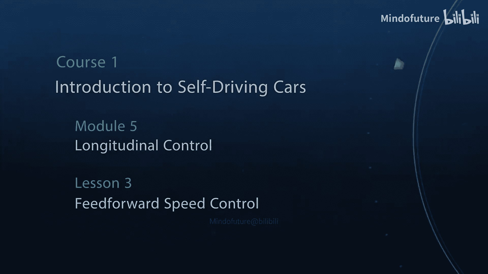
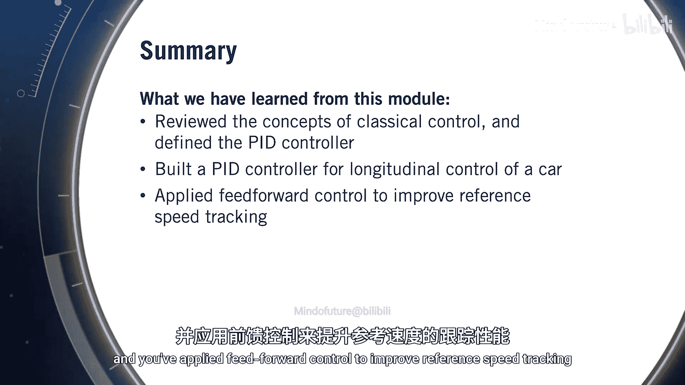

# 【多伦多大学】自动驾驶汽车简介 ｜ Intro Self Driving Cars p38 P38_第三课-前馈速度控制_06_01_05 -BV1mRsHzHETY_p38-

Welcome back。 In the last video， we saw how to build a feedback controller for the longitudinal speed tracking problem that used PID control to generate acceleration commands together with a low level controller to define throttle and brake inputs。

😊，In this final video of the module， we will modify our control architecture to incorporate feed forward commands。

 which will improve tracking performance， particularly in dynamic maneuvers。😊，Specifically。

 we will see how to integrate both feedback forward and feedback control into a combined control architecture。

And we will apply this architecture to longitudinal vehicle control。 Let's get started。First of all。

 let's compare the feedback versus feet forward block diagrams。

The feedback block diagram shows the typical closed loop structure where the current output is compared to a reference signal and the error between the two is fed into the feedback controller。

 which generates the input to the plant。The feed forward block diagram shows an open loop structure where the reference signal is directly fed into the feed forward controller。

 which again generates the inputs to the plant。 feed forward controllers create their plant inputs by modeling the plant process。

 as we have done in module 3 of this course and applying the appropriate inputs directly。

In many applications， feedback forward and feedback loops are combined to improve controller performance。

This block diagram shows how a typical feedback feed forward control structure works。

You can think of feed forward control as providing the necessary inputs expected to keep the plant tracking its reference signal and the feedback controller correcting for errors that result from either disturbances or inaccuracies in the plant model used by the feed forward controller。

The input to the plant is simply the addition of the feed forward and feedback inputs。

To summarize this concept， the main reason that both feedback and feed forward controllers are used to control a system are。

Feed forward controllers provide a predictive response as they produce a reference output to achieve a particular tracking response。

 particularly when the required inputs are non zero。Feedback controllers provide a reactive response。

 which eliminates control errors due to the disturbances as they occur。

The combination of feedback and feedback forward control is widely used because of this complementary relationship。

Because autonomous vehicles require non-ze steering commands to maintain a constant radius turn and a constant throttle or brake command to maintain constant speed or deceleration rates。

 feed forward commands are extremely beneficial in improving tracking performance in automated driving。

Now let's take a look at the combined feedback and feed forward controllers to generate vehicle actuation for longitudinal speed control。

The reference speed or drive cycle is defined by a higher level planner。

 and it is desirable that the vehicle follows the reference velocity precisely。

The reference velocity is the input to the feed forward block and the velocity error is the input to the feedback or PID control block。

Both controllers produce two vehicle actuation signals， the throttle and the brake commands。

Note that there is no low level controller included in this block diagram。

 as we had in the pure PID feedback control from the previous video。

The role of the low level controller achieving the desired acceleration through the use of a mapping from accelerations to engine commands is now going to be handled by the feed forward block。

The feed forward block gets only the reference signal as input。

 and its primary objective is to accurately set the inputs of the plan。To do this。

 we can convert the entire longitudinal dynamics model into a fixed lookup table or reference map。

That maps the reference velocity to the corresponding actuator signals。

 assuming the vehicle is at steady state。This feed forward approach works well at steady state。

 but ignores the internal dynamics of the vehicle power train and must also rely on the current vehicle state estimate to resolve some of the forces and dynamic models used。

Let's look at the steps needed to develop the actuator commands from a feed forward lookup table。

In our example， we are interested in following the reference velocity at each time step。

Based on the kinematic relationship between the vehicle speed and the wheel angular speed。

 we can calculate the wheel angular speed needed。The wheel angular speed is related to the engine angular speed or engine R PMM through the gear ratios from the transmission differential and final drive。

So we can now compute the engine RPM corresponding to the required wheel angular speed all through the kinematic relationships defined in the modeling module。

Then， assuming steady state operation， the dynamics of the powertrain says that the engine torque must be equal to the total load torque acting on the vehicle。

The source of the load torque is aerodynamic resistance， rolling resistance。

 and vehicle gravitational resistance。We can compute the combined load torque using the current state of the vehicle。

 including its current speed and the road slope。We now have a required engine torque and can combine that with the current engine operating speed in RPM to define the throttle position needed to generate the required torque。

Once again， the engine map is defined for discrete， steady state values of engine torque and RPM。

And is interpolated as needed based on the current vehicle operating point。

Let's have a look at the comparison between PD control method described in the previous video and the combined feedback forward feedback method we've discussed in this video。

 We've used the same simulation parameters as in the previous video。

 including the engine map and dynamic model elements。

The key difference between the two responses is visible as the reference speed changes。

 because the PID controller needs errors to exist before it can correct them。

 its response lags the feed forward approach， which immediately applies the relevant input reference values。

The feed forward tracking is still not perfect， however。

 as the vehicle response is ultimately governed by its inertia and the feed forward approach we've presented relies on steady state modeling of the car。

As the feed forward model becomes more precise， the feedback components can focus purely on disturbance rejection。

 and speed profile tracking can be done with consistent precision。In this video。

 we've covered the concept of feed forward controllers and the integrated feedback and feed forward controller to enhance the performance of reference tracking。

We also applied the feedback back and feet forward loops for autonomous vehicle speed control。

Congratulations， you've now reached the end of this module on longitudinal control for self driving cars。

You've reviewed the concepts of classical control and defined the PID controller。

You've built a PID controller for longitudinal control of a car。

 and you've applied feed forward control to improve reference speed tracking。

In the next module， we'll dive into lateral vehicle control design to guide our vehicle along a reference path。

See you there。

