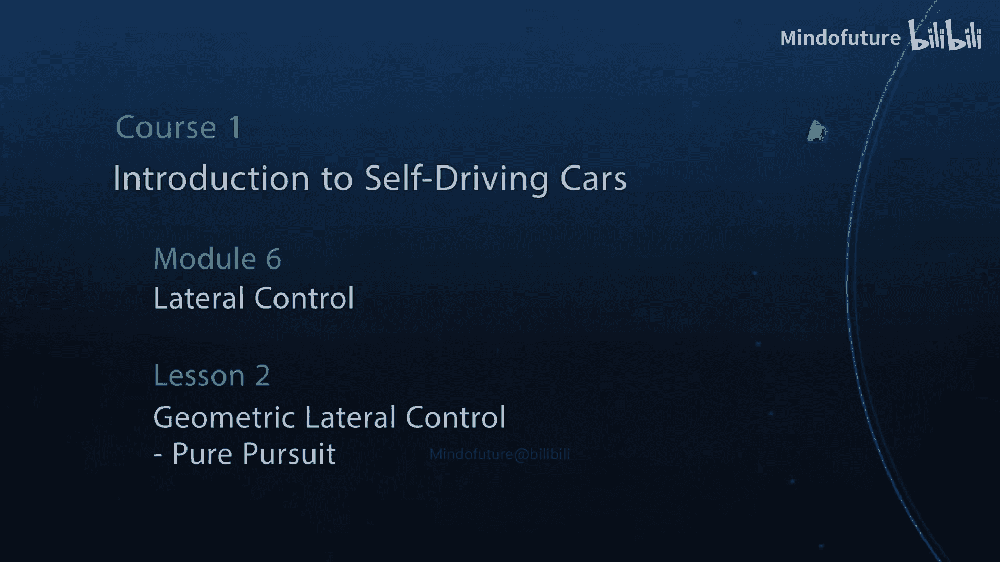
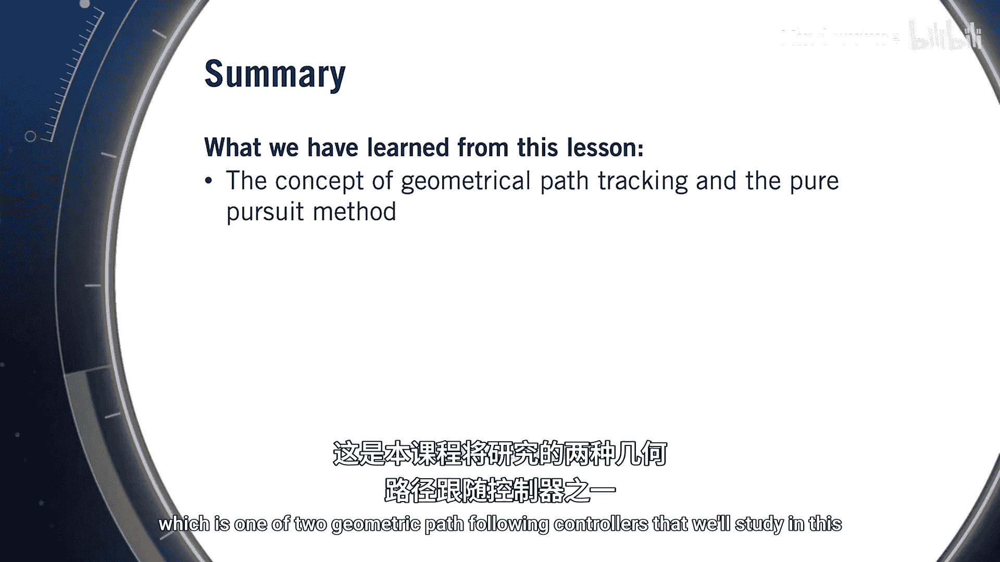

# 【多伦多大学】自动驾驶汽车简介 ｜ Intro Self Driving Cars p41 P41_第二课-几何横向控制-纯追踪算法_07_01_03 -BV1mRsHzHETY_p41-

Welcome back In the last lesson we defined important concepts relevant for the lateral vehicle control。

In this lesson， we will put these concepts to good use。

 We'll first introduce the concept of a geometric path tracking controller。

 which relies on our kinematic vehicle model for selecting steering commands。

And then we'll design a pure pursuit controller for our self driving cars to track a reference path through the environment。

Let's get started。So what is a geometric path tracking controller？Generically。

 it is any controller that tracks a reference path using only the geometry of the vehicle kinematics and the reference path。

In the case of self driving cars， a geometric path tracking controller is a type of lateral controller that ignores dynamic forces on the vehicles and assumes the no slip condition holds at the wheels。

It relies on the kinematic bicycle model and the error measures defined in the previous video to construct a steering command rule that achieves path tracking。

Because of its simple nature， it is very popular and useful in robotics and autonomous driving。

However， this simple approach has a downside。In that its performance suffers when the vehicle motion does not match the no slip assumption。

 as is the case in aggressive vehicle maneuvers with high lateral acceleration。In these cases。

 a deeper understanding of the limits of the available tire forces is needed。

 as are more involved control strategies。When the vehicle is operating in the linear tire region and the tire is not saturated。

 however， geometric path tracking controllers can work very well。

Geometric path tracking controllers rely on a reference point along the desired path。

 which can be the same reference point used to compute heading and cross track errors。

 or it can be a look ahead point some distance in front of the vehicle along the path。

 an example of which is shown in red here。In fact， the pure pursuit controller we're about to derive uses a look ahead point on the reference path。

 while the Stanley controller in the next video uses the same reference point as is needed for error calculations。

Let's now take a closer look at the pure pursuit controller。In the pure pursuit method。

 the core idea is that a reference point can be placed on the path a fixed distance ahead of the vehicle。

 and the steering commands needed to intersect with this point using a constant steering angle can be computed。

As the vehicle turns towards the path to follow this curve， the point continues to move forward。

 reducing the steering angle and gently bringing the vehicle towards the path。In this method。

 the center of the rear axle is used as the reference point on the vehicle。

 and we define the line that connects the center of the rear axle to the target reference point as a line of fixed distance LD。

 known as the look ahead distance， which is the red dashed line in this figure。

The angle between the vehicle's body heading and the look aheadline is referred to as alpha。

To construct the pure pursuit control law， we once again turn to the concept of the instantaneous center of rotation。

The target point on the trajectory， the center of the Rio axle。

 and the instantaneous center of rotation form a triangle with two sides of length R and one of length LD。

We'd like to define the arc that takes the vehicle reference point to the target point on the path。

 This arc is the part of the ICR circle that covers the angle of2 alpha。

The angle 2 alpha can be derived using standard trigometric identities。Based on the law of signs。

 we can write the following equation。L D over the sine of 2 alpha is equal to R over the sine of pi over 2 minus alpha。

Then using some more trigometric identities， we can simplify the equations as follows。

Which leads to the compact expression， LD over sine alpha is equal to 2 R。And finally。

 the curvature Kappa， which is the inverse of the arc radius R， is equal to2 sine alpha over LD。

Now let's take a look at the bicycle model to calculate the steering angle needed to track this arc。

Recall that the steering angle defines the arc radius and yields the relation tan Dlta is equal to the car length L over the arc radius R。

Combining this expression with the expression for R derived earlier。

 we can now express the steering angle needed to follow the arc in terms of easily computed values。

The steering angle delta is set to the inverse tan of 2 L sine alpha over L D。

This is an easily implemented control law for steering， but how well will it perform？

To understand this， we need to dig into how the error values evolve in closed loop。

For the pure pursuit controller， we can define the cross track error as the distance between the heading vector and the target point。

Once again， we'll use E to denote the cross track error。

We now arrive at the expression sine alpha equals E over LD。

Combining this with the expression for curvature shows us that the curvature of the path created by the pure pursuit controller is proportional to the cross track error at the look ahead reference point。

As the error increases， so does the curvature bringing the vehicle back to the path more aggressively。

This equation demonstrates that the pure pursuit controller works in a manner similar to proportional control to correct cross track error using path curvature as the output of the controller。

The proportional gain depends on2 over L D squared。 So as the look ahead distance increases。

 the proportional gain decreases in a nonlinear manner。

It's important to note that the pure pursuit controller with a fixed value of LD leads to a curvature control law that does not take into account the vehicle speed。

This means that the selected steering angle would be the same。

 regardless of whether the vehicle is going 10 kilometers hour or 100 kilometersph。

 leading to very different lateral accelerations。A controller tuned for high speed would be far too sluggish at low speed。

 and one tuned for low speed would be dangerously aggressive at high speeds。

To overcome this limitation， we add one more modification to our pure Pur control law。

We can vary the look ahead distance LD based on the speed of the vehicle。

We define the look ahead distance to increase proportional to the vehicle forward speed。

The addition to the control law takes the form LD is equal to K subPP。

 the pure pursuit look ahead gain times the forward velocity VF。

Substituting this adjustment into the steering angle command equation。

 we arrive at the complete pure pursuit controller。

The control selects the steering angle that will form an arc to the look ahead reference point and adjusts this look ahead point to be further away the faster the vehicle is traveling。

This design results in steering commands and turn rates that are achievable given available tire forces。

 although it must be tuned to do so。You now are ready to start building geometric lateral controllers for self driving cars。

Let's summarize in this lesson， we defined the class of geometric path tracking controllers and derive the pure pursuit controller。

 which is one of two geometric path following controllers that we'll study in this course。

In the next video， well explore the second geometric path tracking controller。

 the Stanley controller， We'll see you there。

