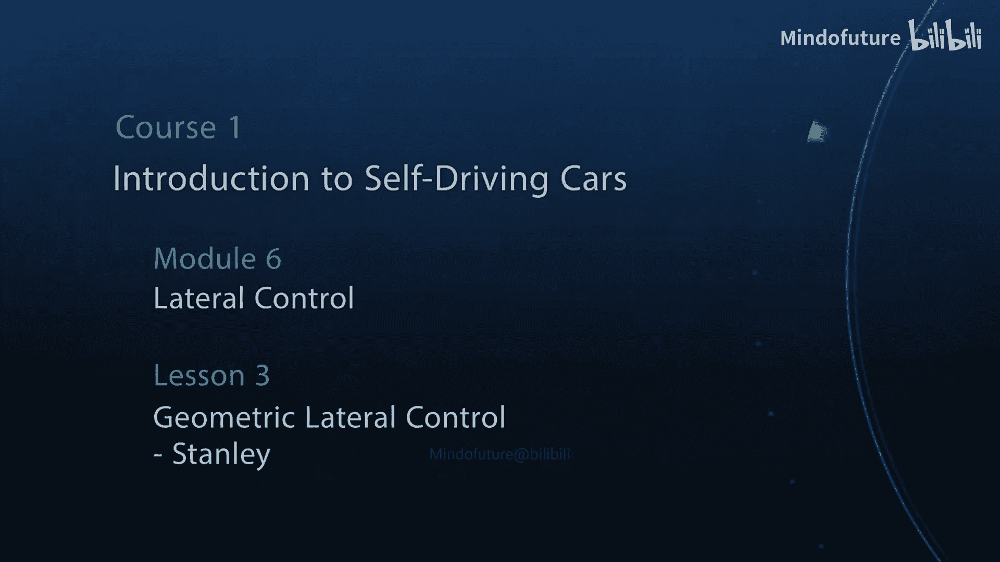

# 【多伦多大学】自动驾驶汽车简介 ｜ Intro Self Driving Cars p42 P42_第三课-几何横向控制-斯坦利算法_07_01_05 -BV1mRsHzHETY_p42-

Welcome back In the last lesson， we derived the pure pursuit controller。

 a geometric path tracking controller that defines steering input based on a look ahead reference point。

In this lesson， we will cover a second geometric path tracking controller， the Stanley controller。

This controller was used by the Stanford Racing team to win the second DARPA Grand Challenge event。

Specifically in this video， you will derive the Stanley geometric controller。

Analyze the evolution of its steering commands for small and large errors。

And evaluate the controlled performance in the form of convergence to desired path from arbitrary starting conditions。

Let's get started。The Stanley controller is a geometric path tracking controller。

 which is simple but useful for autonomous robotics and autonomous cars。

The method was originally developed by Gabe Hoffman。

 a fellow labma of mine at Stanford University as his contribution to the winning team's entry and is named after the vehicle Stanley。

The main concept that went into the creation of the Stanley controller was that a change in the reference position could lead to different。

 possibly more desirable properties of the control。Dr。

 Hoffman was seeking a control law with global convergence to the path and predictable decay of the errors that would be independent of vehicle speed。

And so one day in a fit of inspiration， Dr。 Hoffman switched the vehicle reference point used for the controller to the center of the front axle。

 instead of either the CG or the rear axle to see how this new controller might behave。

The next modifications he added were to consider both heading alignment and cross track error without a look ahead distance。

 but directly at the reference point。And finally， the Stanley controller caps its outputs to fall within the limits of the maximum steering angle。

In all， these three considerations form the basis for the resulting control law。

Let's define each of the terms of the Stanley controller in this diagram you can see the slight modifications to the relevant terms based on the Stanley assumptions。

The cross track error is measured relative to the front axle。

 and the reference point on the path has no look ahead distance associated with it。

Let's make each of the three components of the Stanley controller more concrete。First。

 to eliminate heading error relative to the path， the steering angle is set equal to the heading directly。

Then， to eliminate cross track error， a proportional control is added whose gain is scaled by the inverse of the forward velocity。

The control is then passed through an inverse tan function。

 which maps the proportional control signal to the angular range of minus pi to pi。And finally。

 the steering angle command is capped to fall within the minimum and maximum steering angles。

 Delta min and Dlta max， which are usually symmetric about 0。

The similarities with the pure pursuit controller are not surprising。

 as both are seeking to perform the same task with the same kinematic model。

 The Stanley controller scales its gains by the forward speed in the same way as pure pursuit control。

And also has the same inverse tangent of the proportional control signal。However。

 the independent penalization of heading and cross track errors and the elimination of the look ahead distance make this a different approach from pure pursuit。

The final control law simply combines these three elements to set the steering angle of the car as follows。

Let's now take a look at what steering angle is requested for different error signals。

For heading error， the steering command points in the opposite direction to the heading error。

 causing the vehicle to turn to correct the misalignment with the path。For large heading errors。

 for example， if the heading error exceeds the maximum steering angle。

 this part of the controller requests the maximum steering command until alignment falls back within the available balance。

For large positive cross track error， KE over VF becomes large。

 and the inverse tangent approaches pi over 2。So we can approximate the Stanley control law as the heading error plus pi over2。

This large value clamps the steering command to the maximum， and the vehicle turns towards the path。

The effect of this turn is to increase the heading error in the opposite direction。

 and so the steering command will drop to zero once the heading error reaches minus pi over 2。

The vehicle then proceeds straight to the path until the cross track error decreases。At this point。

 the heading term starts correcting the alignment with the path again。 and ultimately。

 the vehicle starts to track the path more closely。

But how does this control actually converge to the path？As it turns out。

 it's possible to use our expression for the cross track error dynamics defined in the first video of this module to get a sense for the convergence characteristics of the Stanley controller。

Recall that the rate of change of the cross track error for a front axle reference point is equal to minus the forward velocity times the sign of the heading minus the steering angle。

If we substitute in the Stanley control law without limits。

 we get the final expression in this equation。Using a trigometric identity for simplifying the s of the inverse of 10。

 we can find that the rate of change of the crosst error evolves according to minus the gain k times the cross track error divided by the square root of 1 plus k E over VF squared。

For small cross track errors， we can simplify the denominator of this expression by assuming the quadratic term is negligible。

This leads to the realization that the cross track error evolution follows a first order differential equation。

And the solution for this ODE is an exponential。Since k is positive。

 we see that the error decays exponentially to0。The most interesting aspect of this investigation is that the decay rate is completely independent of the speed。

So faster vehicles will travel farther while converging to the path。

 but will converge to the path at the same time as slower moving vehicles。

Let's now dive into a simulation example of the errorerodynamic for the Stanley controller。

To observe its convergence characteristics。In this example。

 let's take a look at two extreme scenarios。Large initial cross track error。

And large initial heading error。In the first case， for large initial cross track error。

Let's assume the initial crosst error is5 meters。And that the maximum allowable steering angle is 25 degrees and the forward velocity is5 meters per second。

We'll set the vehicle wheel base length to1 meter for simplicity。

 and the gain K will be set to a value of 2。5。This was selected based on chosen parameters for the simulation and some trial and error testing。

The simulation shows how the Stanley controller corrects for a large cross track error and converges to the desired path。

The large initial error leads to a large steering command that quickly turns the vehicle towards the path。

The heading error and cross track error terms then reach an equilibrium。

 and the vehicle continues in a straight line towards the path。As the cross track error decreases。

 the exponential decay to the path becomes visible。 and finally。

 the vehicle safely tracks the path in the final stages of the simulation。

We can also run the same simulation at different forward velocities， so let's try speeds of2。

 5 and 10 meters per second。The results show the main characteristics of the Stanley controller。

 in all cases， the turn towards the path， straight line progress。

 and then exponential decay to the path are visible。The higher the speed。

 the further the car travels before reaching the path。

But the final convergence for small cross track errors takes the same amount of time in each case。

In the second case， the simulation can be regenerated for the scenario at a large initial heading error。

The parameters are the same as the previous case， but the vehicle starts out on the path。

 pointing very much in the wrong direction。The simulation results show the heading error is corrected by the Stanley control law。

 First， the steering command is up against its limit as the heading error is corrected。

 Then as the cross track error starts to grow， the steering commands continue to correct the heading of the car beyond alignment with the path。

 Finally， the car enters the exponential convergence segment as before。

These simulation results give us a good idea of the ability of the Stanley controller to correct arbitrarily large errors。

In fact， it comes with a global stability proof， meaning that no matter what the initial conditions。

 the controller will guide the car back to its path。In practice， however。

 the Stanley controller is still a geometric path tracking controller。

 and as such does not consider many different aspects of real self driving car。For example。

 it does not consider noisy measurements， actuator dynamics， or tire force effects。

 all of which can cause undesirable ride characteristics during maneuvers。It is possible， however。

 to make a few adjustments to the geometric path tracking controllers that help mitigate some of these most undesirable effects。

During low speed operation， the pure pursuit in Stanley controllers can behave quite aggressively when confronted with noisy velocity estimates。

Since the velocity term is in the denominator of the fraction inside the inverse tangent。

 errors in low speed estimates tend to get amplified in the steering command。

This leads to wild swings in the steering wheel， which is not desirable for rider comfort。

 So to get rid of this issue and to increase the stability of our solution at low speeds。

 we add a positive softening constant that ensures the denominator always has a minimum value。😊。

This softening constant can be tuned in the field。At higher speeds。

 we have the issue that steering commands need to very slowly to ensure lateral forces are not excessive。

Even with the scaling on speed， Stanley's response was overly aggressive at high speeds。

 and so a damping term on heading rate was also added。

 This essentially converts the heading error control portion to a P controller。

 and the same idea can be applied to the pure pursuit control of curvature as well。Finally。

 for curved paths with high curvature， the controller fails to track them well。

 as the reference dynamics were not considered in the derivation of the geometric controllers。

It is also possible， as we saw in longitudinal control to enhance the performance and drive errors to zero more quickly by adding a feed forward term to the controller。

In this case， it is sufficient to simply include the steering angle required to maintain the curvature of the desired path。

With these modifications， the Stanley controller becomes a useful tool for moderate driving tasks。

 as long as the vehicle avoids exiting the linear tire region。

We'll look more at defining paths that are safe to track in the fourth course of this specialization。

In this lesson， you learned how to apply the Stanley controller as a geometric path tracking controller。

What the convergence properties are for the Stanley controller。

And how to add further enhancements that improve the controller's real world performance。

In the next video， well introduce the model predictive control method。

 an advanced model based control method that can overcome many of the limitations of geometric controllers。

See you next time。

