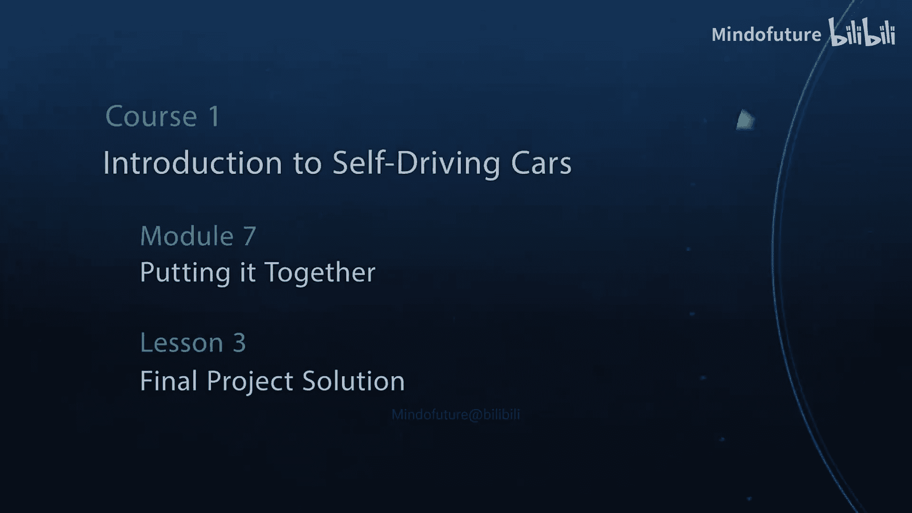
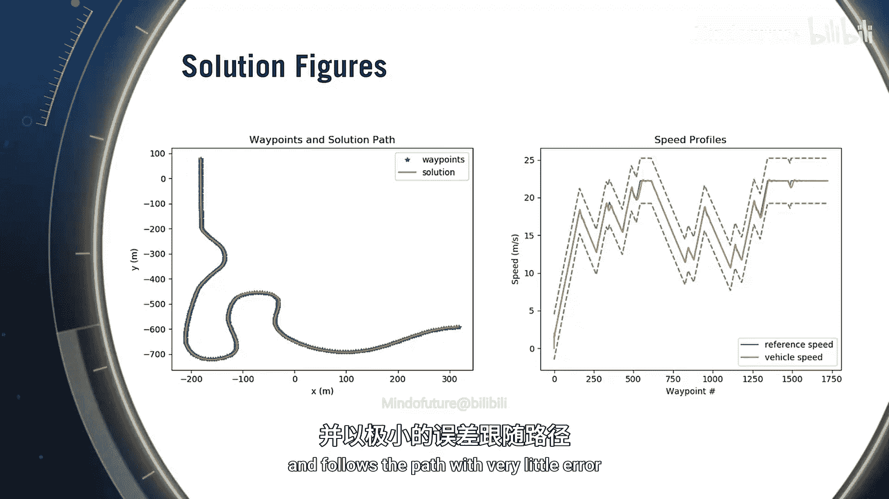

# 【多伦多大学】自动驾驶汽车简介 ｜ Intro Self Driving Cars p46 P46_期末项目解决方案_08_01_05 -BV1mRsHzHETY_p46-

Now that you've had a chance to do some controller design and perform simulations with Kla。

 we will show you our solution to the final course assessment。

Recall that our reference signal consists of both speed and position。

 so we will require both longitudinal and lateral control。For longitudinal control。

 we implemented a PID controller， which was described in the module on longitudinal control。

This P I D controller will take the desired speed as the reference and output throttle and brake as the desired speeds are reasonably low and steady。

 we bypass the low level controller entirely。Remember that a PID controller consists of three components。

 first， a pure gain KP that scales the vehicle acceleration based on the speed error。

This ensures that the vehicle is accelerating in the correct direction with a magnitude proportional to the error。

Second， an integral term K I sets the output based on accumulated past errors。

This ensures the steady state errors are eliminated for ramp reference signals。Finally。

 the derivative term KD dampens the overshoot caused by the integration term。

To complete the longitudinal control， we must convert the acceleration output from the PID controller into throttle and brake commands For simplicity。

 positive outputs will be throttle， and negative outputs will correspond to break。

For lateral control， we implement the Stanley controller that you learned about in the module on lateral control。

Since the reference signal given our waypoint positions。

 we need to convert them into cross track errors and heading errors。

We use the current waypoint and the past waypoint to generate the trajectory line。

Then using the equation of this line， we determine the perpendicular distance to the front axle。

 This is our cross track error。We can now convert the cross track error into part of our steering input by multiplying a gain K。

 dividing by the current velocity and taking the inverse tangent。To calculate the heading error。

 we subtract the current vehicle yaw from the trajectory line angle。

The trajectory line angle can be calculated by taking the inverse tangent of its slope。

Adding both the steering derived from the cross track error and the heading error gives us the total steering input。

This completes our lateral controller。Combining both the longitudinal and lateral controllers gives us the following speed profile and trajectory。

 As you can see， the controller tracks the reference speed well and follows the path with very little error。

There are， of course， other controllers that you could have implemented to solve this project as well。

 such as pure pursuit， feed forward control and model predictive control。

 If you've implemented these controllers， let us know how they performed。 Congratulations。

 You have now completed the final project for this course。

 This is a huge milestone on your journey to becoming engineers for self driving cars。😊。

You will be able to employ your new simulation and control algorithm design skills throughout the autonomous driving space。

 so keep up the great work。 We hope applying what you've learned throughout this course in a real world programming scenario has been an enjoyable learning experience。

 You're going to learn a lot more about what it takes to programming a self- drivingriving car in the subsequent courses in this specialization。

😊。

