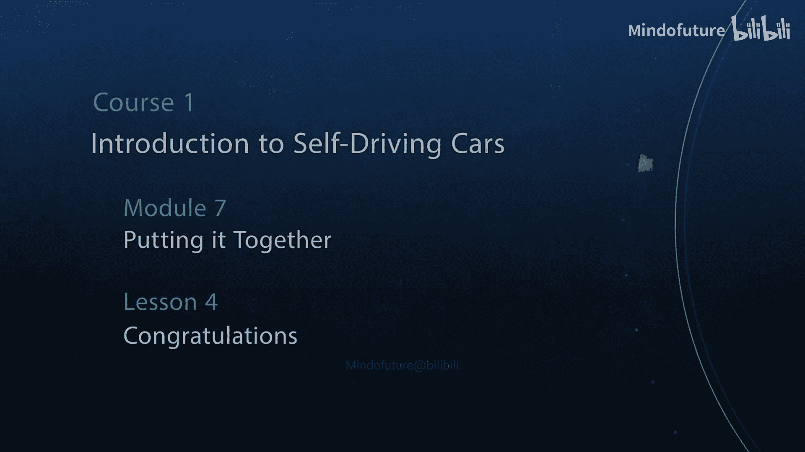
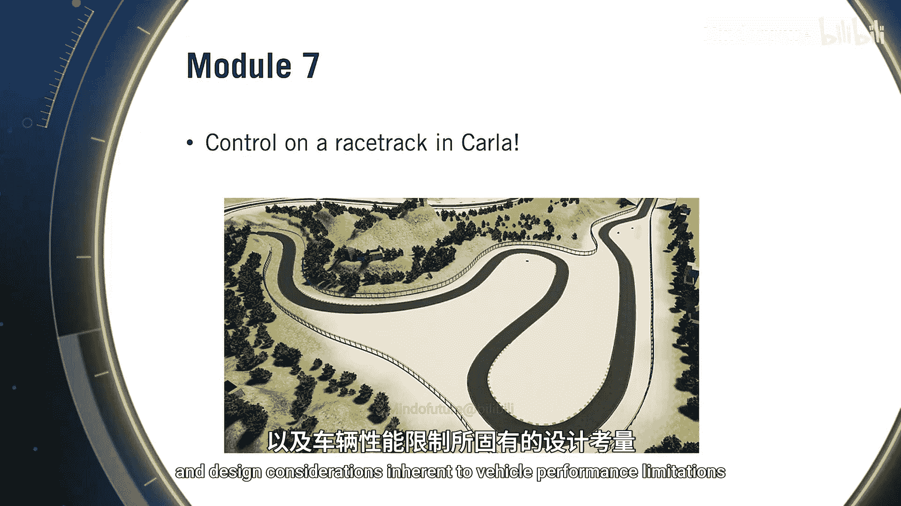
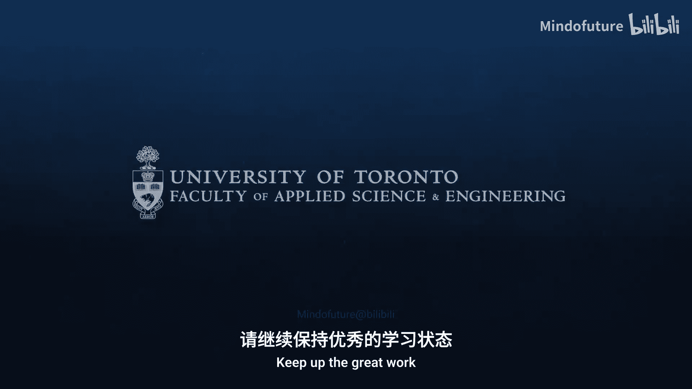

# 【多伦多大学】自动驾驶汽车简介 ｜ Intro Self Driving Cars p47 P47_恭喜完成课程1_08_02_01 -BV1mRsHzHETY_p47-

🎼。

Congratulations， you finished the first course of our self driving car specialization。

The concepts you learned in this course are fundamental to all autonomous driving architectures。

 Let's summarize what you've learned so far in this specialization。

During the first week of the course， you learned about the taxonomy of self driving cars and the perception and planning needs for self driving。

Overall， this gave us a vehicle requirements framework so we can better understand what driving decisions we need to make and the levels of automation needed to make these decisions happen with our car。

In the second week you learned about the hardware and software stack for self-driving cars。

 you learned about the various sensors used for perception。

 the basics of designing sensor configurations， and each component that is needed for a typical autonomy software stack。

We also explored the environment representation for self driving。

 but we'll go into much more detail about this in the next few courses。In module 3。

 you investigated the importance of safety assessment for your self-driving cars。

 you assessed several safety aspects for both the hardware and software stacks you then explored some industry approaches for safety and discussed some of the popular frameworks。

You learned about kinematic and dynamic modeling of vehicles and built detailed longitudinal and lateral models to describe how a car reacts to steering。

 throttle and brake commands。From there you develop the vehicle controllers for both longitudinal and lateral vehicle models。

You learned how to define a controller that regulates the speed of the vehicle through a range of speeds。

And how to define a path following controller to track a desired path。

You also looked at predictive trajectory controllers for executing challenging maneuvers safely and effectively。

And finally， for your final project in this course。

 you put all this knowledge together to navigate a self driving car along a racetrack in the carless simulator。

You successfully tested the limits of your control and design considerations inherent to vehicle performance limitations。

 We hope this has been a rewarding first course in the self driving car specialization。

 There's still much more work we need to do to get to a level 5 autonomous driving society。

 But now you should be aware of many of the fundamental challenges to consider when designing self driving cars。

 In the next course， Jonathan will introduce you to state estimation and localization。😊。

Where you'll learn the mathematical and algorithmic methods。

 such as method of least squares in its relationship to three different types of common filters for doing state estimation recursively。

You'll also learn much more about a few of the different types of sensors commonly found in self driving cars。

 including GNSS and LIDAR。And then learn how to conduct sensor fusion or how to combine multiple sources of data into useful information for your self driving car。

You'll see me again in the third course where I'll discuss visual perception for self driving cars。

In the meantime， you're in good hands with Jonathan。

You're on your way to mastering these important concepts that will help us build the future of autonomous driving。

 Keep up the great work。😊。

