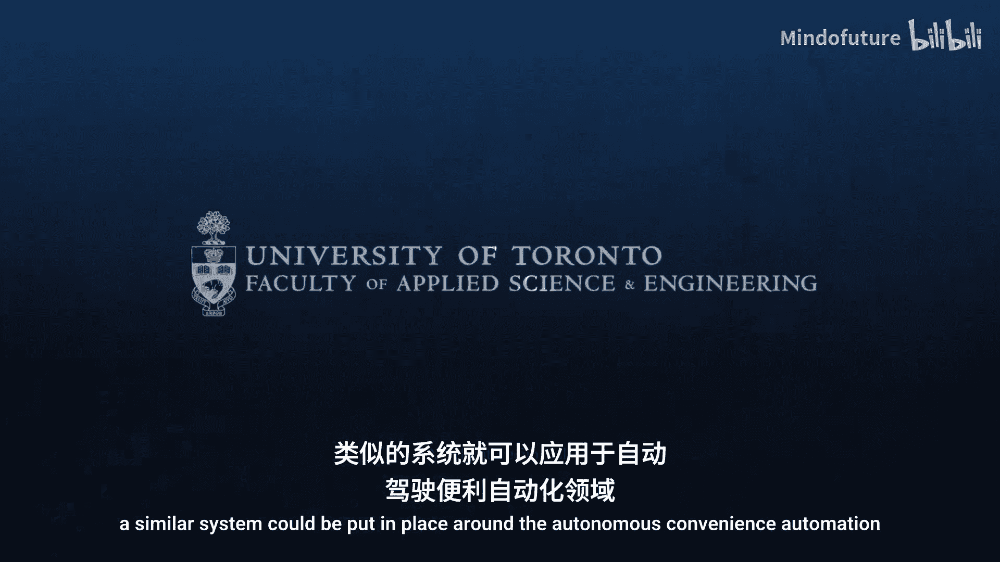

# 【多伦多大学】自动驾驶汽车简介 ｜ Intro Self Driving Cars p50 P50_C1_M3_L4-访谈_克日什托夫·查内茨基_安全车驾驶员__不可能完成的任务_09_01_01 -BV1mRsHzHETY_p50-

It seems that most of the systems that are on the road nowadays still have a safety driver in play right they still need somebody monitoring their system。

 There's only a few examples where we don't have that are the first solutions that we're going to see。

 are they going to involve us monitoring this system and how does that sort of partial autonomy or that reliance on a human to make sure that our system is safe。

 how is that going to play out and is that really a viable solution to this problem so that we have self-driving cars that come sooner but maybe don't have fully autonomous capabilities this is an excellent question？

It's a difficult one， too。 it's an empirical question， right，Essential， in order to answer that。

 we have to have enough experience with it and we just collecting our experience with advanced driver assistance systems。

 And some of the most advanced ones such as like level  two systems like autopilot and so on。

 And we do learn things from that。 And we also have research that that's building on that experience knowing that it takes time to。

Get the situation awareness whenever you need to do a takeover。

 we know that we can phase out while driving。 and that's a big problem。

 to the human is not necessarily a strong monitor of an autonomous right And from aerospace there is also big lessons learned we know that there's potential this killinging if you if you yeah。

 if you're not involved constantly in the task。 And also we've seen in aerospace that while we actually automated the easy stuff and the medium stuff。

 the easy stuff is just the crew。 the medium stuff is like landing and takeoff。

 and what we left is essentially all the emergency situations to the pilot and it turns out that some of the automation we put into those airplanes it's actually making the difficult situation even more difficult because of the added complexity override an autonoous That's right or sometimes creating mode that。

And there modes of operation that now the pilot has to deal with instead of always having having。

 let's say， just seconds， maybe to react or even if it's a minute。

 we know that if meantime betweenfs for humans，And the normal conditions rested。

 it's somewhere like half an hour， if you are under stressed， or if it's a complex task。

 it's something maybe five minutes between， but if it's stress and complex task。

 it's really just literally every few seconds in making error so the research showing that right。

And so relying on the human to take over when the autonomous system doesn't know what to do is's not going to be a sustainable model。

 right certainly， you know， when you think about the SE levels， going from level 1 to 2。

 it's a big jump because essentially level 1， it means that you do。

At least either steering or throttle control， meaning that you constantly engage。

If you go to level 2， essentially be vehicle is doing like， say the 90% of the driving， right。

It's very easy to， actually。Over relyly， lose focus。

 lose focus and not monitor the environment efficiently， so that's a challenge。

So I believe that really you know this model of the Guardian Angel is a great one from Toyota。

 Tell us a little more about the Guardian Angel。 Yeah。

 so the idea is basically that you create like the safety envelope and this constantly comes from aerospace an aerospace or when you're flying an airplane。

One of the basic things is to keep the airplane in the air。 you don't want to stall it。

So basically when you stole it means there is no。Lift anymore and the airplane just falls out of sky and companies like Airbus in their safety concept for the airplane they're essentially put in computer system that will kind of override what the pilot says just to make sure that the pilot can give inputs but the system just make sure that the pilot doesn't take the system into a stall So this system is monitoring the pilot instead of the pilot monitoring the system and for this type of critical part。

 So when the pilot let's say needs to weve been doing a mistake for whatever reason or inadvertently。

 you know it disengages autopilot or whatever the system at least is always there to avoid。

 let's say crash So in that sense， the analogy in automated driving would be to have a crash avoidance system that's really solid and we know that we have crash avoidance system。

 So there's a level zero systems， such as automated braking for example or evasive maneuvers。

They are not're very partial。 I mean， the way they are actually designed is that you don't want to have false engagements。

So they kind of。Tuneune down。 And only when it's very clear that crash is imminent。

 they would actuate only in the final second before a That's right。

 but if we can expand these systems， So for example。

 make sure that even someone who maybe doesn't have the full capacity of quick reaction。

Maybe for example， elderly people。Can still drive the car by giving the inputs and。

 and just you know， tricky situations or or crash situations， near situations。

Often because of maybe some other of the other。A road user who might cut in， for example。

 that the reaction is actually kind of almost reflex like done by the car。

 and I think when we have that done well， similar system could be put in place around the autonomous convenience automation。

