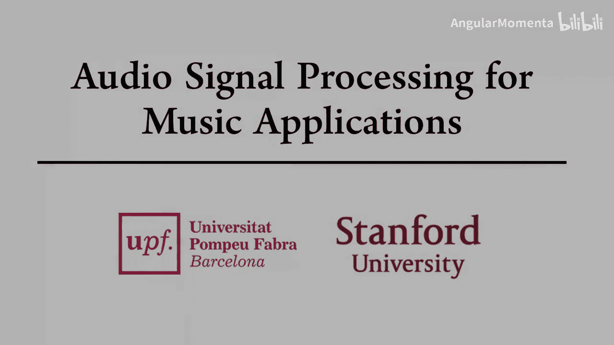

# 【巴塞罗那庞培法布拉大学】音乐应用中的音频信号处理-｜-Audio-Signal-Processing-for-Music-Applications-p01-01_01_01_预告片--BV18Xr6BeEX5_p1-

Music can be listened and enjoyed， but it can also be studied from an engineering perspective。

My name is Jerra and I have been teaching audioin processing courses for more than 25 years。

I taught many summer workshops at Stanford University for people with diverse backgrounds。

For musicians， engineers and people coming from humanities。

 and now I am teaching at Pomel Power University in Barcelona to computer science and electrical engineering students。

With the course on audio S processinging for music applications。

 I have tried to use all that experience to this new fascinating world of massive and open online courses。

Hello， my name is Julia Smith and I teach Sign processingces here at the Center for Computer Research and Music and Accoustics。

 Karma， as we call it， and my courses are signal processing aimed at music and audio applications and the idea is to learn how music technology works from a signal processing point of view and that involves a little bit of math。

 a little bit of software and hopefully a lot of fun and so we hope to see you in the course。

Let me show you an example of the more practical things that we learn to do in the course。

This is the spectrogram of a sound I played in my cello， let's hear it。From the spectrum。

 we can identify the fundamental frequency of the sound。

 which then can be synthesized as a sine wave let's hear that too。

We can then detect the harmonics of that fundamental frequency。

 but there is more to the sound of these harmonics。

We can subtract the harmonics from the original signal and obtain a spectrum， what is left。

 and we can also listen to it。This residual spectrogram can be approximated with what we call an e stochastic model。

 and we can put it together the harmonic plus the stochastic model。

 and this is a representation quite useful and quite powerful。 We can do a lot of things with it。

 For example， we can reynthesize the sound。 while changing some of the nodes that I played。

 Let's hear that。Or we can generate some weird sound by arbitrarily changing the harmonics and time stretching the sound like this one。

 let's hear it。う。The number of possible transformations is infinite。

 in fact it's only bounded by your own creativity。Preparing this course has been a fascinating experience for us。

 I hope it will be of to many of you。If you love music and love technology， this is your course。

You will learn a lot of things， and you will have fun in the process。So I hope to see you in class。

