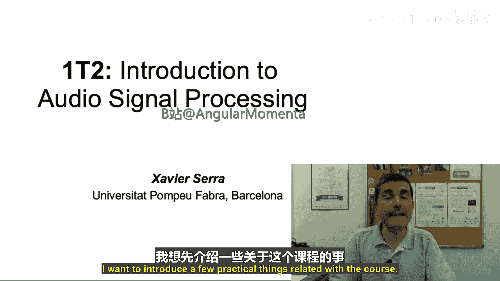
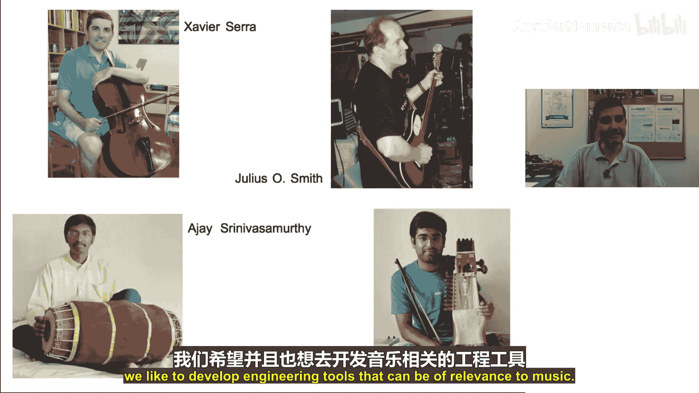
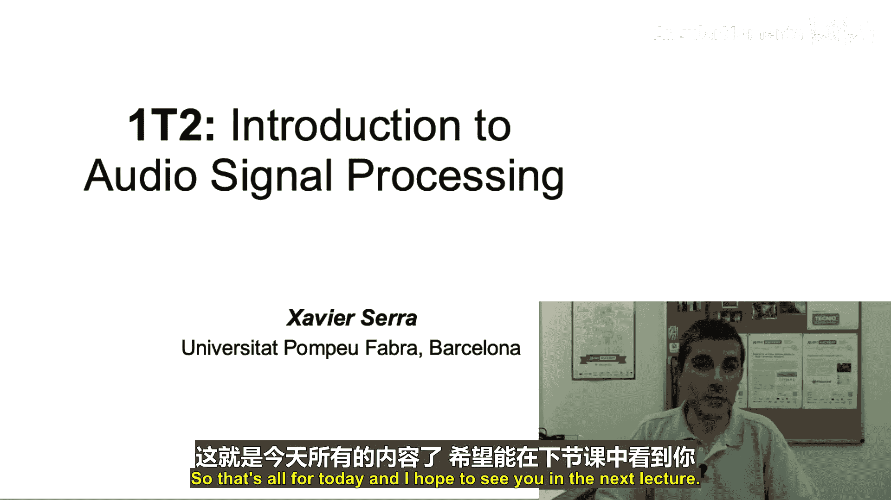

# 【巴塞罗那庞培法布拉大学】音乐应用中的音频信号处理-｜-Audio-Signal-Processing-for-Music-Applications-p02-01_01_02_欢迎--BV18Xr6BeEX5_p2-

Welcome everyone to this first lecture of the course on Art resume processing for music applications。

In this first lecture， I want to introduce a few practical things related with the course。

The first one is to introduce ourselves， Professor Ju Smith。

 hes a professor at Stanford University at the Center for Computer Research in Music and Acoustics。

 under whom I did my PhD quite a few years ago， and from whom I learned most of the things I know on audio signal processing。

Myself， my name is Javiserra and I teach at the Pompeo Far University in Barcelona and I lead a research group in music technology。

And we have two teaching assistants in the course， J， Srinivasamorti and San Kabululati。

They are both doing their PhD and my supervision in Barcelona。

 and of course they work on music and audio technology topics。Despite these pictures。

 we are definitely not professional performers， but we are definitely music lovers。

 we love to play and we love to listen to music and the main reason we are in this topic is because we want and we like to develop engineering tools that can be of relevance to music。

So what is this course about well， it's basically about signal processing， about audio music。

 about programming techniques that are relevant to audio music and about understanding and making sounds。

Who is this course for？Well， it's for anyone interested in understanding how to analyze and process musical sounds。

But you have to be able to follow mathematical formulations， use a programming language。

 and use sound processing software。You definitely don't have to be an engineering student。

 but you have to have some technical background。The course is 10 weeks long and every week covers a particular topic and every particular topic is presented through different perspectives through the theory lectures we present the more mathematical and signal processinging point of view through the programming lectures。

 we present the applied point of view in which you learn how to implement things。And finally。

 through the demo lectures， you understand the more applied point of view。

 the use of these techniques and how these techniques can be of relevance for sound and music。

Then we have some more advanced topics and references that will allow you to view and understand other related topics。

 and every week we'll have some assignments， specifically some programming assignments and some quizzes。

In fact， the devalation is done every week and there is a weekly quiz that counts five points and there is a weekly assignment that counts for 10 points and these weekly assignments are the programming assignments。

And then there are two surveys， one at the beginning of the course。

 one at the end of the course that we would like very much you to fill。

 so we also give it two points for filling up the surveys。

One fundamental concept in the course is that we decided to have everything open。So all the videos。

 slides， all the materials that we have created for the course are available under Creative Commons licenses。

 especially the attribution non commercialcial sharelike license。

All the software that we have developed and that we use in the course is also available freely。

Under the fair GPL license。Most of the references that we use if theyre not ours。

They come from open repositories。Like Wikipedia or some other related sites。

 and we will be using sounds， so all the sounds we use come from freesounded org。

Which is a website that hosts Cre Commons sounds In this short lecture。

 we have presented some practical things related with the course。

There is much more information in the website， so please make sure that you understand the context of the course and how the course is run。

Especially before you actually go deep into the course。

So that's all for today and I hope to see you in the next lecture， thank you。

