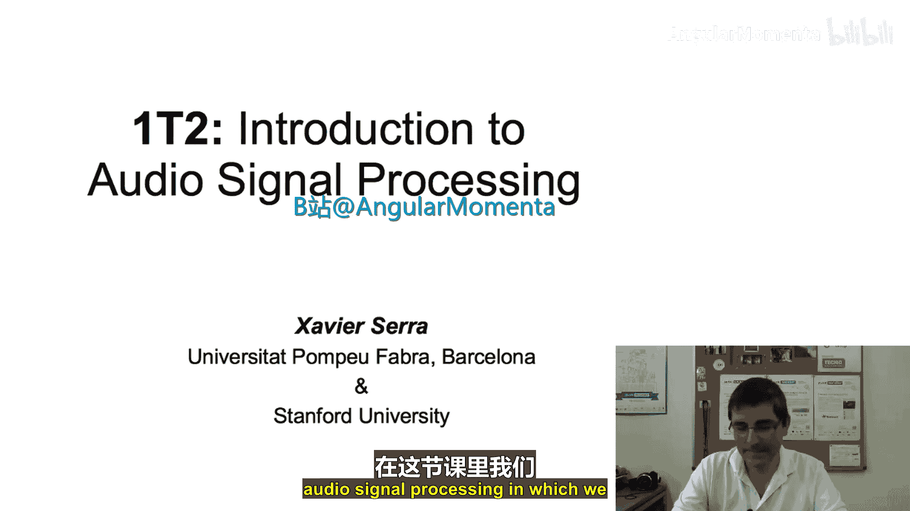
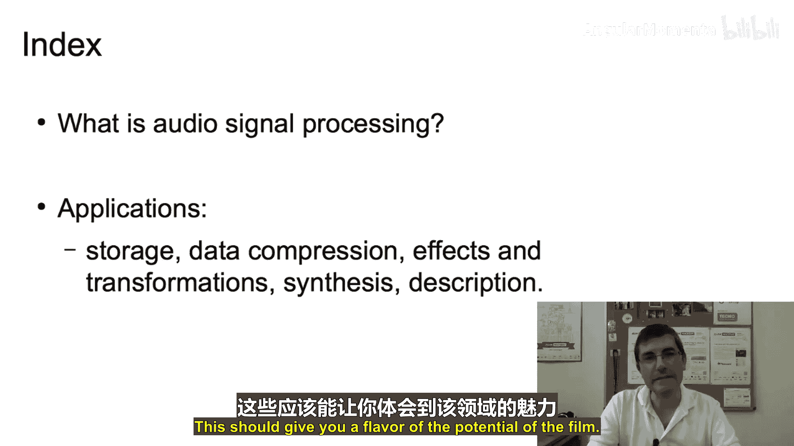
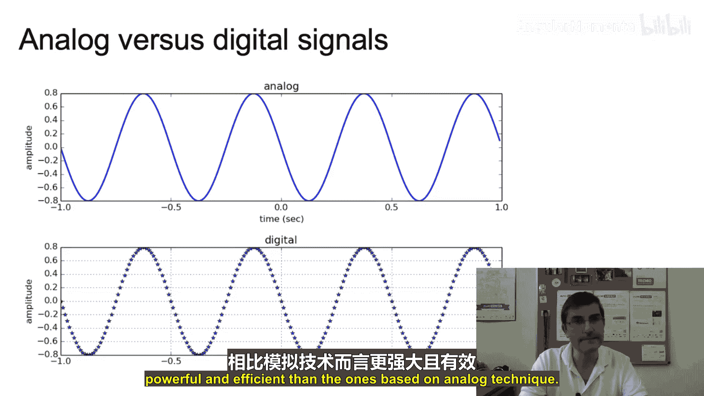
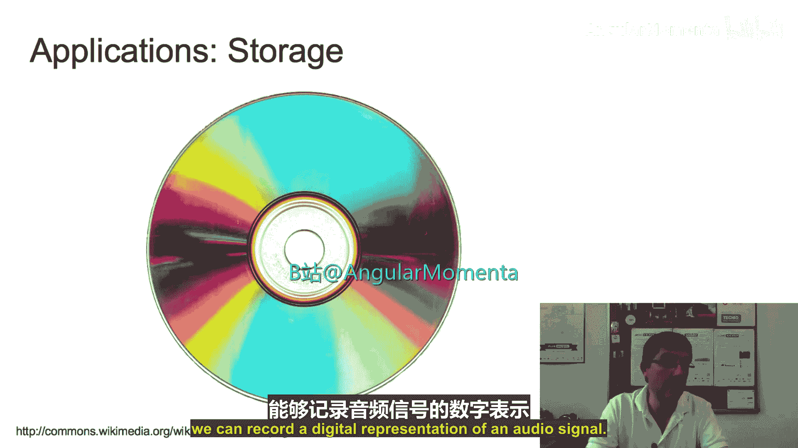
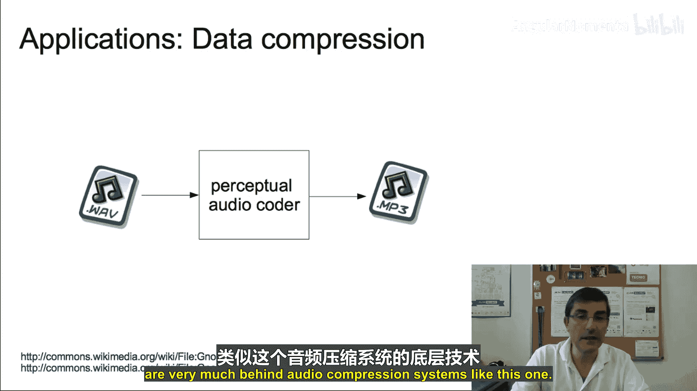
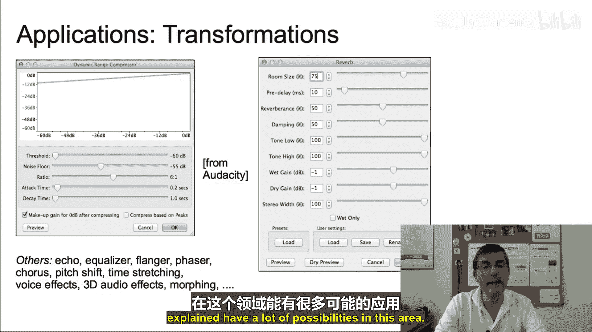
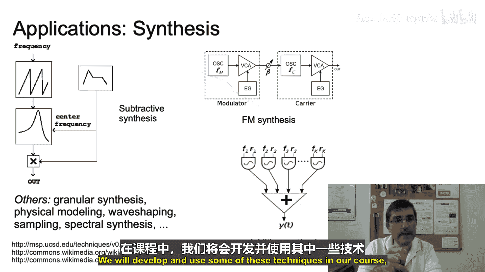
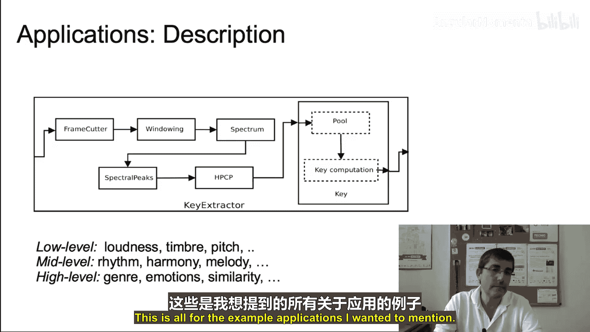
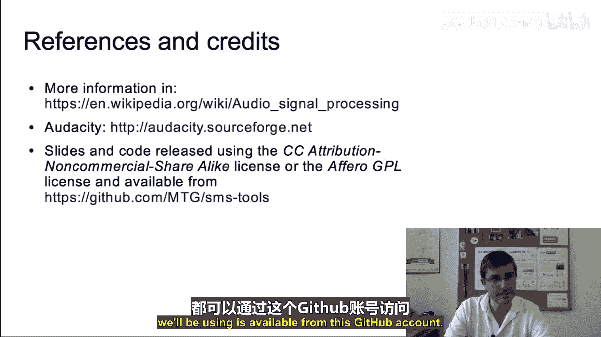
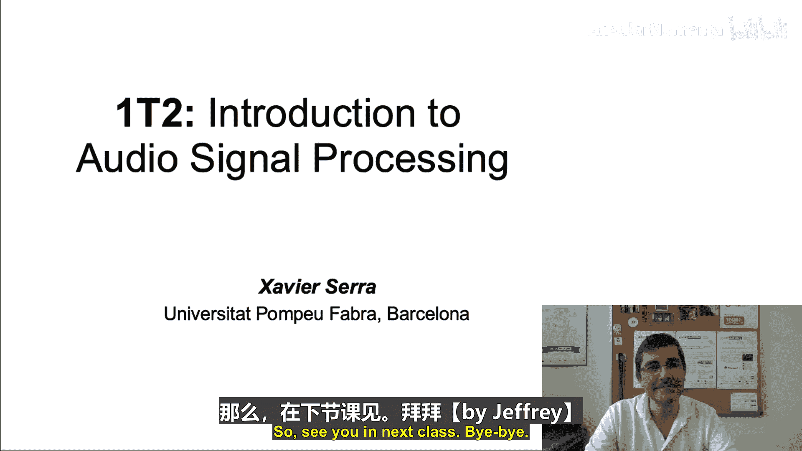

# 【巴塞罗那庞培法布拉大学】音乐应用中的音频信号处理-｜-Audio-Signal-Processing-for-Music-Applications-p03-01_02_01_音频信号处理导论--BV18Xr6BeEX5_p3-

Welcome everyone to the course on now processinging for music applications。

This is an introductory class to our processing。

In which we will introduce the concept of audio signal processing and then we will go over some common music applications of signal processing in particular we will talk about storage。

 about data compression， about effects and transformations， about synthesis。

 and finally about description about audio description。

This should give you a flavor of the potential of the fill。

But first let's define what audio signal processing is and a possible definition would be that audio signal processing is an engineering field that focuses on the computational methods for intentionally altering the sounds so in this block diagram we could represent the concept of an audio signal processing system that is able to take as input an audio signal。

And then using some controls， which could be some human controls or some automatic controls is able to generate another signal being an audio signal or being any other type of information。

Since audio signals sound may be electronically represented in either digital or analog formats。

 signal processing may occur in either domain， analog processors operate directly on the electrical signal while digital processors operate mathematically on the binary representations of that signal。

So let's go a little bit into that concept of analog versus digital signals and an analog sound is usually electrical。

 it's a voltage level representing the air pressure waveform of the sound it is a continuous function like the one shown on top on the top plot on the other hand a digital representation expresses the pressure waveform as binary numbers。

 thus as a discrete function like the one shown in the bottom plot the digital representation permits the use of microprocessors and computers。

Although the conversion from analog to digital can be prone to loss。

 most modern audio systems use this approach because the techniques of digital signal processing are much more powerful and efficient than the ones based on analog techniques。

So now let's start going through some common applications of the audioyn processingtheing techniques。

 one such application is the storage of sounds， thus they recording and reproduction。

 the digital representation of sound waves， such as spoken voice。

 environmental sounds or music can be recorded as electrical or mechanical inscriptions in a media。

And can then be recreated from these inscriptions， so in here we see a picture of an actual CD。

In which we can encode， we can record a digital representation of an audio signal。

Another signal processing application is data compression， or also called audio coding。

 The goal here is to reduce the bandwidth requirements of digital audio streams and the storage size of audio files。

There are two types of compression techniques， the ones call lossless。

 which we do not lose any information with and the ones call loss in which some information at law is lost。

 but hopefully the information lost is not perceptually relevant。

In here we see an example of a perceptual audio coder。That takes as input file WF file。

 so it takes a file that is just the direct representation of the sound in the digital domain without any compression。

 and this is the format call WF。And going through an audio coder。

 a perceptually d audio codeder is able to convert that file into a much smaller file in the format MP3 which is a format that is a very compressed format that is based on the perceptual characteristics of the sounds。

So a number of the basic techniques that we will cover are very much behind audio compression systems like this one。

A large group of applications relate to performing sound transformations。

These type of applications are used in post production and in musically creative usages。

 so for example here we see two screenshots of the application audacity。

In which it includes several plugins， it includes several type of applications that transform audio signals。

So for example， in the left， we see a dynamic compressor。And on the right we see a rebib。

 so these are two types of transformations we can do using audioimproant techniques。

 but there are many others and these would include like E or equalizer or a flger or a phaser。

 corrus， speed shifting， time stretching， voice effects， 3D audio effects。

 morphing and many more in this course we will target a few of these applications。

And most of the methods explained have a lot of possibilities in this area。

Okay， one of the traditional uses of signal processing is related to sound synthesis。

 thus with the aim to generate sounds either by imitating existing sounds or for creating new timbers。

So here we show three block diagrams of three different synthesis techniques on the left top is the diagram of subtractive synthesis in which we start from a rich sound and we filter out components of that rich sound to create another sound。

Or on the top right， we see the FM synthesis which is based on modulating one oscillator by another one。

 modulating the frequency of an oscillator and thus obtaining quite a wide variety of sounds using this technique。

 and on the bottom we see a block diagram of what is known as additive synthesis。

Wwhich maybe is the most intuitive kind of synthesis because it's based on just adding some sinusoids by adding some oscillators and therefore creating complex sounds out of the summation of very simple sounds。

But again， there are many other synthesis techniques that have been developed through the years and this includes granular synthesis。

 the idea of physical modeling or wave shaping or sampling or what is called spectral synthesis and also again many more have been developed and could be mentioned。

 and we will develop and use some of these techniques in our course。

 especially additive synthesises and subtractive synthesis。

The last group of applications that I want to mention are related to sound description。

With techniques for analyzing audio signals with the goal to describe and model meaningful characteristics of the sound。

This is a topic that has expanded enormously in the last few years and that is very relevant in the field of information retrieval or also what is called music information retrieval so in here for example。

 we see a block diagram of an algorithm that is able to extract some meaningful musical concept in particular the concept of the key of a piece of music what relates to the harmony or the chords of some fragment of a piece of music from the audio signal。

 so it starts from an audio signal and then it performs different analysis steps and is able at the end to identify this key of a piece of music。

 which is quite useful and quite relevant for a number of applications。

But when we talk about descriptions， there is a lot of types of descriptions that we can have of a particular audio recording and typically we refer to different levels of descriptions。

😊，We refer to low level descriptors and we refer to descriptors such as loudness， tim， pitch。

 which are very much coming from the audio signal。Or we can refer to what we call meat levelve descriptors that are more musically meaningful and talk about concepts like rhythm。

 harmony， or melody， and finally we can talk about high level descriptors。

 things that are much closer to us to our perception of music and these might relate to concepts like genre or the motions of a piece of music or the concept of similarity。

 what is similar to what。So the automatic description of sounds will be an important application of the topics covered in this course。

 we will not be able to go over the extraction of meat and highle features of a signal。

 but the discussions that we will have on the analysis of low level features are at the basis of the general topic of sound and music description。

And this is all for the example applications I wanted to mention。

And in terms of references and credits， there is a lot， of course。

 that overviews and information about audio signal processing。

 a good overview reference is the audio signal processing entry in Wikipedia。

And all the software that we will use in class is open source， like the program Audacity。

 which I showed a couple of screenshots from and that can be downloaded from this link。And finally。

 all the slides and the code that we are going to be using in this course is also available openly under a C Commons license attribution on commercial share alike for the slides and the documentation and for the code that we'll be using is the license will be a fair GPL。

 which is a very typical open license and all the code that and slides。

That we'll be using is available from this GiHub account。

And thats all that's all for this lecture， I tried to give you a very brief overview of what Aios processinging is。

 giving examples of some application areas。And hopefully this has motivated you to continue in the course and to convince you that it's worth the effort that you will have to dedicate to it。

So see you in next class， bye bye。

