# 【巴塞罗那庞培法布拉大学】音乐应用中的音频信号处理-｜-Audio-Signal-Processing-for-Music-Applications-p04-01_02_02_课程大纲--BV18Xr6BeEX5_p4-

Welcome again to the course and other Sino Praing for music applications。

In the previous theory lecture I gave an overview of the field of as signalal processing as an introduction and motivation to the course Now I want to outline the specific topics that we will present in the course。

 which even though cover a tiny part of the as signalal processing field。

 they are very relevant to understand many concepts and methods used in ainal processing and systems。

 especially the ones for music applications。

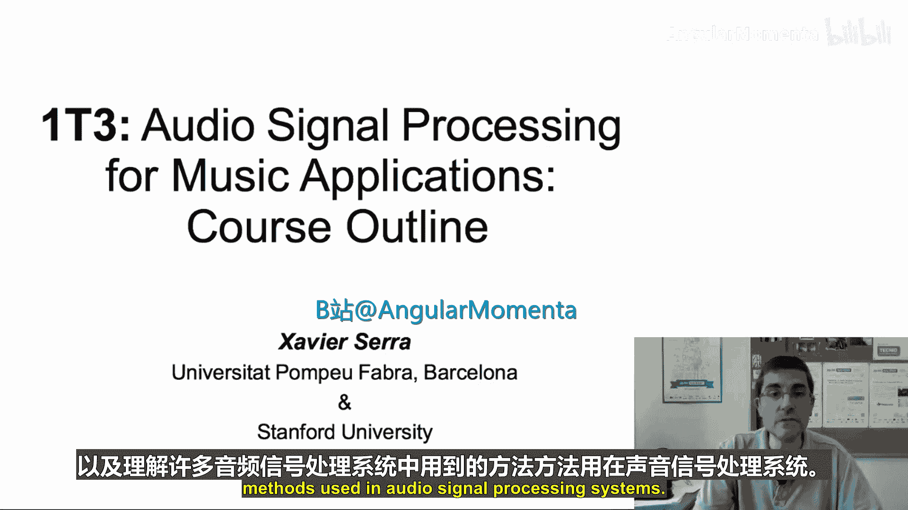

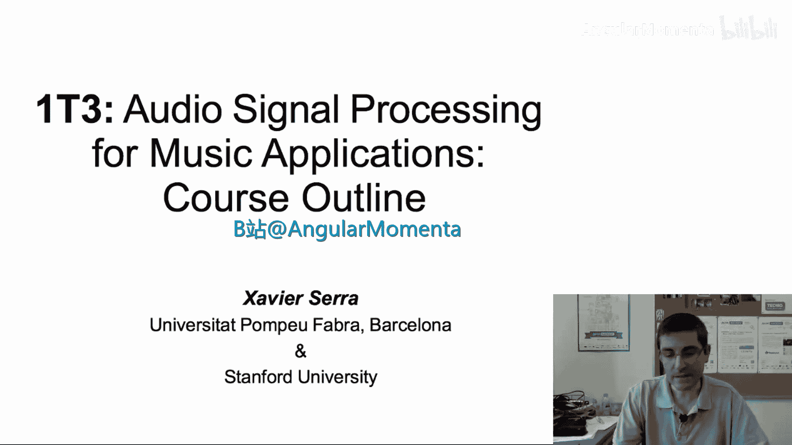

As introduction to the course， this week， we have given a context of the art processinging field。

Given an outline of the course， and we will go over in the next class over the basic mathematics that are required to follow the course。

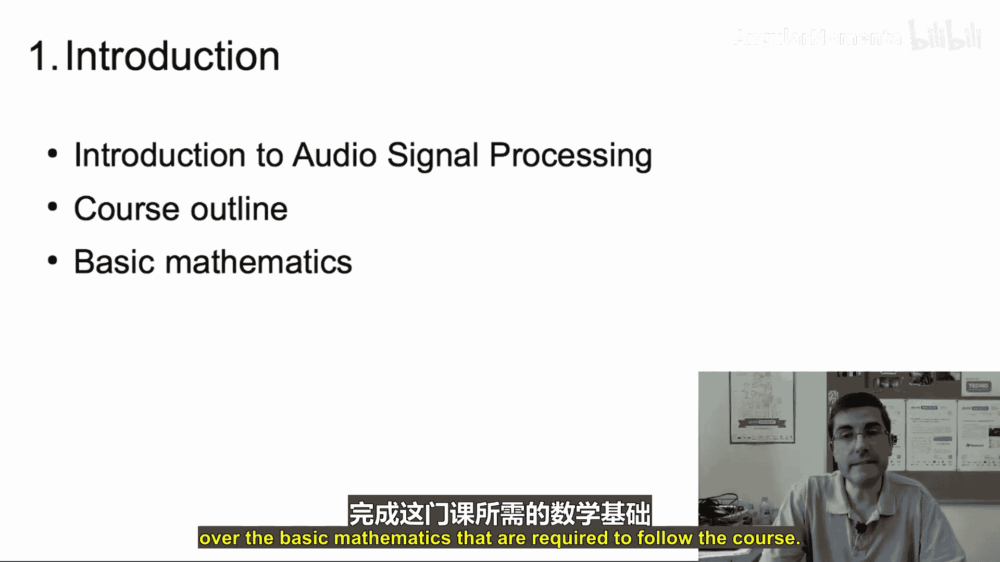

Then next week， we will start by introducing the discrete Fourier transform。

This transform is the basis for everything we will do。

 and we will try to understand every component of it。So we'll go through the DftT equation。

 then we will go through complex exponentials， the scalar product in the DFT。

 the DftT of complex sinusoids， the DftT of real sinusoids。

 and we'll finish with the inverse DFT so to reconstruct the original signal。

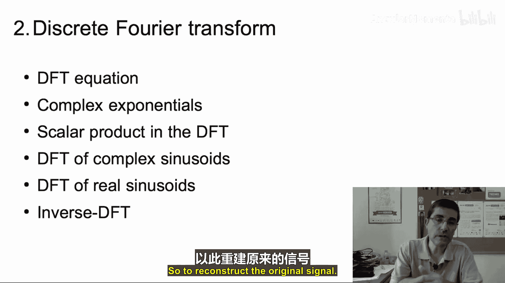

Then in week three， in order to better understand the DFT。

 we will go over the basic theorems and properties of the Fourier transform。

And these are the concept of linearity， shift， symmetry and convolution。

Then we'll talk about energy conservation and decibels。

 the concept of face and wrapping and zero padding。The use of the fast Fourier transform。

 which is the algorithm that we will be using to implement the DFD。

And then the FftT together with the concept of zero phase window in。

 and finally we'll put it together into an analysis synthesis system。

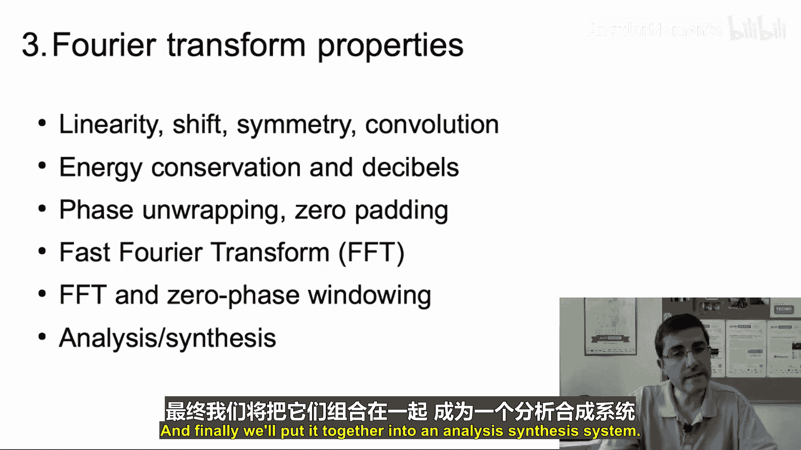

So then， on week 4。We will go to the short time Fourier transform。

 which is the first version of the Fourier transform that can be used in real sounds。

Thus on signals that change in time。We will present the first complete analysis synthesis system of the course that is of some practical use。

So we will start with the SDFT equation， then talk about the analysis window。

 then about the FFT size and hop size and the very common concept which is the time frequency compromise which is fundamental to understand the short time for a transform and finally we will discuss the concept of the inversese short time for a transform。

 so with that we can put together an analysis synthesis system。

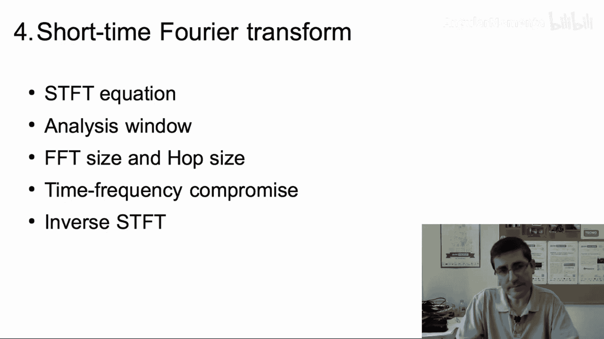

Then on week five， we will go a step further and we will be building on top of the short time period transform what we will call the sinusoidial model。

We will present the equation of the sinusoid model。

 then we will introduce the concept of what are sinusoids seen from the frequency domain seen from the spectrum。

And then we will talk about how we will actually find those sinusoids。

 And the concept is going to be the idea of spectral peaks。

And then we will talk about how to analyze identify these sinusoid in as time varying sine waves in the spectrogram in a time varying spectrum and finally again we' will talk about synthesis so again building up an analysis synthesis system based on this concept of sinusoidal modeling。

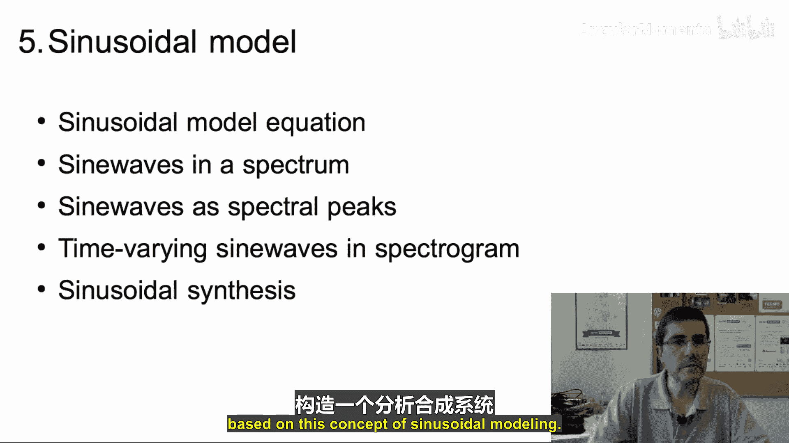

Then the next week on week 6， we will be assuming that sound is harmonic and then if we do that assumption。

 we can develop much more powerful model， but well call the harmonic model。

 which is a sininoceral model in which we add the constraints that all the sinusoids are multiple of a fundamental frequency。

So we'll introduce the harmonic model equation， then we'll talk about three concepts that many times we confuse。

 which is the concept of sinusoids， the concept of partial and the concepts of harmonics。

Then we will introduce the concept of monophonic and polyphonic signals because the analysis techniques we' will be using are quite distinct if we apply them to monophononic or polyphonic signals。

And finally， we'll talk about how to detect the harmonics。To do that。

 we will complement this discussion with the idea of a fundamental frequency detection。

 A harmonic sound is one that has a fundamental frequency。

 so we need to understand these and be able to implement techniques to analyze the fundamental frequency。

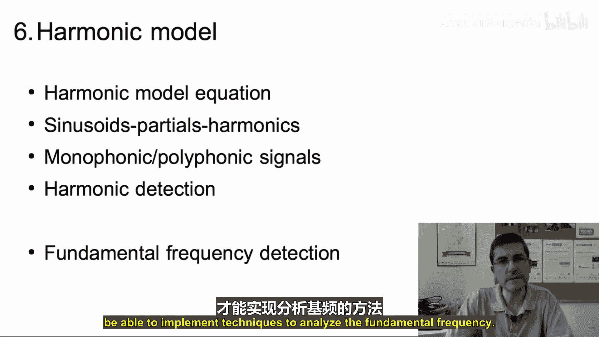

Then， on week 7。We will add some more complexity。Because many sounds cannot be well modeled with sinusoids or with harmonics。

 so we need to worry about the parts of sounds， attacks， nonlinearities。

 noises that are not well modeled with sinusoids。And for this。

 we introduced the idea of modeling sounds with sinusoids plus residual。And in that concept。

 we need to introduce the concept of a stochastic model。

 so how signals can be modeled using this concept of stochastic signals。

Then we will actually talk about how to approximate sounds with these stochastic models。

And then we will introduce this model of sinusoids or harmonics plus residual。

 so the signal that is left that is not model well with sinusoids and harmonics。

 so therefore we will need to talk about subtracting this residual obtaining this residual and then this residual hopefully in many situations can be a stochastic signal and therefore then we can present these sinusoidal or harmonic plus a stochastic model。

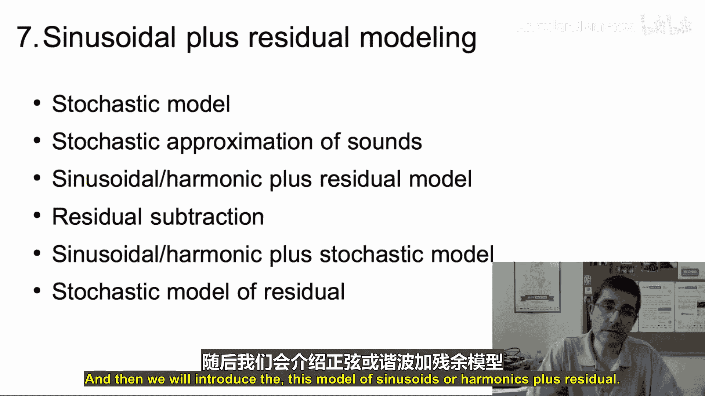

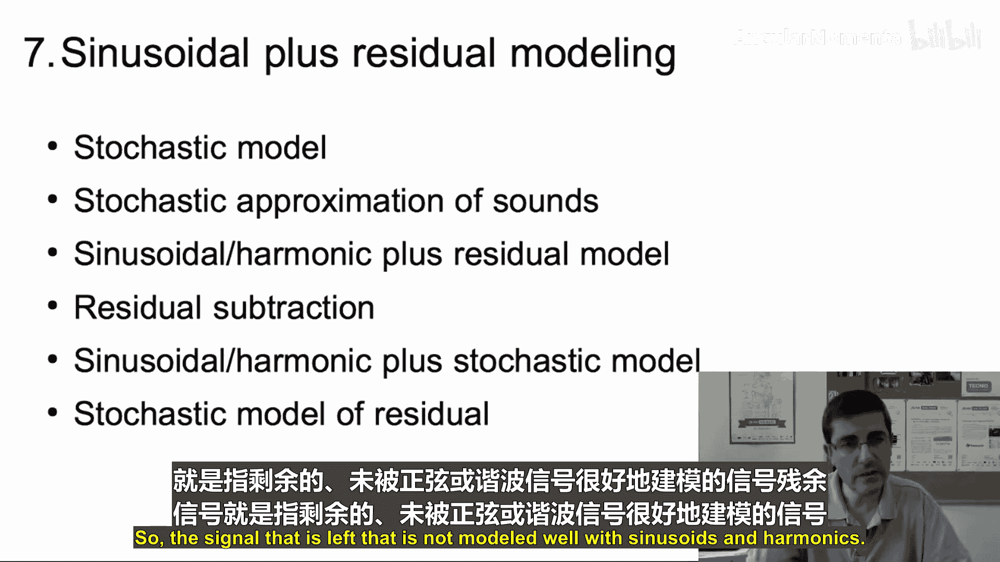

Therefore， for that， we will need to introduce the concept of how to model the residual with this concept of stochastic signals。

 so in this this will be quite dense lecture because well be talking quite a bit about very different models and that complement each other and that can be a little bit complex to understand at the first approximation。

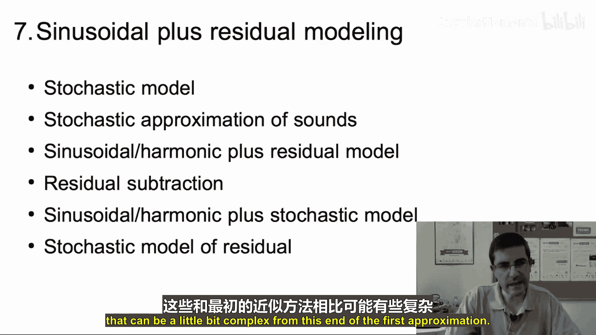

Okay， and then basically， that's gonna be all the models we will be talking about。

 And in the rest of the classes， the the next three classes。

 we will basically talk about applications and more kind of advanced topics。

So as I mentioned in this course， we focus on two types of applications。

 one is sound transformations。 So in this week8 well go over the models that we have presented and show the types of transformations that are possible to do with them。

 So for example， we will talk about the short time for your transform and what can we do in terms of transformation。

 So specifically filtering or morphing then we will go over the sinusoidal model and what type of transformations basically focusing on time and frequency scaling。

Then on the harmonics plus residual model， we will focus on the idea of pitch transposition and finally。

 on the most elaborated model that we will have introduced。

 which is the harmonics plus stochastic model， we will talk about tanmi stretching and morphing。

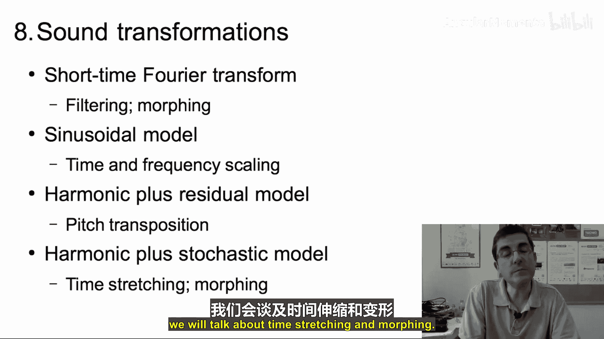

Then on week nine， we will talk about the second measure application we would like to focus on in this class。

 which is the idea of sound description。So with with what we have presented。

 we can extract features of a sound in a way that are relevant to describe it。

So we'll first focus on the idea of audio features that can be obtained from these spectral analyses that we have talked about。

And then we will talk about how to use these type of techniques to describe more complex music or signals and concepts of like a whole collection of sounds。

 how do we handle the analysis of not just one sound， but a collection of sounds？

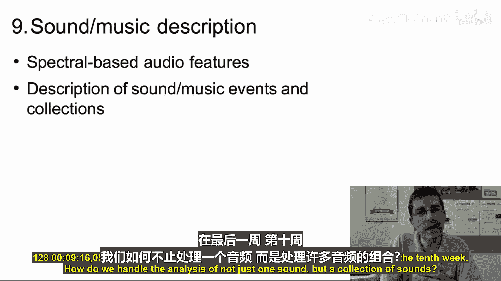

And finally， on the last week of classes on the 10th week。

We will review all the models and outlined related topics that we have not been able to cover in class。

We will present other four Es sound models， and we will also present other models that are not for Es。

So again， so we'll review the class and then go beyond these signal processing for music applications。

 things that we have been talking。

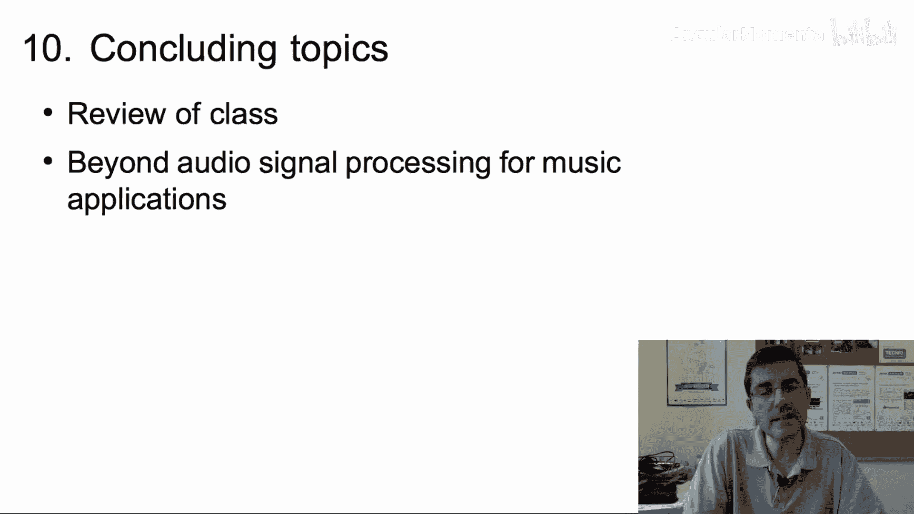

That's all in terms of references， as in every class。

 all the content is available online and with open licenses。

 so feel free to review all the content and have access to everything I have been mentioning。

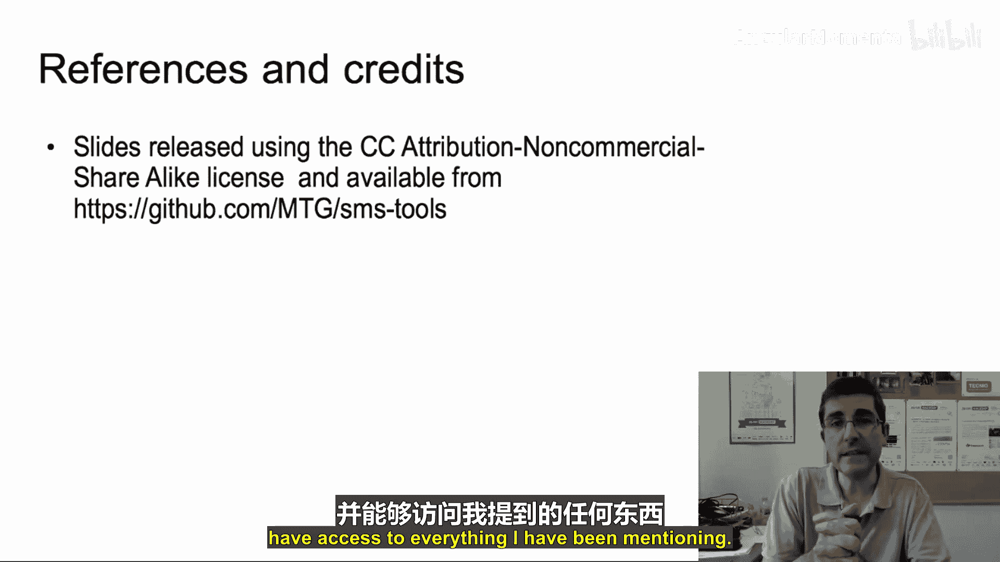

This is all for this lecture we have done a quick outline of the course going over the theory topics that we'll cover so from now on we are really starting going into craing so thank you for your attention and I'll see you next slide。

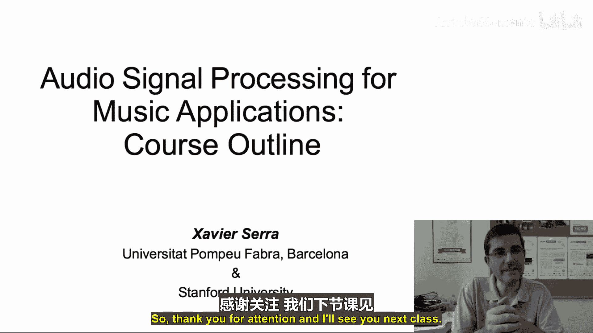