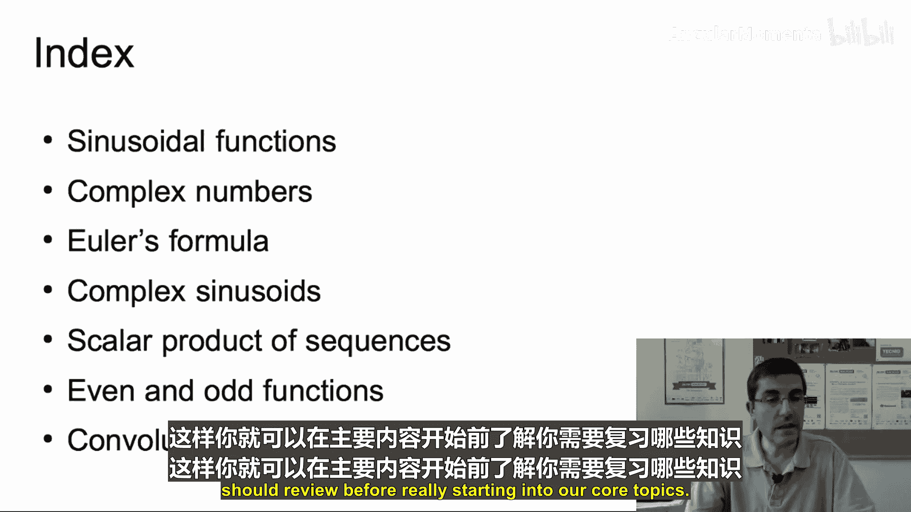
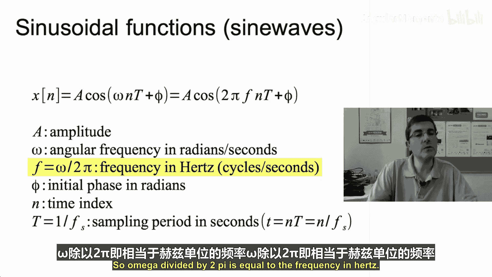
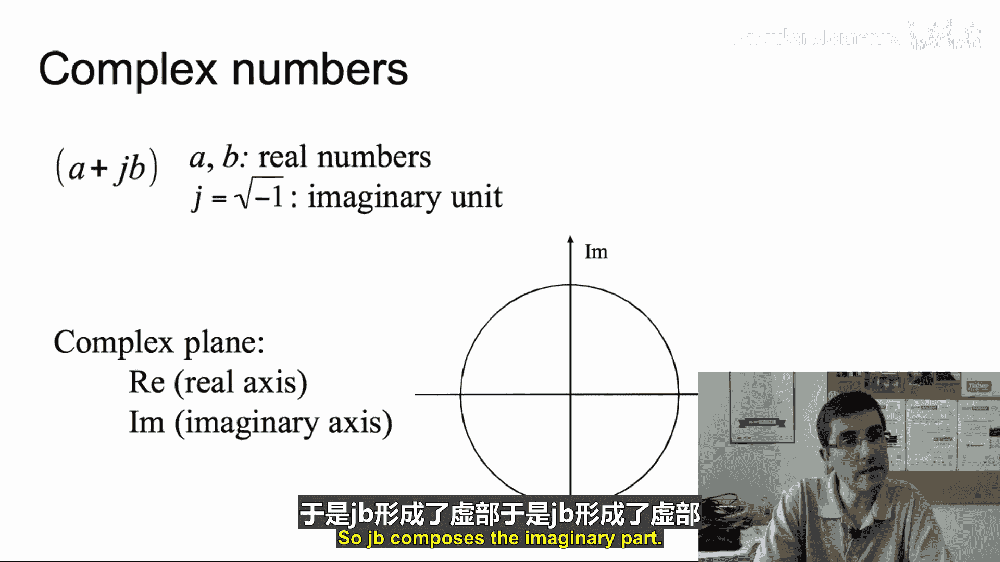
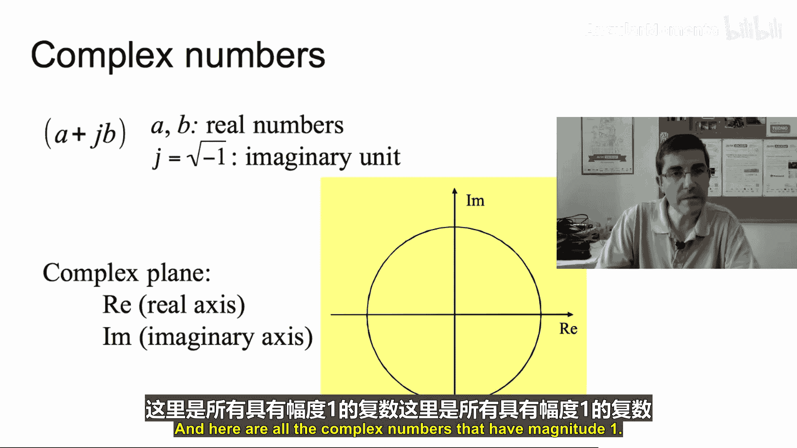
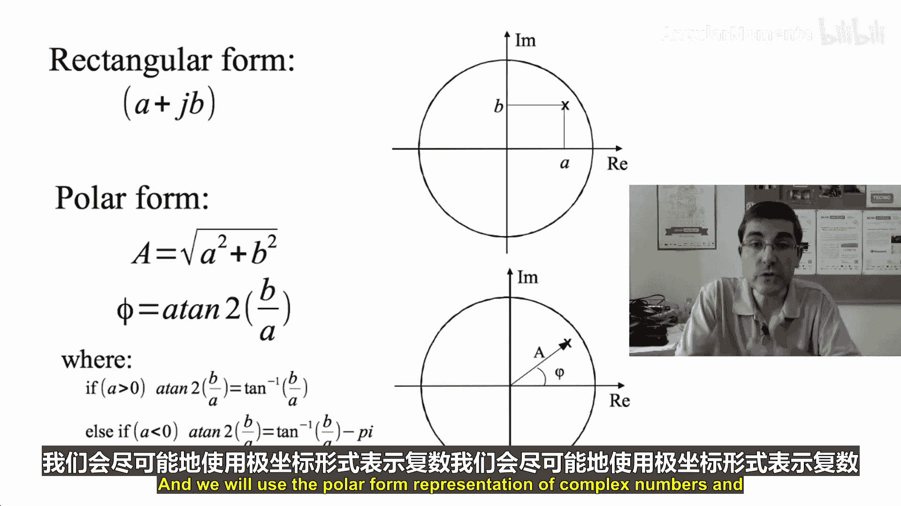
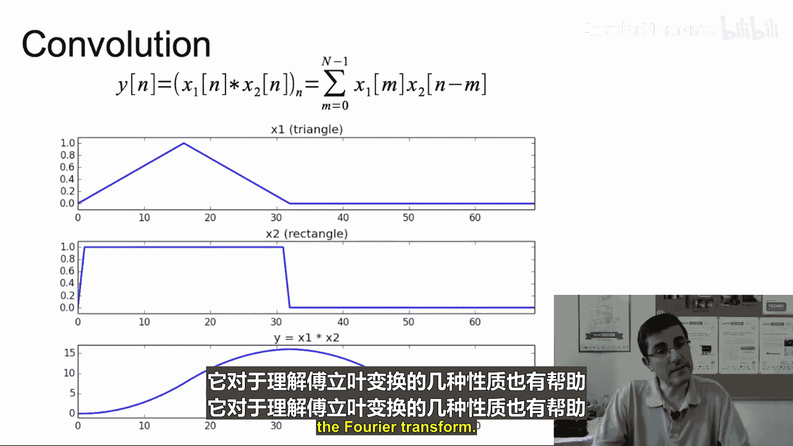
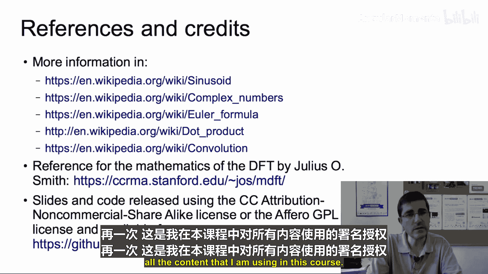
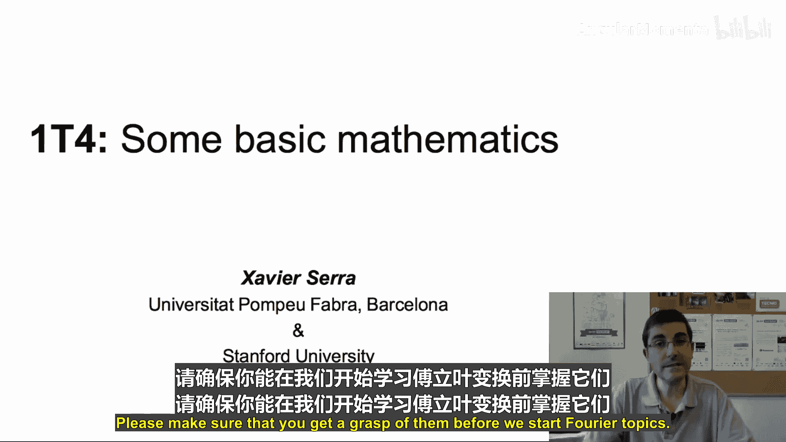

# 【巴塞罗那庞培法布拉大学】音乐应用中的音频信号处理-｜-Audio-Signal-Processing-for-Music-Applications-p05-01_02_03_基础数学--BV18Xr6BeEX5_p5-

Welcome again to the course and Are you pressing for music applications。In this class。

 I want to highlight the basic mathematic concepts that are required to understand what we will cover in the course。

I will not explain them in depth。 So if you have not seen them before or you already forgot them。

 I strongly encourage you to go over them by yourself as soon as possible。

In the context of this course， sounds are discrete signals and the processes that we will develop are discrete systems。

 thus we will require some background on discrete mathematics。

The good news is that no clus is required to follow this course。

You just have to know a little bit about sinusetal functions， complex numbers， U formula。

Complex sinusoids。Skillar product of sequences， even and art functions and convolution。

 And that's not that much。 You really don't need much more than these。

The rest will cover and explain in the course。So let me now present these concepts so you can identify what you should review before really starting into our core topics。

Our first basic concept is the sine wave。A sininoceral function or sine wave is a mathematical curve that describes a smooth。

 repetitive oscillation。It occurs often in physics， engineering and many other fields。

Here we see the equation of a sine wave。X of n， which is our function。

 is equal to capital a times the cosine of omega n capital T plus phi。

So where a is the amplitude of the sine wave。Omega is the angular frequency。

 So it's expressed in radiance。And then n T is basically our time， n is our time index。

 and capital T is our sampling period， so when we multiply n by capital T。

 we obtain the T in seconds。And then the phi is the initial phase also expressed in radiance。

And the frequency can be expressed also in hertz， so to convert the omega into hertz。

 we basically have to divide by2 pi， so omega divided by 2 pi is equal to the frequency in hertz。

Okay， the most common visual representation of a sine wave is this one。

So you see here a plot in which we see the time in the horizontal axis and the amplitude in the vertical axis。

So we can play it。So this is the sound of this sinusoid。And in fact。

 this is the code that generated the sine wave。All our examples and and plots will be generated using Python and all the assignments and exercises2。

 so this is a very simplified code for the sine wave in which we see the amplitude which was 0。8。

 the frequency is 1000 hertz so the frequency we heard is 1000 hertz。

 then there is an initial feehi which is the initial phase at time0。

 which time zero is right in the middle。And then in order to generate the function。

 we need to generate a time array， which is all the time that we will be displaying。

 so a multi an array that goes from minus 0。002 seconds to 0。

002 seconds but of course sampled at the sampling rate at FS。

 and this is the equation that we actually type into Python to generate the sine wave。Okay。

 so another needed basic concept is the one of complex numbers。

 which are numbers that are built of two parts， one part is what we call real part and the other is the imaginary part。

So A would be the real part and B would be the imaginary part in order to represent the imaginary part。

 we multiply by J， which is the imaginary unit。I a square root of minus1。

 so JB composes the imaginary part。

And then these numbers， these complex numbers are normally represented in what we call the complex plane shown here in which the real part is the horizontal axis。

 so is plotted on the horizontal axis and the imaginary part。

 the B value is plotted in the vertical axis。And then we normally have this circle。

 which is magnitude1。 So this is what we call the unit circle。

 in here are all the complex numbers that have magnitude 1。

A complex number can be expressed in two ways in what we call rectangular form or in polar form。

The rectangular form is the most direct form in which we explicitly express the a value。

 the real part and B， the imaginary value and therefore the intersection of these two values in the complex plane with this cross is the actual complex number in polar form what we do is we consider this complex number this cross as the tip of a vector with origin at00。

 therefore as a vector it has a magnitude which is capital A that can be computed from A and B as the square root of the sum of the squares。

 and then it also has an angle and also can be computed from A and B by computing the inverse engine of B over a。

The polar form representation makes the sum and multiplication operations of complex numbers more intuitive for us that will be a great advantage。

 and we will use the polar form representation of complex numbers and functions whenever possible。

Now， let's combine signs and complex numbers。Eer's equation establishes a very useful relationship between rectangular and polar coordinates of a complex number。

So the number E to the J phi， which is a complex exponential。

 can be expressed as the sum of a cosine plus a sine， a real part， cosine phi plus an imaginary part。

 J sine phi。And we can go back and forth in the two directions so we can start from the complex exponential and obtain the real part。

 cosine phi or the imaginary part sine phi and the other way around。It's a nice looking formula。

 and in fact， the physicist Richard Feynman called this equation the most remarkable formula in mathematics。

If we show these in the complex plane in this diagram that we show here。

 we can see these components that we mention， so we see the complex value as the E to the J V。

 which since has magnitude1 is in the unit tu。And we can see the real part and the imaginary part。

 one being the real part， cosine phi。The imaginary part being signed Phi。

So this formula will be fundamental to understand discrete grid for your transform。

 so we will come back to it later。Now， by using sinusoids， complex numbers。

 and what we just have seen the Uular formula， we can introduce complex sinusoids。So in this case。

 the function x of n with a bar is a complex sinusoid。

So it can be expressed with this complex exponential that we just introduced and there are several ways to represent the same function and using this eular's identity。

 so please go through this equation and make sure that you understand it。

We will normally be working with real signals， that's real sinusoids and we will have to go from complex sinusoids。

 the ones that Fourier transform work with to real sinusoids。

 so in here we see the equation of a real sinusoid that we saw before。

 so capital a amplitude times the cosine of omega m plus v。

As can be expressed with the sum of complex sine waves。So a complex sine wave。

 if with sum two of them can generate a real sine wave。

 in fact that seems too complicated and and not so intuitive but its a very useful mathematical trick that Fourier users that in the Fourier transform we need to be able to understand so that basically says that suming two complex sine waves。

 we can cancel the imaginary component of the sinineusoids and keep the real part which is what we normally are going to be interested in。

To plot a complex sine wave is not easy。 We would need to show it in a 3D space。

And a common alternative is to plot the real and imaginary components as two separate functions。

So in here we see the real and imaginary sinusoid， so the in blue is the real part， so it's a cosine。

And in green is the imaginary part。 So it's a sine function。

And that's how we're going to be plotting these complex sine waves。

Another concept to be familiar with is the scalealr or dot product。

 a common algebraic operation between sequences。This is an operation that takes two equal length sequences of numbers and returns a single value。

 This operation can be defined either geometrically or algebraly and algebraically is the sum of the products of the corresponding entries of the two sequences of numbers as is shown here。

 so we have the sequence x sequence y and we just sum over the sample to sample product of each of these sequences。

 and we can show it in an example。 So if we have an example x of n a simple sequence and y of n and another simple sequence complex sequences。

 the dot product will be the point to point multiplication of these two sequences。

 however the second sequence is conjugated So we see here the minus。Of the second sequence。

 because we conjugated the J of the second sequence， and then if we do the whole operation。

 we obtain number， so the scalr product means that we return a single number。

After doing the operation with two sequences。An important property of the scalar product is that when two sequences are orthogonal。

 their scalar product is equal to 0。So here we see this concept。

 x is orthogonal to y if and only if the scalar product of x times y is equal to 0。

So geometrically the dot product can be understood as the projection of one sequence into another and maybe in this diagram we can see this concept so we have two sequences very short sequences one is composed of the values 2 and 2 and the other is composed of the value of2 and minus2 which in the twodial space are orthogonal。

 I mean we see them one being perpendicular to the other and we can prove that by doing the dot product of x times y and so if we do these operation as shown here。

 we can prove that is equal to0。 So the dot product of these two sequences is0 and this is a basic operation that is performed by the discrete for your transform。

Another mathematical concept that will appear in our signal analysis operations is the one of even and odd functions。

So function is even if the negative part of the function。

 So if you say f of minus n is equal to F of n。 So that is what we call a symmetric function。

A odd function is when f of minus n is equal to the minus f of n。

 and this is what we call an antisymmetric signal。So the case of the two functions that we have been talking about cosines and ss very much exemplify these two types of properties。

 a cosine is an even function because is symmetric around the origin about the00 and the s is a odd function because it' antissymmetric around zero。

 we have this anti symmetric。Okay， so this is going to be also relevant in some of the things we will be talking about。

The last concept I want to mention is the one of convolution of sequences。

This is a mathematical operation of two sequences， producing a third sequence that can be viewed as a modified version of one of the original sequences。

Here we see the equation of convolution， I don't have time to go into the detail but please try to understand it and also we can see it graphically if we have these two sequences x sub 1。

 x sub 2 that have different shapes， the resulting sequence。

 the convolve result is a much smoother function。And it's a quite kind of a combination of these two sequences。

 So convolution is is similar to cross correlation。

 It's a common operation used to implement filtering of sounds。

 and it is also useful to understand several of the properties of the Fourier transform。

So the concepts I highlighted in this lecture are extensively covered in many textbooks。

 most of the references I use come from Wikipedia and from the website of Julius Julius Smith on the mathematics of the discrete for your transform reference that I very much recommend that you go through。

So if you want more information in Wikipedia， I have highlighted some of the relevant entries and。

The website of Julius for the book and again， the standard attribution of all the content that I am using in this course。

And these all for this lecture， we have identified the basic mathematic concepts that will be very much needed throughout the course。

Please make sure that you get a grasp of them before we start for your topics。

Thanks for your attention。