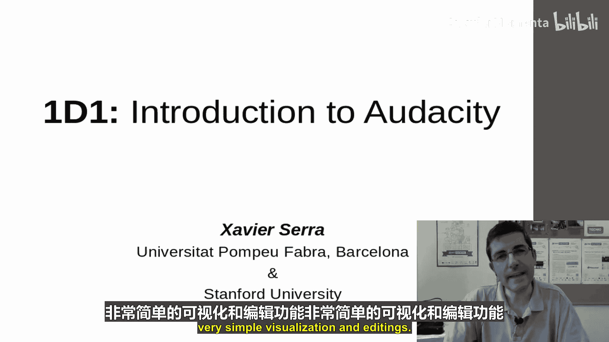
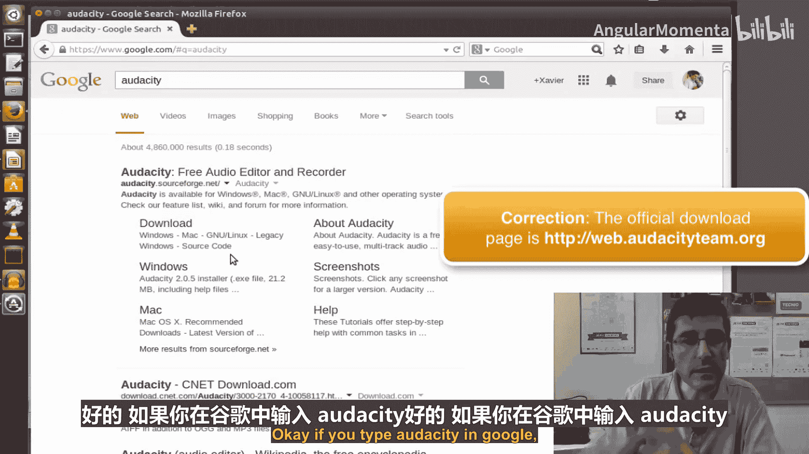
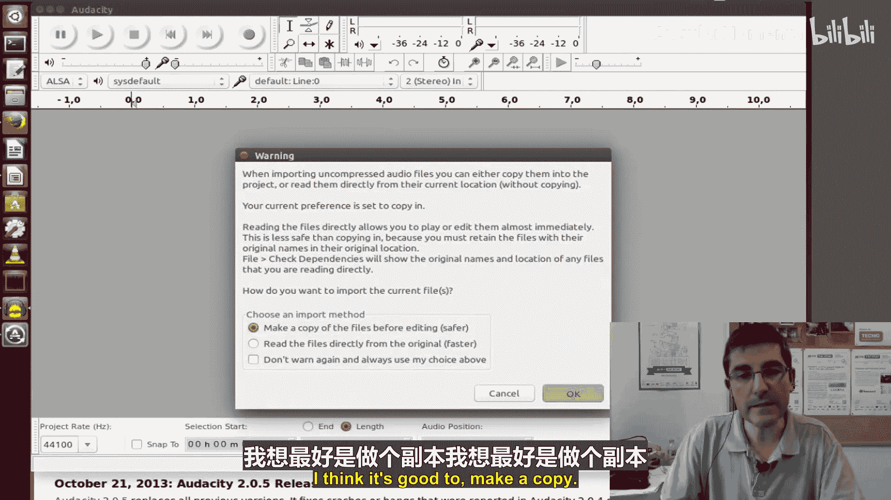
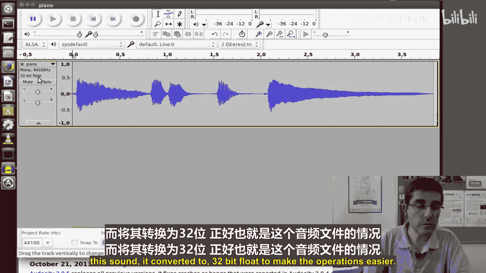
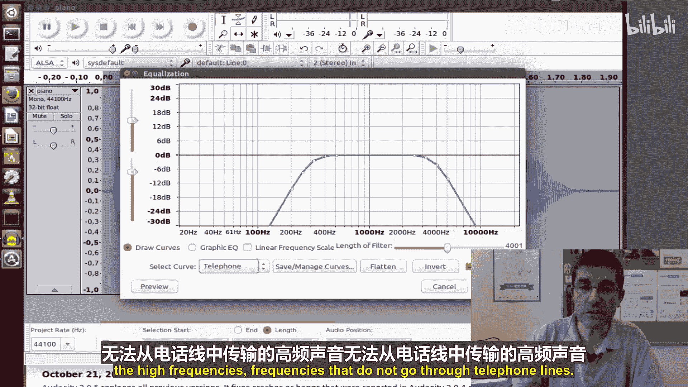
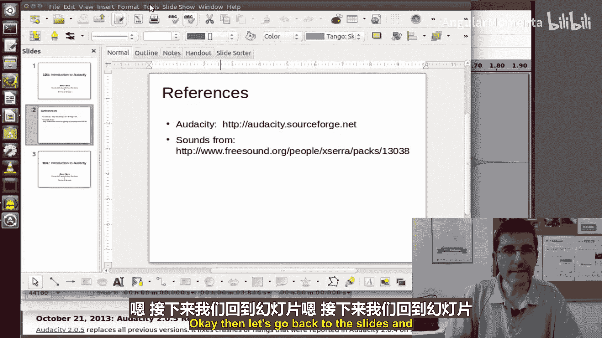
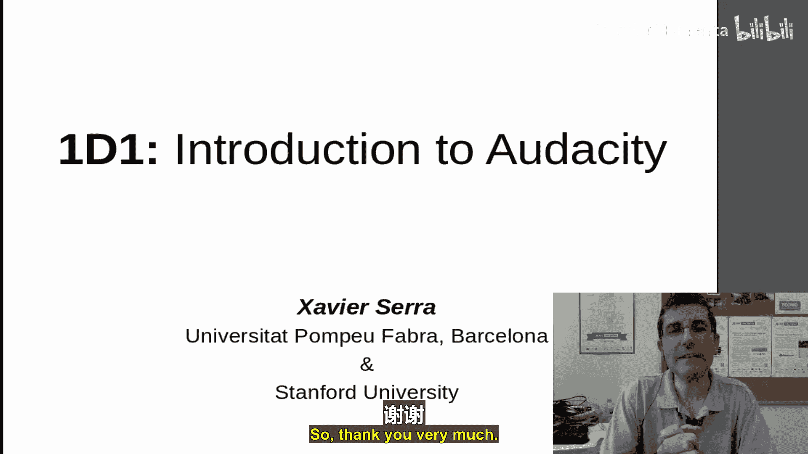

# 【巴塞罗那庞培法布拉大学】音乐应用中的音频信号处理-｜-Audio-Signal-Processing-for-Music-Applications-p06-01_03_01_Audacity入门教程--BV18Xr6BeEX5_p6-

Welcome to the course on audio the scene or processing for music applications。

In this demonstration class， the first class of demonstrations， we will introduce audacity。

Which is an audio software。That is available under all the common platforms， it's free。

 it's available under an open license， going to open license。

And it has been maintained and is supported by a group of volunteers that are doing a great job。

 so it's a great tool that we will use in class。And I recommend you to get a grasp of it。It的。

It's used for quite a few things related to audio editing。

 we will focus on only a few of the things that we need， very simple visualizations and editings。

Let's first go to。B and find it。If you type audacity in Google。

 it will the first link will be this source forge page in which you can get quite a bit of information about it。

 documentation， how to get involved and the download page， you can go directly to downloading。

The the last version of audacity for different platforms in this course， we are using Ubutu。

 So I recommend you to to install it for that platform。 So it's a distribution of Linux。

I already did that there is a good information in this website on how to download it and how to install it。

 so let's go directly to the audacity program。This is the main interface of audacity that has the common menus of sound editors。

Typically， what we want to do is open a sound file。So we go to file open。

 and this is the directory where I keep the sounds that they will be using during the course。

 so let's open this piano Do W file。It asks me if I want to make a copy or use directly the the disc file。

 I think it's good to make a copy。

Okay， and this is the。The visualization of the content of the file， the waveform。

This file has particular formatting and here we have the information about that formatting。

 it's a monophile， one channel， the sampling rate is 44100。And the bit depth is 32 bit float。

 which is the format that audacity uses internally， so even if the original file was 16 bits。

 which is the case for this sound， it converts it to 32 bit float to make the operations easier。

so we can navigate a little bit through this file and that it has the common sort of zooming features and moving around of the sound so you can select a portion of this sound and you can play this fragment。

Okay。🎼We can also， of course， if we don't have anything selected and we go back to the beginning。

 it will play the whole sound file。🎼Yeah。Okay， and one important aspect of visualization is the time。

 we will be selecting， choosing time。 So it's important to get a very accurate reading of time here。

 we have the horizontal axis in seconds。 And when we select a region， it we。

 we see clearly what time we are selecting。 But from below here。

 we see a more accurate reading of the timing。 We have several options of how we display time。

 I recommend to use this milliseconds display。 So from here now， we can see that。

The origin of this section is 402 milliseconds。And the duration of this section。

 because I specify here to visualize the length is 220 milliseconds。That's going to be quite useful。

Then another useful visualization is what we call the spectrogram。

So in here we can click at the spectrogram and we can make it a little bit bigger。

And this is the spectrogram of the piano sound that has been computed from the sound。

And we can see the same the whole piano sound， and again。

 we can do selection playing because this is just a visualization of the sound。

And we can see the harmonics and where the beginning of the nodes are， so it's a quite， I believe。

 much easier way to visualize some aspects of the sound。

There is some parameters that can be chosen to control this analysis and visualization。

 so if we go to edit preferences。And we go to the Spectrogram section。

 we have different parameters that we will talk about in class how to use and how to understand so for example the window size。

 let's just for example， just change it now and let's just change the maximum frequency to visualize to for example。

 1500 and now we see another visualization of the spectrogram having change the parameters。Okay。

 so let's go back to the standard waveform and then let's also talk about what transformations these software can do so under effects there is a whole bunch of transformations that we can apply and we can include many more because these supports an open plugin platform that other developers have been developing for and therefore on the website you can you can use other。

Other plugins to extend this collection of Fx。 For example， let' just use a a simple transformation。

 the equalization， which is a common transformation that might be of use to the kinds of things we' will be doing。

 So， for example， if we。Apply this has different curves。

 which refer to different ways to equalize the sound。For example， let's use like what says telephone。

 which basically means that it filters the sound as it was going through a telephone。

 So it will attenuate the low frequencies and the high frequencies frequencies that do not go through telephone lines Okay so when we apply that。

 then the sound is modified in the time domain， we don't see much。

 but if we go to the frequency domain to the spectrogram。

 we see that the high frequencies have been clearly attenuated for the low frequencies。

 we don't see because there is not enough room， but if we had chosen in the preferences to visualize instead of the first 15000 herz。

 let's say to visualize the first 3000 herz， then we will see that in the low frequencies also。

The frequencies have been attenuated。Okay， and that's basically what I wanted to mention。 Of course。

 you can save the sound files。 you can cut and paste and do quite a lot of things that I believe it's quite easy to to do and from the documentation It's quite easy to understand how to really take advantage of all these functionalities。

 Okay， then let's go back to the slides。

And no。What we talked about today was audacity and so you can go to the website and have all that information from there。

 there is a lot of very interesting documentation for it and for the piano sound use you can get it from free sound and together with all these other sounds that you will be using in class。

So that was all for today we introduce audacity， a sound editor that is quite easy to use。

 quite practical and it's open， so I recommend very much that you download it。

 use it and try to do simple editings that will be useful for later on in the course so thank you very much。

