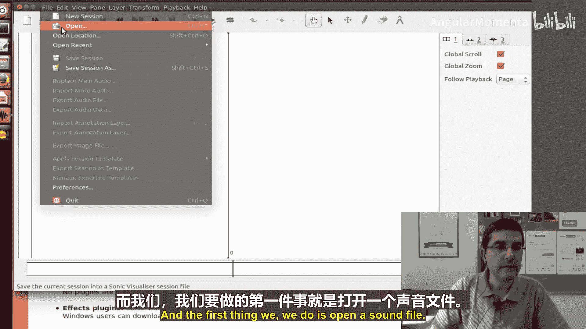
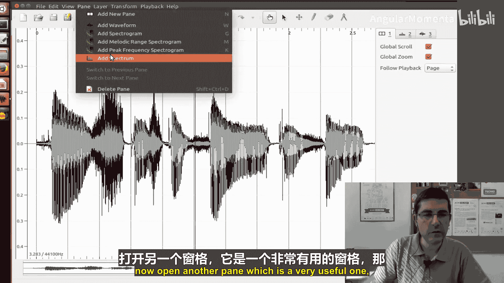
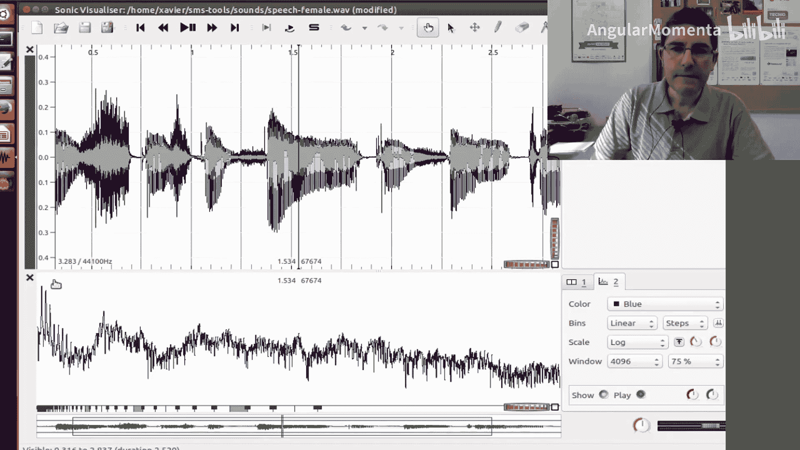
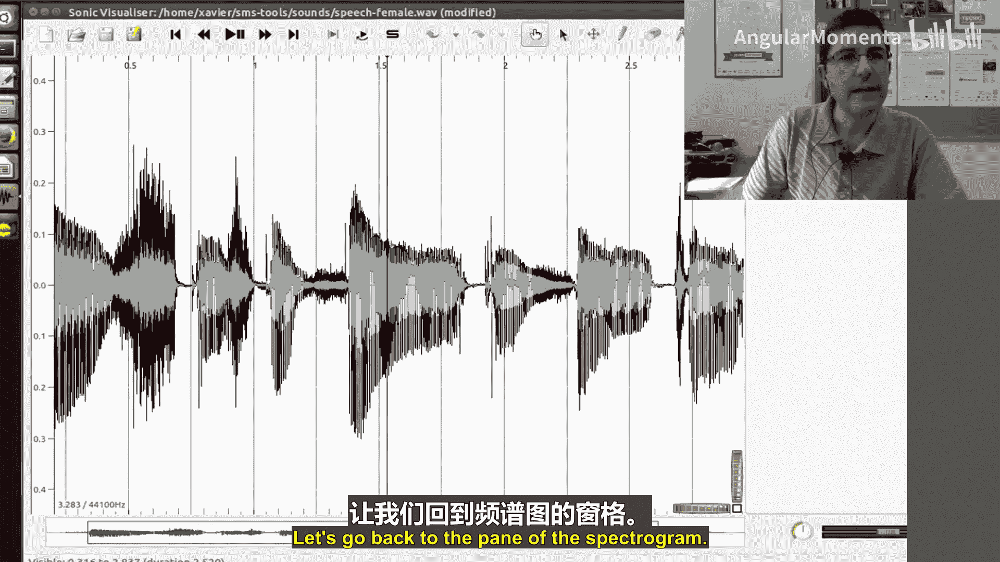
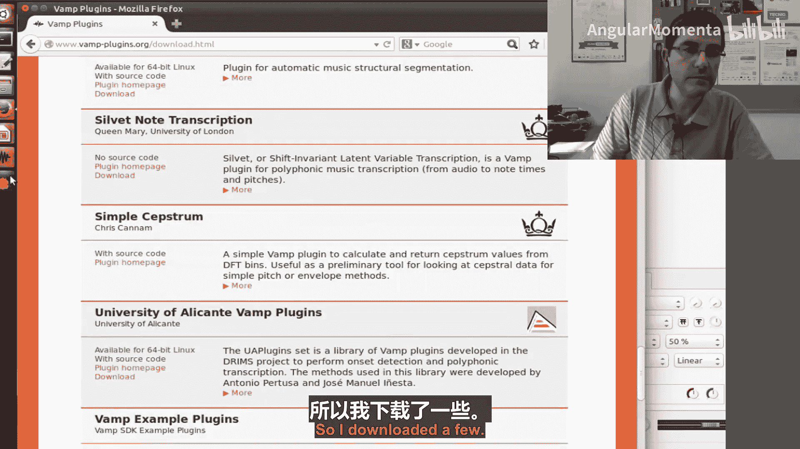
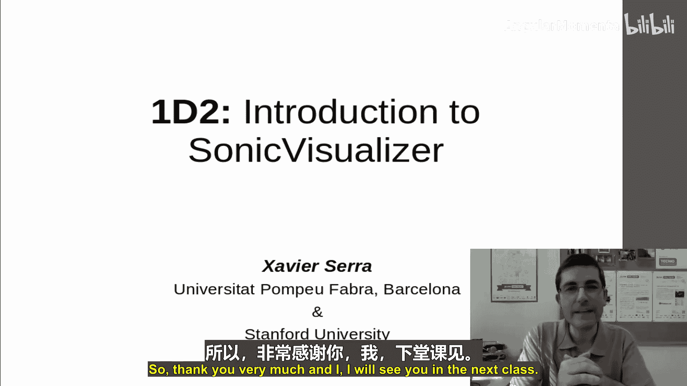

# 【巴塞罗那庞培法布拉大学】音乐应用中的音频信号处理-｜-Audio-Signal-Processing-for-Music-Applications-p07-01_03_02_声波可视化分析入门--BV18Xr6BeEX5_p7-

Welcome back to the course on audio signal processing for music applications。

In the previous demo class we introduced audacity， which was a sound editor quite useful to do small edits and visualizing sound in this class we introduce another sound tool Sonic visualizer。

 which is quite complementary to audacity， it's more oriented towards research and it has a lot of capabilities for analyzing and visualizing advanced aspects of sound。

This is a tool that was developed at Queen Mary in London。

 and it's available under all the comment platforms and distributed with a very open license。

 also the De Gau public license。So it's a very good tool。

 I recommend you very much to install it and use it that will be quite useful for the class。So。

 let's first。Go to where to get it。 if you type in Google Sonic visual visualizer。啊。

It will show that page of Sunigualizer。org。And in it， you will find a lot of information about it。

And projects that had been using this tool and also something that we will talk a little bit about it is the plugin system that it was developed together with Sun visualizer。

 which is these bump plugins。Many people have developed analysis tools for Sonic visualizer using this plugin system。

 so we will be able to have access to quite a bit of algorithms and analysis tools for sound。

If you go to the download page， you can get it for all these command platforms in this class we use Uuntu so we downloaded the Uuntu version。

 I already did that so let's go directly to the program。

This is the main interface of Sony visualizer。And the first thing we do is open a sound file。

This directory， where I keep all the files I will be using in class。 for example。

 let's use this speech female sound。This is the waveform。You can， of course， zoom in。

It is two wheels。 That's quite nice。 And we can play it。 This is the v of Venera。Okay。

 the navigation is quite good and quite powerful。 The navigate through the whole sound。

 So it allows us to zoom in into particular parts that we want to analyze。

A basic concept of sonic visualizer is the idea of panes and layers。

 Paes are basically these windows， So this is a pane in which we are displaying the waveform。Let's。

 for example， open another pane。Which is， for example。

 the spectrogram that we mention also with audacity。 So in here， we're visualizing the pain of。

The spectrogram。And here， the control of the analysis parameters is a little bit easier。

 So we have it right here on the right side。 So for example， we can increase the window size。

And then we can zoom quite more easily and see the harmonics of these speech sound and also we see the kind of the silences and we see the areas in which there is some consonant like these more darker areas in the waveform which correspond to these areas here。

Okay， so that's that's quite good。For example， we can close this pane and now open another pane。

 which is a very useful one， which is the spectrum。

 which is basically one slice of the spectrumtrogram。

Okay so if we move the waveform， the cursor in the waveform， the spectrum changes。Here by default。

 the scale， the horizontal scale， which is what is called the beans， is in lock scale。

I really like better to use it in a linear scale。So this is。The a linear scale of the。

Of the spectrum。 and normally you would like to zoom in or at least show the spectrum in a way that it optimizes the whole range display range。

 So that would be a good way to display it。Okay， and this is quite intuitive。

 and we can try to understand things about the sound。 So， for example， here。

 being in a voice part of the sound， we see the peaks of the the harmonics the shape that we see here are kind of the foments of the voice。

 So that's quite nice。And of course， we can change the parameters quite easily。

Let's go back to the the pane of the spectrogram。

Okay， and now we want to talk about the。The， the plugins system that it offers。 So in here。Okay。

 we display the the structure Ram in a way that might be quite appropriate。

And now I install several plugins， but first let's go to the page of a Sonic visualualizer and we can go to the plugin page so this is a description of the plugin system of Sonicvisualizer and it explains how it works and in fact how to develop for it and there is a link to a list of the plugins that have been developed with this system。

And there is quite a lot。 There is quite a lot。So I downloaded a few。

 so if we go back to the Sun visualizer。

Program， and now here， for example， in transform。There is a list of all the plugins that I have installed。

 and for example， let's use this audio pitch detector。And let's click at that。

 and this is the interface for the analysis。 So these are plugin developed by Poziier。

 and the plugin actually was quoted by Chris Cannon。And it it uses one algorithm。

 which is is the y algorithm。 it's a algorithm that we will talk about in class for detecting the fundamental pitch of a sound。

 This is an implementation using the fast Fourier transform。And they' just say， okay。Okay。

 so what this does is analyze the whole sound。And displays the fundamental frequency。

 and it's displayed on top of the spectrogram as a layer。

This is the other concept that I was mentioning it the layers。嗯。

Are ways to display several things on top of the same pane。

 So here we are seeing the spectrogram and on top of it a layer with the pitch curve that I have analyzed So if we zoom we see clearly these green pitch curve and we will discuss this in class but we can see that is identifying the first harmonic of the sound and in some areas that there is no harmonics it clearly it it gets confused but in the voice parts in the parts that are harmonic it finds it quite easily if we change the window size of the spectrogram bigger so we see the lines more clear then maybe this becomes more obvious。

And。And we can see that the pitch analysis did a decent job in identifying the fundamental frequency of this speech sound。

Okay， and that's all I wanted to mention for a Sonic visualizer。Let's go back to the slides。😔。

So you can go to the Sonic visualualizer page to get information about the program。

 there is the plugin， the v plugin， it has a special page that you can access to it from the Sonic visualizer page we mentioned about the in pitch detection algorithm that we will cover later on and there are quite a few references about it and this pitch sound up came from free sound。

And that's all for today， so introduce another sound visualization tool that's going to be quite useful for the more advanced and scientific visualization that we'll talk about in class。

So thank you very much。 and I will see you next class。

