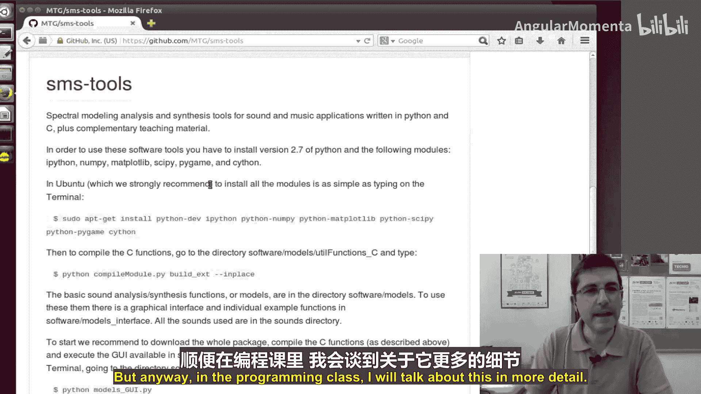
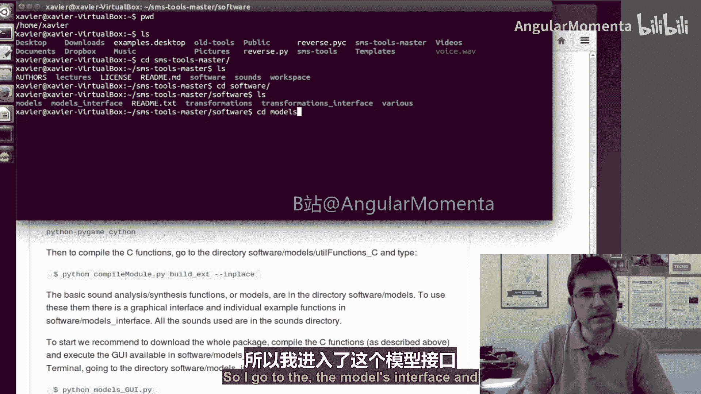
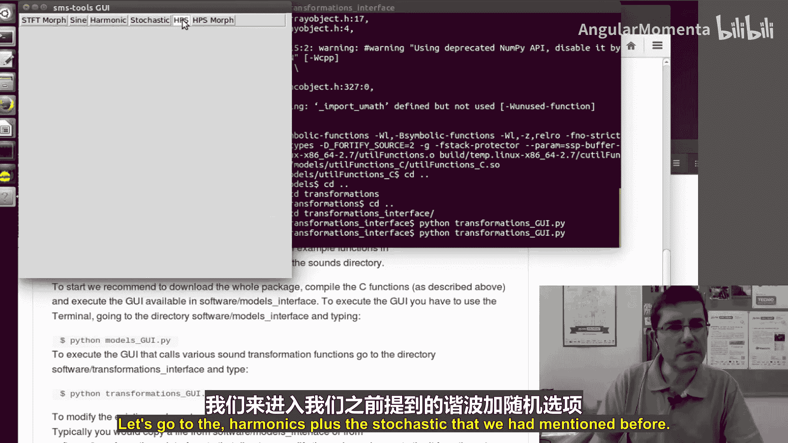
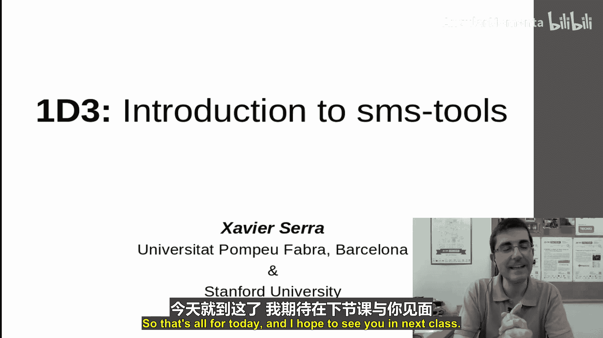

# 【巴塞罗那庞培法布拉大学】音乐应用中的音频信号处理-｜-Audio-Signal-Processing-for-Music-Applications-p08-01_03_03_短信工具简介--BV18Xr6BeEX5_p8-

Welcome everyone back to the course on audio signal processing for music applications。

In the previous two demo lectures， we introduced two audio tools， audacity and Sonic visualizer。

 which were quite useful for visualizing editing， analyzing sounds。

 and in this lecture I want to introduce the tools that have been developed specifically for this course。

That have been developed using Python and that we will very much go into detail into all the programming classes and a lot of the demos also will be using those tools。

Let me first go to the page where these tools are available， it's in a GiHub repository。

 I will talk about that in the programming lecture and it has this under the directory NTG and SMS tools。

In here， I will be constantly updating the tools as things are being developed and bugs are being fake。

 etc cetera， so I recommend you to download the latest version that you can find。

And here you can download a zip file and you can follow the instructions here to compile。

I don't think it's that difficult under Uuntu， but anyway in the programming class。

 I will talk about this in more detail。

This is a tool that or a set of tools that do not have sort of an icon that I can click to。

 so the way to access the tools is through the terminal。This is the terminal in Uundtu。

When you open the terminal， it goes to your home directory。 So this is my home directory。And in it。

 I have a few directories that I have been using for this class。

When I download the SMS tools package， it creates this directory SMS toolsol master。

So to execute the examples， I have to go into that directly。I just type SMS。

 by the way a very good key to use is the tap key， which is now to complete。

 it allows us to go quite quickly to subdirecties or to complete names of files。Okay。

 so this is the directory of。Of the S M S tools。 Again， it has some subdirecties。

 It has the lectures。 It has software。 It has the sounds that I have been using。

 and it has a workspace directory， which I recommend you to use as a place to work from。

But now I want to go to the interfaces for demonstrating some of these tools。

 and these are within the software directory。In the sub directory again。

 there is some subdirecties and that the interface I want to use are the models interface。Okay。

 so I go to the models。

Interface。And in it， there is quite a few files， but there is a main interface for all the files。

 And that's what is called the models。GY dot bY。Okay， so we can execute this file。

 and through that interface， I will have access to all of them to execute a Python file。

 I can just type Python。And the name of the Python file。 So if I type models G dot PY。

 it will execute this Python file。So this is an interface， so it has opened up these small interface。

And in it， I have access to all the different analysis。

 synthesis tools that we will be talking about in class like， for example， the DFT。

 the SDFT assign model， harmonic model， stochastic model。

 signal plus residual signal plus stochastic harmonic plus residual and harmonic plus is stochastic。

 that's quite a lot。 but we will go through all of them in both the demo and in the programming lectures。

To put you an example of how these things work， let's just go for example to the short time for a transform。

This is one of the first models that we will talk about and here we can input a file by default default that is always something that makes sense。

 but let's go to another file， So this is the directory of my sound， for example。

 let use this orchestra sound。And then we can play from here。Okay。

 this is a recording of a Chinese orchestra playing fragment。And in here。

 we have a whole bunch of parameters that well be using to analyze this sound。

 let's just use the default parameters and click compute。Okay and this is what it has computed。

This was the original file input sound。X signal。 and then it has analyzed the spectrogram。

 like the ones we're seeing in audacity and soundnic visualizer。

 But now we have actually computed with our own program。

 and it has a little bit more control than in audacity and soundnic visualizer。

 We can see the magnitude of the spectrogram。 And also， we can see the phase of the spectrogram。

 which we'll talk about that。 And then it can。🎼Imbse this process and reynthesize the original sound output sound。

 the Y signal。 and in from the interface， we can play this output sound。Okay。

 so that's basically the same。So that means that this analysis synthesis has worked quite well in terms of an identity system。

 So that's good。 Let's go to another of these models。

 Maybe the the most sophisticated one that we will do， which is called the harmonics plus stochastic。

Representation。 and again， let's maybe take another sound instead of this sax phrasese。

 Let's take the short version。 So it's going to be quicker。 Okay， and let's play it。

This is a s phrase and again， we can analyze a whole bunch of things and define many parameters。

 Let's just compute it。So this is a model that is more sophisticated than four things it takes a little bit more time and this is the result of these analysis。

 this is the input sound we just heard， this is the analysis representation we have computed that shows the harmonics and what we call the stochastic representation and this is the synthesis by looking at it。

 it's quite similar to the original， let's just listen to that。Okay， so yes， it's quite similar。

 but in this analysis what we have done is analyze two aspects of the sound。

 one that we call sinusoid， and let's hear that。Whi basically captures most of the components of what is interesting in the sound。

 but also has a residual which is modeled as an e stochastic signal that we can also listen to。Okay。

 it's quite soft。 but if you pay attention is is there and is basically the the breathing part air part of of the sound that is。

Quite relevant in， in many sounds。And。Okay， let's close this interface and let's go to another interface that we also will be using。

 And so we go back by doing this。Okay， and now we are again in the main directory of the tools。

 And if we go to the software。And instead of going to the models interface。

 we go to the transformations。Okay， so we go to the transformations。Interface。And these are。Programs。

 algorithms that what they do is transform the sound using the models that we just saw。 and again。

 it has a whole bunch of of transformations， and there is one which is the main the main interface。

 which is this transformations GY。So we can execute this file by typing Python and the name of this file。

Okay， so in here we have a number of possibilities to transform different sounds using the models we talked about。

 so for example， we can do a morph with a short time very transform。

 we can do transformation with the design model， transformation with the harmonic model with the stochastic model。

 the harmonic plus it stochastic and do a morph with the harmonic plus stochastic。

 let's go to the harmonic plus stochastic that we mentioned before and let's instead of the s phrase。

 let's just maybe take a shorter phrase， a s phrase but short。

Okay， we can play it。うんん。And with the default parameters， let's analyze it。Okay。

 this is the original sound， this is the analysis that we did。

 so we see the harmonics and the stochastic component and the resynthesize which looks。

Like what we did before。 So it looks quite good。 And now let's go back to the interface and we can apply some transformations。

 There is some values here。 But let's just erase this。 and let's put some。😊。

Sort of identity parameters。 So identity means that there is no change。 So frequency is scaling。

 there is a time value appears。 So at time 0， we can put frequency scaling of1。

 So that means there is no scaling。 And then at time 1 at the end we just put the same thing。

 So that means no frequency scaling frequency stretching we will do the same thing。 So we will do0，1。

1，1 and time scaling， we are not gonna to do any time scaling。 So at time 0。

 we will have time 0 and at time 1， we have time 1。 So at the time is normal。

 So we can put any values。 but means that we can just work also from 0 to 1。

 And in here in terms of timeber preservation。 Let's put0。 So it doesn't do anything。 Okay。

 so let's apply the transformation。And now we can listen to it。🎼Okay， we haven't done anything。

But now let's do some change。 For example， what can we do。

 So let's transpo to an octave higher what that would mean。 So it means I would just put 0，2 and1，2。

 okay。And now if we played that。诶。And if we do timber preservation。

 that means it tries to maintain kind of the timur。It will sound a little bit better。

OkayBut we can do other things。 for example， let's do a time frequency stretching。

 Fr stretching can be， let's put this back to what it was。

 It's kind of a stretching the partials and then make them and not equally space。 So if we start。

 for example， starting from at time 0。 we stretch it a little bit and at time1。

 then we stretch it quite a bit more。 Okay， we stretch it 1。01 and here 1。1。

 let's apply this transformation。And here you see that the harmononicies kind of go up and they sort of get more separated as as the frequencies go higher。

 Let's hear that。Okay， so we hear this kind of in harmonicity in the higher frequencies， of course。

 if we make a larger later stretching。啊。We can have a much stronger effect。

And these will be very pronounced。Okay， and we can put go back to the no transformation in terms of frequency stretching。

And 0，1，1，1。 and then let's do some time stretching。 So at 0，0， for example， let's do that at 05。

 we compress the sound， So we we do much shorter， so let's say。Po25。

 So it's going to be half of the duration。 And then at time1， we leave it the same。

 So it's going to go faster at the beginning， and then it will go slower towards then。

Let's hear that。and if we played。So it has gone faster at the very beginning。

 first half of the sound， and then the second half of the sound has slowed down。Okay。

 that's just a very brief example again we will talk quite a bit more about these programs。

 these tools and hopefully we'll have fun trying all these things out。嗯。And that was it。

We if you want to know more about these SMS tools， of course， follow the class。

 we will go quite deep into that and you can go to this directory for the actual code and again all these sounds come from Prison。

So this was also in these three demo lectures of this first week， we have presented three tools。

 three applications， audacity， Sonic visualizer and our own tools。

 hopefully this gives you an overview of the type of tools that can be of used to manipulate audio。

And hopefully this has given you an interest in following the course and really trying to understand what is behind this。

So in the demo lectures we will just make sort of introduction to the tools and from from a very practical application。

 but then in the programming classes and of course in the theory lectures we will go deeply in trying to understand all these things so that's all for today and I hope to see you in next class Thank you。

