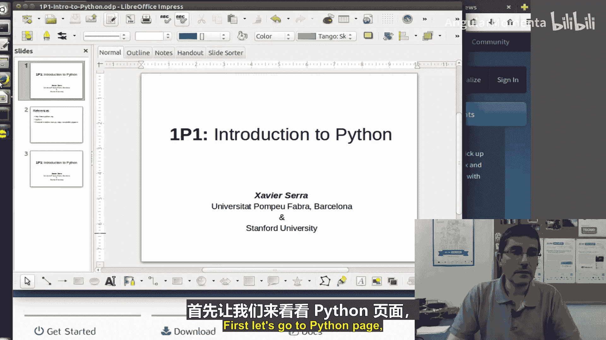
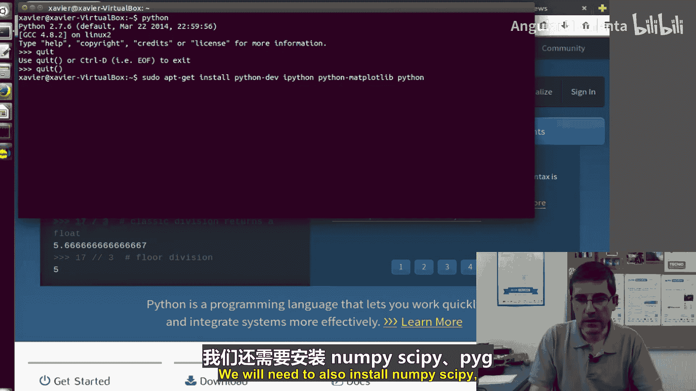
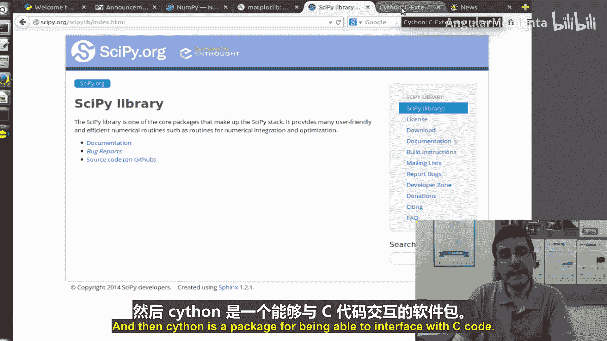
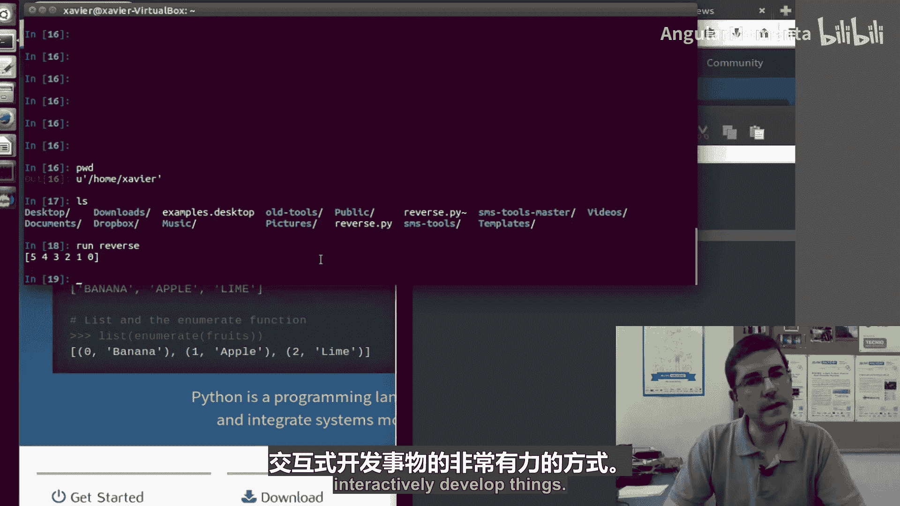
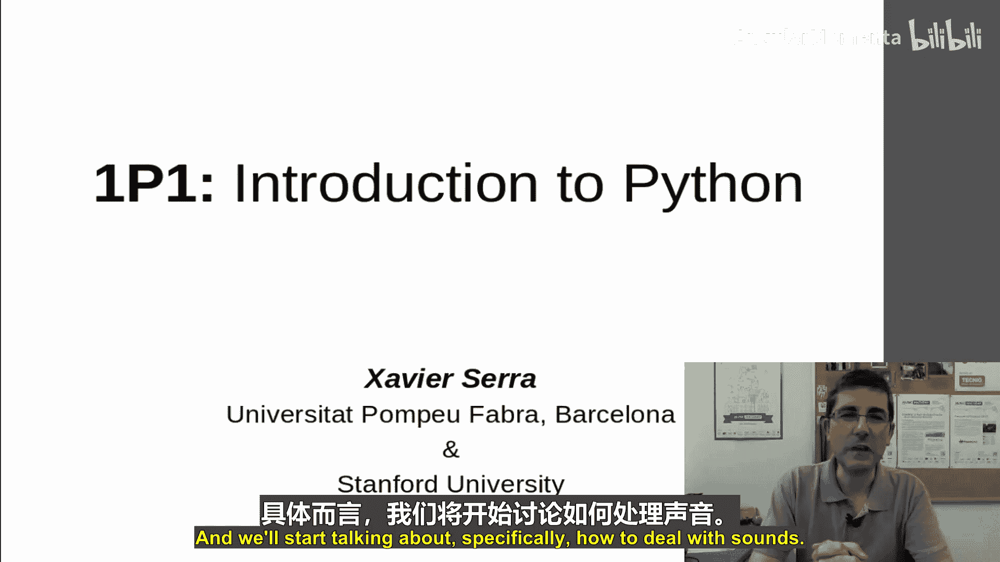

# 【巴塞罗那庞培法布拉大学】音乐应用中的音频信号处理-｜-Audio-Signal-Processing-for-Music-Applications-p09-01_04_01_Python入门--BV18Xr6BeEX5_p9-

Welcome to the course on audio usinging or processingces for music applications and to this first programming class in this lecture we introduce Python。

 which is a high level programming language that we will use throughout the course very much in a lot of the things we will be programming with all the assignments。

 but this is not a programming course， we will be just doing simple programs。

And there is no need to have an extensive background in programming。

 but please try to make sure that you have some proficiency in Python and on Uuntu so that you can do the assignments and understand what we will be doing。

嗯。First， let's。

Go to Python page。 this is Python。org。 This is the main page for Python in which you will find a lot of tutorials and information about it。

In the case of Uuntu， Python comes installed with it。 So if you open a terminal anti Python。

You will see that it shows the version of Python that is installed in this particular case， 2。7。

6 so this is good and in fact you can already start typing and interacting with Python here。

There are many different versions of Python， especially there is a newer version 3。 something。

 and in our particular case we would like to use 2。

7 a lot of the packages we need to use are only available under 2。

7 so please make sure that you have version 2。7。 something in install under Ubutu and that you're able to execute it from the terminal。

Okay， now apart from the basic installation of Python， we need to use several packages。

 several collections of functions that are going to be important for our course。In particular。

 in order to install them， we need to use the standard。Installation application that Ubutu has。

 which is called app gett。 But in order to install， we need to have。Super user。Permission。

 so well do Su upt and then。We need to install a whole bunch of packages。 In particular。

 we need to install the basic development tools。 Then we will need to install I Python。Then。

 we need to install。Mala lip。诶。We will need， also， to install Ny。

S牌。诶。By game。 And finally， sighttan。Okay， since we are in super user， we need to give the password。

Okay， and in my particular case， I have already installed all these packages。

 so it doesn't need to install anything else。Okay all these packages are quite wellknown packages and you can find quite a bit of information about them。

 So for example， I Python， which is the interactive shell that we will be using or Ny。

 which is the package for doing array processing All our sounds are going to be arrays。

 so we will be using Ny to process these array of numbers。Well be plotting a lot of things。

 So Matpl leak is going to be our package for plotting sounds and all these analysis that we will be generating。

Sip Pi is the package for signal processing， and a lot of the functions we'll be using come from this package。

And then Ctan is a package for being able to interface with C code。

 There will be a number of functions in our code that is written in C in order to compile it。

 We will need to use Ctan。 So all these are extension of Python that will be necessary to have for our course。

 So please make sure that you install them and in the class we will talk about them a little bit。

Okay， let's start， so in order to start， we will just use I Python。Okay。

 so we type I Python and it already tells me the version of Python， again that I Python uses。

 which is the same one that the system install， which is 2。7。6。 That's good。

 And in here gives me some shell interactive shell that it can start typing commands and do operations。

 So for example， we can do standard aromamedtic operations。 We can just declare variables。

And operate with them。And in order to deal with sounds， as I said。

 we need to deal with arrays in order to do that， we need to import the package for array operation which was Npy so we do import Npy and we normally will give it a name to refer to it so that we don't have to type everything so we just for example。

 import Npy as NP and now we have all the functions of Npy there so we can now declare a variable a that is going to be an array so we can call the function of NP called array and we just can create an array of different numbers。

For example， like this， Okay， and this is the array A。 and if we type a， it displays this array。

We can access elements of this array， for example， the third element。

 or we can access all the elements from the location1 to the third。

 which is going to be the first and the one and two elements and if we want to plot this array。

 we need the mat plot lip， so we need to import mat plot leap。

 but in particular we need to import the module that does two dimensional plotting which is pi plot。

Okay， and again， we will use a name， a short name to refer to these， for example， PLT。Okay。

And now we can plot use the function plot of pi plot to display the array A。

This generates a display object and in order to show it， we will need to type。The show command。

 and this is the figure with the array values that we had。Okay， now let's， let's continue on。

 on issues of programming。 If we want to， to write some more sophisticated programs。

 what we will be doing is using a text editor。Okay， this is the G edit text editor。

 which is the default editor of Ubu do。 And now in here， we can type。The the commands。

 the python calls that we did in the interactive shell。 So for example。

 we can start by importing the nuy and calling it NP P。

 then we can have a variable a that will be an array of a nuy array of， let's say。接着我。3，4，5。Okay。

 and now let's do some operation to this array。 For example， let's have a new array。

 which will be the reverse version of a and how we do that。 Well。

 we have access to all the indexes of the array， but we use the increment of minus-1 in this way we will go reading backwards all the array and then we can just print this。

Variable B。And now we can save it。诶。In our home directory， let's call reverse。pyy。And呢。

That will be file。A Python script that we have saved。 So now if we are here in the in i Python。

 we are in the directory， the home directory and in this home directory we see the file that we save reverse dot Py and if we can execute this file we do it by typing run and typing the reverse。

Okay， on it returns。The print command， so it returns the array A， but reverse， so it returns B。

 which is the reverse version。Okay， so we can this way we can develop some more sophisticated programs and we can execute them interactively from Iyon and we can go back and forth。

 That's going to be a very powerful way to develop and interactively develop things。

And that's all I wanted to say。 So basically。We have talked about Python， and I refer to the Python。

 org。Website for more information about that， we have used i Python as our interactive shell in which we can program and execute files from。

 and finally we have been using and talking about some packages that extend the potential of the basic Python。

 particularly the nupiI for processing array， S P which will be a package very much use for signal processing operations for tools。

A matpl lip， which is used for plotting things。And that's all for today we have seen a very basic introduction to Python sorry so I hope that you have time by yourself to go more into these and look at some tutorials and some further information and that's all next class we will extend these presentation and we will start talking about specifically how to deal with sounds so thank you very much for your attention。

