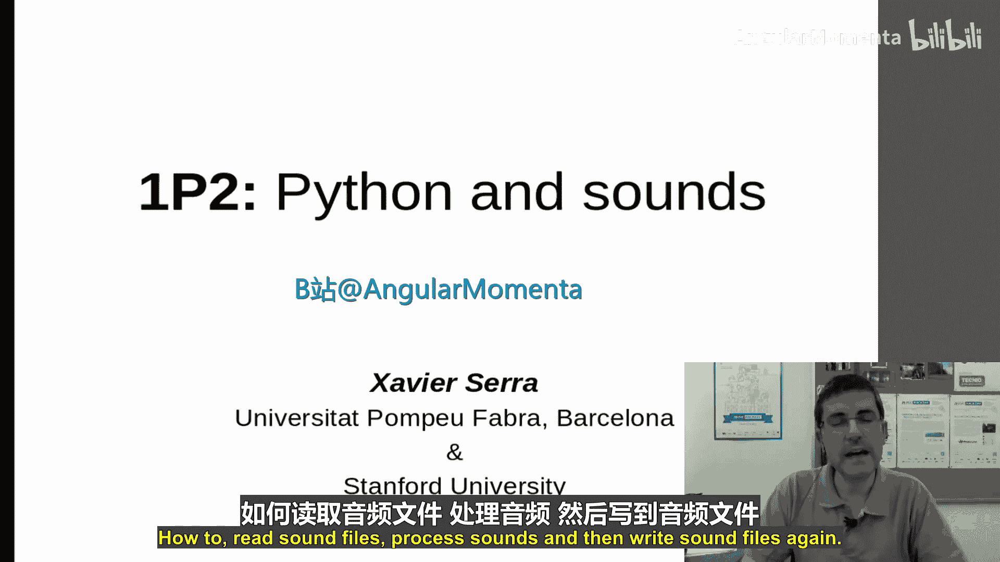
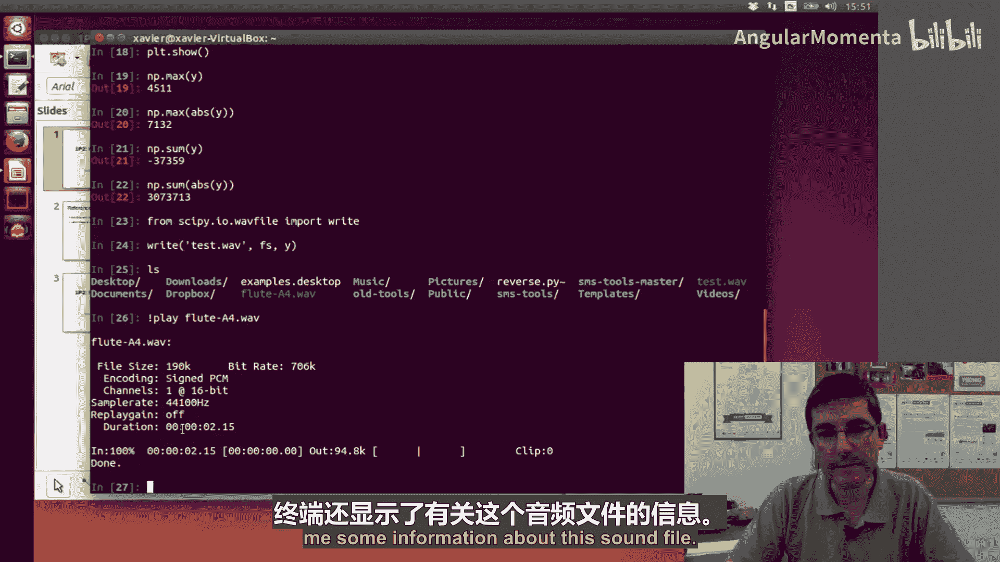
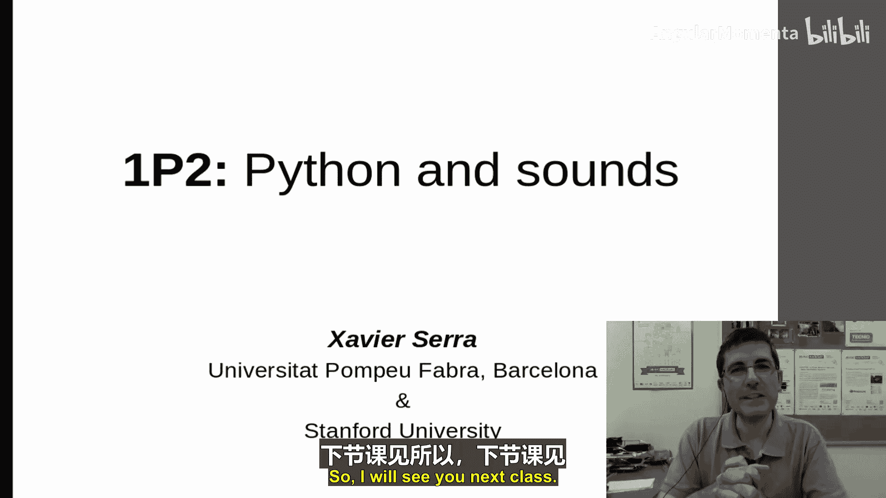

# 【巴塞罗那庞培法布拉大学】音乐应用中的音频信号处理-｜-Audio-Signal-Processing-for-Music-Applications-p10-01_04_02_Python与声音--BV18Xr6BeEX5_p10-

Welcome to the course on ourU or processinging for music applications。In the last programming class。

 we introduced Python， which is a high level language， quite powerful。

 and that's going to be very useful for us for all the applications and for all the programming we will have to do。

In this lecture， I want to talk about how to use Python to process sounds， how to read sound files。

 process sounds， and then write sound files again。

So let's start by going to a terminal。And now starting the interactive shell that we'll be using to program in Python。

 which is i Python。And now we have to read a sound file。OkayTo read the sound file。

 we need to use one package sippi that has this functionality。

 So what we're going to do is from sippi and within sippi there is a module called IO。

 and within that there is one specifically to handle Wf files。 So from that part of this package。

 we're going to import。The read function。So now the read function is part of our system Python。

 and in fact， if we type help and the read function。

 it knows about it and it tells me what is the input and the output。

 So as input were going to input the name of the file I want to have。And then as returned。

 what it returns is the sampling rate and an array with the actual samples of the sound。Okay。

 so what we're going to do is have F S as a variable where to put the sampling rate， X as a variable。

 where to put the samples of the sound。 And then we're going to say read。

 and we're going to put a file name here Okay in this directory， I am in。

 I have a file name called floatte。A4 dotwa。Okay。So I will read this sound file into。Into memory。

Okay， so now FS。Has the sampling rate 44100， and x is an array of integers。

 There are 16 bit integers， including all the samples here。 of course。

 is not showing everything in just showing the first three and the last three。

Now we can start asking things about this sound， for example。

 if we want to know the length of the array， we can just type x dot size and this tells me that this sound has 94803 samples。

If we want to know how many seconds that is， we can divide。

The the number of samples into the sampling rate。However， these two numbers are integer。

 so the result is an integer。 If we want to know the duration in an exact way。

 what we're going to do is just convert one of the numbers to a floating point number like the Fs so that now it returns a floating point number。

 So this is the duration of the sound in second。 so it's 2。149 seconds。Now we can plot the sound。

 for example， in order to plot it， we need to import the package for plotting mat plot leap。

 so we will import。mat plot leap。 And specifically within that， the pipe plot module。

 And we're going to give it as a name PL T。So now we can call the plot function within that module and give it the。

Aray of samples。In order to show it， we're going to have to call the show command。Okay。

 and this is the sound。The visualization of the waveform。In the horizontal axis。

 it basically has the samples I read。And then on the vertical axis。

 it has the values of these samples being integer values。 it goes from minus10，000 to 8000。

But this is not a nice way to visualize sound。 What we want to do is to visualize them in seconds。

 So the time access should be in seconds。 How do we do that。Okay。

 so what we're going to do is we need to get some arrays。 And for doing that。

 we need to import another package， which is the nuy。So import Ny as MP。

 And now we can use some useful functions from Ny， specifically， we can create a time axis。

So we define a time axis T。That uses a function of nuy call。Arange。

And arrange what it does is basically。Creates an array of the length that I put in as input。

 going from 0 to that value。And then if I divide by the sampling rate。This will create basically。

 an array of。Seconds of the the size of the sound， but in seconds。Okay， so that I have T。 And now。

 if I。Bt。啊。RD。With respect to X。Now I have。 and then， of course， I have to show it。

I have a much nicer display because on the horizontal axis。

 I have time in seconds so I can go from 0 to 2。7。 And this is the duration in seconds。Within that。

 this this figure， we can zoom into into it and do quite a few things。 For example。

 it has this option， which is zoom a rectangle so we can select a region of these。And we can see。

The oscillation of the sound， in fact， if we do it a little more。

 we're going to see it and even more we will see the individual periods。

 the oscillation of the sound。Okay， so that's quite good。

 We don't have to actually call the function with these specific numbers， so within the figure。

 we can already navigate through this sound。But also we can select samples with with Python command by choosing just the samples from a given array。

 So for example， if we want to have another array that is just one fragment of our input array So we can say okay。

 take just samples for example from 44100。 So that means from second1 to let's say 45100。

 So this is going to be 1000 files。1000 samples that are going to be stored in Y。And now， of course。

 we can， just if we plot this， why it will just show。The呃。These 1000 samples。

Okay now we can start doing operations， for example， on this new array and for example。

 we can just ask what is the maximum of these arrays so there is this function called max from nuy that if we give it array y it gives us what is the maximum value however。

 of course we know that sound sort of oscillates around zero so it has positive and negative values so in fact instead of doing that what it makes more sense is to just take the absolute value of y so that it considers also the negative values as as values to be considered so if we now type the maximum of the absolute value of y it gives us a different number which basically that means that this was a negative value that of course was higher in terms of absolute value than the positive values。

And we can do things like some， all the samples of an array。Okay， so this is the sum of all of them。

 Of course， now it's negative because again， it has some positive and negative。

 If we do the absolute value， it will be a completely different value。Okay。

 now that we know how to process sounds。 Now， what typical thing we will want to do is to write the result or write this new sound into a file。

 So we need to get a function to write sound file。 So for again， from s pi。

So from sip pi dot Io dot W file， we are going to import。The right function。And the right function。

 basically。嗯。Acepts as input values， a name of a file to write。Then we need to give it sampling rate。

 which is the same as the input or F S。And now we can just put an array of numbers， so for example。

 this new y array。Okay， and that's it。 We have created a sound file。And if we type S。

 it's going to be in test dot W file。And from within ipyython。

 we can play these sound files by calling Unix or terminal level programs or functions so specifically if we put the exclamation mark and we there is this function in Unix。

 this program called play， and so if we this calls the Uniix program play and we can give it any file that is in this directory。

 So if we put the flute。A4 dot W。It's playing this flute sound and at the same time is' giving me some information about this sound file。

Okay， so that's all I wanted to say。 So basically。We have been talking about reading and writing。

Some files and。There is this package wa file within Sippi that allows us to do that。And there is a。

Packages that allow us to process and to manipulate these sounds。 so with Matpl leap。

 we can plot sounds， fragments of sounds， and with Ny。

 there is a whole bunch of functions that allows us to process these sounds。

And that's all for this class。 So we have already introduced Python and now we have introduced some basic functions to read write sound files。

And hopefully with that， we can start doing some interesting things， but of course。

 we have to learn more much more。 so I will see you next class。 Thank you。

