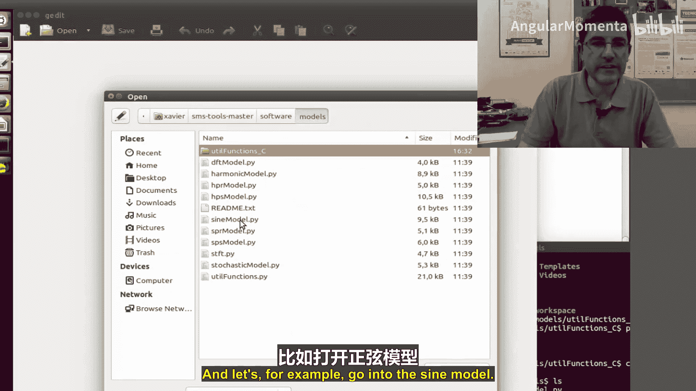
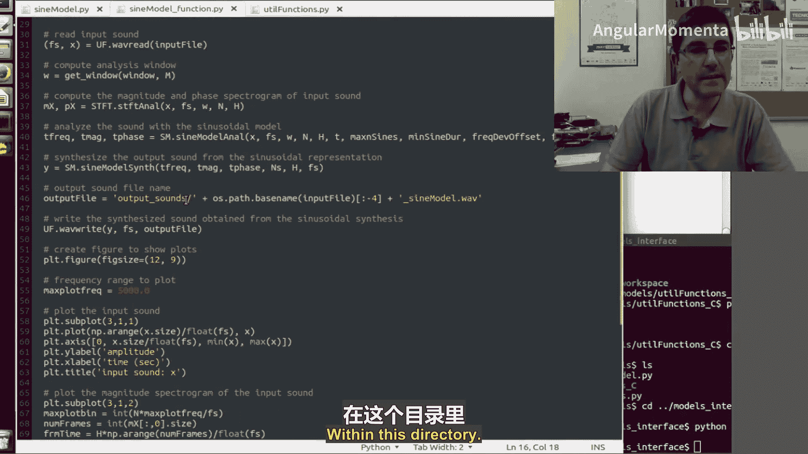
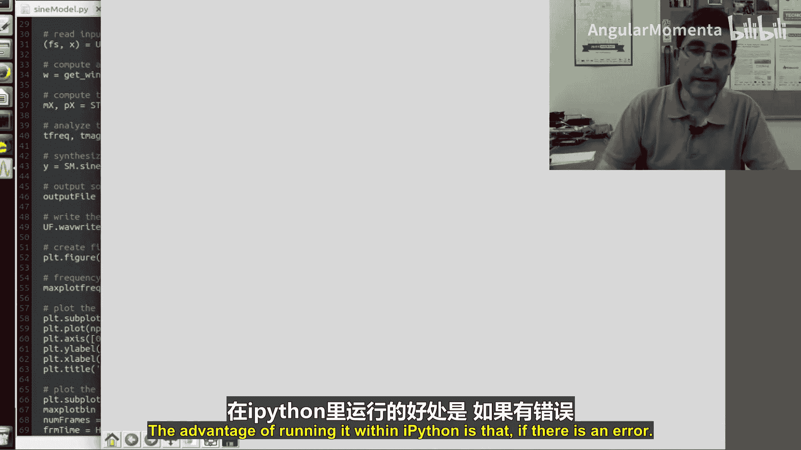
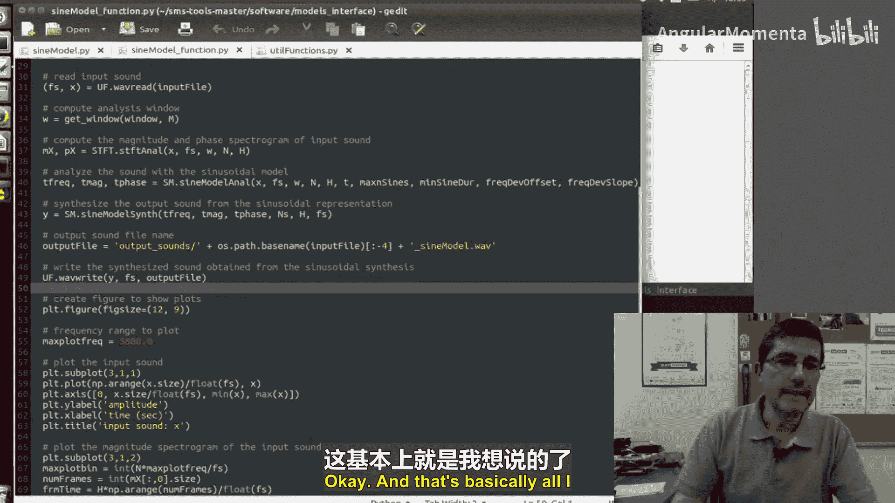
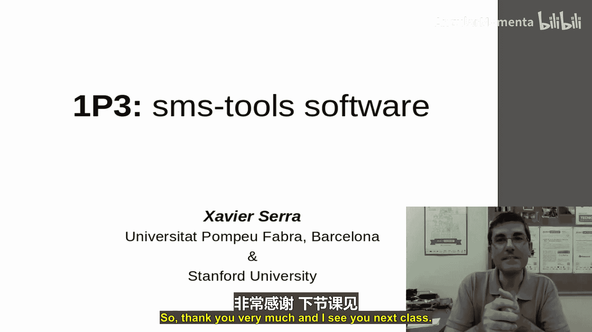

# 【巴塞罗那庞培法布拉大学】音乐应用中的音频信号处理-｜-Audio-Signal-Processing-for-Music-Applications-p11-01_04_03_短信工具软件--BV18Xr6BeEX5_p11-

Welcome again to the course scenario processing for music applications。

In the last two programming classes， we introduced Python and some basic tools of how to read and process sounds。

In this class， I want to introduce the SMS tools。Which are the Python tools that we have developed for this class and the ones that we will really go through and try to understand quite deeply SMS comes from spectral modeling synthesis。

And that's a name that I gave to this type of tools a long time ago。 And so I got stuck。

 and that's what I use。So these tools are available from GitHub。

 which is an online repository of software， which is a great tool and a great community of people。

 so a lot of the software initiatives， free software initiatives are using this repository。

So in these the SMS S tools， you can。You can go through that and you will see several directories in the lectures you will see the slides of the theory lectures and the code that I use for all the plots from the slides so that may be good for you in the software that where I going to focus now and then there is sounds so where all the sounds that I use in class R store and then a workspace for you to work from etc。

 so if we open the software directory here you will see the main software for the course。

 so these are the models， the software models that we will be using and in here you will have the DFT the harmonic model。

 SDFT etc， all the models that we will be talking quite a bit in class and code to apply transformations to these models。

And then the interfaces are the the functions and the files that are used to call these models。

 So this is going to be the the functions that we will be executing。Okay， and then。

If we go back here there is this readmi file that describes basically how to install it The first thing it tells is that of course we need Python 2。

7 that we need to install all these packages we already it in lecture1 and then that we need to compile the C functions。

 there is some C functions that we need to compile so in order to do all that the first thing we have to do is to download the zip file with all these so if we click download it will just create a C file and it will save it locally so I already have done that so we have now if we open the terminal in the home directory I have SMS tools master which is the directory I have created with all these content so if I go to the SMS。

ThisTo master。嗯。I have the same content that I have here in GiHub okay and if we continue following the readmi file。

 what it tells me is that I need to compile this execute this command， so let me copy the command。

And I have to go to the directory software models， U functions underscore C。 Okay。

 so I need to go to the software。Models。Uutil functions。 And I have to。Execute this command。Okay。

 and I already did it。 So it's already compiled。 You should not have any problem with that。 Okay。

 so basically， we are ready。 now， I mean， if we don't want to go too much into coding。

 we can just execute the interfaces， as it says here。That we presented in the in another class。

 in a demo class， so we can execute。The model G I or the transformation GY。But now what I want to do。

Is to go into the models directory。And here is where the core models that we will be studying are included。

 so let's open one of them from text editor， so we have the G edit and then let's go into for example。

 into the software into the models and let's for example， go to into the sign model。

Okay。So， sign model。Is one of the models that basically analyze a sound as if it was a sum of sinusoids。

And in this code， we have at the beginning， of course， importing the packages that we need。

 and then it has a set of functions。So like different functions that implement different aspects of this sinnocer model。

 Okay， let's focus into one of them。For example， let's focus on this sine model and now。

 This is the function that。These from an input， which are all these are the input parameters。

 the main one being the input sound as an array and the control parameters that we need to have to decide what analysis to perform。

Okay，It performs a whole bunch of things。 It iterates over the whole sound， and it returns。

Three variables。Wwhich are basically the frequencies。

 the magnitude and the faces of all the sinusoids included in this sound so these are big metricses that store all this information and all this is explained in these introductory text is common in which it tells us what it does。

 the input parameters and the returning values。But to call this function， we use another file。

 So we go to the interface。Models interface directory。 And here we will find the sign model function。

And this is the function that we actually call in order to perform the sinusoidial analysis。Okay。

 so this is a file that again， has， it imports the the set of packages。

 and then it has one single function， which is called main。

And then in order for being able to execute this file and not having to call the function。

 there is this command here that basically says that when we execute the file。

 it should execute the function main， so by default， when we just execute this file。

 it will run this function。And all the input parameters have default values。

So it has input file as a default value， and it has all the other parameters as default values。

 Of course， we can go in here and modify all these values。 And then within that。

 it performs all the steps for the sinusoidal analysis。 It reads the sound file。

and then it gets an analysis window， it performs a short time for your transform。

 then it performs a sine model and nu， this is the function that we just saw。

 it has gotten all the values and variables from all these execution beforehand and so we can just call the function and it returns these three variables that store the frequencies magnitude and phases of the sinineusoid and then we can synthesize。

The， the sound back， okay， and then we can write。The sound again， as an output file。By the way。

 these way of reading and writing the sound files is a function。

 a wrapper to the s pi that I talked about。 and in fact， if we go to this。

Utility functions that are in within the models。We can go to the this function， the read and write。

Sound file， the W read and the W right。 And basically， it just reads。The input sound。

 as we had done in the previous class， but what it does now is it normalizes。

 it converts to a floating point number and it normalizes to a value from1 to minus-1 which is kind of the convention to deal with sounds as floating point numbers going from minus-1 to1 and in writing the file we have to undo the process so we have to create the integer the 16 bit numbers back。

Okay， so that's。An overview of basically what this file does。

 and we can execute it so we can go to the。The interface models interface page。

 And we can just type Python。And we can type the sign model。function。

And what these will do is well execute this main file。And it will write。

A sound file where it will write it。 Well， the first thing it will do is to plot。The analysis result。

 okay。And this was the display of the input file and this is the analysis result。

 and this is the output file。And basically， it has written。

A sound file into a directory called output sounds。 within this directory。

 So if we look here the types， there is a directory called output sounds。

🎼That has， if we type Ls output sounds， it has this bende underscore sign model。

 which is the resulting file。 Okay， so to play that。

 we just type play and we just put output sounds and we just bende。嗯。Okay。

 so this is the synthesize sound that we have generated from these analysis synthesis。Of course。

 this can be done within i Python。 So if we type i Python and we are within the interactive mode。

 we also can execute this file by typing run and we just type run sign model and the function and it will do the same thing。

It will execute that function。And then it will display the result and it will save the sound file。

The advantage of running it within i Python is that if there is an error or we can really want to explore the intermediate steps of the function。

 we can do it， we can run a debugger， etc cetera， etctera。 So that's going to be quite useful for us。

Okay， and that's basically all I wanted to mention。 So in this class。

 what we have gone through is explanation of the SMS S tools， which is hosted within Github。

 So feel free to。

Go there and download it and install it。In order to install it。

 the only thing we had to do apart from the previous installation we did。

Was to compile the C functions we citan。And briefly today， we is。

Describe one of the models that we're going to be analyzing。

 which is the sign model we have executed， and we have seen how we can analyze and synthesize a sound from it。

Okay so that was it that was a brief overview of what are the SMS tools and together with the other class。

 the demo class in which I went through the interface and we actually analyze and transform some sounds。

 I hope you got an idea of what are these tools and the kinds of things that we will learn in class。

So thank you very much and I see you next class。

